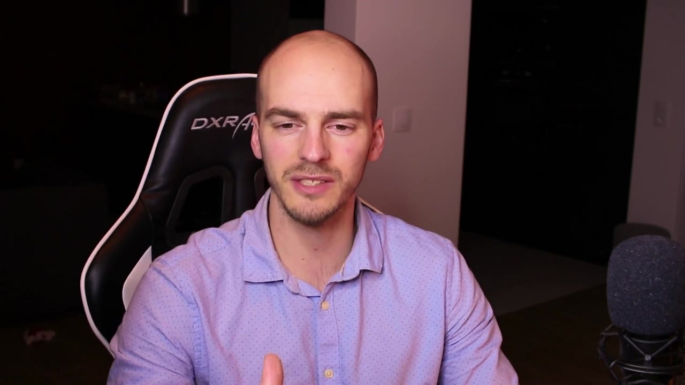

# 后记 · 继续 Three.js 学习之旅

完成整套课程并不意味着学习过程已经结束。课程建立了从 Three.js 基础、经典渲染技术到 GLSL、Blender 工作流和 React Three Fiber 的知识框架，而真正将这些知识转化为能力，还需要持续的独立实践。

*课程结束是独立实践的开始*

## 用项目巩固知识

学习图形开发不能仅依赖阅读和观看演示。选择一个足够小、但能够完整完成的项目，把场景、材质、交互、动画和部署串联起来，通常比反复浏览教程更有效。项目可以是一组粒子、一件可交互的产品、一个滚动叙事页面，也可以是对电影画面或游戏效果的简化复现。

实践过程中遇到障碍是正常现象。定位问题、查阅文档、简化场景并验证假设，本身就是图形开发能力的一部分。如果某个目标暂时过于复杂，可以缩小范围或更换实现路径，待经验积累后再回到原问题。

## 保持开放而谦逊的学习方式

WebGL、Three.js 及其周边生态仍在不断发展。新的渲染技术、工具和项目会持续出现，因此没有必要把一次课程视为知识边界。阅读其他开发者的代码、研究优秀作品的实现方式、尝试不熟悉的效果，都是拓展能力的有效途径。

知识增加之后，同样需要保持谦逊。对问题作出判断时，应区分已经验证的事实与尚未验证的猜想；面对不同的实现方案，则应结合具体需求、性能预算和维护成本进行选择。

## 分享成果并参与社区

即使项目规模很小，也值得整理和发布。截图、演示链接、源代码和简短的技术说明，不仅能够帮助自己回顾设计过程，也可能为其他学习者提供参考。外界的反馈还可以暴露此前未曾注意到的兼容性、性能和交互问题。

当个人项目或工作项目遇到难以独立解决的问题时，可以带着最小复现、环境信息和已经尝试过的方案向社区求助。清晰的问题描述通常比笼统地询问“为什么不能运行”更容易得到有效帮助。

课程提供的是起点。持续实验、完成作品、分享结果并帮助他人，才是这段学习旅程真正的延续。
