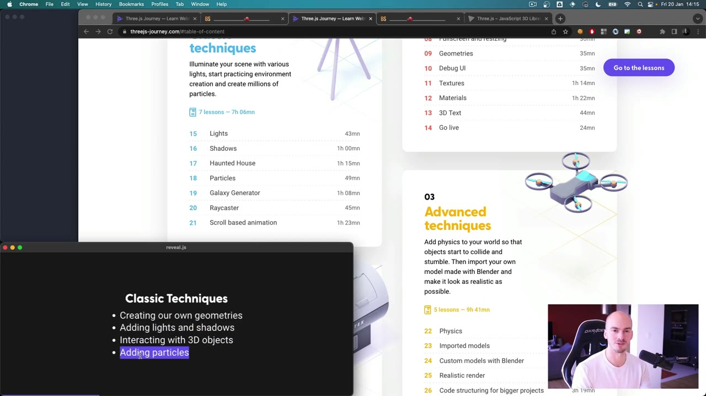
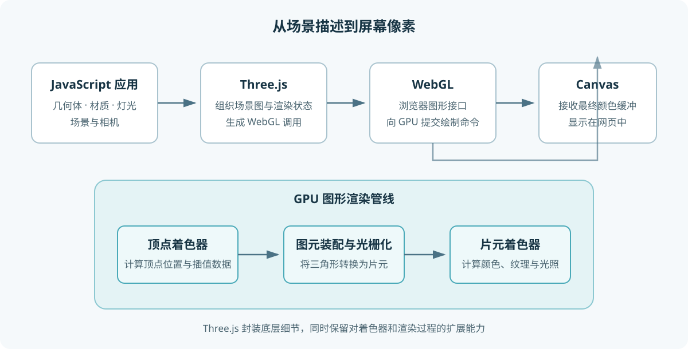
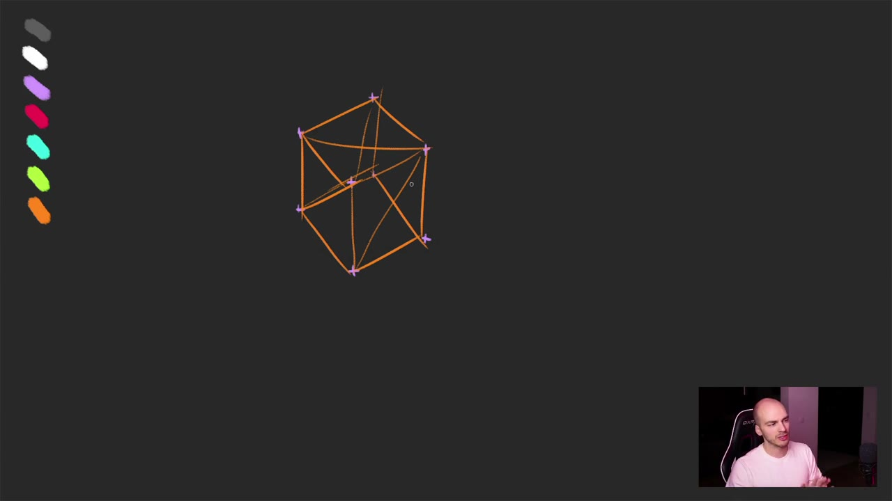

# 第 1 章 课程导论与 WebGL 基础

本章作为 Three.js 学习的入门指引，首先介绍课程的基本结构与学习方法，然后探讨 WebGL 的技术本质及其在现代 Web 开发中的作用，最后阐明为什么可以将 Three.js 作为 WebGL 开发的常用入口。本章为后续动手实践提供必要的概念基础。

## 课程导论：学习路径与准备

本课程名为 Three.js Journey（Three.js 学习之旅），是一个从头开始系统学习 WebGL 与 Three.js 的综合性教学项目。原课程包含 66 个主题性课程及结语；本书按知识关系重组为六个部分、45 章，循序渐进地涵盖从基础概念到高级应用的完整知识体系。

### 课程结构与内容安排

课程设计遵循从易到难的原则：
1. **第一部分**（Three.js 基础，第 1-8 章）：从 WebGL 的基本定位开始，涵盖开发环境搭建、场景创建、网格对象、坐标变换、动画控制、相机配置、几何体创建、纹理贴图、材质设置与项目部署等基础操作。
2. **第二部分**（经典渲染技术，第 9-16 章）：围绕灯光、阴影、粒子系统、物理模拟、外部模型导入、环境贴图和写实渲染等传统计算机图形学技术构建完整的三维场景。
3. **第三部分**（工程化与 GLSL 着色器，第 17-30 章）：建立可持续扩展的项目结构，系统学习 GLSL 着色器语言、自定义材质、粒子特效与基于 GPU 的通用计算（GPGPU），将渲染控制深入到 GPU 着色阶段。
4. **第四部分**（后期处理与交互体验，第 31-32 章）：介绍后期处理链、性能诊断、加载过程优化，以及 HTML 与 WebGL 的协同工作方式，兼顾视觉质量、运行效率和用户体验。
5. **第五部分**（Blender 场景工作流，第 33-35 章）：贯通 Blender 建模、光影烘焙、场景导出和 Three.js 导入优化流程，将数字内容创作（DCC）工具制作的场景转化为可交互的网页体验。
6. **第六部分**（React Three Fiber，第 36-45 章）：学习如何在 React 框架中结合 React Three Fiber（R3F）与 Drei 等辅助库，创建组件化的 3D 应用，并最终完成作品集展示与游戏项目。

课程由 Bruno Simon 主讲，他是一位法国创意开发人员，曾在 Immersive Garden（一家屡获奖项的数字工作室）担任首席开发人员，并在多个法国研究生项目中教授 WebGL 与 Three.js。Bruno Simon 于 2019 年创作的个人作品集（[bruno-simon.com](https://bruno-simon.com/)）展示了许多 WebGL 技术的应用实例，已成为该领域的标志性作品之一。



*图 1-1 课程教学内容的逻辑结构示意*

### 学习方法与工具准备

学习 WebGL 与 Three.js 需要特定的技术基础和工具准备：

**技术基础要求：**
- **JavaScript 基础**：熟悉变量、数组、对象、函数、循环与事件等核心概念
- **现代浏览器**：推荐使用 Chrome 或 Firefox，需要良好的开发工具（DevTools）支持
- **代码编辑器**：推荐 Visual Studio Code 及其相关插件生态
- **数学能力**：基本线性代数知识（向量、矩阵）有助于理解 3D 变换，但非强制要求
- **3D 软件**：课程中将使用 Blender（开源 3D 建模软件）创建自定义模型

**学习建议：**
- 合理安排学习节奏，建议每天完成 1-3 课的进度，给大脑充分的消化吸收时间
- 动手实践是关键，课程为每节课提供“起始文件”（starter）和“完成文件”（final）供参考
- 课程视频支持变速播放，推荐根据个人理解难度调整播放速度
- 配套文本资料与视频内容基本对应，提供代码高亮、截图预览等辅助学习资源
- Discord 学习社区为学员提供答疑交流渠道，可按章节在专属频道提问

**克服困难的心理准备：**
随着课程深入，特别是涉及着色器（Shader）等底层编程时，学习难度会显著提升。这种困难恰恰体现了相关知识的价值——底层技术的学习曲线越陡峭，掌握后的创造自由度就越大。遇到困惑和挫折时，通过反复练习、查阅文档和社区讨论，将逐步建立直观理解。

## WebGL 技术原理：底层渲染机制

要理解 Three.js 的价值，必须首先认识 WebGL（Web Graphics Library）是什么以及它如何工作。

### 什么是 WebGL

WebGL 是一种基于 OpenGL ES 标准的 JavaScript API，它允许在网页的 `<canvas>` 元素中直接渲染硬件加速的 2D 和 3D 图形。其核心特性包括：

- **GPU 加速**：利用用户设备的图形处理器（GPU）进行并行计算，实现高性能渲染
- **跨平台兼容**：支持现代主流浏览器（Chrome、Firefox、Safari、Edge 的最新版本）
- **标准化接口**：基于 Khronos Group 维护的开放标准，确保实现一致性
- **可编程渲染**：通过着色器（Shader）控制顶点处理和片元着色等关键环节

WebGL 的基本渲染单元是三角形。所有复杂的 3D 模型都可以分解为一系列三角形的集合（三角网格）。这种设计具有数学上的稳定性：三个点唯一确定一个平面，任何三个非共线的点都能构成有效三角形。

### GPU 并行计算机制

GPU 的强大之处在于其大规模并行架构。以一个包含 1000 个三角形的基本模型为例：
- 每个三角形有 3 个顶点（Vertex），共计 3000 个坐标点
- GPU 可以并行处理所有顶点的位置计算（矩阵变换）
- 确定三角形覆盖的片元后，GPU 又能并行执行片元着色计算
- 这种并行性允许实时渲染数百万级别的三角形数量

这种并行计算的效率体现在渲染流水线中：
1. **顶点着色器（Vertex Shader）**：处理每个顶点的位置变换
2. **图元装配（Primitive Assembly）**：将顶点组装成三角形
3. **光栅化（Rasterization）**：将三角形转换为屏幕像素
4. **片元着色器（Fragment Shader）**：确定每个像素的最终颜色值
5. **帧缓冲区操作**：将结果输出到显示设备



*图 1-2 Three.js、WebGL 与 GPU 图形渲染管线之间的关系*

### 原生 WebGL 的复杂性

使用原生 WebGL API 绘制一个带有透视和基本着色的三角形，通常需要以下步骤：

```javascript
// 精简示意：实际代码更复杂
const canvas = document.getElementById('canvas');
const gl = canvas.getContext('webgl');

// 1. 定义着色器源代码（顶点着色器 + 片元着色器）
const vertexShaderSource = `
  attribute vec4 aPosition;
  uniform mat4 uProjectionMatrix;
  uniform mat4 uModelViewMatrix;
  void main() {
    gl_Position = uProjectionMatrix * uModelViewMatrix * aPosition;
  }
`;

const fragmentShaderSource = `
  precision mediump float;
  uniform vec4 uColor;
  void main() {
    gl_FragColor = uColor;
  }
`;

// 2. 编译着色器程序
// 3. 创建并绑定顶点缓冲区
// 4. 设置投影矩阵和模型视图矩阵
// 5. 设置Uniform变量（如颜色）
// 6. 执行绘制命令
// 7. 清理资源
```

仅上述示意就显示出原生 WebGL 的冗长性。实际应用中还需处理矩阵计算（透视矩阵、模型视图矩阵等）、材质属性、光照模型、纹理绑定、帧缓冲区管理和多次绘制等复杂概念。创建具有交互性、动态光照、复杂材质和多物体的场景时，代码量与维护成本都会显著增加。



*图 1-3 课程演示中的 WebGL 渲染过程与 Three.js 抽象层*

## Three.js：简化 WebGL 开发的桥梁

Three.js 由 Ricardo Cabello（网名 Mr.doob）于 2010 年创建，目标是降低 WebGL 的使用门槛，让开发者能够专注于创意实现而非底层细节。

### Three.js 的核心定位

Three.js 在技术栈中的位置：
- **上层**：应用逻辑与业务代码
- **中间层**：Three.js API（简化抽象）
- **底层**：原生 WebGL API（直接 GPU 控制）
- **硬件层**：GPU 渲染硬件

Three.js 的 MIT 许可证使其成为完全开源且免费的项目，由 Mr.doob 主导，并由庞大的开发者社区共同维护。GitHub 仓库每月都有稳定更新（[github.com/mrdoob/three.js/releases](https://github.com/mrdoob/three.js/releases)）。

### Three.js 的主要优势

1. **抽象层级合理**：
   - Three.js 提供了“场景（Scene）-相机（Camera）-渲染器（Renderer）”的核心架构
   - 封装了网格（Mesh）、几何体（Geometry）、材质（Material）、灯光（Light）等高级对象
   - 内部自动处理矩阵计算、着色器编译、缓冲区管理等复杂操作

2. **完整的特性覆盖**：
   - 支持多种相机类型（透视相机、正交相机）
   - 提供丰富的几何体（立方体、球体、圆柱体、平面等）
   - 内置多种材质系统（基础材质、标准材质、物理材质等）
   - 集成加载器系统（JSON、glTF、FBX、OBJ 等格式）
   - 包含辅助工具（坐标轴、网格、摄像机助手等）

3. **良好的文档与社区**：
   - 官方文档（[threejs.org/docs](https://threejs.org/docs/)）详细且更新及时
   - 数百个官方示例（[threejs.org/examples](https://threejs.org/examples/)）展示各种技术应用
   - 活跃的 GitHub 社区和丰富的第三方库生态

4. **平衡性能与控制**：
   - Three.js 在保持易用性的同时，仍允许访问底层 WebGL 功能
   - 可以通过自定义着色器、创建自定义几何体等方式实现高级需求
   - 性能优化选项丰富（视锥体裁剪、细节层次、实例化渲染等）

### 同领域替代方案对比

虽然 Three.js 是 WebGL 开发中最流行的选择，但行业内仍存在其他优秀库：

- **Babylon.js**：微软支持的 3D 引擎，特性丰富且文档完善
- **PlayCanvas**：专注于游戏开发，提供完整的编辑器工具链
- **A-Frame**：基于 WebXR 的声明式框架，简化沉浸式内容创建

选择 Three.js 的主要理由包括：
1. **生态系统成熟**：最庞大、最活跃的社区支持
2. **技术垂直**：专注于 WebGL 而非泛化的游戏引擎
3. **灵活性**：在简化与可控之间取得良好平衡
4. **学习资源**：本课程及其他大量学习材料的支持
5. **行业采用**：众多知名项目（如 Bruno Simon 的作品集、Three.js Journey 官网等）的实际验证

### 基本代码结构对比

使用 Three.js 创建基础场景的代码示例：

```javascript
// Three.js 版本 - 约15行可运行代码
import * as THREE from 'three';

// 创建场景
const scene = new THREE.Scene();

// 创建立方体
const geometry = new THREE.BoxGeometry(1, 1, 1);
const material = new THREE.MeshBasicMaterial({ color: 0x00ff00 });
const cube = new THREE.Mesh(geometry, material);
scene.add(cube);

// 设置相机
const camera = new THREE.PerspectiveCamera(75, window.innerWidth / window.innerHeight, 0.1, 1000);
camera.position.z = 5;

// 创建渲染器
const renderer = new THREE.WebGLRenderer();
renderer.setSize(window.innerWidth, window.innerHeight);
document.body.appendChild(renderer.domElement);

// 渲染循环
function animate() {
    requestAnimationFrame(animate);
    cube.rotation.x += 0.01;
    cube.rotation.y += 0.01;
    renderer.render(scene, camera);
}
animate();
```

对比前文的原生 WebGL 示例，Three.js 显著减少了初始化与状态管理代码，同时提供了更强的可读性与可维护性。这种简化让开发者能够更专注于创意实现而非底层细节。

## 本章小结

本章作为 Three.js 学习的开篇，完成了三方面的准备工作：

1. **课程认知**：明确了 Three.js Journey 的整体架构、学习路径和工具要求，为后续系统性学习建立了方向感。

2. **技术原理**：深入理解了 WebGL 的核心机制，特别是：
   - GPU 并行计算的本质与优势
   - 三维图形渲染的基本管线流程
   - 原生 WebGL API 的复杂性与使用门槛

3. **工具选择**：理解了为何 Three.js 是学习 WebGL 开发的合适入口：
   - 在抽象层级与底层控制之间保持平衡
   - 拥有最完善的生态系统和学习资源
   - 已被大量生产项目验证其稳定性和性能表现

通过本章的学习，读者应当明确：WebGL 是底层渲染能力的技术基础，Three.js 是基于此基础构建的高效开发工具链。后续章节将从实际操作出发，逐步掌握如何在 Three.js 框架中创建、控制与优化三维场景，最终实现从理论认知到实践能力的转化。

下一章将进入动手实践环节，从开发环境配置开始，创建第一个可运行的 Three.js 项目，真正步入 Three.js 的世界。