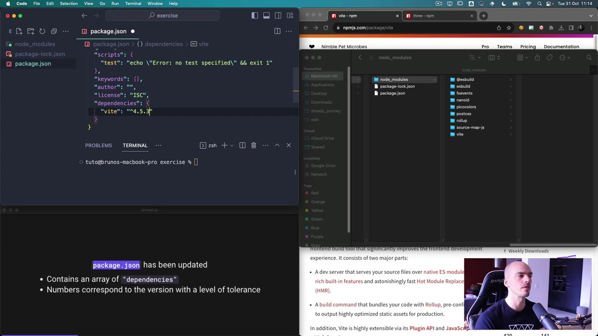
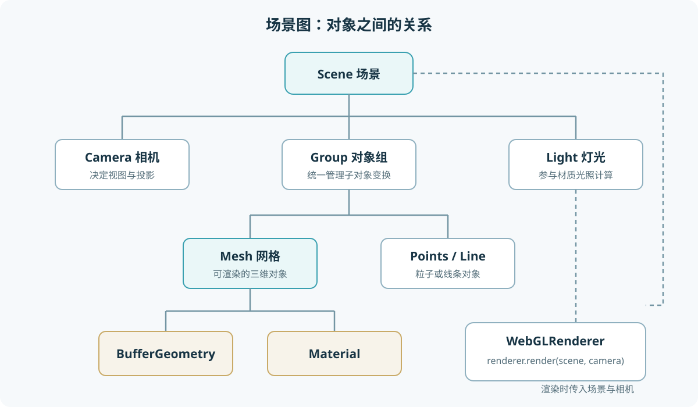
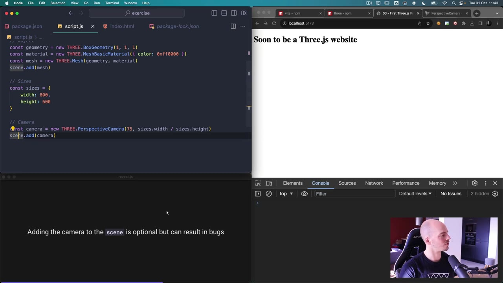

# 第 2 章 开发环境与第一个 Three.js 项目

在了解 WebGL 与 Three.js 的技术定位后，本章开始搭建开发环境，并从零构建第一个三维场景。内容既包括工具链的选择与配置，也包括场景、对象、相机和渲染器的基本用法，为后续练习建立稳定且可复现的工程基础。

## 构建工具的选择与本地服务器

在现代 Web 开发中，直接双击 HTML 文件虽然也能打开页面，但 ES 模块、模型与纹理加载以及某些浏览器 API 会受到安全策略和资源协议的限制。更可靠的方式是使用构建与开发工具启动本地服务器，并通过 HTTP 地址访问项目。

当前主流构建工具包括 Webpack、Vite、Gulp、Parcel 等。过去 Three.js Journey 课程曾使用 Webpack，而现在则转向了 [Vite](https://vitejs.dev/)（源自法语'快速'）。该工具在安装速度、启动效率与稳定性方面均有优势，提供了更顺畅的开发者体验。课程已将所有练习迁移至 Vite 环境，尽管部分历史视频中仍可见 Webpack 痕迹，但实际操作流程基本一致。

Vite 是一个现代化的构建工具，负责处理 HTML、CSS、JavaScript 文件的编译打包，同时提供本地服务器、热更新（Hot Module Replacement）、源码映射（source map）及优化压缩等功能。它具备可扩展的插件系统，后续课程中我们将通过插件支持 GLSL 着色器文件和 React 框架。

## Node.js 环境准备

Vite 运行依赖于 [Node.js](https://nodejs.org/)，这是一个可在浏览器外执行 JavaScript 的运行环境。在终端中执行 `node -v` 可检查 Node.js 是否已安装及当前版本。如提示命令未识别，需前往官网下载并安装"长期支持版本"（LTS）。安装完成后重新启动终端并验证版本是否符合要求。

### 创建项目结构

首先新建一个文件夹作为项目根目录，建议保持结构清晰以便管理后续多节课程内容。使用 Visual Studio Code（VSCode）等编辑器打开该文件夹较为便捷：编辑器内终端的当前路径会自动定位至此，同时侧边栏文件管理也比系统资源管理器更为直观。

在终端中执行 `npm init -y` 初始化 Node.js 项目。NPM（Node Package Manager）随 Node.js 一同安装，用于管理项目依赖。此命令将生成 `package.json` 文件，其中记录了项目基本信息及后续添加的依赖信息。

### 添加构建工具依赖

本课需要两个核心依赖：Vite 与 Three.js。首先聚焦于 Vite，在终端中执行 `npm install vite`：

```bash
npm install vite
```

安装完成后会观察到以下变化：
- 新增 `node_modules/` 目录，包含 Vite 及其所有次级依赖
- `package.json` 中新增 `"dependencies"` 字段记录版本号
- 生成 `package-lock.json` 锁定确切依赖版本

这些文件与文件夹构成了现代 JavaScript 项目的共享基础。若需分享项目给其他开发者，通常忽略 `node_modules/`（因其体积庞大），仅传递源码与配置文件；接收方通过 `npm install` 即可根据 `package.json` 重新安装所有依赖。

## 基础网页与 Vite 配置

接下来创建最基本的网页结构：在项目根目录新建 `index.html`：

```html
<!DOCTYPE html>
<html lang="zh-CN">
<head>
    <meta charset="UTF-8">
    <meta name="viewport" content="width=device-width, initial-scale=1.0">
    <title>第一个 Three.js 项目</title>
</head>
<body>
    <h1>即将成为 Three.js 网站</h1>
</body>
</html>
```

注意此时不应直接双击打开此文件，而需要通过 Vite 启动本地服务器访问。在 `package.json` 中添加以下脚本配置：

```json
{
  "scripts": {
    "dev": "vite",
    "build": "vite build"
  }
}
```

执行 `npm run dev` 启动开发服务器，终端将显示类似 `http://localhost:5173/` 的本地地址。在浏览器中访问该地址即可查看运行中的网站。

### 添加 JavaScript 支持

为网页添加动态功能需要创建 JavaScript 文件。新建 `script.js`：

```javascript
console.log('JavaScript 已正常工作')
```

在 `index.html` 的 `<body>` 末尾添加模块化脚本引用：

```html
<script type="module" src="./script.js"></script>
```

注意必须包含 `type="module"` 属性以支持 ES 模块语法。保存文件后浏览器将自动刷新，开发者工具控制台中应显示验证信息。此时 Vite 的热更新功能已生效：修改文件内容后页面会自动重新加载。



*图 2-1 终端执行 npm run dev 启动 Vite 开发服务器*

## Three.js 引入与核心概念

### 安装 Three.js 依赖

在终端中执行 `npm install three` 添加 Three.js。可以在另一个终端中安装依赖，也可以先停止当前开发服务器：

```bash
npm install three
```

安装完成后，`node_modules/` 中新增 `three/` 目录，`package.json` 与 `package-lock.json` 也相应更新。如果需要同时启动服务器与安装依赖，可以：
- 按 `Ctrl + C` 停止当前服务器
- 执行 `npm install three`
- 使用 `npm run dev` 重新启动

### ES 模块导入方式

在 `script.js` 中通过 ES 模块语法导入 Three.js：

```javascript
import * as THREE from 'three'
```

该语句将 Three.js 的核心类全部导入 `THREE` 变量（注意变量名为全大写）。可通过 `console.log(THREE)` 查看可用类列表——虽然大部分常用类都在此变量中，但仍有部分需要通过独立路径引入（后续课程会涉及）。

## 构建第一个 3D 场景

Three.js 场景渲染需四个基本要素：场景容器、三维对象、摄像机与渲染器。



*图 2-2 场景、相机、网格、几何体、材质与渲染器之间的关系*

### 场景容器

场景 (`Scene`) 作为容器承载所有可见对象、模型、粒子、光源等元素，类似舞台环境：

```javascript
// 场景
const scene = new THREE.Scene()
```

### 网格对象

网格 (`Mesh`) 是几何形态 (`Geometry`) 与外观材质 (`Material`) 的组合体。这里创建简单的红色立方体：

```javascript
// 对象
const geometry = new THREE.BoxGeometry(1, 1, 1) // 单位立方体
const material = new THREE.MeshBasicMaterial({ color: 0xff0000 }) // 红色基础材质
const mesh = new THREE.Mesh(geometry, material)
scene.add(mesh) // 将网格添加到场景
```

`BoxGeometry` 的三个参数分别对应立方体的宽、高、深尺寸。`MeshBasicMaterial` 的参数对象中，`color` 属性支持多种格式：十六进制数值 `0xff0000`、字符串 `'#ff0000'`、色彩名称 `'red'` 或 `THREE.Color` 实例。

### 透视摄像机

摄像机定义渲染视角，类似电影拍摄机位。这里使用透视摄像机 (`PerspectiveCamera`) 模拟人眼视觉效果：

```javascript
// 尺寸定义
const sizes = {
    width: 800,
    height: 600
}

// 摄像机
const camera = new THREE.PerspectiveCamera(
    75, // 垂直视野角度（度数）
    sizes.width / sizes.height // 宽高比
)
scene.add(camera) // 可将相机加入场景；渲染本身并不要求这一步
```

关键参数说明：
- **垂直视野角度 (fov)**：75 度提供适中视角范围；增大角度会扩大可见范围并增强边缘透视拉伸，减小角度则会收窄视野
- **宽高比**：通常为画布宽度除以高度，这里使用预设值

### 渲染器与画布

渲染器 (`WebGLRenderer`) 负责将场景从摄像机视角渲染至画布 (`<canvas>`)。首先在 HTML 中添加画布元素：

```html
<canvas class="webgl"></canvas>
```

随后在 JavaScript 中获取画布引用并配置渲染器：

```javascript
// 画布
const canvas = document.querySelector('canvas.webgl')

// 渲染器
const renderer = new THREE.WebGLRenderer({
    canvas: canvas // 指定目标画布
})
renderer.setSize(sizes.width, sizes.height) // 设置渲染尺寸
```

### 初次渲染与位置调整

执行渲染命令：

```javascript
renderer.render(scene, camera)
```

此时可能出现纯黑色画面，原因在于摄像机与网格对象都位于场景原点 `(0, 0, 0)`，无法形成有效观察距离。透视相机默认朝向局部坐标的负 Z 方向，因此可将相机沿正 Z 轴移开：

```javascript
camera.position.z = 3 // 向后移动 3 个单位
```

再次渲染即可看到红色立方体呈现为正方形——因摄像机正对其一个面，未展露三维形态。



*图 2-3 渲染出的红色立方体：基础几何、材质与摄像机配置*

## 使用课程提供的起始文件

虽然从零构建项目有助于理解完整流程，但每节课都提供**起始文件** (`starter`) 以便快速开始练习。多数后续课程遵循相同模式，这里说明通用使用流程。

### 依赖安装

下载并解压起始压缩包后，项目文件夹中通常不包含 `node_modules/`（因体积过大不适合传输）。此时在项目目录中执行：

```bash
npm install
```

该命令根据 `package.json` 列出的依赖关系重新构建 `node_modules/` 目录并生成 `package-lock.json`。

### 启动开发服务器

执行启动命令：

```bash
npm run dev
```

稍等片刻后浏览器将自动打开本地服务器页面（通常为 `http://localhost:5173`）。终端中还会显示网络地址（形如 `http://192.168.1.25:5173`），可用于同一网络下其他设备（如手机）访问调试。

### 项目结构说明

起始项目包含以下基本结构：

课程起始项目通常把页面、脚本和样式放在 `src/` 中，把纹理、模型、字体等静态资源放在 `static/` 中。JavaScript 通过相对路径导入源代码；静态资源则由开发服务器直接提供，例如 `static/textures/color.jpg` 在代码中可写为 `/textures/color.jpg`，URL 不包含 `static` 前缀。

`vite.config.js` 已预设源码根目录、静态资源目录、开发服务器和构建输出等配置，初学者可以先沿用模板，不必逐行修改。需要注意，`static/` 是课程模板的约定；Vite 默认公共目录通常名为 `public/`，在其他项目中应根据实际配置确定资源路径。

## 常见问题排查

以下列举开发环境搭建过程中可能遇到的典型问题及其解决方案：

### 终端路径问题
确保终端位于正确项目目录。使用 `pwd` 命令检查当前路径，`cd `（空格后拖放文件夹至终端）命令切换目录。

### 路径长度限制
如果项目文件夹嵌套过深导致路径超长，可将其移至更浅目录层级。

### 云同步干扰
OneDrive、Google Drive 等云同步工具可能干扰 Node.js 依赖安装。建议将项目移至非同步目录操作。

### 特殊字符路径
项目路径应避免包含空格、中文或特殊符号，优先使用小写字母、数字、连字符和下划线。

### 依赖警告
安装过程中可能出现安全漏洞提示。应先核对受影响依赖、漏洞等级和课程版本，不要盲目执行可能引入不兼容升级的 `npm audit fix --force`。练习项目可以沿用课程锁定的依赖组合，生产项目则仍需单独评估并处理实际风险。

若以上方案均无效，可通过课程 Discord 社区寻求帮助。

## 开发环境管理要点总结

- **依赖安装**：首次打开项目或依赖清单发生变化后执行 `npm install`
- **服务器启动**：每次开始编码前执行 `npm run dev`
- **热更新**：文件保存后将自动刷新页面
- **静态资源**：`static/` 目录下的文件可通过根路径直接访问
- **跨设备测试**：本地网络地址可用于其他设备调试
- **配置复杂性**：`vite.config.js` 包含预设配置，初学者无需深究细节

## 本章小结

本章完成了 Three.js 开发环境从理论到实践的完整过渡。重点包括：

1. **工具链选型**：从 Webpack 到 Vite 的迁移体现了现代前端工具对开发效率的重视。Vite 在安装便捷性、启动速度与热更新响应方面均显著优化了开发体验。

2. **工程化起点**：通过 `npm init`、`package.json` 配置与依赖管理建立了可复现的 Node.js 项目基础，这是现代 JavaScript 开发的通用起点，不仅适用于 Three.js。

3. **核心渲染流程**：理解了场景‑对象‑摄像机‑渲染器的四元组架构。场景作为容器，网格组合几何与材质，摄像机定义透视视角，渲染器将三维信息转换为画布二维图像。

4. **工作流习惯**：掌握 `npm install` 与 `npm run dev` 的日常使用，理解 `node_modules/` 在项目共享与版本控制中的角色，能够通过起始文件快速进入练习状态。

5. **问题排查能力**：建立对常见环境问题（路径、权限、依赖等）的基本认知框架，知道何时需要调整配置、何时应寻求社区帮助。

至此，我们已拥有完整的本地开发环境与可运行的基础场景。下一章将深入探讨对象变换与动画，让静态的立方体真正"动起来"。