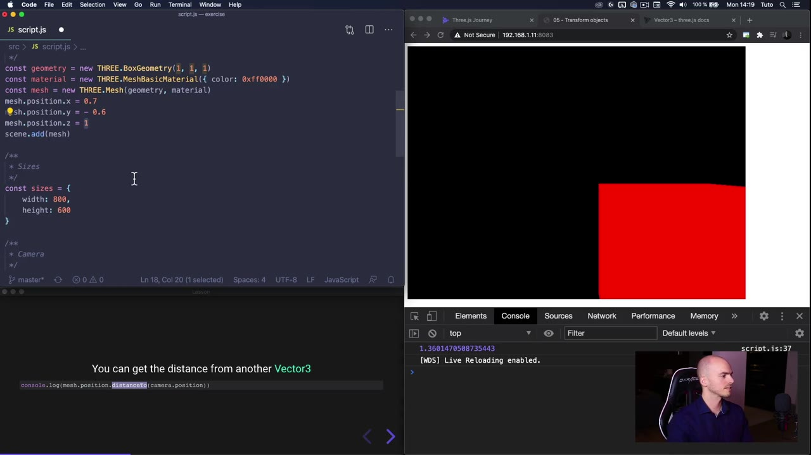
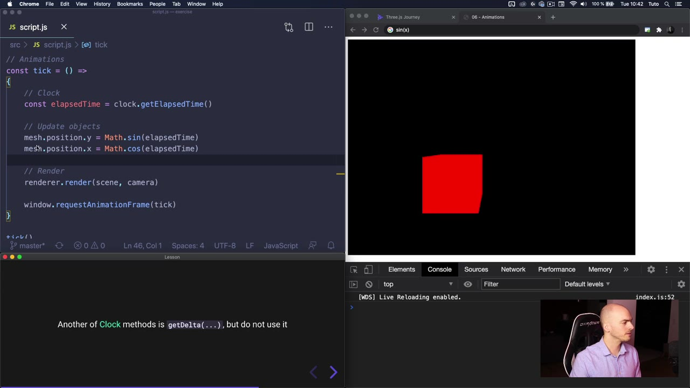

# 第 3 章 对象变换与动画

上一章我们完成了第一个 Three.js 项目的搭建。此刻，场景中已有一个方块，但项目仅渲染一次便告结束。实际的三维作品中，场景需要连续动态变化，而不仅仅是静态画面。改变三维对象的位置、朝向和大小——这些基本变换正是场景从静止走向动态的第一步。本章将从小处着手，讲解如何随心所欲地变形、定位对象，并以变换为基础构建连贯动画，使场景真正“活”起来。

## 3.1 对象的基本变换

Three.js 场景中的所有可视元素，不论是方块的网格、观察场景的相机，还是照亮物体的灯光，本质上都是一种“三维对象”。在 Three.js 的体系中，这些对象都继承自 `THREE.Object3D` 基类，这意味着它们共享一套控制自身位置、旋转和大小的核心方法。

### 3.1.1 位置变换与坐标系

三维空间中的“位置”由三个相互垂直的坐标轴构成。在计算机图形学领域，通常使用右手坐标系：伸出右手，食指指向右侧为 X 轴正向，中指指向正上方为 Y 轴正向，拇指指向屏幕外为 Z 轴正向。Three.js 遵循这一约定：X 轴向右，Y 轴向上，Z 轴向外。

```javascript
// 创建一个简单的方块
const geometry = new THREE.BoxGeometry(1, 1, 1);
const material = new THREE.MeshBasicMaterial({ color: 0xff0000 });
const mesh = new THREE.Mesh(geometry, material);
scene.add(mesh);

// 通过 position 属性调整位置
mesh.position.x = 0.7;   // 向右移动 0.7 个单位
mesh.position.y = -0.6;  // 向下移动 0.6 个单位
mesh.position.z = 1;     // 向屏幕外移动 1 个单位
```

对象的坐标值没有固定的物理含义。1 个单位可以代表 1 厘米、1 米甚至 1 公里，具体含义取决于你所构建的场景规模。如果制作微型场景，1 个单位可视为 1 厘米；若设计建筑漫游，1 个单位则更适合代表 1 米。

`position` 属性并不是普通的 JavaScript 对象，而是 `THREE.Vector3` 类的实例，这意味着它提供了丰富的数学方法。

```javascript
// Vector3 的实用方法
console.log(mesh.position.length()); // 计算向量的长度（与原点的距离）

// 计算两个对象位置之间的距离
console.log(mesh.position.distanceTo(camera.position));

// 将向量归一化（长度变为 1，方向不变）
mesh.position.normalize();

// 一次性设置三个坐标值
mesh.position.set(0.7, -0.6, 1);
```

### 3.1.2 缩放变换

缩放改变对象沿各轴方向的尺寸大小。默认情况下，`scale` 属性的 `x`、`y`、`z` 分量均为 1，表示未进行任何缩放。当值为 0.5 时，对象在该轴方向缩小一半；值为 2 时，尺寸加倍。

```javascript
// 非均匀缩放：各方向变化比例不同
mesh.scale.x = 2;   // X 方向放大 2 倍
mesh.scale.y = 0.25; // Y 方向缩小至 1/4
mesh.scale.z = 0.5;  // Z 方向缩小至 1/2

// 或者使用 set 方法一次性设置
mesh.scale.set(2, 0.25, 0.5);
```

负值的缩放理论上可行，但可能导致坐标轴方向逆转，引入预料之外的渲染问题，实践时应尽量避免。

### 3.1.3 旋转变换的两种方式

旋转的表示比平移和缩放复杂一些。Three.js 提供了两种机制：直观但可能出问题的欧拉角（Euler rotations），以及更稳健但略显复杂的四元数（quaternions）。

#### 欧拉角旋转

欧拉角通过三个独立的旋转分量描述朝向：想象一根穿过物体中心的轴，沿该轴旋转指定角度。在 Three.js 中，这些角度以弧度为单位。

```javascript
// 使用 Math.PI 表示 π 弧度（180度）
mesh.rotation.x = Math.PI * 0.25; // 绕 X 轴旋转 45°
mesh.rotation.y = Math.PI * 0.25; // 绕 Y 轴旋转 45°

// 更贴近物理直觉的旋转方向描述：
// rotation.y = π/2 类似旋转木马的水平旋转
// rotation.x = π/2 类似汽车车轮的纵向旋转
// rotation.z = π/2 类似飞机螺旋桨的垂直旋转
```

欧拉角的旋转顺序默认为 X、Y、Z。正因顺序固定，连续旋转可能导致万向节锁问题——某个轴失去旋转自由度。此时可以调整旋转顺序来避免：

```javascript
// 修改旋转顺序为 Y、X、Z
mesh.rotation.reorder('YXZ');
```

#### 四元数旋转

四元数使用四个数值描述三维旋转，完全避免了万向节锁问题。虽然其数学表达不如欧拉角直观，但 Three.js 会自动同步两者，这意味着你可以自由选择更习惯的表达方式。

```javascript
// 使用四元数设置旋转（绕 Y 轴旋转 60°）
mesh.quaternion.setFromAxisAngle(
  new THREE.Vector3(0, 1, 0), // 旋转轴（Y轴）
  Math.PI / 3                 // 旋转角度（π/3 = 60°）
);
```

### 3.1.4 便捷的朝向控制：lookAt

`Object3D` 提供了 `lookAt()` 方法，用于根据目标点自动调整对象朝向。对于相机，它会使观察方向指向指定的世界坐标，无须手动计算欧拉角。

```javascript
// 让相机看向场景中某个特定位置
camera.lookAt(new THREE.Vector3(0, -1, 0));

// 让相机始终注视立方体
camera.lookAt(mesh.position);
```

这对于相机对焦、武器瞄准或角色注视等场景非常有用。



*图 3-1 AxesHelper 显示红绿蓝三条坐标轴：红色为 X 轴，绿色为 Y 轴，蓝色为 Z 轴*

### 3.1.5 坐标轴辅助线：AxesHelper

在三维空间中精确定位绝非易事，尤其是相机位置变动后，坐标轴方向更难直观把握。Three.js 提供了 `AxesHelper` 辅助对象，可视化地显示 XYZ 坐标轴。

```javascript
// 创建长度为 2 个单位的坐标轴辅助线
const axesHelper = new THREE.AxesHelper(2);
scene.add(axesHelper);
```

`AxesHelper` 会生成三条彩色线段：红色代表 X 轴，绿色代表 Y 轴，蓝色代表 Z 轴，均从场景中心向外延伸。虽然课程后续部分可能不再使用它，但调试阶段它始终是有用的视觉参考。

## 3.2 组合变换与父子关系

单一对象的三种变换可以任意组合，形成最终的状态。真正的挑战来自于多个对象如何相互关联、协同变换。

### 3.2.1 变换矩阵：概念层与实现层

你可能已经注意到，`position`、`rotation`（或 `quaternion`）和 `scale` 的修改顺序不影响最终结果。这是因为 Three.js、WebGL 和 GPU 并不直接使用这些属性，而是将它们编译成数学上的变换矩阵。变换矩阵将所有变换统一编码为一个 4x4 的数字表格，GPU 擅长大规模处理这类矩阵运算。幸运的是，Three.js 承担了矩阵转换的所有工作，你只需关注更高层的属性。

```javascript
// 三种变换的组合应用
mesh.position.set(0.7, -0.6, 1);
mesh.scale.set(2, 0.25, 0.5);
mesh.rotation.set(Math.PI * 0.25, Math.PI * 0.25, 0);
```

### 3.2.2 对象分组：简化复杂场景

假设你在构建一座房子，包含墙壁、门窗、屋顶、灌木等多个独立对象。若设计完成后发现整体尺寸过小，需要调整每个对象的尺寸和位置，工作量将非常庞大。更好的方案是将所有相关对象打包成一个整体进行统一变换。

`THREE.Group` 类专门用于对象分组。与其他三维对象一样，它也继承自 `Object3D`，拥有完整的变换能力。

```javascript
// 创建一个分组对象
const group = new THREE.Group();
group.scale.y = 2;          // 整组对象在 Y 方向放大
group.rotation.y = 0.2;     // 整组对象绕 Y 轴旋转
scene.add(group);

// 创建三个方块并加入分组
const cube1 = new THREE.Mesh(
  new THREE.BoxGeometry(1, 1, 1),
  new THREE.MeshBasicMaterial({ color: 0xff0000 })
);
cube1.position.x = -1.5;
group.add(cube1);

const cube2 = new THREE.Mesh(
  new THREE.BoxGeometry(1, 1, 1),
  new THREE.MeshBasicMaterial({ color: 0x00ff00 })
);
cube2.position.x = 0;
group.add(cube2);

const cube3 = new THREE.Mesh(
  new THREE.BoxGeometry(1, 1, 1),
  new THREE.MeshBasicMaterial({ color: 0x0000ff })
);
cube3.position.x = 1.5;
group.add(cube3);
```

此时方块的位置位于分组对象的局部坐标系中。上下移动分组对象，所有方块会一同移动；旋转分组对象，方块们会像固定在旋转木马上一样同步旋转。

### 3.2.3 局部坐标系与世界坐标系

理解这两种坐标系的区别对于复杂场景至关重要：

- **局部坐标系**：以对象自身为原点的坐标系，随对象移动、旋转而改变方向。
- **世界坐标系**：整个场景的绝对参考系，原点固定在场景中心 (0, 0, 0)。

当建立父子关系时，子对象的位置 `position` 始终是相对于父对象局部坐标系的。分组变换的本质正是利用了这一特性。

```javascript
// 获取对象在世界坐标系下的实际位置
const worldPosition = new THREE.Vector3();
mesh.getWorldPosition(worldPosition);
console.log('世界位置:', worldPosition);
```

无论场景层级多深，`getWorldPosition()` 等世界变换方法都能获取对象在绝对坐标系中的真实状态。

## 3.3 动画基础：从单帧到连续画面

静态场景仅需调用一次渲染函数，而动态场景需要在每一帧更新对象状态并重新渲染，如同制作定格动画：轻微移动，拍摄一帧；再移动，再拍摄。

### 3.3.1 帧率与时间基准

现代显示器通常以 60 帧/秒的频率刷新，这意味着每帧间隔约 16 毫秒。但实际上，刷新率因设备而异（高端电竞屏可达 144Hz 甚至 360Hz），计算机性能不足时帧率也会下降。因此，动画实现必须适应不同的帧率环境。

JavaScript 提供了 `window.requestAnimationFrame()` 方法，将指定函数安排在“下一帧”执行。如果我们让该函数内部再次调用 `requestAnimationFrame()`，即可形成持续运行的帧循环。

```javascript
// 基本的动画循环
const tick = () => {
  // 更新对象状态
  mesh.rotation.y += 0.01;

  // 重新渲染场景
  renderer.render(scene, camera);

  // 注册下一帧的回调，形成循环
  window.requestAnimationFrame(tick);
};

tick(); // 启动动画循环
```

此时的旋转速度为每帧增加 0.01 弧度。在 60fps 的设备上，每秒旋转约 0.6 弧度（34.4°）；在 144fps 的设备上，每秒旋转约 1.44 弧度（82.5°）——动画速度与设备帧率挂钩，显然不合理。

### 3.3.2 帧率无关动画：时间增量计算

解决方案是记录上一帧的时间戳，计算两帧之间的时间差（delta time），然后基于时间差而非帧数更新对象状态。这样，无论设备每秒渲染多少帧，对象的旋转角度始终保持一致。

```javascript
// 使用原生 JavaScript 时间实现
let previousTime = Date.now();

const tick = () => {
  const currentTime = Date.now();
  const deltaTime = currentTime - previousTime; // 毫秒为单位
  previousTime = currentTime;

  // 基于时间差的旋转（每秒旋转 180°）
  mesh.rotation.y += Math.PI * (deltaTime / 1000); // π 弧度/秒

  renderer.render(scene, camera);
  window.requestAnimationFrame(tick);
};

tick();
```

基于时间差的动画现在可以在任何帧率下保持一致速度为每秒 180° 旋转。



*图 3-2 动画循环中，每帧都计算时间差（delta time），并据此更新对象变换*

### 3.3.3 Three.js 的内置计时器：Clock 类

考虑到性能和时间精度，Three.js 提供了 `THREE.Clock` 类，专门处理动画相关的时间计算。

```javascript
// 使用 Clock 获取经过时间
const clock = new THREE.Clock();

const tick = () => {
  const elapsedTime = clock.getElapsedTime(); // 返回秒为单位的时间

  // 随时间推移连续旋转
  mesh.rotation.y = elapsedTime; // 每秒旋转 1 弧度（约 57.3°）

  renderer.render(scene, camera);
  window.requestAnimationFrame(tick);
};

tick();
```

`getElapsedTime()` 返回自 `Clock` 实例化以来经过的秒数，非常适合创建连续、平滑的动画。

```javascript
// 使用三角函数创造周期性运动
const tick = () => {
  const elapsedTime = clock.getElapsedTime();

  // 正弦、余弦波组合，形成圆周运动
  mesh.position.x = Math.cos(elapsedTime); // X 坐标在 -1 到 1 间摆动
  mesh.position.y = Math.sin(elapsedTime); // Y 坐标在 -1 到 1 间摆动

  // 相机也可参与动画
  camera.position.x = Math.cos(elapsedTime) * 3;
  camera.position.y = Math.sin(elapsedTime) * 3;
  camera.lookAt(mesh.position);

  renderer.render(scene, camera);
  window.requestAnimationFrame(tick);
};
```

`Clock` 还提供 `getDelta()` 方法返回帧间时间差，但其内部实现较为复杂，可能在某些边缘情况下产生意外行为，建议新手优先使用 `getElapsedTime()`。

### 3.3.4 复杂动画使用 GSAP 库

如果你需要实现精确的时间曲线、弹性效果或复杂的序列动画，专业的动画库是更好的选择。GSAP（GreenSock Animation Platform）是业内知名的动画库，完美适配 Three.js。

首先安装 GSAP：

```bash
npm install gsap@3.12
```

然后在代码中导入并使用：

```javascript
import gsap from 'gsap';

// GSAP 动画：1 秒后开始，持续 1 秒，移动到 x=2 的位置
gsap.to(mesh.position, {
  duration: 1,   // 动画持续 1 秒
  delay: 1,      // 延迟 1 秒后开始
  x: 2           // 目标位置 x=2
});

// 动画循环仍需保留，用于连续渲染
const tick = () => {
  renderer.render(scene, camera);
  window.requestAnimationFrame(tick);
};

tick();
```

GSAP 内置了自己的 `requestAnimationFrame` 循环来驱动动画，但仍需要我们自己维护渲染循环以更新画面。GSAP 的 `to()` 方法创建了从当前状态到目标状态的“补间动画”，参数 `duration`、`delay`、`ease` 等提供了精细的控制能力。

## 3.4 实践选择：原生动画还是动画库

面对具体项目时如何选择？基本准则如下：

1. **使用原生 JavaScript/Three.js**：适合简单的连续动作，如无限旋转的角色、缓慢摆动的钟摆、随鼠标移动的光标等。这些动画逻辑简单，代码量少，性能开销低。

2. **选择 GSAP 等专业库**：适合精细时间控制的复杂动画序列，如武器挥动的预备-攻击-收回三阶段、UI 元素的弹性显示/隐藏、多个对象的同步协调运动等。库提供的丰富的缓动函数和链式调用能极大简化开发。

实际上，两种方式可以混合使用。例如，用 `Clock` 控制环境的日夜循环，用 GSAP 处理角色的跑跳动画。

## 3.5 性能考量与调试技巧

### 3.5.1 矩阵更新的手动控制

默认情况下，Three.js 会在每一帧自动计算每个对象的变换矩阵。当场景中有成百上千个动态对象时，这会成为性能瓶颈。此时可以关闭自动更新，在合适的时机手动更新。

```javascript
// 批量对象动画优化示例
const objects = []; // 假设有大量对象的数组

// 禁用自动矩阵更新
objects.forEach(obj => {
  obj.matrixAutoUpdate = false;
});

const tick = () => {
  const elapsedTime = clock.getElapsedTime();

  // 批量更新所有对象
  objects.forEach((obj, index) => {
    obj.position.y = Math.sin(elapsedTime + index * 0.3) * 0.5;
    obj.rotation.x = elapsedTime * 0.5;
    obj.updateMatrix(); // 手动触发矩阵计算
  });

  renderer.render(scene, camera);
  window.requestAnimationFrame(tick);
};
```

### 3.5.2 视图对齐的矩阵冻结

对于从不移动的静态对象（如远处山体、固定建筑），可以完全冻结其变换矩阵，彻底避免相关计算：

```javascript
const staticObject = new THREE.Mesh(geometry, material);
scene.add(staticObject);

// 设置初始位置后立即冻结
staticObject.position.set(0, -10, 0);
staticObject.updateMatrix();
staticObject.matrixAutoUpdate = false;
```

### 3.5.3 频率限制与降级策略

极端性能场景下，可以降低渲染频率。例如不是每帧都渲染，而是每两帧渲染一次：

```javascript
let frameCount = 0;

const tick = () => {
  // 每两帧更新一次渲染
  if (frameCount % 2 === 0) {
    // 更新逻辑
    mesh.rotation.y += 0.01;
    renderer.render(scene, camera);
  }

  frameCount++;
  window.requestAnimationFrame(tick);
};
```

## 本章小结

本章涵盖了两个视频课程的核心内容：对象的变换基础与动画实现原理。将它们合并为一章的原因是：变换（移动、旋转、缩放）是动画的技术基础，动画则是变换在时间维度上的延伸。

通过本章的学习，你应该掌握了：

1. **三种基本变换**：理解 `position` 控制位置的世界坐标系概念，`scale` 实现缩放的数值含义，以及 `rotation`（欧拉角）与 `quaternion`（四元数）两种旋转表达方式的适用场景。

2. **坐标系统与对象层级**：熟练使用 `AxesHelper` 辅助调试，理解局部坐标与世界坐标的转换关系，学会通过 `Group` 对象创建父子层级以统一控制多个对象。

3. **动画循环核心原理**：能够正确实现基于 `requestAnimationFrame()` 的帧循环，理解帧率差异带来的动画速度问题，掌握使用时间增量（delta time）确保动画在任何设备上表现一致。

4. **时间管理与动画库**：熟悉 `THREE.Clock` 提供的两种时间获取方式，理解原生日历时间（`Date.now()`）与 Three.js 专用计时器（`Clock`）的精度差异，了解何时引入 GSAP 等专业动画库。

5. **性能优化意识**：认识到自动矩阵更新的开销，了解在大量动态对象场景中手动控制矩阵更新的优化策略。

掌握这些知识后，你已经能够让 Three.js 场景真正“动”起来。接下来需要学习的是如何选择合适的视角观察场景——这正是下一章“相机与画布适配”要解决的问题。