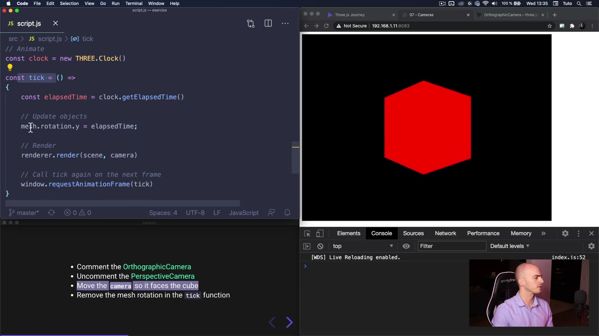
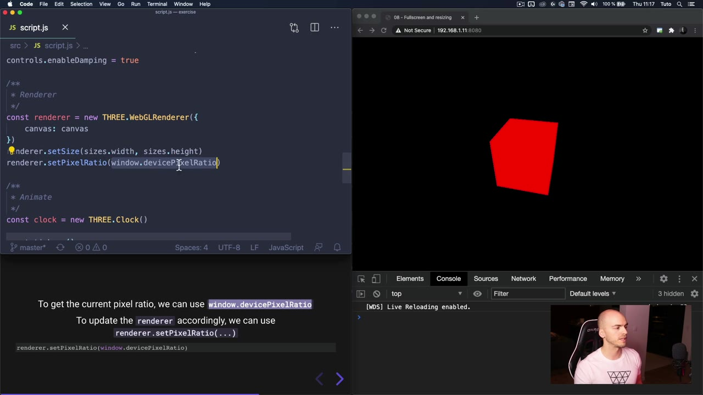

# 第 4 章 相机与画布适配

相机是 Three.js 场景中最关键的观察者，决定了最终呈现在屏幕上的画面构图。本章将从相机类型的剖析开始，详细介绍透视相机与正交相机的参数特性与应用场景，然后讲解如何通过 OrbitControls 实现流畅的交互式观察。最后，我们将学习如何让画布适配各类屏幕尺寸并支持全屏模式，建立完整的画布自适应机制，为后续的视觉呈现奠定基础。

## 相机类型与核心参数

Three.js 提供了多种相机类型以满足不同的创作需求。在开始操作前，我们应当了解每个主要类的定位与适用性。

### Camera 基类与派生相机

Camera 类是 Three.js 中各种相机的基类，实际场景通常使用它的具体子类。它定义了相机共有的属性与方法，其他相机类型则继承这些能力并实现各自的投影逻辑。

#### 常见的相机子类包括：

- **ArrayCamera**：使用多个相机分别渲染画布的不同区域，适合创建类似分屏游戏的多人视角效果。

- **StereoCamera**：通过两个模拟人眼视差的相机进行渲染，产生深度感，主要用于 VR 头显或红蓝 3D 眼镜等特殊设备。

- **CubeCamera**：从六个方向渲染场景并生成立方体环境贴图，常用于反射、折射和环境采集。

- **OrthographicCamera**：正交相机，没有透视效果，物体在屏幕上的大小不随距离改变，适用于 RTS（即时战略）游戏或工程图纸类展示。

- **PerspectiveCamera**：透视相机，模拟真实世界的人眼或相机观察，是本课程中最常用的类型。

---

## 透视相机的构造与参数

我们已经在之前的章节中初步使用了透视相机，但并未深入其参数意义。正确设置相机的各项数值对于获得预期的渲染效果至关重要。

### PerspectiveCamera 实例化

透视相机的构造函数接收四个核心参数：

```javascript
const camera = new THREE.PerspectiveCamera(
  75,                    // 视野垂直角度
  sizes.width / sizes.height, // 宽高比
  0.1,                   // 近裁剪平面
  100                    // 远裁剪平面
)
```

#### 视野垂直角度（field of view）

第一个参数是视野垂直角度，单位为度。这个角度决定了相机的视角范围：
- **小角度（如 30-45）**：产生远焦效果，适合望远镜或长焦镜头模拟
- **中角度（45-75）**：常见的默认范围，接近人眼自然观察
- **大角度（75-120）**：形成宽广透视，画面边缘的拉伸和变形更明显

对于大多数通用场景，建议使用 `45` 到 `75` 之间的数值。

#### 宽高比（aspect ratio）

第二个参数是画布宽高比，即 `宽度 ÷ 高度`。该参数决定投影矩阵的水平与纵向比例，必须与实际渲染区域一致；窗口或画布尺寸变化时，也要同步更新。

建议将尺寸信息统一存储在变量中：

```javascript
const sizes = {
  width: 800,
  height: 600
}
```

#### 近裁剪平面和远裁剪平面（near & far）

第三、第四个参数定义了相机的可见范围。任何比 `near` 更靠近相机或比 `far` 更远离相机的物体都不会出现在渲染中。

设置时需要注意：
1. **避免极端值**：不要使用 `0.0001` 和 `9999999` 之类的极端值，可能导致 z-fighting（深度冲突），即两个表面争夺渲染先后顺序的视觉瑕疵
2. **合理匹配场景**：根据场景中物体的最远、最近距离进行调整，例如在房间大小的场景中使用 `0.1` 和 `100`
3. **控制深度范围**：过大的 `far / near` 比例会降低可用深度精度。裁剪范围应覆盖场景，但不宜无依据地扩展到极大数量级

---

## 正交相机的特点与应用

正交相机与透视相机在数学投影方式上存在本质差异。正交相机移除透视变形，使得物体不论远近在屏幕上保持相同尺寸，这为特定类型的项目提供了独特的视觉方案。

### OrthographicCamera 的实例化

正交相机的参数设置方式与透视相机不同：

```javascript
const aspectRatio = sizes.width / sizes.height
const camera = new THREE.OrthographicCamera(
  -1 * aspectRatio,  // 左裁剪平面
   1 * aspectRatio,  // 右裁剪平面
   1,                // 上裁剪平面
  -1,                // 下裁剪平面
   0.1,              // 近裁剪平面
   100               // 远裁剪平面
)
```

正交相机的视锥体是一个矩形盒子，而非透视相体的金字塔。前四个参数定义了盒子的边界：`left`、`right`、`top`、`bottom`。

#### 保持正确比例

关键需要注意的是：当使用 `-1, 1, 1, -1` 这样的对称值时，渲染的是一个**正方形**区域。如果画布本身是矩形，正方形区域会被拉伸变形。为解决此问题，我们需要根据画布宽高比调整水平边界：

```javascript
const aspectRatio = sizes.width / sizes.height
const camera = new THREE.OrthographicCamera(
  -1 * aspectRatio,  // 左侧边界乘以宽高比
   1 * aspectRatio,   // 右侧边界乘以宽高比
   1,                 // 上边界保持不变
  -1,                 // 下边界保持不变
   0.1,
   100
)
```

这样调整后，渲染区域的宽度按比例扩大，立方体等物体便能以正确比例显示。



*图 4-1 课程中切换正交相机与透视相机，并调整相机使立方体进入视野。*

---

## 自定义相机控制逻辑

理解了相机的基本参数后，我们可以进一步探索如何动态控制相机的位置与朝向，创建交互式的观察体验。

### 鼠标位置映射

首先需要将鼠标位置转换为适合控制相机的坐标范围。我们希望获得这样的映射：
- 鼠标在画布最左侧：`x = -0.5`
- 鼠标在画布中心：`x = 0`
- 鼠标在画布最右侧：`x = 0.5`
- `y` 轴同理，但要反转方向（Web 的 `clientY` 向下为正，Three.js 的 `y` 向上为正）

```javascript
// 鼠标位置对象
const cursor = {
  x: 0,
  y: 0
}

window.addEventListener('mousemove', (event) => {
  // 将鼠标坐标映射到 [-0.5, 0.5] 范围
  cursor.x = event.clientX / sizes.width - 0.5
  cursor.y = - (event.clientY / sizes.height - 0.5) // 反转 Y 轴
})
```

### 基础相机控制

得到鼠标坐标后，可以直接在动画循环中更新相机位置：

```javascript
const tick = () => {
  // 更新相机位置（乘以系数放大移动幅度）
  camera.position.x = cursor.x * 3
  camera.position.y = cursor.y * 3

  // 让相机始终看向立方体
  camera.lookAt(mesh.position)

  // ... 渲染逻辑
}
```

### 环形绕轨控制

更高级的控制方式是利用三角函数让相机绕物体作圆周运动：

```javascript
const tick = () => {
  // 根据鼠标 X 坐标计算角度（完整圆周为 2π）
  const angle = cursor.x * Math.PI * 2

  // 使用正弦和余弦函数计算圆周上的 X、Z 坐标
  camera.position.x = Math.sin(angle) * 3  // 半径 3
  camera.position.z = Math.cos(angle) * 3  // 半径 3

  // Y 轴仍受鼠标垂直位置影响
  camera.position.y = cursor.y * 3

  camera.lookAt(mesh.position)

  // ... 渲染逻辑
}
```

这种方法产生的观察效果十分流畅，尤其适合产品展示或场景导航。

---

## 内置控件：OrbitControls

虽然自定义控制逻辑具备教学价值，但 Three.js 内置的控件类提供了更完整、便捷的功能。OrbitControls 是最常用的控件之一，它实现了环绕观察、平移、缩放的标准交互模式。

### OrbitControls 的引入与配置

OrbitControls 位于 Three.js 的示例（examples）模块中，需要单独导入：

```javascript
import { OrbitControls } from 'three/examples/jsm/controls/OrbitControls.js'
```

创建 OrbitControls 需要将相机和画布的 DOM 元素作为参数：

```javascript
// 创建 OrbitControls 实例
const controls = new OrbitControls(camera, canvas)

// 启用阻尼效果，使运动更平滑
controls.enableDamping = true

// 可在动画循环中更新控件状态
const tick = () => {
  controls.update()  // 需要每帧调用以使阻尼生效
  // ... 渲染逻辑
}
```

启用 `enableDamping` 后，每次拖拽后相机运动会有缓入缓出的平滑效果，极大提升了交互体验。

### OrbitControls 的交互行为

OrbitControls 提供了完整的相机交互方案：
- **左键拖动**：绕目标点旋转相机
- **右键拖动**：垂直/水平平移相机
- **滚轮**：缩放（拉近/推远）
- **阻尼效果**（启用后）：交互结束后动量衰减

这些交互方式已经覆盖了大多数 3D 观察需求，建议在项目中直接使用，而非重新实现。

---

## 画布尺寸与视口适配

固定尺寸的画布在演示中尚可接受，但在实际应用中，我们需要让 WebGL 画布尽可能利用可用的屏幕空间，同时保持良好的渲染质量。

### 使用视口尺寸

第一步是将画布尺寸从固定值改为动态获取视口尺寸：

```javascript
const sizes = {
  width: window.innerWidth,   // 视口宽度
  height: window.innerHeight  // 视口高度
}
```

同时调整 CSS 样式，消除浏览器默认边距并固定画布位置：

```css
/* 重置所有元素的默认边距 */
* {
  margin: 0;
  padding: 0;
}

/* 防止滚动条出现 */
html, body {
  overflow: hidden;
}

/* 固定画布位置并消除轮廓 */
.webgl {
  position: fixed;
  top: 0;
  left: 0;
  outline: none;  /* 移除 Chrome 中的蓝色轮廓 */
}
```

此时画布应占满整个视口，且无滚动条干扰。

### 窗⼝重⼤小事件处理

当用户调整浏览器窗口大小时，我们需要同步更新三个部分：

```javascript
window.addEventListener('resize', () => {
  // 1. 更新尺寸变量
  sizes.width = window.innerWidth
  sizes.height = window.innerHeight

  // 2. 更新相机宽高比并重算投影矩阵
  camera.aspect = sizes.width / sizes.height
  camera.updateProjectionMatrix()

  // 3. 更新渲染器尺寸
  renderer.setSize(sizes.width, sizes.height)
})
```

**关键点**：修改相机参数后，必须调用 `camera.updateProjectionMatrix()` 才能让新参数生效。这是因为 Three.js 内部使用投影矩阵进行渲染计算，参数的变化需要重新生成矩阵。

---

## 设备像素比优化

现代显示设备（尤其是移动设备和高分辨率屏幕）的像素密度（device pixel ratio）往往大于 1。这导致软件定义的 1 个 CSS 像素对应物理屏幕的多个像素点。

### 像素比的历史与挑战

- **早期设备**：像素比为 1，软件像素与物理像素一一对应
- **视网膜屏幕**：苹果引入 2 倍像素比的 Retina 显示屏
- **现代设备**：像素比可达到 2 甚至 3，画面锐利度提升

高像素比带来视觉质量提升的同时也带来性能问题：
- 像素比 2：渲染像素数量是原来的 4 倍
- 像素比 3：渲染像素数量是原来的 9 倍

移动设备通常像素比更高但计算能力有限，需谨慎处理像素比设置。

### 像素比的最佳实践

获取并设置像素比：

```javascript
// 获取设备像素比，但限制最大值
renderer.setPixelRatio(Math.min(window.devicePixelRatio, 2))
```

限制到 2 有以下考虑：
1. **性价比最佳**：大多数用户难以察觉 2 与 3 之间的视觉差异
2. **性能保护**：避免电池过度消耗和帧率下降
3. **折中方案**：平衡画质与性能

将此设置加入 resize 处理流程：

```javascript
window.addEventListener('resize', () => {
  // ... 之前的 resize 逻辑

  // 4. 更新像素比（限制在 2 以内）
  renderer.setPixelRatio(Math.min(window.devicePixelRatio, 2))
})
```

多显示器切换的像素比变化通常通过窗口大小调整来触发，无需额外监听事件。

---

## 全屏模式支持

为了提供更沉浸的体验，我们需要支持画布的全屏显示功能。Web API 提供了一系列全屏相关的方法，可以让我们在普通视图与全屏模式间切换。

### 双点击触发全屏

使用双击事件监听器可以直观地触发全屏切换：

```javascript
window.addEventListener('dblclick', () => {
  // 检查当前是否已处于全屏状态
  if (!document.fullscreenElement) {
    // 请求画布进入全屏模式
    canvas.requestFullscreen()
  } else {
    // 退出全屏模式
    document.exitFullscreen()
  }
})
```

需要注意的是，并不是所有浏览器都支持双击事件（如 Android Chrome），生产环境中可以考虑添加专门的按钮控件。

### 全屏 API 细节

1. **目标元素**：可以指定任何 DOM 元素进入全屏，这里是画布元素
2. **状态检测**：`document.fullscreenElement` 返回当前全屏的元素或 `null`
3. **请求方法**：`element.requestFullscreen()` 使特定元素进入全屏
4. **退出方法**：`document.exitFullscreen()` 退出当前全屏状态



*图 4-2 通过 `window.devicePixelRatio` 与 `renderer.setPixelRatio()` 匹配设备像素比。*

---

## 本章小结

相机与画布适配是 Three.js 项目中的基础设施，直接决定了用户的观察体验与画面质量。

**核心知识要点：**

1. **相机类型选择**：通常使用 PerspectiveCamera 模拟真实视觉，OrthographicCamera 适合工程制图或等轴视图需求

2. **参数设置原则**：
   - field of view 在 45-75 度之间较为常见
   - near/far 裁剪平面应合理匹配场景范围，避免极端值导致深度冲突
   - 正交相机需根据宽高比调整边界以保持正确比例

3. **交互控制策略**：优先使用 OrbitControls 内置控件获得完整交互体验，若需自定义控制，可将鼠标位置映射为基础变换或三角函数控制

4. **画布适配三部曲**：
   - 使用 `window.innerWidth/Height` 获取视口尺寸
   - 监听 resize 事件并同步更新相机、渲染器和像素比
   - 通过 CSS 消除滚动条并固定画布位置

5. **像素比处理**：限制最大像素比为 2，在视觉质量与性能间取得平衡

6. **全屏体验**：通过双击事件进入全屏模式，提供沉浸式观察环境

**整合建议**：在项目初始阶段建立完整的相机与画布适配逻辑，防止后续内容添加时出现适配问题。将尺寸、像素比、全屏等逻辑封装为工具模块，便于不同项目间复用。

通过本章的学习，我们不仅掌握了相机与画布的基础配置，还建立了响应式适配的完整体系，为后续复杂场景的构建奠定了扎实的视觉框架基础。