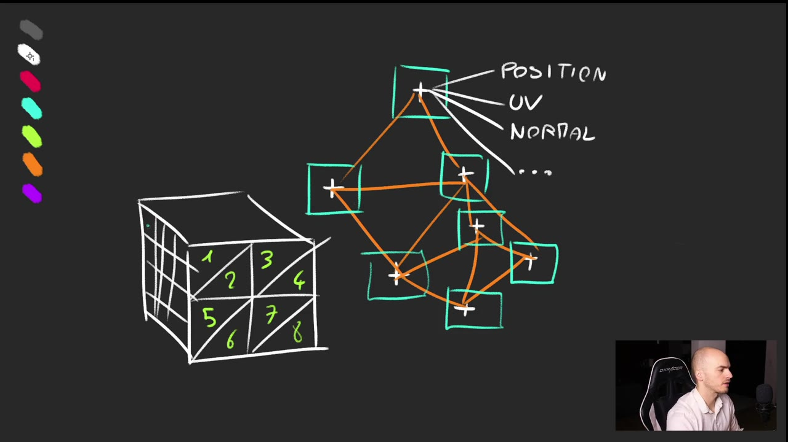
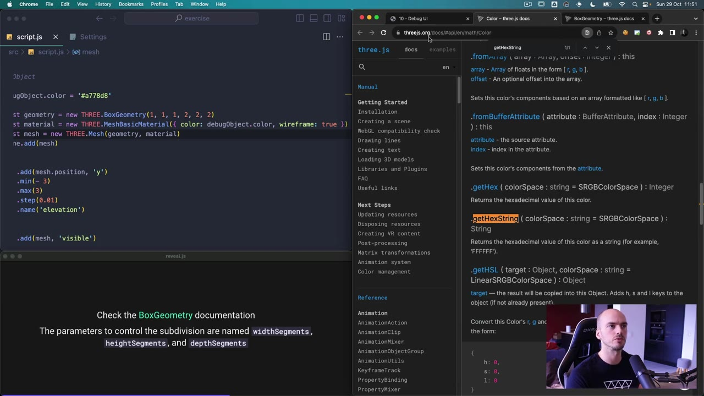

# 第 5 章 几何体与调试界面

本章将系统介绍 Three.js 中的几何体体系以及调试界面的使用方法。几何体是构建三维模型的基础，掌握不同几何体的特性和创建方式对于制作各类场景至关重要。同时，为了在开发过程中实时调整参数并获得理想效果，调试界面是不可或缺的工具。本章将深入讲解 BufferGeometry 的工作原理、各种内置几何体的使用方法，以及如何通过 lil-gui 创建功能完善的调试面板。

## 几何体的基本概念

在 Three.js 中，几何体（Geometry）是构成三维模型的基础数据结构。几何体由顶点（Vertices）和面（Faces）组成。顶点是三维空间中的坐标点，而面则是由三个顶点连接形成的三角形表面。

每个顶点不仅存储位置信息，还可以包含其他数据，如 UV 坐标、法线向量、颜色值等。这些附加数据为后续的材质着色、光照计算和纹理映射提供了必要的信息基础。

几何体主要用于创建网格（Mesh），但也可用于生成粒子系统。当用于粒子系统时，每个顶点对应一个粒子，而忽略面的信息。这种灵活性使得几何体在 Three.js 中具有广泛的应用场景。

## BufferGeometry 核心机制

Three.js 中的所有几何体都继承自 `BufferGeometry` 类。`BufferGeometry` 采用缓冲区（Buffer）的方式存储几何数据，这种方式能够将数据高效传输到 GPU，是现代图形编程的标准做法。

创建自定义几何体的核心步骤如下：

### 1. 顶点数据存储

顶点数据通过 `Float32Array` 存储，这是一种原生 JavaScript 类型化数组，专门用于存储单精度浮点数。每个顶点由三个浮点数组成，分别对应 x、y、z 坐标：

```javascript
// 创建一个包含三个顶点的 Float32Array（共9个值）
const positionsArray = new Float32Array([
    0, 0, 0, // 第一个顶点
    0, 1, 0, // 第二个顶点
    1, 0, 0  // 第三个顶点
])
```

### 2. 创建缓冲区属性

将 `Float32Array` 转换为 `BufferAttribute`，以便 Three.js 能够识别和处理：

```javascript
const positionsAttribute = new THREE.BufferAttribute(positionsArray, 3)
```

第二个参数 `3` 表示每个顶点由三个值组成（x, y, z）。

### 3. 设置几何体属性

将缓冲区属性添加到几何体，并使用 `'position'` 作为属性名，这是 Three.js 内部着色器识别顶点位置的标准名称：

```javascript
const geometry = new THREE.BufferGeometry()
geometry.setAttribute('position', positionsAttribute)
```

### 4. 创建多个随机三角形

以下示例展示了如何创建大量随机三角形的实用方法：

```javascript
const geometry = new THREE.BufferGeometry()
const count = 50 // 创建50个三角形
const positionsArray = new Float32Array(count * 3 * 3) // 50个三角形 × 3个顶点 × 3个坐标值

for(let i = 0; i < count * 3 * 3; i++) {
    positionsArray[i] = (Math.random() - 0.5) * 4 // 生成 -2 到 2 之间的随机坐标
}

const positionsAttribute = new THREE.BufferAttribute(positionsArray, 3)
geometry.setAttribute('position', positionsAttribute)
```

### 5. 索引优化

对于复杂几何体，可以使用索引（Index）来复用共享顶点，从而减少内存占用和提高渲染性能。例如，立方体的八个角点会被多个三角形面共享，使用索引可以避免在顶点数组中重复存储相同的坐标。

## 内置几何体概览

Three.js 提供了丰富的内置几何体，涵盖了常见的三维形状。以下是常用几何体及其主要参数：

### 基础几何体

- **BoxGeometry**：立方体，参数包括宽度、高度、深度以及各轴向上的细分段数
- **PlaneGeometry**：平面，可指定宽度、高度和细分
- **CircleGeometry**：圆形或扇形，参数包括半径、分段数和起始角度
- **SphereGeometry**：球体，参数包括半径、宽度分段数和高度分段数

### 扩展几何体

- **ConeGeometry**：圆锥体，可控制底面半径、高度和分段
- **CylinderGeometry**：圆柱体，可独立控制上下底面半径
- **TorusGeometry**：圆环（甜甜圈形状）
- **TorusKnotGeometry**：环面结，产生复杂的扭结形状
- **DodecahedronGeometry**：十二面体为基础的球体近似
- **IcosahedronGeometry**：二十面体为基础的球体近似，三角形大小均匀

### 高级几何体

- **ShapeGeometry**：将二维 `Shape` 轮廓转换为可渲染的平面几何体
- **ExtrudeGeometry**：通过拉伸二维形状创建三维体，可控制斜角
- **TubeGeometry**：沿路径创建管状几何体
- **LatheGeometry**：通过旋转轮廓创建花瓶类几何体
- **TextGeometry**：创建三维文字，需要提供字体文件（Typeface JSON 格式）

## 几何体参数详解：以立方体为例

以 `BoxGeometry` 为例，了解几何体参数的使用方法：

```javascript
const geometry = new THREE.BoxGeometry(
    1,      // 宽度（x轴尺寸）
    1,      // 高度（y轴尺寸）
    1,      // 深度（z轴尺寸）
    2,      // 宽度分段数（x轴细分）
    2,      // 高度分段数（y轴细分）
    2       // 深度分段数（z轴细分）
)
```

分段数决定了每个面上的三角形数量。默认值为 1 时，每个面由 2 个三角形组成。增加分段数可以获得更精细的几何体，但也会增加顶点数量和渲染开销。

要可视化细分效果，可以将材质的 `wireframe` 属性设为 `true`：

```javascript
const material = new THREE.MeshBasicMaterial({
    color: 0xff0000,
    wireframe: true
})
```



*图 5-1 BoxGeometry 的线框显示，展示了细分效果*

## 调试界面的重要性

在创意项目开发中，能够轻松调整参数是至关重要的。调试界面不仅帮助开发者快速迭代，还能让设计师、客户等其他参与者参与到参数调整中，共同寻找最佳视觉效果。合理的参数调节可能带来意外的惊喜效果。

## lil-gui 调试界面库

lil-gui 是目前 Three.js 生态中最流行的调试界面库之一，它是早期 dat.GUI 的现代替代品，具有更好的维护性和更多功能。

### 安装与引入

通过 npm 安装 lil-gui：

```bash
npm install lil-gui
```

在项目中引入并使用：

```javascript
import GUI from 'lil-gui'

// 创建调试界面实例
const gui = new GUI()
```

### 调试参数类型

lil-gui 支持多种参数类型：

1. **数值范围（Range）**：用于数字参数，可设置最小值和最大值
2. **颜色选择器（Color）**：用于颜色参数，支持多种颜色格式
3. **复选框（Checkbox）**：用于布尔值参数
4. **文本输入（Text）**：用于字符串参数
5. **下拉选择（Select）**：用于从列表中选择值
6. **按钮（Button）**：用于触发函数

### 基础调试示例

#### 1. 调整对象位置

```javascript
// 添加 y 轴位置调整
gui
    .add(mesh.position, 'y')
    .min(-3)
    .max(3)
    .step(0.01)
    .name('高度调整')
```

#### 2. 控制可见性与线框

```javascript
// 控制网格可见性
gui.add(mesh, 'visible')

// 控制材质线框显示
gui.add(material, 'wireframe')
```

#### 3. 颜色调整技巧

由于 Three.js 的颜色管理系统，直接调整 `material.color` 可能无法获得预期效果。推荐使用以下方法：

```javascript
// 创建调试对象存储原始颜色值
const debugObject = {
    color: '#a778d8'
}

// 初始化材质时使用调试对象的颜色
const material = new THREE.MeshBasicMaterial({
    color: debugObject.color
})

// 添加颜色调试，并同步更新材质
gui
    .addColor(debugObject, 'color')
    .onChange(() => {
        material.color.set(debugObject.color)
    })
```

#### 4. 触发功能按钮

```javascript
// 创建旋转动画函数
debugObject.spin = () => {
    gsap.to(mesh.rotation, {
        duration: 1,
        y: mesh.rotation.y + Math.PI * 2
    })
}

// 添加旋转按钮
gui.add(debugObject, 'spin')
```

#### 5. 动态更新几何体

对于需要在运行时调整的几何体参数（如细分段数），需要特殊的处理方式：

```javascript
debugObject.subdivision = 2

gui
    .add(debugObject, 'subdivision')
    .min(1)
    .max(20)
    .step(1)
    .onFinishChange(() => {
        // 先释放旧几何体资源
        mesh.geometry.dispose()

        // 创建新几何体并应用
        mesh.geometry = new THREE.BoxGeometry(
            1, 1, 1,
            debugObject.subdivision,
            debugObject.subdivision,
            debugObject.subdivision
        )
    })
```

注意：这里使用 `onFinishChange` 而不是 `onChange`，可以避免在拖拽滑块时频繁创建几何体，只在释放滑块时执行一次更新操作。

## 组织调试面板

当调试项较多时，可以使用文件夹进行分类组织：

```javascript
// 创建立方体调试文件夹
const cubeTweaks = gui.addFolder('立方体设置')

// 将相关调试项放入文件夹
cubeTweaks.add(mesh.position, 'y').name('Y轴位置')
cubeTweaks.add(mesh, 'visible').name('可见性')
cubeTweaks.add(material, 'wireframe').name('线框模式')
cubeTweaks.addColor(debugObject, 'color').name('颜色')
cubeTweaks.add(debugObject, 'spin').name('旋转')
cubeTweaks.add(debugObject, 'subdivision').name('细分等级')
```



*图 5-2 lil-gui 调试界面示例，展示了各项调试控件*

## 调试界面最佳实践

### 1. 集中管理调试对象

创建专门的调试对象来存储所有可调参数，避免直接修改原始变量：

```javascript
const debugObject = {
    positionY: 0,
    rotationSpeed: 1,
    color: '#ff0000',
    visibility: true,
    wireframe: false
}
```

### 2. 合理使用触发时机

- 使用 `onChange()` 实时响应变化
- 使用 `onFinishChange()` 在操作结束时响应，适合计算密集型操作

### 3. 资源管理

动态创建几何体或材质时，务必调用 `dispose()` 方法释放旧资源，避免内存泄漏。

### 4. 命名清晰

为每个调试项提供清晰的名称，方便团队协作：

```javascript
gui.add(debugObject, 'rotationSpeed').name('旋转速度')
gui.add(debugObject, 'visibility').name('是否可见')
```

### 5. 合理分组

根据功能将相关调试项分组到文件夹中，提高界面可读性。

## 性能注意事项

### 顶点数量与细分

增加几何体的细分段数会显著增加顶点和面的数量。虽然这能让几何体看起来更平滑，但也会增加 GPU 的渲染负担。需要在视觉效果和性能之间找到平衡点。

### 调试界面的性能影响

调试界面本身也会消耗一定的性能资源。在生产环境中，应确保调试界面可以被禁用或移除。

### 几何体更新频率

频繁更新几何体（如每帧都修改顶点数据）会导致性能下降。应尽量在初始化时确定几何体，或者使用缓冲区更新等技术进行优化。

## 本章小结

本章系统介绍了 Three.js 中的几何体体系和调试界面使用方法，涵盖以下核心知识点：

1. **几何体基础**：几何体由顶点和面构成，顶点存储位置信息和其他属性数据，面由三个顶点连接形成三角形。

2. **BufferGeometry机制**：Three.js 使用 BufferGeometry 通过缓冲区高效传输几何数据到 GPU。可以创建自定义几何体，并通过索引优化复用共享顶点。

3. **内置几何体库**：Three.js 提供了丰富的内置几何体，从基础的立方体、球体到复杂的文字几何体、挤出几何体等，满足大部分三维形状需求。

4. **几何体参数调节**：通过调整分段数等参数可以控制几何体的精细程度，在视觉效果和性能之间取得平衡。

5. **调试界面必要性**：调试界面是创意开发中的重要工具，帮助开发者和设计团队快速迭代、调整参数、寻找最佳视觉效果。

6. **lil-gui使用**：lil-gui 提供了数值范围、颜色选择器、复选框、按钮等多种调试控件，支持参数分组和事件回调，是功能完善的调试解决方案。

7. **最佳实践**：合理组织调试对象、管理资源释放、控制更新频率、提供清晰命名等实践方法，能够提高开发效率和代码质量。

掌握几何体创建与调试界面使用是 Three.js 开发的基础技能。在实际项目中，应根据具体需求选择合适的几何体类型，并通过调试界面快速调整参数，逐步完善视觉效果。在后续章节中，我们将以此为基础，学习纹理、材质、光照等更高级的三维渲染技术。