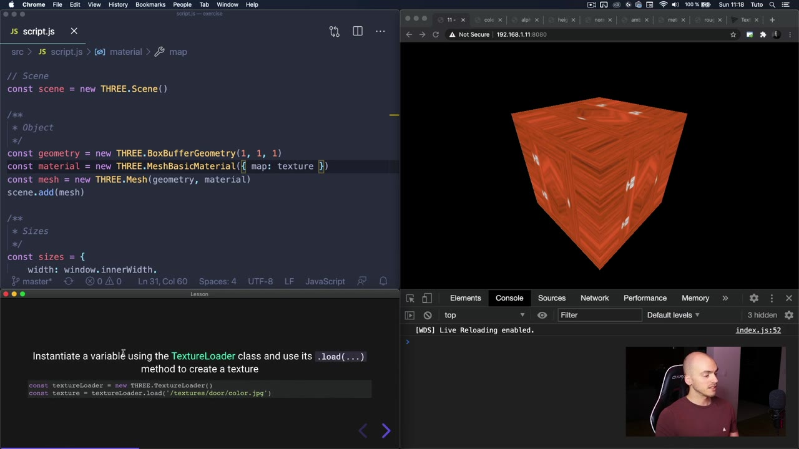
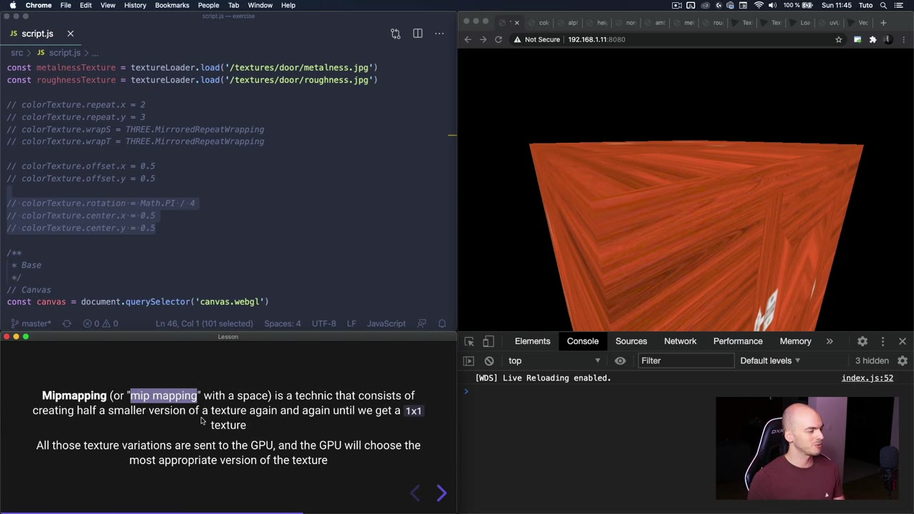

# 第 6 章 纹理

几何体决定对象的形状，材质决定表面如何着色，而纹理（Texture）把图像中的颜色或数据带到这个表面上。纹理不仅能给对象添加图案，还能控制透明区域、顶点起伏、受光细节、金属度与粗糙度。本章以一套门面纹理为例，说明常见贴图的区别、图像加载与纹理更新、UV 坐标、纹理变换、过滤和 mipmap，并进一步讨论文件体积、分辨率、数据精度与通道复用。理解这些关系后，才能同时兼顾画面质量、下载成本与 GPU 开销。

## 纹理类型与 PBR

纹理通常来源于图像，但图像中的像素不一定表示肉眼看到的颜色。它们也可以表示透明度、高度、方向或其他数值。Three.js 将图像整理为适合 GPU 采样的纹理，材质的着色器再依据纹理类型解释这些数据。因此，不能把一张灰度图随意换到另一个贴图槽位，并期待它仍然产生相同效果。

颜色纹理（Color Texture）也常称反照率纹理（Albedo Texture），提供表面本身的颜色，是最直观的一类。Alpha 纹理使用灰度控制可见程度：白色区域可见，黑色区域隐藏，中间灰度形成不同程度的半透明。它适合处理镂空、边缘遮罩以及不规则轮廓。

高度纹理也称位移纹理（Displacement Texture），同样采用灰度数据，但它会实际移动几何体的顶点。灰度值决定顶点的偏移程度，最终幅度还由材质参数控制。若平面只有少量顶点，即使高度图非常精细，也没有足够多的顶点可供移动，无法还原细节。使用位移时，必须给几何体足够的细分，并承担相应顶点处理成本。

法线纹理（Normal Texture）通常呈紫蓝色。它改变着色时使用的表面方向，使平坦表面也能呈现对光照有响应的凹凸细节。与位移不同，法线贴图不移动顶点，因此不要求大量细分，通常能以较低的几何成本获得丰富细节。不过，对象的轮廓和真实起伏并未改变；从贴近表面的侧面观察时，仍可能看出它原本是一个平面。

环境光遮蔽纹理（Ambient Occlusion Texture，AO）在缝隙、交界处和凹槽中补充暗部，增强局部对比。它属于预先准备的遮蔽信息，并不等同于灯光实时计算出的阴影。其目的主要是改善细节层次，而不是严格模拟每一条光线。

金属度纹理（Metalness Texture）用灰度描述表面的金属属性：白色偏向金属，黑色偏向非金属，中间值表示过渡。粗糙度纹理（Roughness Texture）描述反射的分散程度：较亮区域更粗糙，反射更分散；较暗区域更光滑，反射更集中。两者经常配套使用。例如，门上的金属构件可以具有较高的金属度，而老化、锈蚀或清漆又会让不同区域呈现不同粗糙度。

这些贴图与基于物理的渲染（Physically Based Rendering，PBR）密切相关。PBR 使用接近现实光学的算法和参数，依据金属度、粗糙度以及光照条件计算表面反射。Unity、Unreal Engine、Blender 和 Three.js 等工具广泛采用这一思路，使相同模型与贴图在不同平台中更容易获得相近的材质表现。这里的“相近”并不意味着每个像素完全一致，因为光照、渲染算法和后处理仍可能不同。



*图 6-1 多种纹理共同描述门面的颜色、透明区域、表面细节与反射特征*

## 图像路径与原生加载过程

加载纹理之前，首先要获得浏览器可以访问的图像 URL。课程模板使用 Webpack，图像放在 `src` 中时，可以像导入 JavaScript 模块一样导入它：

```js
import imageSource from './color.jpg'

console.log(imageSource)
```

此时导入值是构建工具生成的资源 URL。Webpack 可能给文件名加入哈希，用于缓存失效控制，因此最终名称不必与原文件相同。这种方式有效，但具体行为依赖项目配置。

另一种方式是把资源放在课程的 `static` 目录中。该目录内容会按静态资源提供，访问路径从 `static` 内部开始计算，URL 中不再包含 `static` 本身。例如，文件位于 `static/textures/door/color.jpg`，加载路径为：

```text
/textures/door/color.jpg
```

这一方式路径直观，也便于后续集中管理纹理、模型等资源。无论采用哪种方式，都应检查目录、大小写和扩展名；`.jpg`、`.jpeg` 与 `.png` 不能相互替代。

理解原生 JavaScript 的加载过程，有助于认识 `TextureLoader` 在幕后完成的工作。浏览器先创建 `Image`，设置 `src` 后开始异步下载；Three.js 的 `Texture` 则持有该图像，并在图像就绪后更新：

```js
const image = new Image()
const colorTexture = new THREE.Texture(image)

image.onload = () => {
  colorTexture.needsUpdate = true
}

image.src = '/textures/door/color.jpg'

const material = new THREE.MeshBasicMaterial({
  map: colorTexture
})
```

这里有两个关键点。第一，普通的 HTML 图像不能代替 Three.js 纹理直接参与 WebGL 渲染，需要由 `THREE.Texture` 管理。第二，`needsUpdate` 采用驼峰拼写，赋值为 `true` 后，Three.js 才知道纹理内容发生变化，需要重新处理。纹理在回调外部声明，材质就能直接引用它，不必把场景创建代码全部塞进加载回调。若只在 `onload` 内声明 `const colorTexture`，外部代码会因 JavaScript 作用域限制而无法访问该变量。

## TextureLoader 与 LoadingManager

实际项目通常使用 `THREE.TextureLoader` 简化上述流程。只需实例化一次加载器，就可以多次调用 `load`，不需要为每张纹理分别创建加载器：

```js
const textureLoader = new THREE.TextureLoader()

const colorTexture = textureLoader.load('/textures/door/color.jpg')
const alphaTexture = textureLoader.load('/textures/door/alpha.jpg')
const heightTexture = textureLoader.load('/textures/door/height.jpg')

const material = new THREE.MeshBasicMaterial({
  map: colorTexture
})
```

`load` 会立即返回可供材质引用的纹理对象，图像则在后台继续加载。除路径外，`load` 还能接收加载完成、加载进度和加载错误三个回调。完成回调适合执行依赖图像就绪的后续操作，错误回调适合诊断路径或网络问题。课程中的单纹理进度回调并不能稳定提供从 0% 到 100% 的连续进度，因此不应把它当成通用进度条方案。

当场景同时加载多张纹理，以及之后的模型、字体等资源时，可以用 `THREE.LoadingManager` 统一管理事件。把同一个管理器传给相关加载器，就能集中观察整组资源，而不必分别拼接每个文件的状态：

```js
const loadingManager = new THREE.LoadingManager()

loadingManager.onProgress = (url, loaded, total) => {
  console.log(`${url}: ${loaded}/${total}`)
}

loadingManager.onError = (url) => {
  console.error(`资源加载失败：${url}`)
}

const managedTextureLoader = new THREE.TextureLoader(loadingManager)
const managedColor = managedTextureLoader.load('/textures/door/color.jpg')
const managedAlpha = managedTextureLoader.load('/textures/door/alpha.jpg')
```

管理器还提供 `onStart` 与 `onLoad` 等事件入口：前者用于响应加载开始，后者用于响应所管理资源全部完成。`onProgress` 可以接收当前 URL、已加载数量和总数量，`onError` 则便于定位失败资源。某个路径写错时，错误事件能帮助区分“资源没有下载成功”和“材质参数没有配置正确”这两类问题。

## UV 展开决定图像落点

将同一张纹理分别用于球体、圆锥、圆环和立方体，会得到不同的铺展与拉伸结果。这不是随机现象，而是由几何体的 UV 坐标决定的。UV 展开（UV Unwrapping）可以理解为把三维表面沿适当位置剪开并摊平到二维图像上，类似展开折纸或包装纸。

三维模型中的顶点拥有三维位置坐标，同时还可以拥有二维 UV 坐标。UV 坐标说明该顶点对应纹理平面中的哪个位置，通常以 `(0, 0)` 到 `(1, 1)` 的范围描述一张图像。渲染三角形时，GPU 在顶点的 UV 之间插值，从而确定表面各区域应读取的纹素。复杂的模型可能需要多处剪切与多个展开岛，以减少拉伸并合理利用图像空间。

Three.js 的内置几何体已经提供 UV。以缓冲几何体为例，可以查看：

```js
console.log(geometry.attributes.position)
console.log(geometry.attributes.uv)
```

`position` 保存顶点位置，`normal` 保存法线，`uv` 则保存二维纹理坐标。`uv` 通常是 `Float32BufferAttribute`，其 `itemSize` 为 2，即每个顶点对应两个数值，而不是位置属性的三个数值。若自行构建几何体，就需要同时提供合理的 UV；若在 Blender 等三维软件中制作模型，则需要在导出前完成展开。没有正确 UV，即使纹理和材质代码无误，也可能出现错位、拉伸或无法按预期显示的问题。

## 重复、偏移与旋转

`THREE.Texture` 不仅能保存图像，还能控制采样时的二维变换。这些修改发生在纹理坐标上，不会移动网格本身。

`repeat` 是二维向量，分别控制纹理在 U、V 方向的重复次数。仅增大 `repeat` 往往只能看到局部图案和边缘像素的延伸，还必须设置相应方向的包裹模式：

```js
colorTexture.repeat.set(2, 3)
colorTexture.wrapS = THREE.RepeatWrapping
colorTexture.wrapT = THREE.RepeatWrapping
```

`wrapS` 和 `wrapT` 对应纹理坐标的两个方向。`RepeatWrapping` 直接重复图像，`MirroredRepeatWrapping` 则让相邻重复单元交替镜像，可用于减弱某些重复接缝。若不需要重复，就不要设置过大的 `repeat`，否则纹理会被压缩到更多单元中。

`offset` 同样是二维向量，用于平移采样位置，例如 `colorTexture.offset.set(0.5, 0.5)`。它偏移的是纹理，不是 UV 属性数组，也不是网格顶点。`rotation` 控制二维旋转，单位是弧度；`center` 决定旋转与缩放的中心。若希望围绕纹理中心旋转，应先将中心设为 `(0.5, 0.5)`：

```js
colorTexture.center.set(0.5, 0.5)
colorTexture.rotation = Math.PI / 4
```

`Math.PI` 表示半圈，`Math.PI * 2` 表示整圈，因此 `Math.PI / 4` 表示八分之一圈。重复、包裹、偏移、中心与旋转可以组合使用，但排查效果时应逐项调整，避免多个变换叠加后难以判断原因。

## 过滤、mipmap 与采样风格

相机拉远或以很斜的角度观察表面时，一大块纹理可能只占据很少屏幕像素。若仍直接读取原始高分辨率图像，容易闪烁并产生走样。mipmap 技术会自动生成一系列逐级减半的纹理版本，直到最小尺寸；GPU 再根据表面在屏幕上的覆盖情况选择合适层级。远景变模糊并不一定是缺陷，它可能正是过滤与 mipmap 在抑制高频细节。

缩小过滤由 `minFilter` 控制，处理大量纹素被压缩到较少屏幕像素的情况。课程所用默认值为 `THREE.LinearMipmapLinearFilter`，会在线性采样的同时混合 mipmap 层级。改用 `THREE.NearestFilter` 后，采样更接近邻近纹素，结果可能更清晰，但高分辨率棋盘格在远处也更容易出现摩尔纹（Moiré Pattern）。清晰不等于始终更美观，应结合物体距离与目标风格判断。

放大过滤由 `magFilter` 控制，处理纹理分辨率不足、纹素被拉伸到多个屏幕像素的情况。默认的 `THREE.LinearFilter` 会混合相邻纹素，让小图像显得平滑；`THREE.NearestFilter` 则保留明显边界，适合像素画或 Minecraft 式风格。很小的棋盘格和渐变纹理最容易展示这一差别。

```js
colorTexture.minFilter = THREE.NearestFilter
colorTexture.magFilter = THREE.NearestFilter
colorTexture.generateMipmaps = false
```

上述组合明确采用最近邻采样，因此这里可以关闭 mipmap 生成，减少额外图像数据与处理。需要特别注意：`generateMipmaps = false` 与这份配置配套，并不是任何纹理都应关闭 mipmap。若 `minFilter` 仍依赖 mipmap，就不应照搬该优化。最近邻采样通常也能减少部分过滤成本，但远处物体的闪烁、摩尔纹和整体视觉质量仍需实际测试。



*图 6-2 纹理过滤会影响远距采样、斜面清晰度与像素化风格*

## 文件、分辨率与数据组织

纹理优化需要同时考虑三个维度：用户下载的文件体积、发送到 GPU 的图像分辨率，以及像素中保存的数据。只压缩网络文件并不等于解决全部性能问题，因为文件下载后还要解码并成为 GPU 纹理。

JPEG 使用有损压缩，通常能显著减小文件，但强压缩可能产生伪影。PNG 采用无损压缩，能保留当前图像中的像素值，代价往往是更大的文件。无论选择哪种格式，都可以继续用图像工具或压缩服务降低体积，然后检查视觉损失是否可接受。课程还提到 Basis 这类面向 GPU 的特殊压缩方案，但在基础流程中，先把 JPEG、PNG、分辨率和实际用途管理好更为重要。

分辨率应服务于对象在画面中的实际尺寸。需要近距离展示的门可以保留较多细节，远景房屋上的同类门则应使用更小纹理。大量高分辨率纹理会占用可观的 GPU 资源，启用 mipmap 后还需保存额外层级。在课程所用配置中，为稳定生成逐级减半的 mipmap，纹理宽度和高度宜采用 2 的幂，例如 256、512、1024；宽与高可以不同，不必强制正方形。若输入尺寸不合适，Three.js 可能额外调整图像，增加处理并损害结果。

数据精度同样影响格式选择。法线图把方向编码在像素中，有损压缩造成的细小值变化可能转化为光照伪影，因此通常优先使用 PNG 等无损格式。课程示例中的法线图为了演示而使用 JPEG，这不代表它是所有项目的推荐选择。颜色图是否值得无损保存，则应在体积与质量之间实测。

带透明通道的 PNG 可以把颜色和透明度放在一张图中，也可以拆成一张颜色 JPEG 和一张 Alpha JPEG。前者减少文件数量，后者可能降低下载体积，却会增加 GPU 中的纹理数量。没有脱离场景的固定答案，需要比较网络传输、显存、采样次数与视觉效果。

还可以把不同数据打包到同一图像的红、绿、蓝和 Alpha 通道。例如，将图像遮罩、边框和阴影分别写入不同通道，再在相应网格或着色逻辑中读取；地形也可以用一个通道保存高度、另一个通道保存边缘透明度。通道打包能减少资源数量，但制作与解释成本更高，必须明确约定每个通道的含义，避免把数据图误当颜色图处理。

获取纹理时，可以使用纹理资源站、自己拍照、在 Photoshop 等二维软件中绘制，或使用 Substance Designer 的节点流程生成程序纹理。个人练习与公开、商业发布对授权的要求不同；用于公开项目前，必须核实图像和 matcap 等资源的许可证，不能仅以“能够下载”推断“可以任意使用”。

## 本章小结

纹理由图像或数据与 GPU 采样规则共同构成。颜色、Alpha、位移、法线、AO、金属度和粗糙度贴图承担不同职责，其中位移会改变顶点，法线主要改变受光细节，PBR 则把这些输入组织为较统一的材质计算方式。`TextureLoader` 简化单张纹理加载，`LoadingManager` 协调多资源事件，UV 决定图像如何落到几何体表面。

重复、包裹、偏移和旋转控制纹理坐标，过滤与 mipmap 控制不同屏幕尺度下的采样结果。最终优化不能只盯着压缩率，还要同时评估下载体积、GPU 分辨率、mipmap、数据精度、透明度和通道组织，并在目标设备与目标视角下验证画面。
