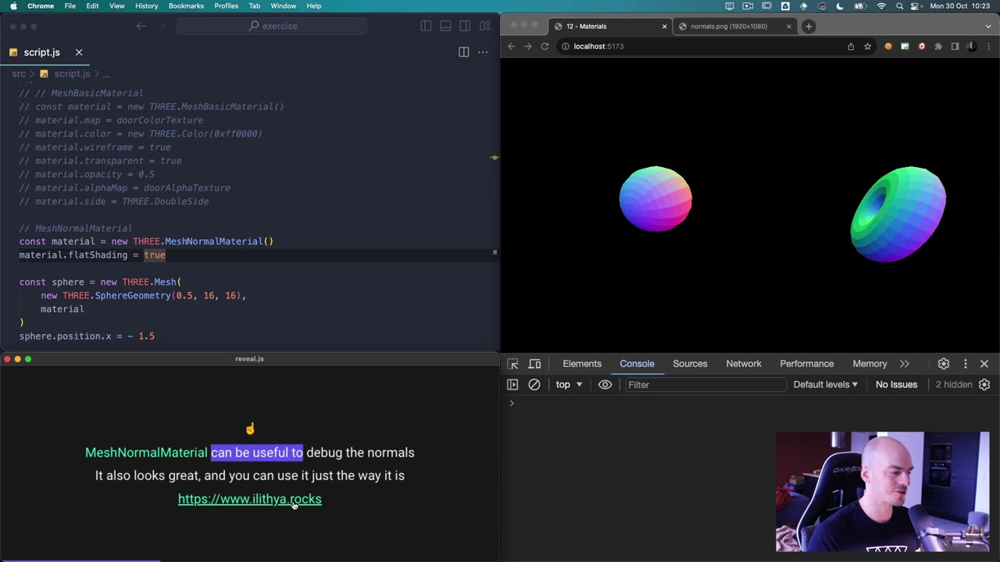
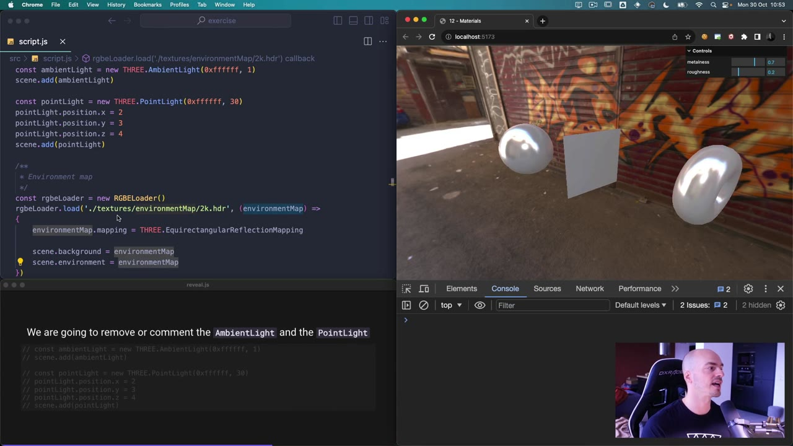

# 第 7 章 材质

网格（Mesh）把几何体与材质组合在一起：几何体提供形状，材质（Material）决定表面最终如何着色。材质的计算由发送到 GPU 的着色器完成，Three.js 的内置材质则把这些复杂程序封装为可直接配置的类。本章使用球体、平面和圆环组成的测试场景，比较基础、法线、Matcap、深度、Lambert、Phong、Toon、Standard 与 Physical 等材质，并重点说明纹理、灯光、环境贴图及性能之间的关系。

## 测试场景与纹理准备

可以先创建一份共享材质，再把它传给三个网格。共享材质意味着之后只需修改一次参数，三个对象就会同步变化；`scene.add` 也能一次接收多个对象。

```js
const material = new THREE.MeshBasicMaterial()

const sphere = new THREE.Mesh(
  new THREE.SphereGeometry(0.5, 16, 16),
  material
)

const plane = new THREE.Mesh(
  new THREE.PlaneGeometry(1, 1),
  material
)

const torus = new THREE.Mesh(
  new THREE.TorusGeometry(0.3, 0.2, 16, 32),
  material
)

sphere.position.x = -1.5
torus.position.x = 1.5
scene.add(sphere, plane, torus)
```

在基于累计时间的更新函数中，可以让三个对象分别以 `0.1 * elapsedTime` 和 `-0.15 * elapsedTime` 修改 `rotation.y` 与 `rotation.x`。不同轴向、不同速率的旋转便于观察高光、法线和反射。均匀球体在纯白色基础材质下不容易看出旋转，但切换到平面着色或反射材质后，变化就会清楚起来。

后文为便于比较，会使用不同的材质变量名。实际测试时，可以继续把当前材质实例赋给原来的 `material` 变量，或分别设置 `sphere.material`、`plane.material` 和 `torus.material`，确保示例材质确实用于这三个网格。

本章使用的门纹理包括颜色、Alpha、环境光遮蔽、高度、法线、金属度和粗糙度，另外还需要一张 Matcap 图与一张渐变图。一个 `TextureLoader` 即可加载全部资源：

```js
const textureLoader = new THREE.TextureLoader()

const doorColorTexture = textureLoader.load('/textures/door/color.jpg')
const doorAlphaTexture = textureLoader.load('/textures/door/alpha.jpg')
const doorAmbientOcclusionTexture = textureLoader.load('/textures/door/ambientOcclusion.jpg')
const doorHeightTexture = textureLoader.load('/textures/door/height.jpg')
const doorNormalTexture = textureLoader.load('/textures/door/normal.jpg')
const doorMetalnessTexture = textureLoader.load('/textures/door/metalness.jpg')
const doorRoughnessTexture = textureLoader.load('/textures/door/roughness.jpg')
const matcapTexture = textureLoader.load('/textures/matcaps/1.png')
const gradientTexture = textureLoader.load('/textures/gradients/3.jpg')

doorColorTexture.colorSpace = THREE.SRGBColorSpace
matcapTexture.colorSpace = THREE.SRGBColorSpace
```

用于 `map` 的颜色纹理和用于 `matcap` 的颜色参考图按 sRGB 编码时，需要设置 `THREE.SRGBColorSpace`，让渲染流程正确解释颜色。法线、高度、金属度等纹理保存的是数据而非颜色，不能因为它们也是图像就照搬这一设置。

## MeshBasicMaterial 与通用属性

`MeshBasicMaterial` 不依赖场景灯光，适合先理解材质的共同配置。实例化时可以传入参数对象，也可以先创建实例再逐项赋值：

```js
const basicMaterial = new THREE.MeshBasicMaterial({
  map: doorColorTexture
})

// 与上面的 map 配置等价；实际使用时保留一种写法即可
basicMaterial.map = doorColorTexture
```

`color` 给表面统一着色，同时存在 `map` 时会对纹理进行染色。构造参数可以接受颜色名称、十六进制和 CSS 风格字符串，但已经存在的 `material.color` 是一个 `THREE.Color` 实例，不能直接用字符串替换整个属性：

```js
const coloredMaterial = new THREE.MeshBasicMaterial({ color: 'green' })
coloredMaterial.color = new THREE.Color('#ff0000')
```

也可以对现有颜色实例调用 `set`。关键在于区分“构造材质时解析颜色参数”和“运行时修改 `Color` 对象”这两种操作。

`wireframe = true` 以线框显示三角形，主要用于检查几何结构和调试。多数平台上的线宽接近 1，不能依赖跨平台可调的粗线效果；线框也可能出现明显锯齿，因此不应默认把它当成稳定的生产视觉方案。

`opacity` 控制整体不透明度，但仅设置小于 1 的值通常还不够，还要启用 `transparent`。`alphaMap` 则按纹理灰度控制局部透明：白色可见、黑色隐藏、灰色半透明，同样需要启用透明模式。

```js
const transparentMaterial = new THREE.MeshBasicMaterial({
  map: doorColorTexture,
  transparent: true,
  opacity: 0.5,
  alphaMap: doorAlphaTexture
})
```

上例同时演示两种透明控制；若只想观察 Alpha 贴图，可把 `opacity` 保持为 1。透明效果是否明显还取决于对象背后是否有其他画面，纯黑背景下不容易判断其层次。

`side` 决定渲染表面的哪一侧。`THREE.FrontSide` 是默认值，只渲染正面；`THREE.BackSide` 只渲染背面；`THREE.DoubleSide` 两侧都渲染。使用默认正面时，相机进入球体内部可能看不到表面，切换到双面后则能看到内壁。双面会增加需要处理的片元，不能作为“防止任何面消失”的常规开关。由 Blender 等软件导出的材质也可能携带双面设置，导入后应结合实际模型检查。



*图 7-1 三种几何体构成统一的材质测试场景，便于比较通用参数*

## MeshNormalMaterial、MeshMatcapMaterial 与 MeshDepthMaterial

`MeshNormalMaterial` 用法线方向生成颜色。法线描述表面朝向，是光照、反射和折射计算的重要输入；该材质把相对于相机的方向映射为容易辨认的颜色，因此常用于检查法线是否异常。对象或相机运动后，颜色变化反映的是观察空间中的方向变化，而不是普通颜色贴图。

```js
const normalMaterial = new THREE.MeshNormalMaterial({
  wireframe: false,
  flatShading: true
})
```

`flatShading = true` 会强调每个面的平坦效果，让球体呈现清晰的小面，也可用于低多边形风格。`MeshNormalMaterial` 同样支持线框等通用属性，但它不是通过 `color` 随意染色的常规材质。除调试外，法线输出还可服务于后期处理，或直接作为特殊的视觉风格。

`MeshMatcapMaterial` 使用材质捕获（Material Capture，Matcap）纹理模拟光照和反射。Matcap 图通常是一张包含球体光照结果的方形图像，着色器根据表面相对于相机的方向，从图中选取颜色。它能在没有场景灯光的情况下呈现明暗、高光甚至金属感，计算开销通常较低。

```js
const matcapMaterial = new THREE.MeshMatcapMaterial({
  matcap: matcapTexture
})
```

这里的属性必须是 `matcap`，不是 `map`。这种真实感来自预先绘制或渲染的参考图：不能像真实灯光那样单独移动光源或调整强度，光照方向还会随观察空间产生特定表现。相机大幅绕到对象另一侧时，画面可能与场景中的真实阴影或其他光照不一致。因此，Matcap 特别适合视角受控、灯光固定且重视性能的项目。

更换 Matcap 图就能显著改变风格。可以从有明确授权的资源库获取，也可以自行制作：在 Blender 等三维软件中为球体布置材质与灯光，使用正对球体的相机做方形渲染；也可以在二维软件中用柔和画笔绘制方形参考图，它不必真的画出完整球体。制作后应在目标模型和目标视角下测试，并确认第三方资源的许可证。

`MeshDepthMaterial` 按片段与相机的距离着色，近处偏白、远处偏黑。它不是用于普通外观展示的主要材质，更多参与深度相关流程，例如阴影、后期处理以及需要显式处理深度的自定义材质。理解其灰度含义即可，无须为了普通模型颜色而使用它。

## 需要灯光的 Lambert、Phong 与 Toon

切换到 `MeshLambertMaterial` 后，如果场景没有灯光，对象会变黑，这不是加载错误。该材质需要光照才能呈现明暗。可以为测试场景添加环境光和点光源：

```js
const ambientLight = new THREE.AmbientLight(0xffffff, 1)
scene.add(ambientLight)

const pointLight = new THREE.PointLight(0xffffff, 30)
pointLight.position.set(2, 3, 4)
scene.add(pointLight)

const lambertMaterial = new THREE.MeshLambertMaterial()
```

环境光从各方向提供基础亮度，不容易形成有明确位置的高光；点光源从所设位置照射，使朝向和背向光源的区域产生差别。`MeshLambertMaterial` 支持颜色、纹理等常见属性，是需要灯光的材质中性能较好的选择。如果效果已经满足需求，就没有必要仅为了使用更复杂的类而增加成本。不过，它较难调出细腻、真实的效果，某些几何体上还可能出现不自然的局部图案。

`MeshPhongMaterial` 消除了课程示例中的部分 Lambert 视觉问题，并提供高光控制，但计算成本更高。`shininess` 控制高光的集中程度，`specular` 控制镜面反射颜色：

```js
const phongMaterial = new THREE.MeshPhongMaterial({
  shininess: 100,
  specular: new THREE.Color(0x1188ff)
})
```

提高 `shininess` 会让高光更集中、更强烈，降低则使其更分散。环境光没有明确方向，点光源则能在表面形成可见高光。`shininess` 与 `specular` 较偏向经验调节，不如 PBR 参数直观，若目标是跨软件、跨场景的真实材质，通常还需要更物理化的模型。

`MeshToonMaterial` 有意追求非真实感，把连续明暗分成有限色阶，形成卡通或赛璐璐（Cel Shading）效果。默认可呈现亮部与暗部的分区，通过 `gradientMap` 则能指定更多阶段：

```js
const toonMaterial = new THREE.MeshToonMaterial({
  gradientMap: gradientTexture
})

gradientTexture.minFilter = THREE.NearestFilter
gradientTexture.magFilter = THREE.NearestFilter
gradientTexture.generateMipmaps = false
```

课程中的渐变图只有 3×1 像素。若使用默认线性放大过滤，三个色阶会相互混合，无法得到清晰的卡通分块；最近邻过滤保留独立像素，正好符合需求。`minFilter` 也设为 `NearestFilter` 后，这份渐变图不再需要 mipmap，因此可以关闭生成。换成含五个像素的渐变图，就能以同样方法得到五个明暗层级。

## MeshStandardMaterial 与环境光照

`MeshStandardMaterial` 采用 PBR，支持灯光，并以 `metalness` 和 `roughness` 等参数描述材质。金属度主要影响表面对环境的反射特征，粗糙度影响反射的扩散与清晰程度。两者通常在 0 到 1 之间调整：高金属度与低粗糙度更容易出现清晰的环境反射，高粗糙度则使反射更柔和。

```js
const standardMaterial = new THREE.MeshStandardMaterial({
  metalness: 0.45,
  roughness: 0.65
})
```

这些参数需要结合灯光、环境和视角调节，而不是孤立地寻找固定答案。可以使用 lil-gui 快速观察联动效果。安装 `lil-gui` 后导入 `GUI`，给两个属性添加范围为 0 到 1 的控制：

```js
import GUI from 'lil-gui'

const gui = new GUI()
gui.add(standardMaterial, 'metalness').min(0).max(1).step(0.0001)
gui.add(standardMaterial, 'roughness').min(0).max(1).step(0.0001)
```

仅靠几盏局部灯光，金属表面仍可能显得缺乏环境信息。环境贴图提供场景周围的全景图像，既可作为背景，也可参与反射和环境照明。课程使用 HDR 资源，通过 `RGBELoader` 加载，并设置等距柱状反射映射：

```js
import { RGBELoader } from 'three/examples/jsm/loaders/RGBELoader.js'

const rgbeLoader = new RGBELoader()
rgbeLoader.load('/textures/environmentMap/2k.hdr', (environmentMap) => {
  environmentMap.mapping = THREE.EquirectangularReflectionMapping
  scene.background = environmentMap
  scene.environment = environmentMap
})
```

必须在加载回调中使用已经就绪的环境纹理。`scene.background` 只负责让环境图出现在背景中，`scene.environment` 才让它参与场景环境照明；两者用途不同，不能只设置背景便期待对象获得反射。可将测试用的 `metalness` 调为 0.7、`roughness` 调为 0.2 观察变化。若环境图已提供充分照明，可以减弱或移除先前的环境光和点光源，避免叠加后过亮。2K HDR 对实时项目并不算轻量，仍需评估下载和 GPU 成本。

## 门面材质的贴图组合

标准材质真正发挥作用时，需要把颜色、结构细节与 PBR 数据结合起来。以下配置沿用已经加载的门纹理：

```js
standardMaterial.map = doorColorTexture
standardMaterial.aoMap = doorAmbientOcclusionTexture
standardMaterial.aoMapIntensity = 1

standardMaterial.displacementMap = doorHeightTexture
standardMaterial.displacementScale = 0.1

standardMaterial.metalnessMap = doorMetalnessTexture
standardMaterial.roughnessMap = doorRoughnessTexture
standardMaterial.metalness = 1
standardMaterial.roughness = 1

standardMaterial.normalMap = doorNormalTexture
standardMaterial.normalScale.set(0.5, 0.5)

standardMaterial.alphaMap = doorAlphaTexture
standardMaterial.transparent = true
```

`map` 提供基础颜色。`aoMap` 在缝隙和凹槽增加遮蔽细节，`aoMapIntensity` 控制强度；它主要影响环境光、环境贴图和半球光等环境照明，并不等同于点光源产生的直接阴影。强度可临时调大以观察作用区域，正式使用则应避免把对比推到不自然的程度。

`displacementMap` 会移动真实顶点，`displacementScale` 控制幅度。低细分的平面只有两个三角形，无法表现高度图的丰富变化，因此需要提高几何体细分。课程将球体细分提高到 64×64，圆环也增加分段后再观察位移。更多顶点会提高几何处理成本；若幅度过大，还会出现夸张的撕裂般轮廓，所以应联合调整细分和缩放。

`metalnessMap` 与 `roughnessMap` 并不是简单覆盖同名数值，而是分别与 `metalness`、`roughness` 相乘。若此前为了环境反射把 `roughness` 设为 0.2，再添加粗糙度图，所有纹素值都会被缩小，可能让材质仍然过于光滑。把两个标量都设为 1，可以让贴图值作为主要调节依据，同时仍保留整体缩放入口。门的木纹、清漆、金属构件和老化区域由此获得不同反射表现。

`normalMap` 在不增加顶点的情况下补充受光细节，`normalScale` 是二维向量，可用 `set(x, y)` 调整强度。它适合表现木纹和细小凹凸，但不会改变轮廓；从极斜的角度观察时，真实平坦的几何表面仍会暴露这一点。位移与法线可以组合，也可以在不需要真实轮廓起伏时仅使用法线，以控制性能。

最后，`alphaMap` 按灰度隐藏相应区域，仍需 `transparent = true`。把这张贴图加入完整材质时，如果透明没有效果，应先检查透明开关，再检查路径和纹理本身，而不是立即调整其他 PBR 参数。



*图 7-2 多种贴图与环境照明共同构成具有木材、金属和表面细节的门面材质*

## MeshPhysicalMaterial 的扩展效果

`MeshPhysicalMaterial` 扩展了 `MeshStandardMaterial`。在相同基础参数下，它可以保持标准材质的表现，同时提供清漆层、光泽、虹彩和透射等额外能力。这些功能增强真实感，也会增加着色成本，应逐项启用并单独测试。

清漆层由 `clearcoat` 控制强度，`clearcoatRoughness` 控制该层自身的粗糙度。它相当于在原材料上覆盖一层透明涂层，例如门表面的透明漆；涂层的反射可以与底层木纹、金属或粗糙度不同。

```js
const physicalMaterial = new THREE.MeshPhysicalMaterial({
  clearcoat: 1,
  clearcoatRoughness: 0
})
```

`sheen` 在掠射角增强表面亮度，常用于天鹅绒、绒布等柔软织物。`sheenRoughness` 调节这一效果的粗糙程度，`sheenColor` 是 `THREE.Color`，可以用 `set` 修改颜色。它与清漆层解决的问题不同：清漆强调额外涂层，光泽更强调布料边缘的柔和发亮。

虹彩由 `iridescence` 启用，可模拟油膜、肥皂泡和光盘表面随观察变化的彩色效果。`iridescenceIOR` 控制薄膜折射率，`iridescenceThicknessRange` 用数组指定厚度范围。它们会影响颜色变化，适合在调试面板中分别调节，不宜把不理解的参数一次性叠加到复杂场景。

透射由 `transmission` 控制，使光线穿过材质，让观察者看到被物体形状和折射改变的背景。这与简单降低 `opacity` 不同，目标是模拟玻璃、水等具有折射的介质。`ior` 表示折射率（Index of Refraction，IOR），`thickness` 表示用于近似计算的厚度：

```js
physicalMaterial.transmission = 1
physicalMaterial.ior = 1.5
physicalMaterial.thickness = 0.5
physicalMaterial.metalness = 0
physicalMaterial.roughness = 0
```

不同真实物质具有不同折射率，例如课程给出的钻石参考值约为 2.417。可以用材质折射率表作为起点，再结合实际画面调整。`thickness` 在这里是预设数值，并不会自动根据球体中心厚、边缘薄的真实几何形状逐点计算，因此仍是视觉近似。透射效果还会受到粗糙度、环境和背景内容影响；没有可供折射的背景时，很难判断其真实表现。

`MeshPhysicalMaterial` 是本章所比较材质中成本最高的一类，尤其是多个大型对象覆盖屏幕并同时启用高级功能时。应在性能较弱的设备上测试，而不是只在开发机器上判断可用性。其他专用材质还包括用于粒子的 `PointsMaterial`，以及用于自行编写着色器的 `ShaderMaterial` 和 `RawShaderMaterial`，它们分别需要粒子系统和 GLSL 等后续知识。

## 本章小结

内置材质把不同着色算法封装为可配置的类。`MeshBasicMaterial` 适合无光照表面和通用属性练习，`MeshNormalMaterial` 用于观察法线，`MeshMatcapMaterial` 以视角相关参考图换取低成本光照感，`MeshDepthMaterial` 表达深度。Lambert、Phong 与 Toon 分别偏向基础光照、高光和离散卡通色阶。

写实流程通常以 `MeshStandardMaterial` 为核心，联合灯光、环境贴图和颜色、AO、位移、金属度、粗糙度、法线、Alpha 等纹理。`MeshPhysicalMaterial` 再增加清漆、织物光泽、虹彩与透射。选择材质时应先满足视觉目标，再控制双面、细分、贴图和高级着色功能的成本；只要较简单的材质已经能得到所需结果，就不必升级到更昂贵的方案。
