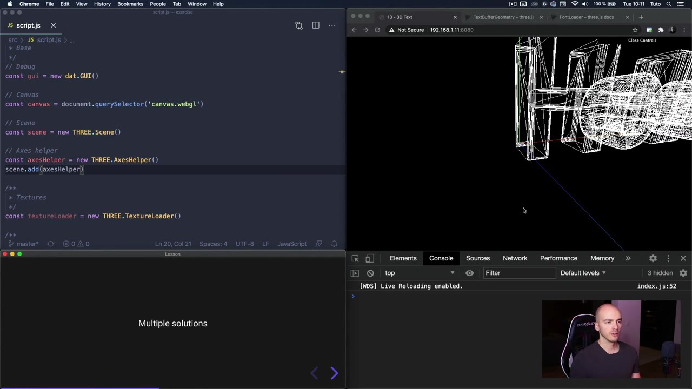
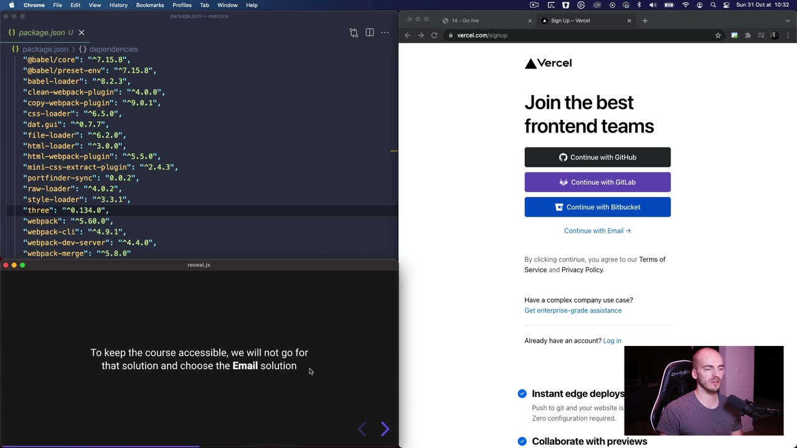

# 第 8 章 3D 文本与项目部署

本章将结合 3D 文本创建与项目部署两个核心主题。首先学习如何利用 Three.js 的 `TextGeometry` 创建动态三维文本，包括字体加载、几何体参数调整、居中处理与材质应用；接着掌握将 WebGL 体验部署上线的完整流程，涵盖传统构建与现代云端部署两种方案。通过重现 Ilithya 作品集风格的 3D 文本场景，我们不仅掌握技术实现，还将学会如何将创意成果分享至互联网。

## 3D 文本基础与字体格式

Three.js 内置了创建三维文本的能力，通过 `TextGeometry` 类可生成基于字体的立体几何体。不过，Three.js 要求字体文件必须是名为 **Typeface** 的特殊 JSON 格式，这是一种将矢量字体数据序列化的表示方法。使用任何字体前，请确保拥有相应版权许可，或仅用于个人学习目的。

获取 Typeface 格式字体主要有两种方式：

1. **字体转换工具**：使用在线转换器如 [Facetype.js](https://gero3.github.io/facetype.js/)，上传常规字体文件（.ttf、.otf 等）即可生成 Typeface 格式的 JSON 文件。
2. **使用 Three.js 示例字体**：Three.js 安装包自带几个 Typeface 字体，位于 `node_modules/three/examples/fonts/` 目录下，可直接复制使用。

在本章中，我们将采用混合方案：复制 `helvetiker_regular.typeface.json` 字体文件及其许可证文件到项目的 `/static/fonts/` 目录。

```javascript
// 字体文件位于 node_modules/three/examples/fonts/
// 复制 helvetiker_regular.typeface.json 和 LICENSE 到 /static/fonts/
```

项目中字体的访问路径为 `/fonts/helvetiker_regular.typeface.json`（基于项目的静态资源根目录）。

## 加载字体与创建几何体

加载 Typeface 字体需要使用 `FontLoader` 类，它不属于核心 `THREE` 命名空间，需要单独导入：

```javascript
import { FontLoader } from 'three/examples/jsm/loaders/FontLoader.js'
```

`FontLoader` 的使用方式与 `TextureLoader` 类似，但有一个重要区别：`FontLoader.load()` 需要回调函数处理加载成功后的逻辑，而不能像纹理那样立即使用返回值。

```javascript
/**
 * 字体加载
 */
const fontLoader = new FontLoader()

fontLoader.load(
    '/fonts/helvetiker_regular.typeface.json',
    (font) => {
        console.log('字体加载完成')
        // 在此回调内创建文本几何体
    }
)
```

文本几何体由 `TextGeometry` 类创建，同样需要从扩展模块导入：

```javascript
import { TextGeometry } from 'three/examples/jsm/geometries/TextGeometry.js'
```

创建几何体时需要提供两个主要参数：文本字符串和配置选项：

```javascript
const textGeometry = new TextGeometry(
    'Hello Three.js',
    {
        font: font,               // 已加载的字体对象
        size: 0.5,                // 字体大小
        height: 0.2,              // 挤出深度
        curveSegments: 12,        // 曲线分段数，影响圆形部分精度
        bevelEnabled: true,      // 启用斜角效果
        bevelThickness: 0.03,    // 斜角厚度
        bevelSize: 0.02,         // 斜角大小
        bevelOffset: 0,           // 斜角偏移
        bevelSegments: 5          // 斜角分段数
    }
)
```

创建几何体后，使用基础材质观察初步效果：

```javascript
const textMaterial = new THREE.MeshBasicMaterial()
const text = new THREE.Mesh(textGeometry, textMaterial)
scene.add(text)
```



*图 8-1 线框显示的三维文本几何结构，可见字母的挤出轮廓与斜角细节*

## 文本居中与边界框

默认创建的文本几何体并不居中，其原点位于第一个字母的基准线左下角。为了实现美观的旋转动画和布局，需要将几何体中心对齐到场景原点。Three.js 提供几何体边界框（Bounding Box）信息辅助完成这一操作。

边界框是 Three.js 内部用于空间计算的数据结构，有长方体（Box）和球体（Sphere）两种形式。它们主要用于 **视锥体剔除**（Frustum Culling）——判断对象是否在相机视野内从而决定是否渲染，能显著提升性能。

计算文本的边界框并利用它实现居中：

```javascript
// 计算几何体的边界框
textGeometry.computeBoundingBox()

// 手动居中逻辑（演示原理）
textGeometry.translate(
    - (textGeometry.boundingBox.max.x - 0.02) * 0.5,  // 减去斜角大小影响
    - (textGeometry.boundingBox.max.y - 0.02) * 0.5,
    - (textGeometry.boundingBox.max.z - 0.03) * 0.5   // 减去斜角厚度影响
)
```

斜角参数（`bevelSize` 和 `bevelThickness`）会影响边界框的计算结果，因此需要精确调整。实际开发中，Three.js 提供了更简便的居中方法：

```javascript
textGeometry.center()  // 自动基于边界框居中几何体
```

使用 `center()` 方法可快速完成居中，既避免了手动计算的复杂性，又保证了精度。理解边界框概念对于后续优化渲染性能有重要意义。

## 应用 Matcap 材质

基础材质适合观察几何结构，但要创建视觉效果丰富的文本，推荐使用 **Matcap 材质**（MeshMatcapMaterial）。这种材质基于法线方向采样预渲染的环境贴图，既能呈现逼真光照效果，又保持极高的渲染效率。

首先加载 Matcap 纹理。可使用项目提供的纹理（位于 `/static/textures/matcaps/`），或从 [Matcaps 仓库](https://github.com/nidorx/matcaps) 下载。注意：商业使用时需确认纹理许可。

```javascript
// 使用项目中预设的 matcap 纹理
const matcapTexture = textureLoader.load('/textures/matcaps/1.png')
matcapTexture.colorSpace = THREE.SRGBColorSpace  // 设置正确的色彩空间

// 创建 Matcap 材质
const material = new THREE.MeshMatcapMaterial({ matcap: matcapTexture })
const text = new THREE.Mesh(textGeometry, material)
```

Matcap 材质为文本提供了类似金属或塑料的表面质感，且因为使用了预计算的光照信息，渲染性能优于需要实时计算的物理材质。

## 添加环绕物体与性能优化

参考 Ilithya 作品集风格，我们在场景中添加随机分布的甜甜圈（圆环）物体，创建更丰富的视觉层次。使用 `TorusGeometry`（圆环几何体）生成甜甜圈形状：

```javascript
const donutGeometry = new THREE.TorusGeometry(0.3, 0.2, 20, 45)

for(let i = 0; i < 100; i++) {
    const donut = new THREE.Mesh(donutGeometry, material)

    // 随机位置：-5 到 5 的范围内
    donut.position.x = (Math.random() - 0.5) * 10
    donut.position.y = (Math.random() - 0.5) * 10
    donut.position.z = (Math.random() - 0.5) * 10

    // 随机旋转（半圈足够，因为甜甜圈对称）
    donut.rotation.x = Math.random() * Math.PI
    donut.rotation.y = Math.random() * Math.PI

    // 统一缩放（保持形状不变）
    const scale = Math.random()
    donut.scale.set(scale, scale, scale)

    scene.add(donut)
}
```

上述实现已经把几何体与材质放在循环外，使 100 个网格共享相同资源。若把 `new THREE.TorusGeometry(...)` 和 `new THREE.MeshMatcapMaterial(...)` 写进循环，就会反复创建等价对象，增加初始化时间、内存占用和垃圾回收压力。共享几何体与材质是必须保留的优化，具体收益应在目标设备上测量。

文本与甜甜圈也可以使用同一个 Matcap 材质实例，从而进一步减少材质数量。资源复用并不意味着这些网格失去独立变换能力：每个 `THREE.Mesh` 仍有自己的位置、旋转和缩放。

## 几何体参数优化

`TextGeometry` 的细节参数直接影响渲染性能。`curveSegments` 控制曲线部分（如字母 "O"、"S"）的分段数，`bevelSegments` 控制斜角的分段数。较高的值产生更平滑的外观，但会大幅增加三角形数量。

推荐在可视质量与性能间取得平衡：
- `curveSegments: 5`：字母圆形部分略微可见多边形，但远处视角完全可以接受
- `bevelSegments: 3`：斜角保持基本形状，细节损失不明显

通过降低这两个参数，通常可以显著减少文本的三角形数量，改善初始化与渲染开销。具体幅度取决于字体、字符和参数组合，应通过几何体属性统计与目标设备实测评估，而不是假定固定比例。



*图 8-2 注册 Vercel 并准备将三维文本项目发布到线上*

## 传统项目构建与部署

完成项目开发后，需要将其部署到互联网供他人访问。传统部署流程需要先将项目构建为浏览器可直接运行的文件。

运行构建命令：

```bash
npm run build
```

此命令执行 `package.json` 中定义的 `build` 脚本，通常使用 Webpack 或 Vite 打包工具。构建过程会：
1. 优化和压缩 JavaScript 代码
2. 处理 CSS 预处理器
3. 复制静态资源（纹理、字体等）
4. 生成最终的 HTML、CSS、JS 文件

构建输出位于 `dist/` 目录（Distribution 的缩写），包含：
- `index.html`：主页面文件
- 入口 JavaScript 文件（如 `main.[hash].js`）
- 样式文件（如 `style.[hash].css`）
- 静态资源（复制到 `dist` 中的纹理、字体等）

传统部署方式是将 `dist/` 目录内的全部文件通过 FTP 客户端上传到托管服务商（如 OVH、1&1、Gandi 等）的服务器。每次更新项目后，重新运行 `npm run build` 获取新版文件并上传。

## 现代云端部署：Vercel

传统部署需要手动管理服务器，而现代方案如 **Vercel** 提供了更便捷的持续集成/持续部署（CI/CD）流程。Vercel 专为前端项目优化，支持自动构建、预览环境和一键部署。

### 设置 Vercel

首先在 [vercel.com](https://vercel.com) 创建账户，支持 GitHub、GitLab、Bitbucket 或邮箱注册。对于本课程，建议使用邮箱注册以简化流程。

将 Vercel CLI 添加到项目依赖：

```bash
npm install vercel
```

在 `package.json` 中添加部署脚本：

```json
{
  "scripts": {
    "dev": "vite",
    "build": "vite build",
    "deploy": "vercel --prod"
  }
}
```

### 首次部署

执行部署命令：

```bash
npm run deploy
```

首次运行会引导完成配置：
1. 选择身份验证方式（选择 "Continue with Email"）
2. 输入注册邮箱，接收验证邮件并确认
3. 确认部署当前项目（输入 `Y` 并回车）
4. 选择部署范围（通常只有一个默认范围）
5. 设置项目名称（默认为文件夹名称，可自定义）
6. 确认代码目录（默认为 `./`）
7. 调整构建配置：
   - 构建命令：`npm run build`（与 Vite 默认一致）
   - 输出目录：改为 `dist`（适配 Vite 输出）

Vercel 将自动上传项目文件，在其服务器上执行构建，并生成可访问的 URL。部署完成后，终端会显示类似 `https://your-project.vercel.app` 的链接。

### Vercel 功能与限制

Vercel 免费方案（Hobby 计划）包含：
- 无限制项目数量
- 自动 HTTPS 证书
- 预览部署（测试分支变更）
- 基础分析和日志

限制包括：
- 每月带宽限制（100GB）
- 构建时间上限（100小时/月）
- 适合个人项目和小型应用

对于需要更大带宽或团队的商业项目，可升级至付费计划。Vercel 还支持自定义域名、团队协作、环境变量等进阶功能。

替代方案包括 **Netlify** 和 **GitHub Pages**，它们提供类似的服务，选择取决于个人偏好和现有工具链。

## 部署流程总结

完整部署流程如下：

1. **本地测试**：使用 `npm run dev` 确保项目正常运行
2. **构建项目**：`npm run build` 生成生产文件
3. **部署选择**：
   - 传统：将 `dist/` 内容上传至 FTP 服务器
   - 现代：执行 `npm run deploy` 使用 Vercel
4. **测试线上版本**：在浏览器访问部署 URL，确认功能正常
5. **更新部署**：修改代码后，重新执行构建和部署步骤

优化的最佳实践：
- 使用 `.env` 文件管理环境变量
- 配置适当的缓存策略减少带宽消耗
- 启用压缩（如 Brotli 或 Gzip）
- 使用 CDN 分发静态资源

## 本章小结

本章集成了三维文本创作与项目部署两大核心技能，完成了从创意实现到成果分享的完整闭环。

**技术要点与实现**：
- **3D 文本构建**：使用 `TextGeometry` 创建三维文字，通过 `FontLoader` 加载 Typeface 格式字体，调整大小、深度、斜角等参数控制视觉效果
- **布局与对齐**：利用几何体边界框实现精确居中，理解视锥体剔除的空间优化原理
- **材质与视觉效果**：应用 Matcap 材质获得高效逼真的表面质感，复用资源优化渲染性能
- **场景丰富性**：通过复用几何体和材质批量生成随机分布的环绕物体，创建引人注目的视觉层次

**工程实践与部署**：
- **构建流程**：理解 `npm run build` 如何将开发环境项目转化为生产就绪的静态文件
- **部署方案对比**：传统 FTP 上传与现代云平台（Vercel）部署的优缺点分析
- **持续集成理念**：掌握由代码变更触发构建和部署的现代开发工作流
- **性能考量**：从几何体优化、资源复用到带宽管理，建立全方位的性能意识

**关键收获**：
1. **技术与创意结合**：文本创建不仅是技术实现，更是艺术表达的手段，参数调整直接影响视觉风格
2. **性能优化贯穿始终**：从几何体参数到资源复用，再到部署带宽管理，性能是 WebGL 体验的核心指标
3. **完整产品思维**：从本地开发到线上发布，了解作品从概念到可分享产品的完整生命周期
4. **工具链整合**：现代前端开发不仅关注实现本身，更要掌握构建、测试、部署等配套工具的应用

通过本章学习，我们掌握了创建专业级三维文本场景的全流程，并能够将创作成果有效分享。这为后续更复杂的项目奠定了基础——无论是交互式作品集、数据可视化还是创意表达，都将运用本章的核心概念。