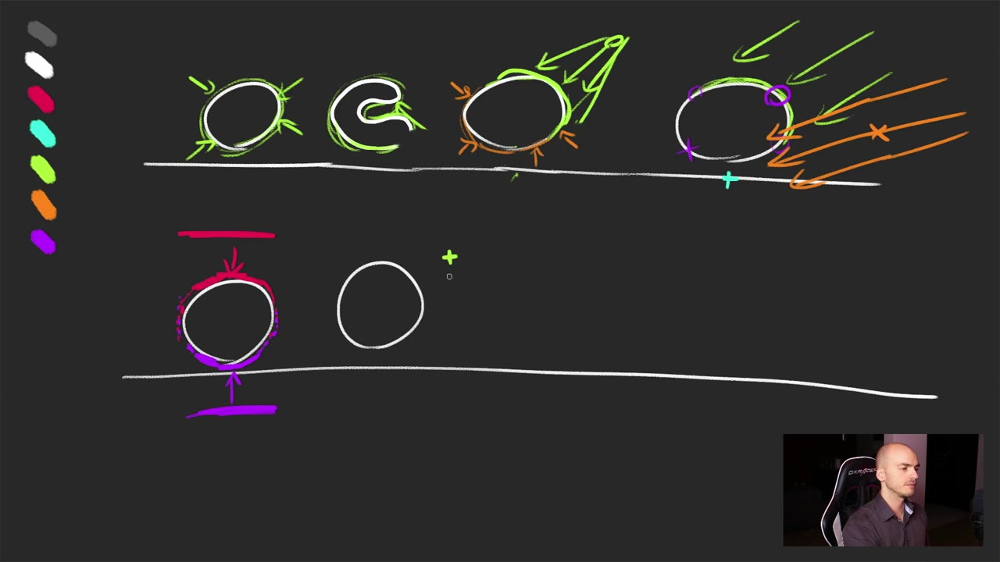
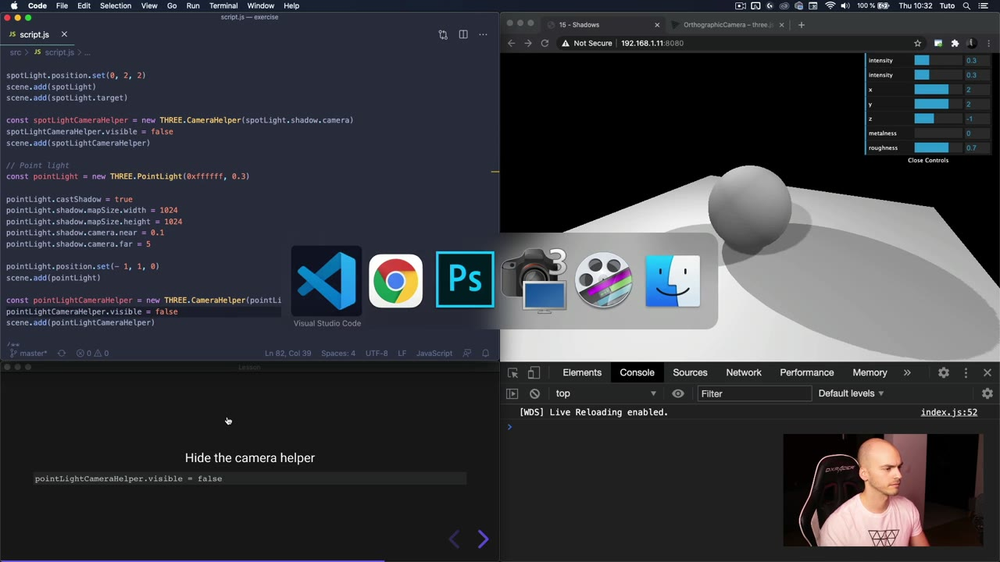

# 第 9 章 灯光与阴影

高质量的灯光与阴影是实现沉浸式三维体验的关键要素。在Three.js中，灯光不仅决定场景的明暗分布，还直接影响材质的表现效果；阴影则为对象之间的空间关系提供视觉线索。本章将系统介绍Three.js支持的各种光源类型、创建与参数调整，并深入解析阴影贴图的工作原理与性能优化技巧，帮助开发者在视觉质量与运行效率之间找到平衡。

## Three.js光源的类型与应用场景

Three.js提供了六种内置光源，每一种都有特定的用途和性能特性。合理选择光源类型是创建逼真场景的第一步。

### 环境光（AmbientLight）

环境光为场景提供均匀、无方向的基础照明，用于近似环境反射带来的整体亮度。它不依据表面与某个光源的相对位置形成明暗变化，也不产生阴影。

```javascript
// 创建环境光：参数为颜色和强度
const ambientLight = new THREE.AmbientLight(0xffffff, 0.6)
scene.add(ambientLight)

// 等价于分步设置
const anotherAmbientLight = new THREE.AmbientLight()
anotherAmbientLight.color = new THREE.Color(0xffffff)
anotherAmbientLight.intensity = 0.6
scene.add(anotherAmbientLight)
```

环境光的亮度过高会使场景失去立体感，通常建议使用较低的强度值（0.1-0.3）来模拟光线的二次反射效果。

### 半球光（HemisphereLight）

半球光模拟天空与地面的自然光照差异，为面向不同方向的表面提供不同颜色的照明。这种光源特别适合户外场景。

```javascript
// 参数：天空颜色、地面颜色、强度
const hemisphereLight = new THREE.HemisphereLight(0x87ceeb, 0x228b22, 0.8)
scene.add(hemisphereLight)
```

天空色（如浅蓝色）照亮相上表面，地面色（如草绿色）照亮相下表面，这种差异化的照明方式显著增强了场景的立体感。

### 定向光（DirectionalLight）

定向光模拟远距离平行光源，如太阳光。`position` 与 `target` 共同决定照射方向，光照强度不会因为光源在数值上放得更远而衰减。

```javascript
const directionalLight = new THREE.DirectionalLight(0xffffff, 1.2)
directionalLight.position.set(2, 3, 1)  // 设定光源方向
scene.add(directionalLight)
```

定向光特别适合模拟室外日照，或其他需要一致照射方向的场景。

### 点光源（PointLight）

点光源从一个特定位置向所有方向均匀放射光线，模拟如灯泡、蜡烛等真实光源。其光照强度会随距离衰减。

```javascript
const pointLight = new THREE.PointLight(0xff9000, 1.5, 10, 2)
pointLight.position.set(1, -0.5, 1)
scene.add(pointLight)
```

参数详解：
- 第三个参数`distance`：光线完全衰减的距离
- 第四个参数`decay`：衰减速率，通常设置为`2`以符合物理真实世界的光线衰减

```javascript
// 自定义衰减参数
pointLight.distance = 15      // 15单位距离后完全衰减
pointLight.decay = 1.5        // 衰减系数
```

### 聚光灯（SpotLight）

聚光灯产生锥形光束，类似于手电筒或舞台追光灯。其参数配置最为复杂，但能创建最精确的照明区域。

```javascript
const spotLight = new THREE.SpotLight(
  0x78ff00,    // 颜色
  4.5,         // 强度
  10,          // 距离
  Math.PI * 0.1, // 锥角
  0.25,        // 边缘柔和度
  1            // 衰减率
)
spotLight.position.set(0, 2, 3)
scene.add(spotLight)
```

聚光灯需要配置目标对象来确定照射方向：
```javascript
// 创建目标对象
spotLight.target.position.set(-0.75, 0, 0)
scene.add(spotLight.target)  // 必须添加到场景中
```

关键参数说明：
- `angle`：光束锥体的半角（弧度）
- `penumbra`：边缘模糊程度（0-1），0表示清晰边缘，1表示高度模糊

### 矩形区域光（RectAreaLight）

矩形区域光模拟如柔光箱、灯箱等大面积光源，产生柔和均匀的照明效果。

```javascript
const rectAreaLight = new THREE.RectAreaLight(0x4e00ff, 6, 1, 1)
rectAreaLight.position.set(-1.5, 0, 1.5)
rectAreaLight.lookAt(new THREE.Vector3(0, 0, 0))  // 看向场景中心
scene.add(rectAreaLight)
```

注意：矩形区域光仅支持`MeshStandardMaterial`和`MeshPhysicalMaterial`两种材质，并且不参与 Three.js 的阴影贴图计算。

#### 光源辅助工具

调试光源位置时，可以使用对应的辅助工具直观显示光源属性：
```javascript
// 辅助工具的导入和使用
import { RectAreaLightHelper } from 'three/examples/jsm/helpers/RectAreaLightHelper.js'

const directionalLightHelper = new THREE.DirectionalLightHelper(directionalLight, 0.2)
const pointLightHelper = new THREE.PointLightHelper(pointLight, 0.2)
const spotLightHelper = new THREE.SpotLightHelper(spotLight)
const rectAreaLightHelper = new RectAreaLightHelper(rectAreaLight)

scene.add(directionalLightHelper)
scene.add(pointLightHelper)
scene.add(spotLightHelper)
scene.add(rectAreaLightHelper)
```



*图 9-1 Three.js中的六种灯光类型（AmbientLight、HemisphereLight、DirectionalLight、PointLight、SpotLight、RectAreaLight）及其对应的辅助工具*

## 光源性能分析与选择策略

不同类型的光源在渲染时有显著的性能差异，了解这些差异有助于创建高效的三维场景。

### 性能成本分级

1. **低性能成本光源**
   - `AmbientLight`（环境光）：最简单的光源，所有表面均匀照明
   - `HemisphereLight`（半球光）：基于表面朝向的简单计算

2. **中等性能成本光源**
   - `DirectionalLight`（定向光）：需要计算每个面的朝向关系
   - `PointLight`（点光源）：涉及距离衰减和方向计算

3. **高性能成本光源**
   - `SpotLight`（聚光灯）：复杂的锥形区域计算，涉及距离衰减和边缘柔化
   - `RectAreaLight`（矩形区域光）：大面积光源照射计算

### 光源选用原则

- **视觉目标优先**：在满足照明设计的前提下减少不必要的灯光，而不是为了降低计算量随意替换光源类型
- **按需计算阴影**：光源本身有成本，启用阴影还会增加额外的渲染工作
- **烘焙照明技术**：对于静态场景，可预先将光照效果烘焙到纹理中，减少运行时计算开销

```javascript
// 烘焙照明的优势说明
// 下方是一段概念性代码，展示烘焙照明的主要思路
const bakedTexture = textureLoader.load('/textures/baked-lightmap.jpg')
const bakedMaterial = new THREE.MeshBasicMaterial({ map: bakedTexture })
```

烘焙照明虽然无法实现动态光照效果，但在要求极致性能的场景下（如移动端、复杂场景）是理想选择。

## 阴影贴图原理与启用流程

在实时三维渲染中，阴影的实现基于阴影贴图技术。Three.js的内置阴影系统虽然存在局限性，但提供了便捷的API接口。

### 阴影贴图工作原理

Three.js的阴影生成分为两个阶段：

1. **阴影贴图渲染阶段**：针对每个支持阴影的光源，Three.js会从光源视角渲染场景，使用特殊的`MeshDepthMaterial`记录深度信息，生成阴影贴图。

2. **主渲染阶段**：在渲染每个接收阴影的材质时，系统将对应的阴影贴图投影到几何体表面，计算阴影区域。

这个过程会显著增加渲染负担，因为每个阴影光源都需要额外渲染一次场景。

### 启用阴影的基本配置

启用阴影需要在渲染器、几何体和光源三个层面进行配置：

```javascript
// 1. 启用渲染器的阴影贴图功能
renderer.shadowMap.enabled = true

// 2. 配置支持阴影贴图的光源
const directionalLight = new THREE.DirectionalLight(0xffffff, 1.5)
directionalLight.position.set(2, 3, 1)
directionalLight.castShadow = true  // 允许该光源产生阴影
scene.add(directionalLight)

// 3. 设置几何体的阴影属性
const sphere = new THREE.Mesh(
  new THREE.SphereGeometry(0.5, 32, 32),
  new THREE.MeshStandardMaterial({ color: 0xff0000 })
)
sphere.castShadow = true  // 该物体可以投射阴影
scene.add(sphere)

const plane = new THREE.Mesh(
  new THREE.PlaneGeometry(5, 5),
  new THREE.MeshStandardMaterial({ color: 0xcccccc })
)
plane.receiveShadow = true  // 该物体可以接收阴影
plane.rotation.x = -Math.PI / 2
plane.position.y = -0.5
scene.add(plane)
```

重要注意事项：
- 只有`DirectionalLight`、`PointLight`和`SpotLight`支持阴影投射
- 每个对象都需要显式设置`castShadow`和`receiveShadow`属性
- 应尽量减少阴影投射和接收对象的数量，以优化性能

## 阴影质量优化与控制参数

默认阴影设置通常质量较低，需要进行多方面的调整以达到理想的视觉效果。

### 阴影贴图分辨率

阴影贴图的分辨率直接影响阴影边缘的清晰度：

```javascript
// 提高阴影贴图分辨率
directionalLight.shadow.mapSize.width = 1024
directionalLight.shadow.mapSize.height = 1024

// 贴图尺寸必须是2的幂次方，以提高mipmap效率
const validSizes = [256, 512, 1024, 2048, 4096]  // 建议尺寸
```

### 阴影相机参数配置

每个支持阴影的光源内部都有一个用于渲染阴影贴图的相机。调整这些相机的参数可以优化阴影质量。

#### 定向光的正交相机配置

定向光使用`OrthographicCamera`渲染阴影贴图：

```javascript
// 配置定向光的阴影相机
directionalLight.shadow.camera.near = 0.5
directionalLight.shadow.camera.far = 10
directionalLight.shadow.camera.top = 3
directionalLight.shadow.camera.right = 3
directionalLight.shadow.camera.bottom = -3
directionalLight.shadow.camera.left = -3
```

缩小相机的可见范围可以提高阴影的精度，但要注意避免过度裁剪。

#### 聚光灯和点光源的透视相机配置

聚光灯和点光源使用`PerspectiveCamera`渲染阴影贴图：

```javascript
// 配置聚光灯的阴影相机
spotLight.shadow.camera.near = 1
spotLight.shadow.camera.far = 8

// 配置点光源的阴影相机（注意：点光源需要渲染6个方向）
pointLight.shadow.camera.near = 0.1
pointLight.shadow.camera.far = 18
```

#### 相机辅助工具

使用相机辅助工具可视化阴影相机的范围：

```javascript
const directionalLightCameraHelper = new THREE.CameraHelper(directionalLight.shadow.camera)
scene.add(directionalLightCameraHelper)

// 调试完成后隐藏辅助工具
directionalLightCameraHelper.visible = false
```

### 阴影边缘模糊控制

Three.js提供了两种方式控制阴影边缘的柔和度：

```javascript
// 方法1：radius属性（不适用于PCFSoftShadowMap）
directionalLight.shadow.radius = 5

// 方法2：切换阴影贴图算法
renderer.shadowMap.type = THREE.PCFSoftShadowMap
```

### 阴影算法对比

Three.js支持多种阴影贴图算法：

```javascript
// 不同算法的性能与质量对比
const shadowAlgorithms = {
  // 性能最高，质量最差，有明显锯齿
  BASIC: THREE.BasicShadowMap,

  // 平衡选择，边缘较为平滑
  PCF: THREE.PCFShadowMap,

  // 质量较高，边缘更柔和
  PCF_SOFT: THREE.PCFSoftShadowMap,

  // 算法复杂，可能产生意外结果
  VSM: THREE.VSMShadowMap
}

// 推荐设置
renderer.shadowMap.type = THREE.PCFSoftShadowMap
```



*图 9-2 阴影质量优化对比：从基础的锐利阴影到柔和的模糊阴影，展示不同参数配置的效果*

## 多光源阴影管理与性能考量

当场景中有多个光源时，阴影管理变得更加复杂。

### 多光源阴影的组合问题

多个光源的阴影不会自动融合，而是各自独立计算：

```javascript
// 多个光源的阴影配置可能导致重叠问题
const directionalLight = new THREE.DirectionalLight(0xffffff, 1.3)
directionalLight.castShadow = true
scene.add(directionalLight)

const spotLight = new THREE.SpotLight(0xffffff, 2.4, 10, Math.PI * 0.3)
spotLight.castShadow = true
spotLight.position.set(0, 2, 2)
scene.add(spotLight)
scene.add(spotLight.target)
```

结果可能显示多个独立的阴影区域，而物理世界中的阴影会相互叠加融合。Three.js没有内置的阴影融合机制。

### 性能优化策略

- **按需启用阴影**：只让关键光源投射阴影，只让确实需要的对象参与 `castShadow` 或 `receiveShadow`。
- **控制阴影贴图尺寸**：较小的贴图降低成本但更容易产生锯齿，较大的贴图提高精度却增加显存和渲染开销。
- **限制阴影相机范围**：让近、远裁剪面与视锥覆盖有效场景，避免把精度浪费在不可见区域。
- **避免频繁重建**：运行时反复修改 `mapSize` 可能触发渲染目标重建。确需修改时，应结合当前 Three.js 版本处理旧 `shadow.map` 的释放与更新，而不是在每帧无意义地切换分辨率。

## 光照材质选择与兼容性

不是所有材质都能与各种光源配合工作，了解材质与光源的兼容性关系至关重要。

### 光源支持矩阵

| 光源类型 | 支持的基础材质 | 性能影响 |
|---------|--------------|---------|
| AmbientLight | 所有材质 | 最低 |
| HemisphereLight | 所有材质 | 低 |
| DirectionalLight | Lambert, Phong, Standard, Physical, Toon | 中 |
| PointLight | Lambert, Phong, Standard, Physical, Toon | 中 |
| SpotLight | Lambert, Phong, Standard, Physical, Toon | 高 |
| RectAreaLight | Standard, Physical | 高 |

### 材质的光照响应

```javascript
// 不同材质对光照的响应程度
const materials = {
  basic: new THREE.MeshBasicMaterial({ color: 0xff0000 }),     // 无视光照
  lambert: new THREE.MeshLambertMaterial({ color: 0xff0000 }), // 漫反射
  phong: new THREE.MeshPhongMaterial({ color: 0xff0000 }),      // 镜面高光
  standard: new THREE.MeshStandardMaterial({ color: 0xff0000 }), // PBR材质
  physical: new THREE.MeshPhysicalMaterial({ color: 0xff0000 }), // 高级PBR
  toon: new THREE.MeshToonMaterial({ color: 0xff0000 })        // 卡通风格
}
```

对于需要高质量视觉效果的场景，推荐使用`MeshStandardMaterial`或`MeshPhysicalMaterial`，它们提供基于物理的渲染效果，与各种光源的配合最为自然。

## 实践：创建动态灯光与阴影场景

本节将整合所有知识点，创建一个包含多种光源和可调阴影参数的完整示例。

### 场景初始化

```javascript
// 场景基础设置
const scene = new THREE.Scene()
const camera = new THREE.PerspectiveCamera(75, window.innerWidth / window.innerHeight, 0.1, 100)
const renderer = new THREE.WebGLRenderer({ antialias: true })

renderer.setSize(window.innerWidth, window.innerHeight)
renderer.setPixelRatio(Math.min(window.devicePixelRatio, 2))
renderer.shadowMap.enabled = true
renderer.shadowMap.type = THREE.PCFSoftShadowMap

document.body.appendChild(renderer.domElement)
camera.position.set(0, 2, 5)

// 轨道控制器
import { OrbitControls } from 'three/examples/jsm/controls/OrbitControls.js'
const controls = new OrbitControls(camera, renderer.domElement)
controls.enableDamping = true
```

### 添加几何体

```javascript
// 创建测试几何体
const geometries = {
  sphere: new THREE.SphereGeometry(0.5, 32, 32),
  cube: new THREE.BoxGeometry(1, 1, 1),
  torus: new THREE.TorusGeometry(0.7, 0.2, 16, 100),
  plane: new THREE.PlaneGeometry(10, 10)
}

// 使用标准材质以支持所有光源
const material = new THREE.MeshStandardMaterial({
  color: 0xffffff,
  roughness: 0.4,        // 适当的光泽度以显示反射
  metalness: 0.1         // 轻微的金属感
})

// 创建网格对象
const objects = {
  sphere: new THREE.Mesh(geometries.sphere, material),
  cube: new THREE.Mesh(geometries.cube, material),
  torus: new THREE.Mesh(geometries.torus, material),
  plane: new THREE.Mesh(geometries.plane, material)
}

// 设置位置和阴影属性
objects.sphere.position.set(-1.5, 0, 0)
objects.sphere.castShadow = true

objects.cube.position.set(0, 0, 0)
objects.cube.castShadow = true

objects.torus.position.set(1.5, 0, 0)
objects.torus.castShadow = true

objects.plane.rotation.x = -Math.PI / 2
objects.plane.position.y = -1
objects.plane.receiveShadow = true

// 添加到场景
Object.values(objects).forEach(obj => scene.add(obj))
```

### 配置多光源系统

```javascript
// 1. 环境光 - 基础照明
const ambientLight = new THREE.AmbientLight(0xffffff, 0.2)
scene.add(ambientLight)

// 2. 定向光 - 主光源，投射阴影
const directionalLight = new THREE.DirectionalLight(0xffffff, 1.2)
directionalLight.position.set(3, 4, 2)
directionalLight.castShadow = true

// 阴影优化配置
directionalLight.shadow.mapSize.width = 1024
directionalLight.shadow.mapSize.height = 1024
directionalLight.shadow.camera.near = 0.5
directionalLight.shadow.camera.far = 12
directionalLight.shadow.camera.top = 5
directionalLight.shadow.camera.right = 5
directionalLight.shadow.camera.bottom = -5
directionalLight.shadow.camera.left = -5

scene.add(directionalLight)

// 3. 点光源 - 局部强调
const pointLight = new THREE.PointLight(0xff9000, 1.5, 15, 2)
pointLight.position.set(-2, 1, 1)
pointLight.castShadow = true
pointLight.shadow.mapSize.width = 512
pointLight.shadow.mapSize.height = 512
scene.add(pointLight)

// 4. 聚光灯 - 重点照明
const spotLight = new THREE.SpotLight(0x78ff00, 2, 15, Math.PI * 0.15, 0.3, 1)
spotLight.position.set(2, 3, -1)
spotLight.target.position.set(0, 0, 0)
spotLight.castShadow = true
spotLight.shadow.mapSize.width = 512
spotLight.shadow.mapSize.height = 512
scene.add(spotLight)
scene.add(spotLight.target)
```

### 添加调试界面

```javascript
// 使用dat.GUI创建控制面板
import GUI from 'lil-gui'
const gui = new GUI()

// 环境光控制
const ambientFolder = gui.addFolder('Ambient Light')
ambientFolder.add(ambientLight, 'intensity').min(0).max(2).step(0.01)
ambientFolder.addColor(ambientLight, 'color')

// 定向光控制
const directionalFolder = gui.addFolder('Directional Light')
directionalFolder.add(directionalLight, 'intensity').min(0).max(3).step(0.01)
directionalFolder.addColor(directionalLight, 'color')
directionalFolder.add(directionalLight.position, 'x').min(-5).max(5).step(0.1)
directionalFolder.add(directionalLight.position, 'y').min(-5).max(5).step(0.1)
directionalFolder.add(directionalLight.position, 'z').min(-5).max(5).step(0.1)

// 阴影质量控制
const shadowFolder = gui.addFolder('Shadow Settings')
shadowFolder.add(directionalLight.shadow, 'radius').min(1).max(20).step(1)
shadowFolder.add(directionalLight.shadow.mapSize, 'width', [256, 512, 1024, 2048])
shadowFolder.add(directionalLight.shadow.mapSize, 'height', [256, 512, 1024, 2048])

// 材质属性控制
const materialFolder = gui.addFolder('Material')
materialFolder.add(material, 'roughness').min(0).max(1).step(0.01)
materialFolder.add(material, 'metalness').min(0).max(1).step(0.01)
```

### 动画循环与交互

```javascript
// 动画函数
const clock = new THREE.Clock()

function animate() {
  const elapsedTime = clock.getElapsedTime()

  // 旋转几何体以展示动态阴影
  objects.sphere.rotation.y = elapsedTime * 0.5
  objects.cube.rotation.y = elapsedTime * 0.5
  objects.torus.rotation.y = elapsedTime * 0.5

  // 点光源轻微移动
  pointLight.position.x = Math.sin(elapsedTime * 0.5) * 2

  // 更新控制器
  controls.update()

  // 渲染场景
  renderer.render(scene, camera)

  // 继续动画循环
  requestAnimationFrame(animate)
}

// 启动动画
animate()

// 窗口大小调整处理
window.addEventListener('resize', () => {
  camera.aspect = window.innerWidth / window.innerHeight
  camera.updateProjectionMatrix()
  renderer.setSize(window.innerWidth, window.innerHeight)
})
```

## 本章小结

灯光与阴影是Three.js场景中实现真实感与沉浸体验的核心要素。通过本章的系统学习，我们掌握了以下关键知识：

### 光源类型与特性
- **环境光与半球光**：提供基础均匀照明，性能成本最低，适合模拟环境光反射
- **定向光**：模拟远距离平行光源，适合室外日光效果
- **点光源**：点状全向光源，适合模拟灯泡等局部照明
- **聚光灯**：锥形光束光源，提供精确的区域照明
- **矩形区域光**：大面积柔和光源，仅支持PBR材质，视觉效果最自然

### 阴影系统原理与优化
1. **阴影贴图机制**：Three.js通过从光源视角渲染场景生成阴影贴图，再投射到接收阴影的表面上
2. **性能平衡技巧**：
   - 选择合适的阴影贴图分辨率（256-4096，2的幂次方）
   - 合理配置阴影相机范围，避免过度渲染
   - 使用PCFSoftShadowMap算法获得柔和的阴影边缘
3. **多光源阴影管理**：注意多个光源的阴影不会自动融合，需要手动调整强度与范围

### 材质与光源的配合关系
- `MeshStandardMaterial`和`MeshPhysicalMaterial`支持所有类型的光源，提供基于物理的渲染效果
- `RectAreaLight`仅支持上述两种PBR材质
- 材质的光泽度（roughness）与金属感（metalness）会显著影响光照效果

### 性能优化建议
1. **光源最少化**：仅添加必要的灯光，优先使用性能成本低的光源类型
2. **阴影按需启用**：仅为关键光源和对象启用阴影
3. **参数分级配置**：根据对象与相机的距离动态调整阴影质量
4. **烘焙照明考虑**：对于静态场景，烘焙照明可以提供最佳性能

灯光与阴影的配置需在视觉质量与运行性能之间找到平衡点。通过本章的实践案例，我们不仅掌握了各类光源的创建与调整方法，更理解了如何根据场景需求制定合理的照明方案，为后续创建高品质的三维应用奠定坚实基础。在实际项目中，建议先使用简单光源构建基础照明，再逐步添加复杂光源与阴影效果，通过性能分析工具持续优化，最终达到视觉与性能的双重目标。