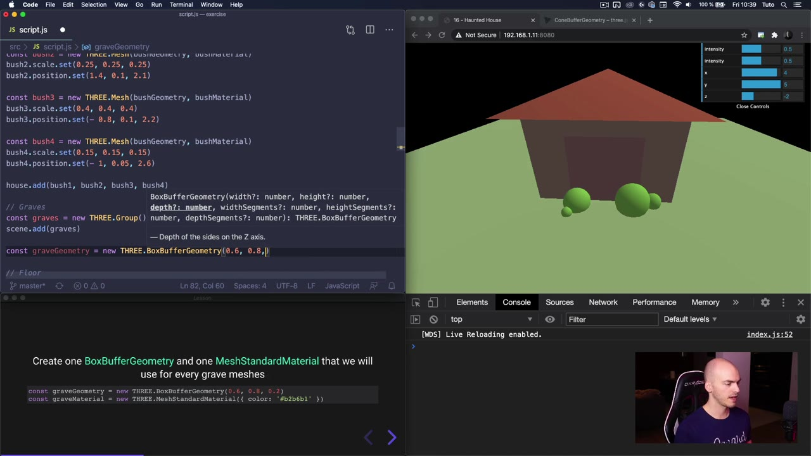
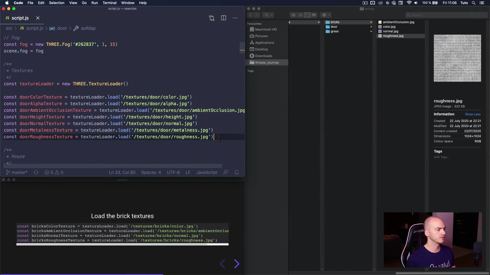

# 第 10 章 鬼屋场景

本章将综合运用之前学习的灯光、阴影、材质和几何体知识，构建一个完整的鬼屋场景。我们将使用 Three.js 基元创建房屋、地面、门、灌木等元素，并添加飘浮的幽灵灯光、雾气效果和动态阴影，形成一个气氛阴森而富有技术挑战的场景示例。

## 场景规划与单位制约定

在开始搭建场景之前，我们需要明确一个重要的概念：Three.js 中的单位制。Three.js 本身没有强制规定的单位系统，一个单位可以代表任意长度。这意味着我们需要自己建立一套单位标准。

对于鬼屋这种室内外场景，最好的做法是**将 1 个单位视为 1 米**。这样，门的尺寸大约为 2.2 米，墙壁高度大约为 2.5 米，房子占地面积大约为 4×4 米。确立这个比例后，我们可以依据现实中的尺寸来设计几何体。



*图 10-1 课程中搭建的鬼屋主体与地面场景*

开始前，项目已经包含以下基础结构：
- 一个平面作为地面
- 一个球体（随后会移除）
- 环境光和定向光（强度过高，需要调整）
- 尚未启用的阴影系统

## 创建房屋结构

### 房屋容器与分组策略

为了使后续的移动、缩放等变换更加方便，我们首先创建一个 `Group` 作为房屋的容器：

```javascript
// 房屋容器
const house = new THREE.Group()
scene.add(house)
```

使用组（Group）可以显著简化场景管理。当我们需要整体移动房屋时，只需操作 `house` 对象，其所有子元素都会自动跟随。

### 墙壁搭建

墙壁使用一个简单的 `BoxGeometry` 实现：

```javascript
// 墙壁
const walls = new THREE.Mesh(
    new THREE.BoxGeometry(4, 2.5, 4),
    new THREE.MeshStandardMaterial({ color: '#ac8e82' })
)
walls.position.y = 1.25
house.add(walls)
```

这里有几个关键点：
- `BoxGeometry` 参数按顺序为宽、高、深，单位对应的是米
- `position.y = 1.25` 将墙壁向上移动一半高度（2.5/2），避免墙壁一半陷入地面
- `#ac8e82` 是砖墙的临时颜色，后续会被纹理替换

### 屋顶制作

Three.js 没有内置的金字塔几何体，但我们可以通过修改圆锥体的参数来实现。将 `ConeGeometry` 的侧面数设为 4，就得到了一个四棱锥：

```javascript
// 屋顶
const roof = new THREE.Mesh(
    new THREE.ConeGeometry(3.5, 1, 4),
    new THREE.MeshStandardMaterial({ color: '#b35f45' })
)
roof.rotation.y = Math.PI * 0.25
roof.position.y = 2.5 + 0.5
house.add(roof)
```

位置计算逻辑：
- `2.5` 是墙壁的高度
- `0.5` 是圆锥体高度的一半（1/2）
- `Math.PI * 0.25` 旋转 45°，调整四棱锥底面的方向，使屋顶边线与房屋墙壁对齐

### 添加门和灌木

门的初始实现使用平面几何体：

```javascript
// 门
const door = new THREE.Mesh(
    new THREE.PlaneGeometry(2, 2),
    new THREE.MeshStandardMaterial({ color: '#aa7b7b' })
)
door.position.y = 1
door.position.z = 2 + 0.01
house.add(door)
```

这里的 `+ 0.01` 非常重要。当两个面位于几乎相同的位置时，GPU 会产生深度冲突（z-fighting），导致像素闪烁。这个微小的偏移能够避免这个问题。

灌木采用共享几何体和材质的优化方式：

```javascript
// 灌木
const bushGeometry = new THREE.SphereGeometry(1, 16, 16)
const bushMaterial = new THREE.MeshStandardMaterial({ color: '#89c854' })

const bush1 = new THREE.Mesh(bushGeometry, bushMaterial)
bush1.scale.set(0.5, 0.5, 0.5)
bush1.position.set(0.8, 0.2, 2.2)

const bush2 = new THREE.Mesh(bushGeometry, bushMaterial)
bush2.scale.set(0.25, 0.25, 0.25)
bush2.position.set(1.4, 0.1, 2.1)

// bush3、bush4 可按同样方式创建
house.add(bush1, bush2)
```

通过共享 `Geometry` 和 `Material`，可以避免为每个灌木重复保存和初始化相同资源。每个网格仍有独立的变换，但这些共享操作本身并不会把多个网格合并成一次绘制调用；若对象数量成为瓶颈，还需进一步考虑实例化等技术。

## 墓地生成与程序化布局

### 墓地容器

为了实现更好的场景管理，我们将所有墓碑放在一个单独的容器中：

```javascript
// 墓地
const graves = new THREE.Group()
scene.add(graves)
```

### 墓碑几何体与材质

同样使用共享的方式创建墓碑：

```javascript
const graveGeometry = new THREE.BoxGeometry(0.6, 0.8, 0.2)
const graveMaterial = new THREE.MeshStandardMaterial({ color: '#b2b6b1' })
```

### 程序化排列

通过数学计算在圆形区域内随机放置墓碑：

```javascript
for(let i = 0; i < 50; i++) {
    const angle = Math.random() * Math.PI * 2  // 随机角度
    const radius = 3 + Math.random() * 6      // 随机半径
    const x = Math.cos(angle) * radius        // 使用余弦计算 x
    const z = Math.sin(angle) * radius        // 使用正弦计算 z

    // 创建墓碑
    const grave = new THREE.Mesh(graveGeometry, graveMaterial)

    // 位置
    grave.position.set(x, 0.3, z)

    // 随机旋转增加自然感
    grave.rotation.z = (Math.random() - 0.5) * 0.4
    grave.rotation.y = (Math.random() - 0.5) * 0.4

    // 添加到墓地容器
    graves.add(grave)
}
```

这里的三角函数应用很巧妙：`Math.cos(angle)` 和 `Math.sin(angle)` 基于角度将坐标映射到圆形上。通过添加随机半径，我们获得了自然的散布效果。



*图 10-2 房屋结构与墓碑分布*

## 灯光布置与氛围营造

### 调整环境光

鬼屋需要阴森的氛围，因此需要调暗现有灯光并调整色温：

```javascript
const ambientLight = new THREE.AmbientLight('#b9d5ff', 0.12)
```

环境光为整个场景提供基础照明，但强度过高会破坏神秘感。蓝色调（`#b9d5ff`）能营造月光效果，0.12 的强度足够识别物体轮廓但不会破坏氛围。

### 调整月光（定向光）

```javascript
const moonLight = new THREE.DirectionalLight('#b9d5ff', 0.26)
moonLight.position.set(4, 5, -2)
```

定向光模拟月光，方向为 (4, 5, -2)，与主视角构成一定的角度，能产生戏剧性的阴影效果。

### 门灯

为了实现温馨与阴森的对比，我们在门前添加一个暖色调的点光源：

```javascript
// 门灯
const doorLight = new THREE.PointLight('#ff7d46', 3, 7)
doorLight.position.set(0, 2.2, 2.7)
house.add(doorLight)
```

点光参数：
- `'#ff7d46'` 温暖的橙红色，与蓝色环境光形成对比
- `3` 强度适中，能产生明显的照明但不会过亮
- `7` 衰减距离，超过此距离光照基本无效果

将点光源添加到 `house` 组中，意味着它会随着房屋移动，保持正确的相对位置。

## 雾气效果与场景融合

### 启用 Three.js 雾

雾是营造恐怖氛围的关键元素：

```javascript
// 雾
const fog = new THREE.Fog('#262837', 1, 15)
scene.fog = fog
```

雾的三个参数：
- `'#262837'` 深蓝色的雾，与场景色调统一
- `1` 近平面，摄像机 1 单位以内无雾
- `15` 远平面，摄像机 15 单位处雾完全遮蔽

### 消除背景边界线

启用雾后，近处的墓碑会逐渐融入雾中，但远处的背景与雾之间存在明显的分界线。解决方案是设置渲染器的清除颜色：

```javascript
renderer.setClearColor('#262837')
```

将背景色设为与雾相同的颜色，场景中的物体在远处会自然地融入背景，消除了视觉上的不连贯。

## 纹理应用与视觉真实感

### 纹理加载器的准备

```javascript
const textureLoader = new THREE.TextureLoader()
```

### 门的复杂纹理

门使用了完整的 PBR 纹理集：

```javascript
const doorColorTexture = textureLoader.load('/textures/door/color.jpg')
doorColorTexture.colorSpace = THREE.SRGBColorSpace

const doorAlphaTexture = textureLoader.load('/textures/door/alpha.jpg')
const doorAmbientOcclusionTexture = textureLoader.load('/textures/door/ambientOcclusion.jpg')
const doorHeightTexture = textureLoader.load('/textures/door/height.jpg')
const doorNormalTexture = textureLoader.load('/textures/door/normal.jpg')
const doorMetalnessTexture = textureLoader.load('/textures/door/metalness.jpg')
const doorRoughnessTexture = textureLoader.load('/textures/door/roughness.jpg')
```

应用这些纹理时，需要为置换贴图提供足够的细分：

```javascript
const door = new THREE.Mesh(
    new THREE.PlaneGeometry(2.2, 2.2, 100, 100),
    new THREE.MeshStandardMaterial({
        map: doorColorTexture,
        transparent: true,
        alphaMap: doorAlphaTexture,
        aoMap: doorAmbientOcclusionTexture,
        displacementMap: doorHeightTexture,
        displacementScale: 0.1,
        normalMap: doorNormalTexture,
        metalnessMap: doorMetalnessTexture,
        roughnessMap: doorRoughnessTexture
    })
)
```

材质参数说明：
- `displacementScale: 0.1` 控制置换效果的强度
- `100, 100` 细分数量，为置换贴图提供足够的顶点
- `transparent: true` 启用透明度，配合 `alphaMap` 创建门上的窗户

### 砖墙纹理

```javascript
const bricksColorTexture = textureLoader.load('/textures/bricks/color.jpg')
bricksColorTexture.colorSpace = THREE.SRGBColorSpace

const walls = new THREE.Mesh(
    new THREE.BoxGeometry(4, 2.5, 4),
    new THREE.MeshStandardMaterial({
        map: bricksColorTexture,
        aoMap: bricksAmbientOcclusionTexture,
        normalMap: bricksNormalTexture,
        roughnessMap: bricksRoughnessTexture
    })
)
```

### 草地纹理与重复

地板的草地纹理需要进行平铺重复：

```javascript
const grassColorTexture = textureLoader.load('/textures/grass/color.jpg')
grassColorTexture.colorSpace = THREE.SRGBColorSpace
grassColorTexture.repeat.set(8, 8)
grassColorTexture.wrapS = THREE.RepeatWrapping
grassColorTexture.wrapT = THREE.RepeatWrapping
```

关键步骤：
1. `repeat.set(8, 8)` 设置 UV 重复 8×8 次
2. `wrapS` 和 `wrapT` 设置为 `THREE.RepeatWrapping` 启用重复模式
3. 同样的设置需要应用到所有草地相关纹理（环境遮蔽贴图、法线贴图、粗糙度贴图）

## 幽灵效果与动态灯光

### 创建幽灵灯光

幽灵不是真实的几何体，而是漂浮的彩色点光源：

```javascript
// 幽灵
const ghost1 = new THREE.PointLight('#ff00ff', 6, 3)
scene.add(ghost1)

const ghost2 = new THREE.PointLight('#00ffff', 6, 3)
scene.add(ghost2)

const ghost3 = new THREE.PointLight('#ffff00', 6, 3)
scene.add(ghost3)
```

三种不同颜色的幽灵（紫、青、黄）在场景中交替移动，产生神秘诡异的效果。

### 幽灵动画

在动画循环中，使用三角函数创建复杂的运动轨迹：

```javascript
const clock = new THREE.Clock()

const tick = () => {
    const elapsedTime = clock.getElapsedTime()

    // 幽灵1：简单圆形运动
    const ghost1Angle = elapsedTime * 0.5
    ghost1.position.x = Math.cos(ghost1Angle) * 4
    ghost1.position.z = Math.sin(ghost1Angle) * 4
    ghost1.position.y = Math.sin(elapsedTime * 3)

    // 幽灵2：较慢的圆周运动，复杂的上下浮动
    const ghost2Angle = - elapsedTime * 0.32
    ghost2.position.x = Math.cos(ghost2Angle) * 5
    ghost2.position.z = Math.sin(ghost2Angle) * 5
    ghost2.position.y = Math.sin(elapsedTime * 4) + Math.sin(elapsedTime * 2.5)

    // 幽灵3：半径变化的圆周运动
    const ghost3Angle = - elapsedTime * 0.18
    ghost3.position.x = Math.cos(ghost3Angle) * (7 + Math.sin(elapsedTime * 0.32))
    ghost3.position.z = Math.sin(ghost3Angle) * (7 + Math.sin(elapsedTime * 0.5))
    ghost3.position.y = Math.sin(elapsedTime * 4) + Math.sin(elapsedTime * 2.5)

    // 更新渲染器
    renderer.render(scene, camera)
    requestAnimationFrame(tick)
}
```

## 阴影系统与性能优化

### 启用阴影

```javascript
// 启用渲染器的阴影映射
renderer.shadowMap.enabled = true
```

### 指定投射阴影的灯光

```javascript
// 月光和门灯投射阴影
moonLight.castShadow = true
doorLight.castShadow = true

// 幽灵灯光也投射阴影
ghost1.castShadow = true
ghost2.castShadow = true
ghost3.castShadow = true
```

### 设置对象阴影属性

```javascript
// 墙壁和灌木投射阴影
walls.castShadow = true
bush1.castShadow = true
bush2.castShadow = true
bush3.castShadow = true
bush4.castShadow = true

// 墓碑也投射阴影
for(let i = 0; i < 50; i++) {
    // ... 墓碑创建代码 ...
    grave.castShadow = true
}

// 地面接受阴影
floor.receiveShadow = true
```

### 阴影优化配置

为了在保证视觉效果的同时优化性能，需要精细配置各个灯光：

```javascript
// 月光阴影优化
moonLight.shadow.mapSize.width = 256
moonLight.shadow.mapSize.height = 256
moonLight.shadow.camera.far = 15

// 门灯阴影优化
doorLight.shadow.mapSize.width = 256
doorLight.shadow.mapSize.height = 256
doorLight.shadow.camera.far = 7

// 幽灵灯光阴影优化
ghost1.shadow.mapSize.width = 256
ghost1.shadow.mapSize.height = 256
ghost1.shadow.camera.far = 7

// 为其他幽灵设置类似配置...

// 使用软阴影
renderer.shadowMap.type = THREE.PCFSoftShadowMap
```

关键优化点：
1. `mapSize` 从默认的 512×512 降到 256×256，减少 75% 的内存和计算量
2. `camera.far` 精确设置，避免渲染不必要的远距离阴影
3. `THREE.PCFSoftShadowMap` 提供更柔和的阴影边缘，减少锯齿感

## 本章小结

本章通过构建一个完整的鬼屋场景，综合应用了之前学习的各项技术：

1. **场景规划与单位制**：建立 1 单位=1 米的尺度标准，为场景构建提供合理依据。

2. **建筑结构创建**：使用 `BoxGeometry`、`ConeGeometry`、`PlaneGeometry` 和 `SphereGeometry` 等基础几何体搭建房屋、灌木等元素，通过分组（`Group`）管理复杂结构。

3. **程序化内容生成**：应用三角函数在圆形区域内随机分布墓碑，实现自然的地面装饰效果。

4. **氛围灯光系统**：
   - 蓝色调的弱环境光创造基础照明
   - 方向性的月光提供主光源
   - 暖色调门灯制造视觉焦点
   - 彩色幽灵点光增加动态神秘感

5. **雾与场景融合**：使用 `Fog` 营造空间纵深与空气感，配合背景色消除视觉断层。

6. **PBR 材质系统**：应用完整的纹理贴图集（颜色、法线、粗糙度、环境遮蔽、置换等），将几何体转化为视觉上真实的物体。

7. **高性能阴影系统**：建立复杂的阴影投射与接收关系，通过精确的相机范围、降低贴图分辨率和使用软阴影算法，在视觉效果与性能之间找到平衡点。

8. **动态动画**：利用三角函数创建复杂的幽灵运动轨迹，实现连续而自然的飘浮效果。

鬼屋项目标志着基础渲染技术的综合应用，后续章节将在此基础上深入更高级的材质定制、着色器编程和性能优化技术。