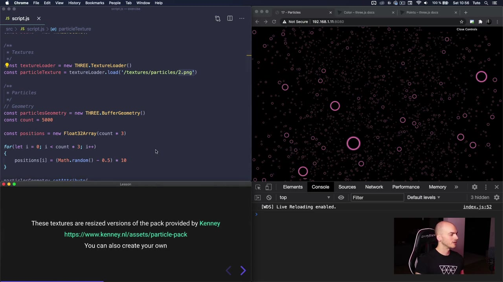
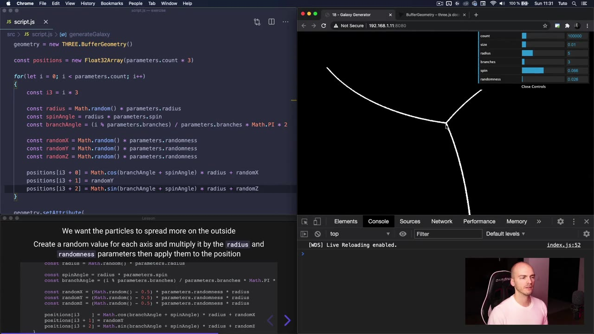

# 第 11 章 粒子与银河生成器

本章将系统学习 Three.js 中的粒子系统，从基础概念、材质配置到透明混合技术，最终整合为一个可交互的银河生成器。粒子系统能够以较低的性能开销渲染大量视觉元素，适用于星空、烟雾、火焰等多种场景。通过本章实践，您将掌握 Points、PointsMaterial 的使用方法，学会自定义粒子几何体、配置纹理与混合模式，并构建包含分支、旋转、随机性和颜色渐变的动态银河生成器。

## 粒子系统基础

Three.js 中的粒子系统基于 `Points` 类实现。与常规的 `Mesh`（网格）不同，`Points` 将几何体的每个顶点渲染为屏幕空间中的点图元，无须为每个粒子单独创建网格和变换对象。大量粒子可以共享同一几何体、材质和绘制流程，因此适合星空、烟雾等数量众多的视觉元素。

创建粒子系统需要三个基本组件：
1. **几何体（Geometry）**：定义每个粒子的位置坐标
2. **点材质（PointsMaterial）**：配置粒子的外观属性
3. **点对象（Points）**：将几何体与材质组合为可渲染对象

最简单的粒子系统可以直接使用内置几何体创建：

```javascript
// 创建球体几何体作为粒子位置源
const particlesGeometry = new THREE.SphereGeometry(1, 32, 32)

// 配置点材质
const particlesMaterial = new THREE.PointsMaterial({
    size: 0.02,           // 粒子尺寸
    sizeAttenuation: true  // 距离衰减（远处粒子变小）
})

// 组合为粒子系统并添加到场景
const particles = new THREE.Points(particlesGeometry, particlesMaterial)
scene.add(particles)
```

上述代码会将球体几何体的所有顶点渲染为独立粒子，形成球面轮廓。`sizeAttenuation` 属性启用距离衰减效果，符合透视投影的自然视觉规律——远处的物体看起来更小。



*图 11-1 使用 SphereGeometry 创建的均匀粒子球体*

## 自定义粒子几何体

实际应用中，粒子通常需要随机或特定模式的分布。此时可以创建自定义的 `BufferGeometry`，通过 `Float32Array` 直接指定每个粒子的三维坐标：

```javascript
const particlesGeometry = new THREE.BufferGeometry()
const count = 5000

// 创建位置数组：每个粒子需要 x, y, z 三个浮点数
const positions = new Float32Array(count * 3)

for(let i = 0; i < count * 3; i++) {
    // Math.random() - 0.5 生成 -0.5 到 +0.5 的随机值
    positions[i] = (Math.random() - 0.5) * 10
}

// 将位置数据设置为几何体属性
particlesGeometry.setAttribute('position',
    new THREE.BufferAttribute(positions, 3)) // 3 表示每组数据的维度
```

此代码生成 5000 个在 10×10×10 立方空间内随机分布的粒子。`BufferAttribute` 的第二个参数 `3` 表明数组中每 3 个连续数值对应一个粒子的 (x, y, z) 坐标。

大规模粒子通常仍比同等数量的独立网格更容易管理，但实际可承载数量取决于硬件、粒子覆盖面积、材质、透明混合和每帧更新方式，不能仅按顶点数推断流畅度。

## 粒子纹理与透明处理

默认的方形粒子缺乏细节，可以通过纹理贴图增强视觉效果。Kenney 粒子纹理包提供了多种预设形状：

```javascript
const textureLoader = new THREE.TextureLoader()
const particleTexture = textureLoader.load('/textures/particles/2.png')

const particlesMaterial = new THREE.PointsMaterial({
    size: 0.1,
    sizeAttenuation: true,
    map: particleTexture,  // 应用纹理贴图
    transparent: true      // 启用透明度支持
})
```

使用纹理后会出现两个常见问题：
1. **遮挡关系错乱**：前方粒子无法正确遮挡后方粒子
2. **纹理边缘可见**：透明区域边缘出现不自然的方形轮廓

Three.js 提供了多种解决方案：

### alphaTest 方案
`alphaTest` 设置透明度阈值（0-1），低于该值的像素将被完全丢弃（不渲染）：

```javascript
particlesMaterial.alphaTest = 0.001
```

此方法能消除大多数边缘瑕疵，但在粒子密集区域仍可能出现轻微闪烁。

### depthTest 方案
禁用深度测试可解决遮挡问题，但会破坏粒子与其他场景对象的正确前后关系：

```javascript
particlesMaterial.depthTest = false
```

### depthWrite 方案
允许深度测试但不将粒子深度写入深度缓冲区，通常是最佳折中方案：

```javascript
particlesMaterial.depthWrite = false
```

该方法保留粒子与已经写入深度的其他对象之间的遮挡关系，同时减少透明粒子因深度写入产生的排序伪影。它并不会自动保证所有半透明粒子之间具有正确排序，密集交叠时仍需结合混合方式和场景结构评估。

## 颜色混合与顶点着色

除了单色粒子，还可以实现两种进阶效果：

### 加法混合（Additive Blending）
加法混合将每个粒子的颜色与背景像素相加，产生明亮的光晕和辉光效果：

```javascript
particlesMaterial.blending = THREE.AdditiveBlending
```

此模式特别适合星空、火焰、魔法效果等需要发光表现的场景。大量粒子重叠时会产生过度绘制（overdraw），增加片元处理与混合成本，因此应同时控制粒子数量和屏幕覆盖面积。

### 顶点颜色（Vertex Colors）
每个粒子可以拥有独立颜色。需要在几何体中添加 `color` 属性并在材质中启用 `vertexColors`：

```javascript
// 创建颜色数组：每个粒子需要 r, g, b 三个分量
const colors = new Float32Array(count * 3)

for(let i = 0; i < count * 3; i++) {
    colors[i] = Math.random()  // 0-1 随机值
}

particlesGeometry.setAttribute('color',
    new THREE.BufferAttribute(colors, 3))

// 启用顶点颜色
particlesMaterial.vertexColors = true
```

顶点颜色会与材质的基础颜色相乘。若希望直接呈现顶点颜色，应将材质基础颜色保持为白色。



*图 11-2 启用顶点颜色与加法混合的粒子系统*

## 粒子动画技术

粒子系统支持多种动画方式：

### 整体变换
`Points` 继承自 `Object3D`，支持旋转、位移、缩放等常规变换：

```javascript
const tick = () => {
    const elapsedTime = clock.getElapsedTime()

    // 整体旋转
    particles.rotation.y = elapsedTime * 0.2
}
```

### 逐顶点动画
通过直接修改几何体的 `position` 属性数组可以实现波浪、引力、涡旋等复杂效果：

```javascript
const tick = () => {
    const elapsedTime = clock.getElapsedTime()

    for(let i = 0; i < count; i++) {
        const i3 = i * 3  // 每个粒子的起始索引

        // 基于 x 坐标的正弦波动画
        const x = particlesGeometry.attributes.position.array[i3]
        particlesGeometry.attributes.position.array[i3 + 1] =
            Math.sin(elapsedTime + x) * 0.5
    }

    // 必须通知 Three.js 几何体已更新
    particlesGeometry.attributes.position.needsUpdate = true
}
```

逐顶点动画虽然灵活，但 CPU 计算负担随粒子数量线性增长。对于超过数万粒子的场景，建议使用自定义着色器（Shader）在 GPU 上并行处理，相关技术将在后续章节介绍。

## 银河生成器：集成应用

将粒子技术应用于具体场景，可以构建交互式银河生成器。该生成器包含以下核心参数：
- `count`：恒星数量
- `size`：恒星尺寸
- `radius`：银河半径
- `branches`：旋臂数量
- `spin`：旋转强度
- `randomness`：分布随机性
- `randomnessPower`：随机分布幂次
- `insideColor`：中心颜色
- `outsideColor`：边缘颜色

### 生成器架构

银河生成器采用函数式设计，参数变更时重新生成整个银河：

```javascript
const parameters = {
    count: 100000,
    size: 0.01,
    radius: 5,
    branches: 3,
    spin: 1,
    randomness: 0.2,
    randomnessPower: 3,
    insideColor: '#ff6030',
    outsideColor: '#1b3984'
}

let geometry = null
let material = null
let points = null

const generateGalaxy = () => {
    // 清理旧银河
    if(points !== null) {
        geometry.dispose()
        material.dispose()
        scene.remove(points)
    }

    // 创建新银河
    geometry = new THREE.BufferGeometry()
    const positions = new Float32Array(parameters.count * 3)
    const colors = new Float32Array(parameters.count * 3)

    // 颜色插值准备
    const colorInside = new THREE.Color(parameters.insideColor)
    const colorOutside = new THREE.Color(parameters.outsideColor)

    for(let i = 0; i < parameters.count; i++) {
        const i3 = i * 3

        // 1. 半径计算（线性分布）
        const radius = Math.random() * parameters.radius

        // 2. 旋臂角度计算
        const branchAngle = (i % parameters.branches) / parameters.branches * Math.PI * 2

        // 3. 旋转角度计算（半径相关）
        const spinAngle = radius * parameters.spin

        // 4. 随机偏移计算（幂次分布）
        const randomX = Math.pow(Math.random(), parameters.randomnessPower) *
                       (Math.random() < 0.5 ? 1 : -1) *
                       parameters.randomness * radius
        const randomY = Math.pow(Math.random(), parameters.randomnessPower) *
                       (Math.random() < 0.5 ? 1 : -1) *
                       parameters.randomness * radius
        const randomZ = Math.pow(Math.random(), parameters.randomnessPower) *
                       (Math.random() < 0.5 ? 1 : -1) *
                       parameters.randomness * radius

        // 最终位置计算
        positions[i3]     = Math.cos(branchAngle + spinAngle) * radius + randomX
        positions[i3 + 1] = randomY
        positions[i3 + 2] = Math.sin(branchAngle + spinAngle) * radius + randomZ

        // 颜色插值（基于半径）
        const mixedColor = colorInside.clone()
        mixedColor.lerp(colorOutside, radius / parameters.radius)

        colors[i3]     = mixedColor.r
        colors[i3 + 1] = mixedColor.g
        colors[i3 + 2] = mixedColor.b
    }

    // 设置几何体属性
    geometry.setAttribute('position', new THREE.BufferAttribute(positions, 3))
    geometry.setAttribute('color', new THREE.BufferAttribute(colors, 3))

    // 创建材质
    material = new THREE.PointsMaterial({
        size: parameters.size,
        sizeAttenuation: true,
        depthWrite: false,
        blending: THREE.AdditiveBlending,
        vertexColors: true
    })

    // 创建粒子系统
    points = new THREE.Points(geometry, material)
    scene.add(points)
}
```

### 参数控制与交互

使用 lil-gui 库提供实时参数调节界面：

```javascript
import GUI from 'lil-gui'

const gui = new GUI()

gui.add(parameters, 'count').min(100).max(1000000).step(100).onFinishChange(generateGalaxy)
gui.add(parameters, 'size').min(0.001).max(0.1).step(0.001).onFinishChange(generateGalaxy)
gui.add(parameters, 'radius').min(0.01).max(20).step(0.01).onFinishChange(generateGalaxy)
gui.add(parameters, 'branches').min(2).max(20).step(1).onFinishChange(generateGalaxy)
gui.add(parameters, 'spin').min(-5).max(5).step(0.001).onFinishChange(generateGalaxy)
gui.add(parameters, 'randomness').min(0).max(2).step(0.001).onFinishChange(generateGalaxy)
gui.add(parameters, 'randomnessPower').min(1).max(10).step(0.001).onFinishChange(generateGalaxy)
gui.addColor(parameters, 'insideColor').onFinishChange(generateGalaxy)
gui.addColor(parameters, 'outsideColor').onFinishChange(generateGalaxy)

// 初始生成
generateGalaxy()
```

`onFinishChange` 事件确保只在参数调节结束时重新生成银河，避免拖动过程中的性能开销。

### 算法解析

银河生成算法的核心逻辑：

1. **旋臂分布**：通过取模运算 `i % parameters.branches` 将粒子均匀分配到各旋臂
2. **旋转效果**：`spinAngle = radius * parameters.spin` 实现半径相关的旋转角度，形成螺旋结构
3. **随机分布**：使用 `Math.pow(Math.random(), parameters.randomnessPower)` 控制随机偏移量。指数越大，偏移越倾向于接近 0，粒子就越靠近理想旋臂；随机正负号和半径因子则决定偏移方向与范围
4. **颜色渐变**：`Color.lerp()` 方法根据粒子半径在内部色与外部色之间线性插值

## 性能优化与实践建议

### 性能考量
1. **粒子数量**：根据目标平台调整，桌面端可承受 10-50 万粒子，移动端建议限制在 5 万以内
2. **混合模式**：加法混合（AdditiveBlending）比普通混合消耗更多性能
3. **纹理尺寸**：使用适当尺寸的纹理（通常 64×64 或 128×128），避免不必要的内存占用
4. **几何体更新**：避免在动画循环中频繁更新几何体属性数组

### 实践技巧
1. **调试辅助**：开发初期使用少量粒子（如 1000 个）验证算法正确性
2. **视觉层次**：通过调整尺寸、颜色和透明度创建深度感和层次感
3. **物理模拟**：结合简单物理规则（引力、碰撞、阻尼）可增强粒子运动的真实感
4. **LOD 策略**：根据摄像机距离动态调整粒子数量和细节级别

### 常见问题排查
1. **粒子不显示**：检查尺寸是否过小、材质颜色是否与背景相同、摄像机位置是否合适
2. **性能低下**：减少粒子数量、禁用加法混合、简化纹理、避免每帧几何体更新
3. **渲染异常**：正确处理透明度和深度测试，根据场景需求选择 `alphaTest`、`depthTest` 或 `depthWrite` 方案

## 本章小结

本章系统介绍了 Three.js 粒子系统的完整技术栈：

1. **基础架构**：粒子系统由 `Points`（点对象）、`PointsMaterial`（点材质）和几何体三部分组成，通过顶点渲染技术实现高效大规模渲染。

2. **视觉定制**：支持纹理贴图、透明混合（`alphaTest`、`depthWrite`、`depthTest`）、颜色混合（`AdditiveBlending`）和逐顶点着色（`vertexColors`），可创建从写实到风格化的多种视觉效果。

3. **动态控制**：既支持整体变换（旋转、位移、缩放），也可通过直接修改几何体属性实现复杂的逐顶点动画，为粒子注入生命力和表现力。

4. **银河生成器实践**：综合应用所有技术点，构建参数化、交互式的银河生成系统，涵盖旋臂分布、螺旋旋转、随机偏移和径向颜色渐变等核心算法。

5. **性能优化**：掌握粒子数量控制、混合模式选择、纹理优化和更新策略等关键性能调优手段，确保在不同硬件平台上都能保持流畅体验。

粒子系统是 Three.js 中平衡视觉效果与运行效率的典范技术。通过本章学习，您已具备创建星空、烟雾、火焰、魔法特效等丰富粒子效果的能力。在后续章节中，我们将进一步探索自定义着色器和 GPGPU，将粒子系统的控制权从 CPU 转移到 GPU，实现更高性能、更复杂的动态效果。