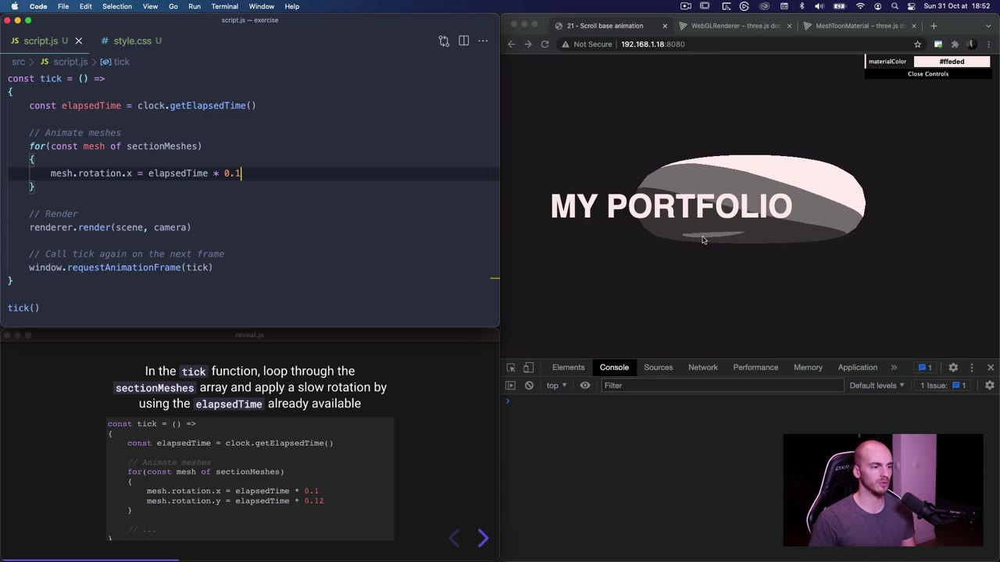
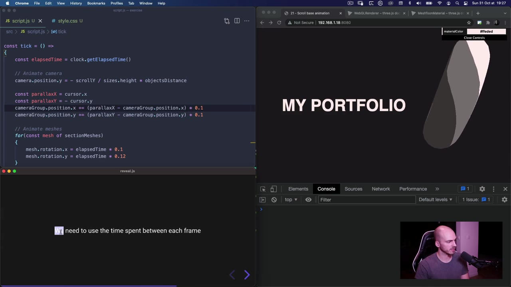

# 第 12 章 滚动驱动动画

本章将学习如何将 Three.js 场景整合到传统网页中，使 WebGL 体验成为网站背景。我们将实现相机随页面滚动而移动的效果，添加基于光标位置的视差动画，并在滚动到不同章节时触发对象旋转动画，从而创建更加沉浸式的网页体验。

## 网页滚动集成

### 启用页面滚动

在之前的课程中，我们通过 CSS 禁用了页面滚动来确保 WebGL 体验占据整个视口：

```css
html, body {
    overflow: hidden;
}
```

要重新启用滚动，只需删除或注释掉这行 CSS 代码。这样页面就可以正常滚动，显示隐藏在下方的其他内容分区。

### 修复弹性滚动背景色

在某些浏览器环境中，当滚动超过页面边界时会出现弹性动画，此时页面背景会显示默认的白色，与 WebGL 场景的黑色背景不匹配。解决方法是让 WebGL 渲染器支持透明度，并在 CSS 中统一设置背景色。

首先，在创建 `WebGLRenderer` 时启用 alpha 通道：

```javascript
const renderer = new THREE.WebGLRenderer({
    canvas: canvas,
    alpha: true
})
```

默认的清除 alpha 值为 0（完全透明），因此只需启用 alpha 处理即可。如需调整，可以使用 `setClearAlpha()` 方法：

```javascript
renderer.setClearAlpha(0)
```

然后在 CSS 中为页面设置统一的背景色：

```css
html {
    background: #1e1a20;
}
```

这样弹性滚动时显示的就是与页面一致的背景色，避免了视觉上的不协调。

## 场景对象配置

### 创建分区对象

我们将为每个网页分区创建一个对应的 3D 对象来增强视觉关联性。使用 Three.js 的基础几何体创建三个网格：

```javascript
// 几何体材质
const material = new THREE.MeshToonMaterial({
    color: parameters.materialColor
})

// 网格对象
const mesh1 = new THREE.Mesh(
    new THREE.TorusGeometry(1, 0.4, 16, 60),
    material
)
const mesh2 = new THREE.Mesh(
    new THREE.ConeGeometry(1, 2, 32),
    material
)
const mesh3 = new THREE.Mesh(
    new THREE.TorusKnotGeometry(0.8, 0.35, 100, 16),
    material
)

const sectionMeshes = [mesh1, mesh2, mesh3]
scene.add(mesh1, mesh2, mesh3)
```

### 卡通材质与灯光

`MeshToonMaterial` 是卡通风格材质，需要光源才能正常显示。添加一个方向光：

```javascript
const directionalLight = new THREE.DirectionalLight('#ffffff', 3)
directionalLight.position.set(1, 1, 0)
scene.add(directionalLight)
```

为了增强卡通效果，可以使用梯度纹理创建更明显的明暗过渡：

```javascript
const textureLoader = new THREE.TextureLoader()
const gradientTexture = textureLoader.load('textures/gradients/3.jpg')
gradientTexture.magFilter = THREE.NearestFilter

const material = new THREE.MeshToonMaterial({
    color: parameters.materialColor,
    gradientMap: gradientTexture
})
```

梯度纹理是非常小的图像（仅 3 个像素），将 `magFilter` 设置为 `THREE.NearestFilter` 可以避免像素插值，保持清晰的分层效果。



*图 12-1 网格对象与分区对应关系*

### 对象垂直分布

通过定义对象间距并沿 Y 轴分布对象，确保一次只显示一个分区对应的对象：

```javascript
const objectsDistance = 4

mesh1.position.y = -objectsDistance * 0
mesh2.position.y = -objectsDistance * 1
mesh3.position.y = -objectsDistance * 2
```

设置 `objectsDistance` 为 4 个单位，确保对象之间有足够距离，避免在视口中同时出现多个对象。

### 水平位置对齐

根据网页布局将对象定位到左右两侧：

```javascript
mesh1.position.x = 2
mesh2.position.x = -2
mesh3.position.x = 2
```

### 持续旋转动画

为所有对象添加缓慢的旋转动画，增强场景的生动性：

```javascript
const tick = () => {
    const elapsedTime = clock.getElapsedTime()

    for(const mesh of sectionMeshes) {
        mesh.rotation.x = elapsedTime * 0.1
        mesh.rotation.y = elapsedTime * 0.12
    }

    // ...渲染代码
}
```

## 滚动驱动的相机移动

### 获取滚动位置

通过 `window.scrollY` 获取页面滚动距离，并监听滚动事件更新该值：

```javascript
let scrollY = window.scrollY

window.addEventListener('scroll', () => {
    scrollY = window.scrollY
})
```

### 相机位置计算

将滚动距离转换为相机移动距离需要几个步骤：
1. 滚动距离是像素值，需要转换为场景单位
2. 每个网页分区对应一个屏幕高度，滚动一个分区应移动到下一个对象
3. 需要根据对象间距进行缩放

```javascript
camera.position.y = -scrollY / sizes.height * objectsDistance
```

这个公式确保当用户滚动一个屏幕高度时，相机正好移动到下一个对象的位置。

### 相机组与视差

为了实现光标位置对视差效果，同时保持滚动功能，需要将相机放入组中：

```javascript
const cameraGroup = new THREE.Group()
scene.add(cameraGroup)
cameraGroup.add(camera)
```

现在相机移动可以通过操作 `cameraGroup` 实现，而滚动引起的 Y 轴移动仍然作用于 `camera.position.y`。

## 光标视差效果

### 光标位置标准化

获取光标位置并进行标准化处理，使其范围在 [-0.5, 0.5] 之间：

```javascript
const cursor = { x: 0, y: 0 }

window.addEventListener('mousemove', (event) => {
    cursor.x = event.clientX / sizes.width - 0.5
    cursor.y = event.clientY / sizes.height - 0.5
})
```

### 缓动动画实现

直接使用光标位置更新相机位置会产生机械感。通过缓动公式实现更自然的运动：

```javascript
const parallaxX = cursor.x * 0.5
const parallaxY = -cursor.y * 0.5

cameraGroup.position.x += (parallaxX - cameraGroup.position.x) * 5 * deltaTime
cameraGroup.position.y += (parallaxY - cameraGroup.position.y) * 5 * deltaTime
```

使用 `deltaTime` 确保不同刷新率屏幕上的动画速度一致。公式的含义是：每帧将当前位置向目标位置移动剩余距离的一部分（5 倍帧时间），产生平滑的缓动效果。



*图 12-2 视差效果示意*

## 粒子系统增强

### 创建粒子几何体

粒子可以增强深度感，创建散布在场景中的粒子系统：

```javascript
const particlesCount = 200
const positions = new Float32Array(particlesCount * 3)

for(let i = 0; i < particlesCount; i++) {
    positions[i * 3 + 0] = (Math.random() - 0.5) * 10
    positions[i * 3 + 1] = objectsDistance * 0.5 - Math.random() * objectsDistance * sectionMeshes.length
    positions[i * 3 + 2] = (Math.random() - 0.5) * 10
}

const particlesGeometry = new THREE.BufferGeometry()
particlesGeometry.setAttribute('position', new THREE.BufferAttribute(positions, 3))
```

### 粒子材质与对象

使用 `PointsMaterial` 和 `Points` 对象创建粒子系统：

```javascript
const particlesMaterial = new THREE.PointsMaterial({
    color: parameters.materialColor,
    sizeAttenuation: true,
    size: 0.03
})

const particles = new THREE.Points(particlesGeometry, particlesMaterial)
scene.add(particles)
```

粒子在垂直方向均匀分布在所有分区范围内，水平（X 轴）和深度（Z 轴）方向在 [-5, 5] 范围内随机分布。

## 分区触发动画

### 检测分区切换

通过滚动位置计算当前所在分区：

```javascript
let currentSection = 0

window.addEventListener('scroll', () => {
    scrollY = window.scrollY
    const newSection = Math.round(scrollY / sizes.height)

    if(newSection != currentSection) {
        currentSection = newSection
        // 触发动画
    }
})
```

由于每个分区高度恰好等于视口高度，因此可以通过 `scrollY / sizes.height` 的舍入值来确定当前分区。

### 使用 GSAP 创建触发动画

安装 GSAP 库：

```bash
npm install gsap@3.12
```

在代码中导入并使用 GSAP：

```javascript
import gsap from 'gsap'

// 在分区切换时
if(newSection != currentSection) {
    currentSection = newSection

    gsap.to(
        sectionMeshes[currentSection].rotation,
        {
            duration: 1.5,
            ease: 'power2.inOut',
            x: '+=6',
            y: '+=3',
            z: '+=1.5'
        }
    )
}
```

### 调整持续旋转

为了与 GSAP 动画兼容，需要将原有的持续旋转从基于绝对时间改为基于增量时间：

```javascript
for(const mesh of sectionMeshes) {
    mesh.rotation.x += deltaTime * 0.1
    mesh.rotation.y += deltaTime * 0.12
}
```

这样 GSAP 的增量动画（`+=`）可以与持续旋转叠加，而不是互相覆盖。

## 性能与优化注意事项

1. **滚动事件优化**：频繁的滚动事件可能影响性能，可以考虑使用防抖或节流技术，但本示例中直接更新是可行的，因为计算量较小。

2. **粒子数量控制**：保持粒子数量在合理范围内（如 200 个），避免影响渲染性能。可以根据设备性能动态调整粒子密度。

3. **动画帧率同步**：使用 `deltaTime` 确保动画速度在不同刷新率设备上保持一致，这是实现跨设备一致体验的关键。

4. **内存管理**：对于复杂的网页应用，需要注意 Three.js 对象的内存释放，特别是在动态创建和销毁对象时。

5. **响应式设计**：确保在窗口大小变化时正确处理 `sizes` 更新，保持滚动与视差的正确比例。

## 本章小结

本章介绍了将 Three.js 整合到传统网页中的关键技术，创建了滚动驱动的交互式 WebGL 背景体验。核心内容包括：

- **网页滚动集成**：启用页面滚动，统一 WebGL 与 HTML 的背景处理，避免视觉不一致问题。
- **分区对象配置**：为网页内容分区创建对应的 3D 对象，建立视觉关联，并通过垂直分布确保一次只显示一个分区。
- **滚动驱动相机**：通过数学转换将页面滚动距离映射到相机移动，实现精确的分区切换。
- **光标视差效果**：基于光标位置创建自然的视差动画，通过缓动公式实现平滑的跟随效果，增强沉浸感。
- **粒子系统增强**：添加粒子系统提升场景深度感，强化三维空间的视觉层次。
- **触发式动画**：使用 GSAP 库在滚动到新分区时触发对象旋转动画，增强交互反馈。
- **性能优化**：采用增量时间动画、合理控制粒子数量等技术确保流畅的用户体验。

这些技术组合形成了完整的网页集成方案，展示了 Three.js 不仅适用于全屏 WebGL 体验，也能作为网页背景和交互元素，与 HTML 内容无缝融合，为传统网站添加丰富的三维视觉层。