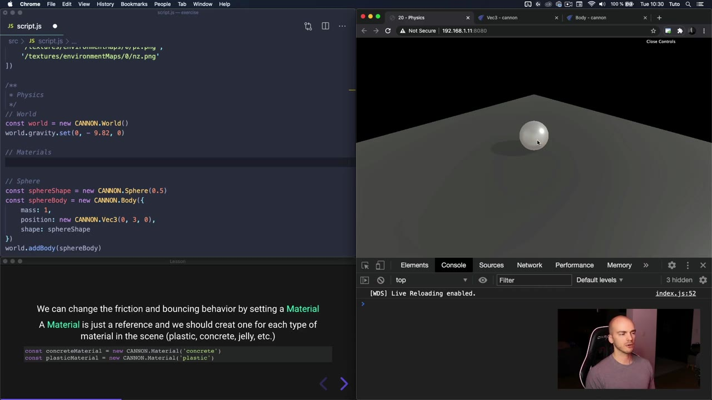
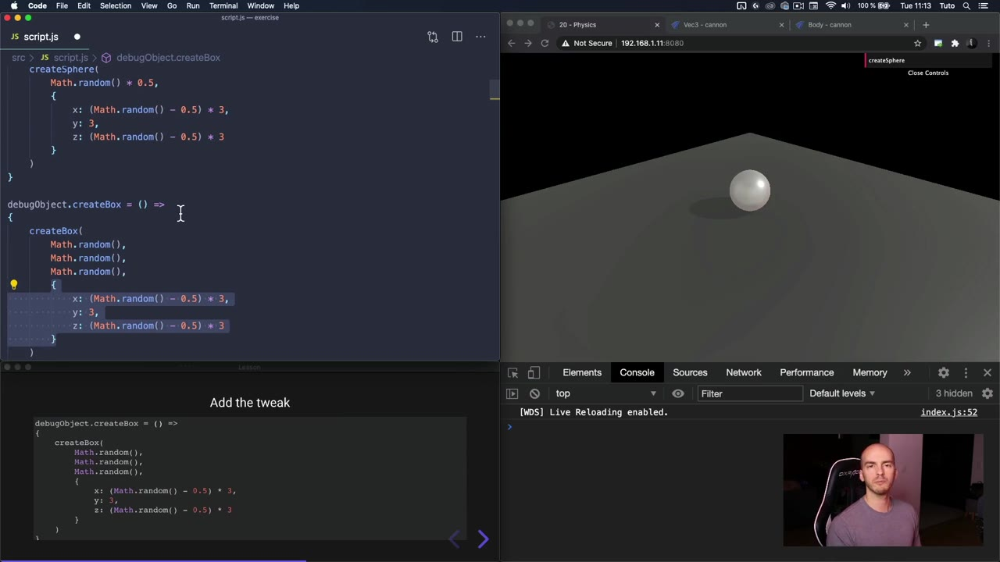

# 第 13 章 物理模拟

物理模拟是为 WebGL 体验增添趣味性的重要功能。通过实现物体下落、碰撞、弹跳等物理效果，可以显著提升用户体验的沉浸感和互动性。本章将详细介绍如何将 Cannon.js/Cannon-es 物理引擎集成到 Three.js 项目中，涵盖物理世界构建、刚体创建、形状与材质设置、受力与碰撞处理、网格同步方法以及性能优化等核心内容。

## 物理模拟概述

物理模拟能为 3D 网站带来极具吸引力的交互体验。用户通常乐于看到物体自由下落、相互碰撞、弹跳翻滚等真实物理效果，正如《愤怒的小鸟》等游戏所展示的场景。

在 Three.js 中实现物理模拟有多种途径。简单的碰撞检测可通过数学计算和 `Raycaster` 等内置工具完成，但对于需要模拟张力、摩擦、弹跳、约束条件等复杂物理行为的 3D 场景，使用专业的物理引擎库是更合适的选择。

物理模拟的基本原理是创建一个不可见的物理世界。该世界独立于 Three.js 的渲染场景，只负责物理计算。我们同时在 Three.js 中创建可视化网格，并在物理世界中创建对应的刚体。在每一帧渲染前更新物理世界，然后将刚体的位置和旋转信息同步到对应的 Three.js 网格上，从而实现视觉上的物理效果。

## 物理引擎选择

根据项目需求，可选择 2D 或 3D 物理引擎。虽然 Three.js 主要处理 3D 内容，但在某些情况下，使用 2D 物理引擎可能更合适。例如台球游戏，球体与墙壁的碰撞完全可以在 2D 平面上表示，此时使用 2D 引擎能获得更好的性能。

### 3D 物理引擎

1. **Ammo.js**
   - C++ 物理引擎 Bullet 的 JavaScript 移植版本
   - 功能强大，支持 WebAssembly，性能优越
   - 文档相对缺乏，实现较为复杂
   - Three.js 官方示例中广泛使用

2. **Cannon.js**
   - 相对轻量级，易于集成和使用
   - 拥有完善的文档
   - 由单人维护，近年更新较少
   - 存在维护良好的 fork 版本

3. **Oimo.js**
   - 轻量级，实现简单
   - 主要由单人维护
   - 更新不够频繁

4. **Rapier**
   - 与 Cannon.js 相似，性能良好
   - 目前处于积极维护状态
   - 支持 2D 和 3D 物理模拟

### 2D 物理引擎

- **Matter.js**: 功能全面，文档完善
- **P2.js**: 与 Cannon.js 同作者，便于学习
- **Planck.js**: 目前持续更新
- **Box2D.js**: 经典 2D 物理引擎的 JavaScript 实现

本章将使用 Cannon.js 作为示例库，因其易于集成且适合教学。该库的基本概念与其他物理引擎相似，掌握了 Cannon.js 后，迁移到其他引擎将更加容易。



*图 13-1 物理模拟的初始场景：球体悬浮在平面上方，准备开始模拟*

## Cannon.js 基础设置

要开始使用 Cannon.js，首先需要安装依赖：

```bash
npm install cannon
```

然后在代码中导入：

```javascript
import CANNON from 'cannon'
```

### 创建物理世界

物理世界是物理模拟的核心容器。创建世界并设置地球重力（-9.82 m/s²）：

```javascript
const world = new CANNON.World()
world.gravity.set(0, -9.82, 0)
```

Cannon.js 中的 `Vec3` 类与 Three.js 的 `Vector3` 类似，都表示三维向量。重力方向可随时调整以适应不同场景需求，比如火星重力或其他奇幻环境。

### 创建刚体

刚体是物理世界中具有质量并受物理规律影响的物体。在 Three.js 中已有球体网格的情况下，需要在物理世界中创建对应的刚体。

首先定义球体的形状：

```javascript
const sphereShape = new CANNON.Sphere(0.5)
```

然后创建刚体，设置质量、初始位置和形状：

```javascript
const sphereBody = new CANNON.Body({
    mass: 1,
    position: new CANNON.Vec3(0, 3, 0),
    shape: sphereShape
})

world.addBody(sphereBody)
```

### 更新机制

创建刚体后，需要实现物理世界的更新循环。每个渲染帧都需要：

1. 计算时间差（delta time）
2. 调用 `world.step()` 更新物理世界
3. 同步刚体位置到 Three.js 网格

```javascript
const clock = new THREE.Clock()
let oldElapsedTime = 0

const tick = () => {
    const elapsedTime = clock.getElapsedTime()
    const deltaTime = elapsedTime - oldElapsedTime
    oldElapsedTime = elapsedTime

    // 更新物理世界
    world.step(1 / 60, deltaTime, 3)

    // 同步位置
    sphere.position.copy(sphereBody.position)
}
```

`1 / 60` 是固定的物理时间步长，`deltaTime` 是距离上次调用的真实时间，第三个参数则限制一次渲染更新中最多补偿的子步数。固定步长有助于稳定求解，真实帧间隔用于追赶模拟进度；更多子步可以处理帧率波动，但也会增加计算负担。

此时球体会开始下落，但会穿过平面，因为平面在物理世界中还不存在。

### 静态物体（平面）

要使平面参与物理模拟，需创建静态刚体。静态物体不受重力影响，常用于地面、墙壁等固定结构：

```javascript
const floorShape = new CANNON.Plane()
const floorBody = new CANNON.Body()
floorBody.mass = 0  // 质量为0表示静态物体
floorBody.addShape(floorShape)
world.addBody(floorBody)
```

平面默认朝向与 Three.js 平面不同，需要旋转使其与 Three.js 平面对齐：

```javascript
floorBody.quaternion.setFromAxisAngle(new CANNON.Vec3(-1, 0, 0), Math.PI * 0.5)
```

Cannon.js 使用四元数表示旋转。`setFromAxisAngle()` 方法的第一个参数是旋转轴（单位向量），第二个参数是旋转角度（弧度）。

至此，球体会下落并在平面上停止。静态物体的位置不需要从物理世界同步到 Three.js 场景，因为它们不会移动。

## 碰撞材质

默认情况下，物体碰撞时弹跳效果有限。通过为物体设置材质并定义接触材质，可以调整摩擦力和恢复系数（弹力）。

### 材质与接触材质

首先创建基本材质：

```javascript
const concreteMaterial = new CANNON.Material('concrete')
const plasticMaterial = new CANNON.Material('plastic')
```

接触材质定义两种材质相互作用时的物理属性：

```javascript
const concretePlasticContactMaterial = new CANNON.ContactMaterial(
    concreteMaterial,
    plasticMaterial,
    {
        friction: 0.1,     // 摩擦系数
        restitution: 0.7   // 恢复系数（弹力）
    }
)
world.addContactMaterial(concretePlasticContactMaterial)
```

然后将材质应用到刚体：

```javascript
const sphereBody = new CANNON.Body({
    // ... 其他参数
    material: plasticMaterial
})

const floorBody = new CANNON.Body()
floorBody.material = concreteMaterial
```

简化方案是使用默认材质，并将其设为世界的默认接触材质：

```javascript
const defaultMaterial = new CANNON.Material('default')
const defaultContactMaterial = new CANNON.ContactMaterial(
    defaultMaterial,
    defaultMaterial,
    {
        friction: 0.1,
        restitution: 0.7
    }
)
world.addContactMaterial(defaultContactMaterial)
world.defaultContactMaterial = defaultContactMaterial
```

此时球体会在平面上多次弹跳后停止，效果更加自然。

## 施加力与控制

刚体可通过多种方法施加力，实现推、拉、撞击等效果：

### 力的应用方法

1. **`applyLocalForce(force, point)`**
   - 在局部坐标系中施加力
   - `force` 为力向量，`point` 为施力点（局部坐标）

2. **`applyForce(force, point)`**
   - 在世界坐标系中施加力
   - 常用于持续效果如风力

3. **`applyLocalImpulse(impulse, point)`**
   - 直接施加冲量（改变速度）

4. **`applyImpulse(impulse, point)`**
   - 在世界坐标系中施加冲量

### 施加初始力

在刚体创建后立即施加力，使其获得初始速度：

```javascript
sphereBody.applyLocalForce(new CANNON.Vec3(150, 0, 0), new CANNON.Vec3(0, 0, 0))
```

### 持续施加力（如风力）

在每帧更新前施加持续力：

```javascript
const tick = () => {
    // ...

    // 施加风力
    sphereBody.applyForce(new CANNON.Vec3(-0.5, 0, 0), sphereBody.position)

    world.step(1 / 60, deltaTime, 3)

    // ...
}
```

## 多物体管理

处理单个或几个物体相对简单，但管理大量物理对象需要更系统的方法。

### 创建辅助函数

创建统一的函数来同时生成 Three.js 网格和 Cannon.js 刚体：

```javascript
const objectsToUpdate = []
const sphereGeometry = new THREE.SphereGeometry(1, 20, 20)
const sphereMaterial = new THREE.MeshStandardMaterial({
    metalness: 0.3,
    roughness: 0.4,
    envMap: environmentMapTexture,
    envMapIntensity: 0.5
})

const createSphere = (radius, position) => {
    // Three.js 网格
    const mesh = new THREE.Mesh(sphereGeometry, sphereMaterial)
    mesh.castShadow = true
    mesh.scale.set(radius, radius, radius)
    mesh.position.copy(position)
    scene.add(mesh)

    // Cannon.js 刚体
    const shape = new CANNON.Sphere(radius)
    const body = new CANNON.Body({
        mass: 1,
        shape: shape,
        material: defaultMaterial
    })
    body.position.copy(position)
    world.addBody(body)

    // 保存到更新数组
    objectsToUpdate.push({ mesh, body })
}
```

几何体和材质在函数外部创建，便于重用和优化。

### 批量更新

在 `tick()` 函数中批量更新所有物体：

```javascript
const tick = () => {
    // ...

    world.step(1 / 60, deltaTime, 3)

    for(const object of objectsToUpdate) {
        object.mesh.position.copy(object.body.position)
        object.mesh.quaternion.copy(object.body.quaternion)
    }

    // ...
}
```

注意此处同时更新了位置和旋转，对于非球体物体，旋转同步是必要的。

### 调试界面集成

通过 lil-gui 添加控制按钮：

```javascript
const debugObject = {}
debugObject.createSphere = () => {
    createSphere(
        Math.random() * 0.5,
        {
            x: (Math.random() - 0.5) * 3,
            y: 3,
            z: (Math.random() - 0.5) * 3
        }
    )
}
gui.add(debugObject, 'createSphere')
```

这样可以动态创建随机位置和大小的球体。

## 添加箱体

箱体的创建与球体类似，但需要注意几何体参数的差异：

### 箱体几何体参数对比

- **Three.js**: `BoxGeometry(width, height, depth)` - 指定宽度、高度、深度
- **Cannon.js**: `Box(halfExtents)` - 指定半长向量（从中心到角点的距离）

创建箱体函数：

```javascript
const boxGeometry = new THREE.BoxGeometry(1, 1, 1)
const boxMaterial = new THREE.MeshStandardMaterial({
    metalness: 0.3,
    roughness: 0.4,
    envMap: environmentMapTexture,
    envMapIntensity: 0.5
})

const createBox = (width, height, depth, position) => {
    // Three.js 网格
    const mesh = new THREE.Mesh(boxGeometry, boxMaterial)
    mesh.scale.set(width, height, depth)
    mesh.castShadow = true
    mesh.position.copy(position)
    scene.add(mesh)

    // Cannon.js 刚体
    const shape = new CANNON.Box(
        new CANNON.Vec3(width * 0.5, height * 0.5, depth * 0.5)
    )

    const body = new CANNON.Body({
        mass: 1,
        shape: shape,
        material: defaultMaterial
    })
    body.position.copy(position)
    world.addBody(body)

    objectsToUpdate.push({ mesh, body })
}
```

通过缩放 Three.js 几何体来匹配所需尺寸，而 Cannon.js 则直接使用半长向量。

### 旋转同步的重要性

箱体如果不同步旋转信息，会看起来像是穿过了平面。实际上箱体发生后翻，但 Three.js 网格没有旋转，导致视觉错误。因此必须同步四元数：

```javascript
object.mesh.quaternion.copy(object.body.quaternion)
```



*图 13-2 物理模拟中的多物体碰撞场景：球体和箱体的复杂互动*

## 性能优化

随着物体数量增加，物理模拟的性能优化变得至关重要。

### 碰撞检测优化

Cannon.js 提供三种碰撞检测算法：

1. **NaiveBroadphase**
   - 简单算法，测试每个物体与其他所有物体
   - 复杂度为 O(n²)，性能较差

2. **GridBroadphase**
   - 将世界划分为网格，仅测试相邻网格内的物体
   - 适用于物体分布均匀的场景

3. **SAPBroadphase**（Sweep and Prune，扫掠与剪枝）
   - 沿多个轴逐步测试物体
   - 性能通常最优，但可能遗漏高速运动的碰撞

推荐使用 SAP 算法：

```javascript
world.broadphase = new CANNON.SAPBroadphase(world)
```

### 休眠机制

当物体的速度足够慢时，可使其进入休眠状态以停止计算：

```javascript
world.allowSleep = true
```

可通过 `sleepSpeedLimit` 和 `sleepTimeLimit` 调整休眠条件。休眠会减少静止刚体的求解与部分碰撞处理开销；当其他物体撞击或施加足够影响时，刚体可以被唤醒。

## 碰撞事件处理

刚体可监听多种事件，如碰撞、休眠和唤醒，用于实现音效反馈等交互效果。

### 碰撞音效

首先创建音频对象：

```javascript
const hitSound = new Audio('/sounds/hit.mp3')

const playHitSound = (collision) => {
    const impactStrength = collision.contact.getImpactVelocityAlongNormal()

    if(impactStrength > 1.5) {
        hitSound.volume = Math.random()
        hitSound.currentTime = 0
        hitSound.play()
    }
}
```

`getImpactVelocityAlongNormal()` 方法返回碰撞沿法线方向的速度分量，表示碰撞强度。

### 事件监听

为刚体添加碰撞事件监听：

```javascript
body.addEventListener('collide', playHitSound)
```

注意：某些浏览器（如 Chrome）要求用户与页面交互后才能播放音频，可通过点击页面任意位置来启用音效。

## 资源管理与重置

为避免内存泄漏，需要及时移除不再需要的物体。

### 重置函数

创建清空场景的函数：

```javascript
debugObject.reset = () => {
    for(const object of objectsToUpdate) {
        // 移除事件监听
        object.body.removeEventListener('collide', playHitSound)

        // 从物理世界移除刚体
        world.removeBody(object.body)

        // 从场景移除网格
        scene.remove(object.mesh)
    }

    // 清空更新数组
    objectsToUpdate.splice(0, objectsToUpdate.length)
}
gui.add(debugObject, 'reset')
```

这样可实现一键清空所有物理物体。

## Cannon-es：更好的选择

由于原始的 Cannon.js 更新较少，推荐使用其维护良好的 fork 版本 Cannon-es：

```bash
npm install cannon-es
```

导入方式略有不同：

```javascript
import * as CANNON from 'cannon-es'
```

Cannon-es 提供向后兼容性，同时包含错误修复和性能改进。若遇到兼容性问题，可安装特定版本：

```bash
npm install cannon-es@0.20
```

## 进阶主题

### 约束条件

Cannon.js 支持多种约束，用于连接两个刚体：

1. **HingeConstraint** - 铰链约束，模拟门铰链
2. **DistanceConstraint** - 距离约束，保持两个物体间固定距离
3. **LockConstraint** - 锁定约束，让两个物体像单个物体一样运动
4. **PointToPointConstraint** - 点对点约束，将物体粘合到特定点

### 使用 Web Workers

当物理计算量较大时，可使用 Web Workers 将计算移至独立线程，避免阻塞主线程导致帧率下降。Cannon.js 提供了 worker 示例。

### 其他集成方案

- **Physijs**: 基于 Ammo.js，提供更高级的 API 封装
- **R3F + Cannon**: React Three Fiber 中可直接使用 Cannon-es
- **Ammo.js**: 功能更强大，支持 WebAssembly，但实现更复杂

选择何种方案取决于项目需求、性能要求和团队熟悉度。

## 本章小结

本章系统介绍了在 Three.js 中实现物理模拟的完整流程。通过将 Cannon.js/Cannon-es 物理引擎与 Three.js 相结合，可以为 WebGL 体验增添真实的物理交互效果。

关键知识点总结：

1. **物理世界构建**：创建独立的物理世界并设置基本参数（如重力），这是物理模拟的基础。

2. **刚体与形状**：刚体是物理世界中的基本单位，可通过不同形状（球体、箱体、平面等）构建复杂物体。静态物体质量为0，不受力影响；动态物体具有质量，遵循物理规律。

3. **材质与接触**：为物体定义物理材质并设置接触属性（摩擦系数、恢复系数），控制物体间的交互行为。

4. **力的应用**：通过多种方法施加力或冲量，实现推、拉、撞击等效果，丰富物理交互。

5. **多物体管理**：通过辅助函数和统一数组管理大量物体，简化创建、更新和销毁过程。

6. **性能优化**：使用高效的碰撞检测算法和休眠机制，确保物理模拟在复杂场景中仍能流畅运行。

7. **事件处理**：监听碰撞等事件，实现音效反馈等增强体验的功能。

实际项目中，可根据具体需求选择 Cannon-es、Ammo.js 或专为 Three.js 设计的 Physijs。物理模拟虽然能大幅提升用户体验，但也应谨慎使用，避免不必要的性能消耗。