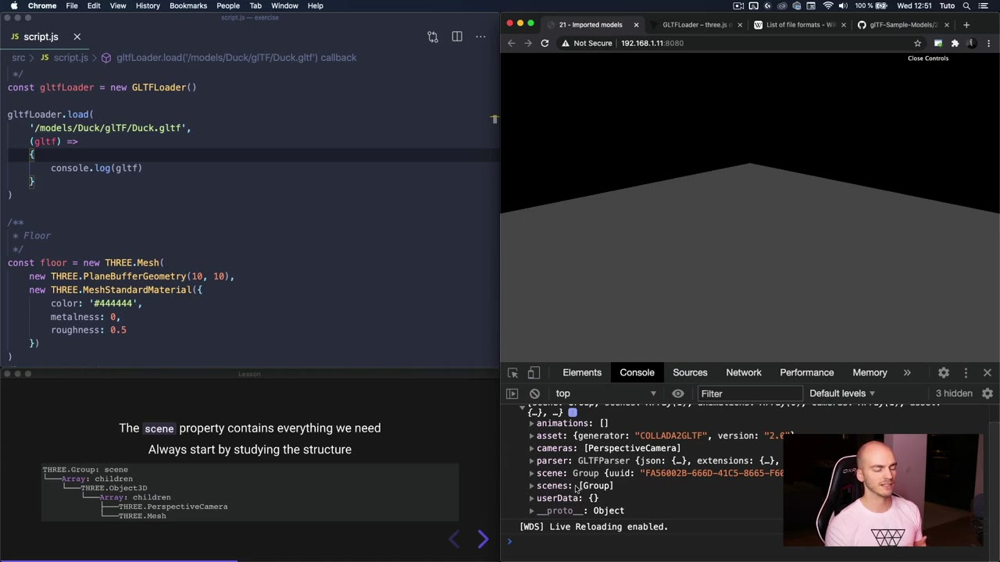
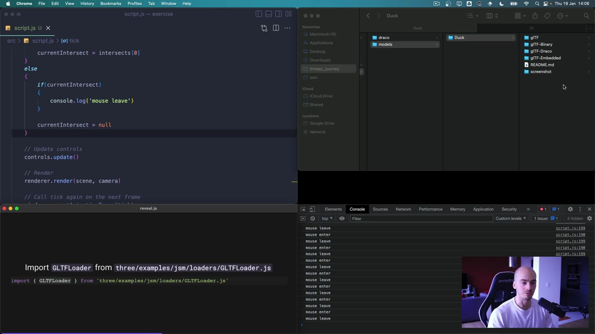

# 第 14 章 模型导入与射线交互

Three.js 不仅能够创建基本几何体，还可以导入外部 3D 软件制作的复杂模型。同时，通过射线投射（Raycaster）技术，我们能够实现鼠标与 3D 物体的交互检测。本章将介绍如何加载和处理 glTF 格式的模型，并掌握射线相交检测技术的实现方法，为创建交互式的 3D 体验奠定基础。

## 模型格式与 glTF

在 3D 图形领域，存在多种模型文件格式，每种格式都有其特定的设计目标和适用场景。常见的格式包括 OBJ、FBX、STL、PLY、COLLADA，以及各类三维软件专用的格式。这些格式在数据完整性、文件大小、压缩方式、兼容性以及授权许可等方面各有侧重。

glTF（GL Transmission Format）由 Khronos Group 制定，已成为实时渲染领域广泛使用的传输格式。glTF 支持几何体、材质、相机、灯光、场景图、动画、骨骼和变形目标等数据，并能采用外部文件、二进制容器或嵌入资源等形式存储。

### glTF 的不同形式

GLTF 有多种变体格式，每种都有其适用场景：

1. **glTF（默认格式）**：由 JSON 描述文件、二进制数据文件和纹理图片组成。JSON 文件包含场景结构、材质引用等元数据，二进制文件存储几何体等顶点数据。
2. **glTF-Binary（.glb）**：将所有数据合并为单个二进制文件，加载方便但难以单独修改内部资源。
3. **glTF-Draco**：使用 Google 的 Draco 算法压缩几何体数据，显著减小文件体积。
4. **glTF-Embedded**：将全部数据嵌入单个 JSON 文件中，便于查看和编辑。

选择哪种格式取决于项目需求：单文件格式便于部署，分离格式利于资源优化，压缩格式适合网络传输。

## 使用 GLTFLoader 加载模型

Three.js 通过 GLTFLoader 加载 GLTF 格式的模型。首先需要从示例模块中导入加载器：

```javascript
import { GLTFLoader } from 'three/examples/jsm/loaders/GLTFLoader.js'
```

然后在代码中实例化加载器并调用 `load` 方法：

```javascript
const gltfLoader = new GLTFLoader()

gltfLoader.load(
    '/models/Duck/glTF/Duck.gltf',
    (gltf) => {
        // 模型加载完成后的回调
        scene.add(gltf.scene)
    },
    (progress) => {
        // 加载进度回调
        console.log('加载进度:', (progress.loaded / progress.total) * 100, '%')
    },
    (error) => {
        // 加载错误回调
        console.error('加载模型时出错:', error)
    }
)
```

加载成功后，`gltf` 对象包含多个属性，其中 `gltf.scene` 是模型的主场景节点，可以直接添加到场景中。`progress.total` 在部分浏览器或网络条件下可能不可靠，因此不能把上述比值始终当作准确的下载百分比。



*图 14-1 GLTFLoader 加载的鸭子模型*

## 模型遍历与材质处理

导入的模型通常包含复杂的层级结构。Three.js 提供了遍历场景图的方法，便于我们对模型进行后处理。

### 遍历模型节点

```javascript
gltfLoader.load(
    '/models/Duck/glTF/Duck.gltf',
    (gltf) => {
        gltf.scene.traverse((child) => {
            // 遍历所有子节点
            console.log(child)

            // 如果是网格对象，可以处理其材质
            if (child.isMesh) {
                console.log('找到网格:', child.name)
                console.log('材质:', child.material)
            }
        })

        scene.add(gltf.scene)
    }
)
```

### 材质处理与优化

导入的模型可能使用标准物理材质（MeshStandardMaterial），需要正确设置光照才能正常显示：

```javascript
// 添加环境光
const ambientLight = new THREE.AmbientLight('#ffffff', 0.7)
scene.add(ambientLight)

// 添加方向光
const directionalLight = new THREE.DirectionalLight('#ffffff', 1.5)
directionalLight.position.set(2, 3, 4)
scene.add(directionalLight)
```

如果需要对材质进行统一修改，可以在遍历时进行处理：

```javascript
gltf.scene.traverse((child) => {
    if (child.isMesh) {
        // 修改材质属性
        child.material.metalness = 0.2
        child.material.roughness = 0.8

        // 开启阴影
        child.castShadow = true
        child.receiveShadow = true
    }
})
```

## Draco 压缩与性能优化

对于复杂的模型，几何体数据可能非常庞大。Draco 压缩算法能显著减小文件体积，但需要额外的解码步骤。

### 配置 DRACOLoader

首先导入并配置 DRACOLoader：

```javascript
import { DRACOLoader } from 'three/examples/jsm/loaders/DRACOLoader.js'

// 创建 Draco 加载器
const dracoLoader = new DRACOLoader()
// 设置解码器路径（需要将 draco 文件夹复制到静态资源目录）
dracoLoader.setDecoderPath('/draco/')

// 将 Draco 加载器关联到 GLTFLoader
gltfLoader.setDRACOLoader(dracoLoader)
```

然后可以直接加载 Draco 压缩的模型：

```javascript
gltfLoader.load(
    '/models/Duck/glTF-Draco/Duck.gltf',
    (gltf) => {
        scene.add(gltf.scene)
    }
)
```

### 压缩选择考量

使用 Draco 压缩需要权衡以下因素：
- **优点**：显著减小文件大小，加快下载速度
- **缺点**：需要加载额外的解码器，解码过程可能造成短暂卡顿
- **适用场景**：几何体数据庞大，网络传输是瓶颈的情况
- **不适用场景**：简单模型或对启动性能要求苛刻的应用

## 模型动画处理

glTF 格式支持骨骼动画，Three.js 通过 AnimationMixer 系统处理模型动画。

### 加载动画模型

```javascript
let mixer = null

gltfLoader.load(
    '/models/Fox/glTF/Fox.gltf',
    (gltf) => {
        // 调整模型大小
        gltf.scene.scale.set(0.025, 0.025, 0.025)
        scene.add(gltf.scene)

        // 创建动画混合器
        mixer = new THREE.AnimationMixer(gltf.scene)

        // 获取并播放第一个动画片段
        const action = mixer.clipAction(gltf.animations[0])
        action.play()
    }
)
```

### 在动画循环中更新

需要在渲染循环中更新动画混合器：

```javascript
const clock = new THREE.Clock()

const tick = () => {
    const elapsedTime = clock.getElapsedTime()
    const deltaTime = elapsedTime - previousTime
    previousTime = elapsedTime

    // 更新动画混合器
    if (mixer) {
        mixer.update(deltaTime)
    }

    // 渲染场景
    renderer.render(scene, camera)

    requestAnimationFrame(tick)
}
```

动画混合器使用时间增量（deltaTime）而非绝对时间，确保动画速度在不同帧率下保持一致。

## Raycaster 基础原理

射线投射器（Raycaster）是 Three.js 中用于检测射线与物体相交的工具。它从指定点发射一条射线，检测场景中哪些对象与这条射线相交。

### 创建和配置 Raycaster

```javascript
const raycaster = new THREE.Raycaster()

// 设置射线起点和方向
const rayOrigin = new THREE.Vector3(-3, 0, 0)
const rayDirection = new THREE.Vector3(1, 0, 0)
rayDirection.normalize() // 方向向量需要归一化

raycaster.set(rayOrigin, rayDirection)
```

### 检测相交对象

Raycaster 提供两种检测方法：

```javascript
// 检测单个对象
const intersect = raycaster.intersectObject(object)
console.log(intersect)

// 检测多个对象
const intersects = raycaster.intersectObjects([object1, object2, object3])
console.log(intersects)
```

检测结果是一个数组，即使只有一个相交对象也是如此。这是因为射线可能穿过同一物体的多个部分（如穿过环状物体的两个侧面）。



*图 14-2 Raycaster 检测射线与球体的相交*

## NDC 鼠标坐标转换

为了实现鼠标与 3D 场景的交互，需要将屏幕坐标转换为归一化设备坐标（NDC）。

### 坐标系转换原理

鼠标事件提供的是屏幕坐标（以像素为单位），而 Three.js 使用归一化设备坐标（范围 -1 到 1）。在画布铺满视口的项目中，转换公式为：

```javascript
const mouse = new THREE.Vector2()

const onMouseMove = (event) => {
    // 将鼠标位置转换为归一化设备坐标
    mouse.x = (event.clientX / window.innerWidth) * 2 - 1
    mouse.y = -(event.clientY / window.innerHeight) * 2 + 1
}
```

如果画布并未铺满窗口，应改用画布的 `getBoundingClientRect()` 获取偏移和尺寸，再计算相对坐标，不能直接使用整个窗口的宽高。

### 从相机发射射线

将归一化坐标转换为从相机位置发射的射线：

```javascript
const updateRaycaster = () => {
    // 从相机位置向鼠标指向的 3D 方向发射射线
    raycaster.setFromCamera(mouse, camera)
}
```

## 相交检测与鼠标事件

结合 Raycaster 和鼠标事件，可以实现丰富的交互效果。

### 基础鼠标交互实现

```javascript
const mouse = new THREE.Vector2()
let intersects = []

// 鼠标移动事件
window.addEventListener('mousemove', (event) => {
    // 更新鼠标位置
    mouse.x = (event.clientX / window.innerWidth) * 2 - 1
    mouse.y = -(event.clientY / window.innerHeight) * 2 + 1

    // 更新射线
    raycaster.setFromCamera(mouse, camera)

    // 检测相交
    intersects = raycaster.intersectObjects(objects)

    // 先恢复所有对象的默认颜色，避免之前的悬停状态残留
    objects.forEach(object => {
        object.material.color.set('#ffffff')
    })

    // 处理交互反馈
    if (intersects.length > 0) {
        // 鼠标悬停在物体上
        intersects[0].object.material.color.set('#ff0000')
    }
})
```

### 模型交互示例

以下示例演示鼠标悬停时改变模型大小的效果：

```javascript
let model = null

// 加载模型
gltfLoader.load(
    '/models/Duck/glTF-Binary/Duck.glb',
    (gltf) => {
        model = gltf.scene
        model.position.y = -1.2
        scene.add(model)
    }
)

// 在动画循环中检测交互
const tick = () => {
    // ... 其他更新逻辑

    if (model) {
        // 更新射线
        raycaster.setFromCamera(mouse, camera)

        // 检测模型相交
        const modelIntersects = raycaster.intersectObject(model)

        // 根据相交状态调整模型大小
        if (modelIntersects.length > 0) {
            model.scale.set(1.2, 1.2, 1.2)
        } else {
            model.scale.set(1, 1, 1)
        }
    }

    // ... 渲染逻辑
}
```

### 相交结果数据结构

Raycaster 返回的相交对象包含丰富信息：

```javascript
{
    distance: 5.3,           // 从射线起点到相交点的距离
    face: {...},            // 相交的三角面
    faceIndex: 124,         // 面的索引
    object: mesh,           // 相交的物体
    point: Vector3 {...},   // 三维空间中的交点坐标
    uv: Vector2 {...}       // 交点在几何体上的 UV 坐标
}
```

这些数据可以用于实现多种交互效果，如显示碰撞点、根据命中位置播放不同动画等。

## 高级交互技巧

### 递归检测与性能优化

默认情况下，Raycaster 会递归检测对象的所有子级。对于复杂场景，可能需要优化检测逻辑：

```javascript
// 仅检测 parentObject 本身，不递归其子级
const intersects = raycaster.intersectObject(parentObject, false)

// 递归检测 parentObject 及其所有后代
const allIntersects = raycaster.intersectObject(parentObject, true)

// 也可以通过 Layers 限定射线参与检测的层级
raycaster.layers.set(1)
```

### 点击事件处理

```javascript
window.addEventListener('click', (event) => {
    // 更新鼠标位置
    mouse.x = (event.clientX / window.innerWidth) * 2 - 1
    mouse.y = -(event.clientY / window.innerHeight) * 2 + 1

    // 更新射线并检测
    raycaster.setFromCamera(mouse, camera)
    const intersects = raycaster.intersectObjects(objects)

    if (intersects.length > 0) {
        // 处理点击事件
        console.log('点击了物体:', intersects[0].object.name)

        // 可以触发自定义事件
        intersects[0].object.dispatchEvent({
            type: 'click',
            intersection: intersects[0]
        })
    }
})
```

### 多物体交互与状态管理

对于需要处理多个可交互物体的场景，可以建立状态管理系统：

```javascript
class InteractionManager {
    constructor() {
        this.interactiveObjects = []
        this.hoveredObject = null
        this.selectedObject = null
    }

    addObject(object) {
        object.interactive = true
        this.interactiveObjects.push(object)
    }

    update(mouse, camera) {
        const raycaster = new THREE.Raycaster()
        raycaster.setFromCamera(mouse, camera)

        const intersects = raycaster.intersectObjects(this.interactiveObjects)

        let newHoveredObject = null
        if (intersects.length > 0) {
            newHoveredObject = intersects[0].object
        }

        // 处理悬停状态变化
        if (this.hoveredObject !== newHoveredObject) {
            if (this.hoveredObject) {
                this.hoveredObject.dispatchEvent({ type: 'mouseleave' })
            }
            if (newHoveredObject) {
                newHoveredObject.dispatchEvent({ type: 'mouseenter' })
            }
            this.hoveredObject = newHoveredObject
        }
    }
}
```

## 本章小结

本章系统介绍了 Three.js 中模型导入与射线交互两大核心主题：

1. **模型导入方面**：详细讲解了 glTF 格式的不同变体及其适用场景，掌握了使用 GLTFLoader 加载模型、遍历场景结构、处理材质、应用 Draco 压缩以及播放模型动画的全套流程。

2. **射线交互方面**：深入理解了 Raycaster 的工作原理，掌握了将屏幕坐标转换为归一化设备坐标的方法，学会了检测射线与物体的相交，并能基于检测结果实现丰富的交互效果。

模型导入与交互检测是构建沉浸式 3D 应用的基础。在实际项目中，两者通常结合使用：导入的模型成为交互的对象，而射线检测为用户提供了与这些对象互动的手段。掌握这些技术后，可以进一步探索更复杂的交互模式、优化加载性能，以及结合物理引擎创建更真实的交互体验。

需要注意的是，模型复杂性、网络环境、目标设备性能等因素都会影响最终的用户体验。在实际开发中，需要根据具体场景选择合适的模型格式、压缩策略和交互方案，在视觉效果和运行性能之间寻找最佳平衡。