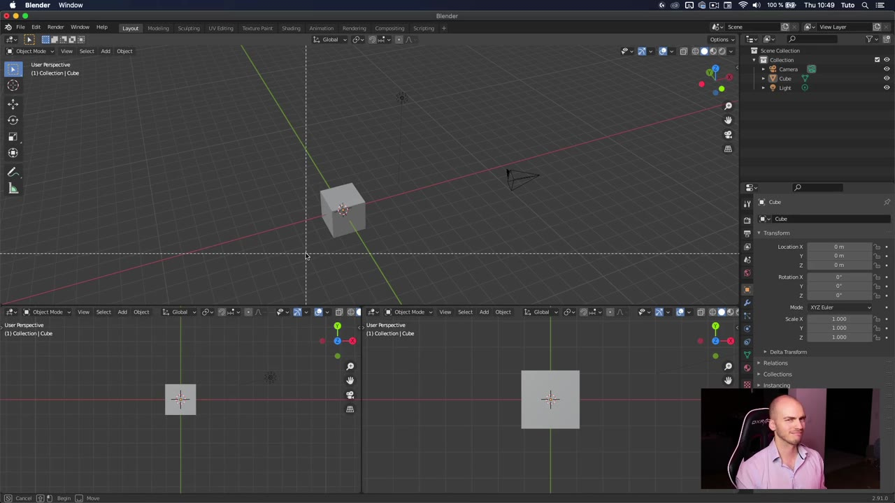
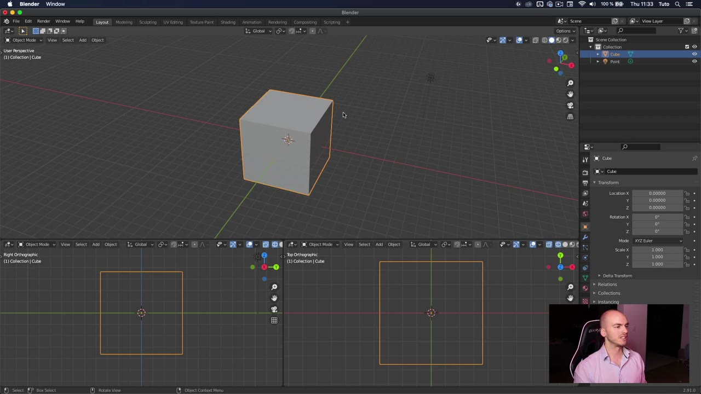

# 第 15 章 使用 Blender 创建自定义模型

本章介绍如何使用 Blender 这一免费开源的三维创作套件创建自定义模型，并将其导出为 glTF/GLB 格式供 Three.js 场景使用。目标是掌握简单实用的建模方法，并理解从几何编辑、材质设置到网页渲染的完整流程。

## 为什么要学习 Blender

之前我们已经学会了如何将已有模型导入 Three.js 场景，现在要更进一步，创建自己的定制化模型。市面上有多款三维软件可供选择：Cinema 4D、Maya、3D Studio Max、ZBrush、Marmoset Toolbag、Substance Painter 等，它们各有特点，在用户体验、性能、功能、兼容性和价格上存在差异。

我们选择 Blender 是因为它不仅是完全免费的，而且性能出色、跨平台兼容、功能丰富，拥有庞大的社区支持。更重要的是，自 2.8 版本以来，Blender 的界面和工作流已经变得更加直观友好。通过本章的学习，你将能够破除对三维建模软件的神秘感，获得创建简单模型所需的必要知识。

## 下载与安装 Blender

前往 Blender 官方网站下载最新版本：[https://www.blender.org/download/](https://www.blender.org/download/)。软件体积不大，数分钟内即可完成下载。安装过程简单直接，只需按照向导操作即可。

本章内容基于 Blender 2.83.5 编写录制。复现课程界面时可使用相近版本；使用新版 Blender 时，应根据官方文档确认菜单位置和功能变化，但核心建模概念仍然适用。

## 界面初探

### 启动与界面布局

首次启动 Blender 会显示启动画面，其中包含常用链接、模板和最近打开的文件列表。点击空白处即可关闭启动画面，进入主界面。

Blender 界面由多个可自定义的区域组成，每个区域负责不同的功能：
- **3D 视口**：主要的建模和场景查看区域。
- **时间轴**：用于创建和管理动画的时间线。
- **大纲视图**：显示场景中的所有对象，便于选择和层级管理。
- **属性面板**：显示当前选中对象的详细属性和环境设置。

这些区域的布局非常灵活，可以根据个人习惯进行调整。你可以通过拖动区域边界来调整大小，通过区域左上角的按钮切换区域类型，也可以在区域角落拖拽创建新的分割区域。

### 视图操作控制

在 3D 视口中导航是建模的基础操作。虽然可以使用触控板，但强烈建议使用带滚轮（可按下）的鼠标以提升工作效率。

**常用导航操作：**
- **环视旋转**：按住滚轮按钮（即中键）并拖动，或使用右上角的小操控器。
- **平移**：按住 `Shift + 中键` 并拖动，可左右、上下移动视图。
- **推拉**：使用滚轮缩放，或用鼠标中键配合 `Shift + Ctrl` 实现无限制的前后移动。
- **正交/透视切换**：按小键盘数字键 `5` 或在界面右上角切换相应图标。
- **对齐视图**：小键盘数字键 `1`、`3`、`7` 分别切换前视、右视和顶视；如需从相反方向观察，配合 `Ctrl` 键使用。

需要注意的是，在 Blender 中 Z 轴是垂直向上的轴，这与 Three.js 中 Y 轴向上的约定有所不同。后续导出模型时需要特别注意坐标轴的转换。

### 选择与交互

选择对象很简单——用鼠标左键单击即可。按住 `Shift` 键单击可实现多选。选中的对象会显示为橙色轮廓，其中轮廓更亮的对象为“活动对象”，其属性会在属性面板中显示。

选择操作也被视为可撤销的动作，如果误选可立即按 `Ctrl + Z` 撤销。其他快速选择技巧包括：
- 按 `A`：全选；双击 `A`：取消全选。
- 按 `B`：矩形框选模式。
- 按 `C`：刷选模式（可滚动滚轮调整刷子大小）。

## 基础建模操作

### 创建立方体

按 `Shift + A` 可打开添加菜单，光标会跟随一个上下文菜单。在「网格」子菜单中可以找到各种基本几何体，选择「立方体」便可在场景中添加一个默认的立方体。

创建对象后，左下角会短暂出现调整面板，可以在此精确设置尺寸、细分等参数。如果错过了这个面板，可按 `F9` 重新打开，但注意开始修改几何体后该面板将无法再次调用。

### 变换操作

Blender 中的变换操作与 Three.js 类似，包含三种基本变换：
- **移动**：选中对象后按 `G` 进行移动变换。
- **旋转**：按 `R` 进行旋转变换。
- **缩放**：按 `S` 进行缩放变换。

每种变换操作都可按特定轴进行约束：按 `X`、`Y` 或 `Z` 可将操作限制在该轴上。例如按 `G` 后立即按 `Z`，对象将只能在 Z 轴方向移动。

### 编辑模式

如果说对象模式便于整体操作，编辑模式则让我们能精细调整模型的几何结构。选中一个网格对象，按 `Tab` 键可在对象模式与编辑模式之间切换。

在编辑模式下，可以选择三种不同级别的几何元素：
- **顶点选择**：按数字键 `1` 或点击相应图标。
- **边选择**：按数字键 `2`。
- **面选择**：按数字键 `3`。

打开编辑模式后，我们就可以像在对象模式中那样对几何元素进行移动、旋转、缩放等变换，从而塑造出更复杂的形状。



*图 15-1 Blender 主要界面区域与工具栏位置*

## 关键功能与工具

### 细分表面修改器

修改器是 Blender 强大功能的核心之一，它们提供了非破坏性的修改方式，可以随时开启或关闭而不影响原始几何体。

细分表面修改器是最常用的修改器之一。它通过细分网格的同时平滑锐角来获得更圆润的形状。要为对象添加此修改器：
1. 选择对象，进入属性面板的修改器属性标签页。
2. 点击「添加修改器」，选择「细分表面」。
3. 调整「视口」细分级别控制平滑程度。

### 着色与渲染

Blender 提供多种着色方式，用于在 3D 视口中以不同详细程度预览场景：
- **实体着色**：默认方式，性能最佳，统一材质预览。
- **材质预览**：会如实显示材质和纹理效果。
- **线框模式**：仅显示网格结构。
- **渲染预览**：最接近最终渲染效果但性能消耗较大。

按 `Z` 键可打开着色方式选择圆盘菜单快速切换。

### 渲染引擎选择

Blender 内置三种渲染引擎，各有特点：
- **Eevee**：实时渲染引擎，类似 Three.js 的 GPU 渲染，性能出色但逼真度有限。
- **工作台**：传统渲染引擎，追求性能而非逼真度。
- **Cycles**：光线追踪引擎，可产生照片级效果但渲染耗时较长。

对于 Three.js 工作流，可以使用 Eevee 快速预览实时效果，也可以使用 Cycles 检查更精细的光照。需要注意，渲染引擎影响的是 Blender 预览与渲染结果，并不会随 glTF 一同导出；网页中的最终外观仍由 Three.js 材质、灯光和渲染设置决定。

要查看实际渲染效果：
1. 确保场景中有相机且视角合适。
2. 切换着色方式为渲染预览。
3. 按 `F12` 进行渲染。

## 创建汉堡模型实践

我们将通过创建一个汉堡模型来将上述知识融会贯通，这也是完整的从建模到导出的实践练习。

### 设定单位尺度

建模前首先确定单位尺度非常重要。Blender 默认将 1 个单位视为 1 米，网格中的每个方格代表 1 米。考虑到汉堡的实际尺寸，我们需要调整这个尺度概念：
- 可使用 1 单位 = 1 厘米的比例进行建模。
- 或在场景属性面板中将单位系统设为「无」以消除单位标注。

### 底部面包胚的制作

汉堡从底部面包胚开始。创建一个边长为 10 个单位的立方体作为基础形状，这为后续修改提供了足够的几何基础。

为立方体添加细分表面修改器，将视口细分级别提高到 3 或 4，立方体会逐渐变得圆润。但此时表面仍然由平面组成，不够平滑。

右击对象并选择「着色平滑」，让表面呈现出连续性。不过为了获得面包的形状，我们需要更多控制点。进入编辑模式后按 `Ctrl + R` 添加环切——黄色虚线出现时移动鼠标确定位置，单击确认，再拖动设定精确位置。

为面包胚的基础和顶部各添加一个环切，然后调整顶点位置，塑造出略带弧度的底部和圆润的顶部边缘。

### 肉饼与奶酪

肉饼制作相对简单：复制底部面包胚（对象模式下按 `Shift + D`）并适当压扁即可。

奶酪的制作则需更多技巧：
1. 在肉饼上方创建一个平面。
2. 进入编辑模式，选择平面仅有的面。
3. 右击选择「细分」，将切割次数设为 10。
4. 按 `O`（字母 O）激活比例编辑模式，这样移动单个顶点时会带动周围的顶点。
5. 滚动滚轮调整影响范围，拖动顶点塑造融化的奶酪边缘。

为了让奶酪更有厚度，添加「实体化」修改器并设置适当厚度。最后启用「自动平滑」功能（在对象数据属性的「法线」部分勾选），让表面只在适当的角度平滑，避免奶酪边缘过分圆润。

### 顶部面包胚

复制底部面包胚并调整为更圆润的球体形状，完成汉堡的主体结构。

### 材质赋予

接下来为各个部分赋予材质。选择底部面包胚，在材质属性面板创建新材质并重命名为「BunMaterial」。在材质的「基础色」中设置面包的颜色，调整「粗糙度」控制反光程度。

同样的方法为肉饼和奶酪创建相应的材质。对于顶部面包胚，直接选择已有的「BunMaterial」即可。

如果场景过暗，可选择灯光对象，在对象数据属性中提高灯光强度，例如设为 5000。将灯光适当远离汉堡并调整角度以获得更好的照明效果。



*图 15-2 汉堡模型在 Blender 中的制作与材质设置*

## 导出与 Three.js 集成

模型完成后，即可导出为 Three.js 可用的格式。

### 导出设置

选择汉堡的所有组成部分（注意避免选中灯光或相机），通过菜单「文件」→「导出」→「glTF 2.0 (.glb/.gltf)」打开导出面板。

关键设置包括：
- **格式**：选择 glTF 二进制（.glb），便于把模型及相关资源打包为单个文件分发。
- **仅输出选中对象**：确保导出的只有汉堡本身。
- **Y 轴向上**：转换坐标轴使+Y成为垂直向上方向，与 Three.js 约定兼容。
- **应用修改器**：务必勾选此项，确保细分表面等修改器效果被转换到几何体中。
- **包含法线**：勾选以保持正确的光照效果。
- **包含材质**：勾选以保留材质设置。
- **压缩**：使用 Draco 压缩可显著减小文件大小。

### Three.js 加载

导出的汉堡模型可以在 Three.js 项目中通过 GLTFLoader 加载：

```javascript
gltfLoader.load(
    '/models/hamburger.glb',
    (gltf) => {
        const hamburger = gltf.scene;
        scene.add(hamburger);
    }
);
```

如果模型过大或需要针对网页环境优化，可在导出时启用 Draco 压缩，但需注意 Three.js 项目需要包含相应的 Draco 解码器。

## 常见问题与解决方案

### 界面混乱或操作失误

如果操作失误导致界面混乱或场景丢失，最快捷的恢复方法是关闭 Blender 重新打开。Blender 会自动为每次保存创建备份文件（.blend1），如有需要可将其重命名为 .blend 来恢复上次保存的状态。

### 找不到命令或功能

Blender 功能丰富但菜单层级复杂，按 `F3` 打开搜索面板可快速定位任何操作。输入功能名称即可找到相关命令及其快捷键。

### 视图导航困难

视图导航是初期最易遇到的困难。确保使用带中键的鼠标，记住核心导航操作：
1. 中键拖动：环视旋转。
2. Shift + 中键：平移视图。
3. 滚轮：缩放视图。
4. Shift + C：将视图重置到场景中心。

如果因缩放过度导致视图“卡住”，使用 `Shift + Ctrl + 中键` 进行真正的视图推拉而非缩放。

### 材质显示异常

如果材质在 3D 视口中不可见，检查着色方式是否为「材质预览」或「渲染预览」。在实体着色模式下所有对象会显示为统一的灰色。

### 导出后模型异常

如果导出后的模型看起来与 Blender 中完全不同，检查是否勾选了「应用修改器」。此外确认导出设置中的「Y 轴向上」已勾选，以正确转换坐标轴系统。

## 本章小结

本章系统介绍了如何使用 Blender 创建自定义三维模型并集成到 Three.js 项目中。主要知识点包括：

1. **Blender 基础**：界面组成、视图导航、选择与变换操作，为后续建模奠定基础。
2. **建模流程**：通过汉堡模型的完整制作过程，学习了从基础几何体到复杂形状的塑造技巧，特别是细分表面修改器、比例编辑和实体化修改器的应用。
3. **材质系统**：创建和分配基于物理的材质，调整基础色与粗糙度等关键参数来控制视觉效果。
4. **导出优化**：将完成的作品导出为 glTF/GLB 格式，重点关注与 Three.js 兼容的设置选项，包括坐标轴转换、修改器应用和几何压缩。

掌握这些基础后，你已经具备了创建简单模型的能力。虽然距离专业级建模仍有差距，但这一起点足以支持大多数 Three.js 项目的模型需求。后续可借助 Blender 丰富的在线教程资源进一步深化技能，记得优先选择基于 2.8 及以上版本的教程以匹配现代工作流。

记住，三维建模的关键在于耐心和实践——从简单形状开始，逐步添加细节，最终你将能够创造出令人满意的个性化三维资产。