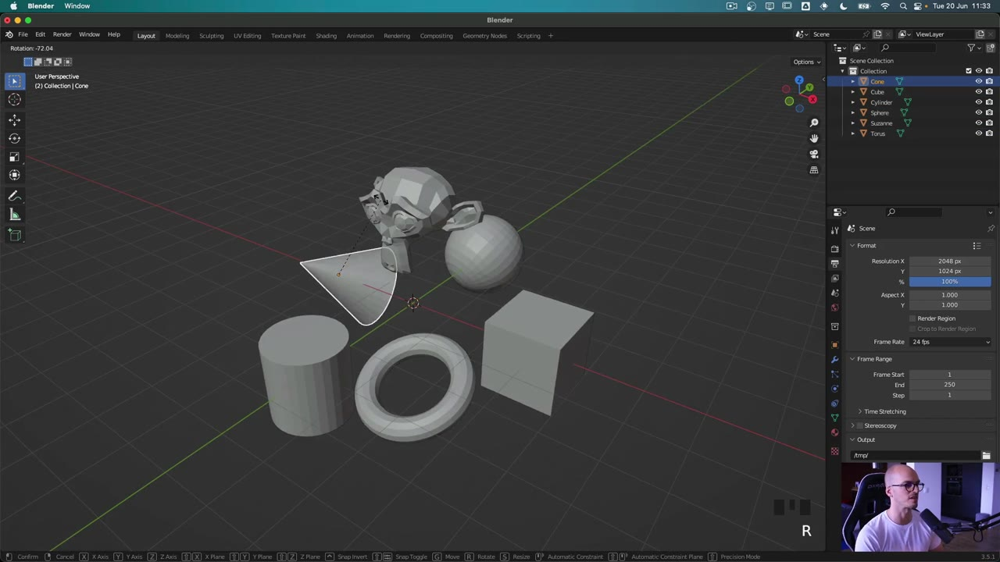
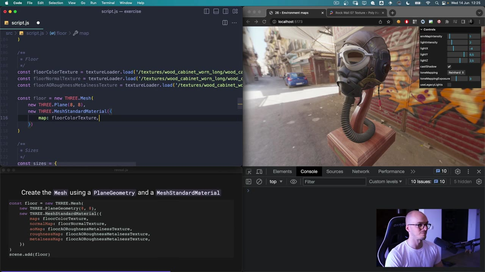

# 第 16 章 环境贴图与写实渲染

环境贴图不仅仅是场景的背景，更是实现真实感渲染的关键技术。通过将全景图像应用到场景环境，我们不仅能为三维空间提供视觉上下文，还能为材质提供精确的反射信息与环境照明。本章将系统介绍立方体贴图与等距柱状投影两种主流环境贴图格式，探讨它们在 Three.js 中的实现方式，并深入讲解如何通过色调映射、抗锯齿、色彩空间调校等一系列技术，将模型渲染提升至接近真实的视觉品质。

## 环境贴图的核心概念

环境贴图本质上是一种全景图像，它记录了某个观察点周围 360° 的视觉信息。在三维渲染中，这种图像主要有三大用途：作为场景背景直接显示、为反射表面提供反射源图像，以及为整个场景提供基于图像的环境照明。

使用环境贴图的环境照明与传统人工光源不同，它能够模拟真实世界中复杂的光照交互。例如，一个室外场景的环境贴图不仅包含天空的光照，还包含地面反射、建筑物阴影等细微的光影变化，为模型提供更加自然和丰富的照明效果。

### 模型准备

为了充分展示环境贴图的效果，我们使用 GLTF 样本模型库中的飞行头盔模型。这个模型具有丰富的材质细节，包括金属、塑料、皮革等多种表面类型，适合用来测试不同环境贴图的表现效果。

首先，我们需要加载并设置模型：

```javascript
import { GLTFLoader } from 'three/examples/jsm/loaders/GLTFLoader.js'

/**
 * 加载器
 */
const gltfLoader = new GLTFLoader()

/**
 * 模型加载
 */
gltfLoader.load(
    '/models/FlightHelmet/glTF/FlightHelmet.gltf',
    (gltf) => {
        gltf.scene.scale.set(10, 10, 10)
        scene.add(gltf.scene)
    }
)
```

由于 `MeshStandardMaterial` 材质需要光源才能正确显示，此时模型在场景中可能呈现为黑色或暗色。这正是后续环境贴图照明要解决的问题。

## 立方体贴图环境贴图

立方体贴图是最基本的环境贴图格式，它将全景图像分解为立方体的六个面：正 X（右）、负 X（左）、正 Y（上）、负 Y（下）、正 Z（前）、负 Z（后）。这种格式在 WebGL 中有着广泛支持，性能开销相对较小。

### 加载立方体贴图

Three.js 提供了专门的 `CubeTextureLoader` 来加载立方体贴图资源：

```javascript
const cubeTextureLoader = new THREE.CubeTextureLoader()

/**
 * 环境贴图
 */
// LDR 立方体贴图
const environmentMap = cubeTextureLoader.load([
    '/environmentMaps/0/px.png',
    '/environmentMaps/0/nx.png',
    '/environmentMaps/0/py.png',
    '/environmentMaps/0/ny.png',
    '/environmentMaps/0/pz.png',
    '/environmentMaps/0/nz.png'
])
```

这些贴图通常来自 Poly Haven 等高清全景图像资源库，并通过工具转换为立方体格式。

### 作为背景与照明源

加载后的环境贴图可以同时用作场景背景和环境照明：

```javascript
// 设置为场景背景
scene.background = environmentMap

// 设置为环境照明
scene.environment = environmentMap
```

`scene.background` 使环境贴图直接显示为场景背景，而 `scene.environment` 则让环境贴图参与基于物理的材质光照计算，影响 `MeshStandardMaterial`、`MeshPhysicalMaterial` 等材质。后者让物体的高光、反射和漫反射利用环境信息，是实现真实感渲染的重要配置。



*图 16-1 使用立方体贴图作为场景背景与环境照明*

## 等距柱状投影与高动态范围

立方体贴图和等距柱状投影都可以表示完整环境。前者由六张面图组成，后者用单张全景图保存方向信息，资源制作和加载流程因而不同。等距柱状投影并不等于天然没有接缝或失真，实际效果仍取决于图像质量、映射方式和采样设置。

### HDRI 环境贴图

高动态范围图像能够保存远超普通显示范围的辐射亮度信息，使明亮光源与暗部之间保留更丰富的数值差异。与低动态范围图像相比，这些额外信息更适合驱动基于图像的照明和反射。

加载 HDRI 环境贴图需要使用等距柱状投影纹理加载器：

```javascript
import { RGBELoader } from 'three/examples/jsm/loaders/RGBELoader.js'

const rgbeLoader = new RGBELoader()

rgbeLoader.load('/environmentMaps/1/2k.hdr', (environmentMap) => {
    // 设置为环境贴图
    environmentMap.mapping = THREE.EquirectangularReflectionMapping
    scene.environment = environmentMap
    scene.background = environmentMap
})
```

需要注意的是，HDRI 文件通常比 LDR 图像大得多，在使用时需要权衡文件大小与视觉质量。

### PMREM 预计算

由于 HDRI 需要实时计算漫反射环境光照，这可能会对性能产生影响。Three.js 提供了 `PMREMGenerator` 来预计算环境贴图的光照信息：

```javascript
const pmremGenerator = new THREE.PMREMGenerator(renderer)
pmremGenerator.compileEquirectangularShader()

rgbeLoader.load('/environmentMaps/1/2k.hdr', (environmentMap) => {
    const generatedCubeRenderTarget = pmremGenerator.fromEquirectangular(environmentMap)
    scene.environment = generatedCubeRenderTarget.texture

    // 清理临时资源
    environmentMap.dispose()
    pmremGenerator.dispose()
})
```

PMREM（Prefiltered Mipmap Radiance Environment Map）在加载阶段预计算环境辐射信息，并为不同粗糙度准备预过滤结果，供漫反射与镜面环境光照使用。它把原本昂贵的环境采样工作转化为渲染时更高效的纹理查询；代价是初始化计算、显存占用和加载时间。

## 环境贴图的生成与获取

### Blender 生成环境贴图

Blender 不仅可以创建三维模型，还能生成高质量的环境贴图。通过设置适当的摄像机参数和渲染设置，Blender 能够输出立方体贴图或等距柱状投影格式的环境贴图，特别适合创建与场景模型完全匹配的环境光照。

### AI 辅助生成

近年来，AI 图像生成技术在环境贴图创建方面展现出强大能力：

1. **NVIDIA Canvas**：基于 AI 的绘画工具，可以将简单的笔触转化为逼真的全景图像
2. **Blockade Labs**：专门针对环境贴图生成的 AI 工具，能够根据文字描述创建带有照明信息的环境图像

这些工具大大降低了环境贴图的创作门槛，使开发者无需专业的摄影设备或全景拍摄技术就能获得高质量的环境资源。

## 实现写实渲染的关键技术

环境贴图提供了良好的光照基础，但要达到真正的写实效果，还需要多项渲染技术的协同工作。

### 色调映射

色调映射是将高动态范围值转换为低动态范围值的过程。即使在没有真正 HDR 内容的情况下，Three.js 的色调映射也能模拟出逼真的动态范围压缩效果。

```javascript
// 可用的色调映射算法
renderer.toneMapping = THREE.ACESFilmicToneMapping  // ACES 电影色调映射
renderer.toneMapping = THREE.ReinhardToneMapping    // Reinhard 色调映射
renderer.toneMapping = THREE.CineonToneMapping      // Cineon 胶片色调映射
renderer.toneMapping = THREE.LinearToneMapping     // 线性色调映射
```

每种色调映射算法都有其特点：`ACESFilmicToneMapping` 提供接近电影工业标准的色彩响应；`ReinhardToneMapping` 在保持高光细节方面表现良好；`CineonToneMapping` 模拟胶片特性；`LinearToneMapping` 则是最直接的线性转换。

```javascript
// 调整色调映射的曝光值
renderer.toneMappingExposure = 3

// 通过 lil-gui 进行实时调整
gui.add(renderer, 'toneMappingExposure').min(0).max(10).step(0.001)
```

通过调整曝光值，可以控制场景的整体亮度水平，这对于匹配不同环境光的强度至关重要。

### 抗锯齿技术

锯齿是实时渲染中的常见问题，表现为几何体边缘的阶梯状像素化效果。Three.js 支持多种抗锯齿解决方案：

```javascript
// 启用硬件抗锯齿
const renderer = new THREE.WebGLRenderer({
    canvas: canvas,
    antialias: true
})
```

硬件抗锯齿基于多采样技术（MSAA），只在几何边缘进行多重采样，在保持性能的同时有效减少锯齿。对于需要更高视觉质量的场景，可以考虑通过提高渲染分辨率来实现超采样：

```javascript
// 手动设置渲染分辨率
renderer.setPixelRatio(Math.min(window.devicePixelRatio, 2))
```

需要注意的是，过高的像素比会显著增加 GPU 负载，需要在视觉质量和性能之间找到平衡点。

### 阴影优化

真实感渲染离不开精确的阴影。对于环境贴图照明的场景，可能需要结合定向光或聚光灯来生成清晰的阴影。

```javascript
// 定向光配置
const directionalLight = new THREE.DirectionalLight(0xffffff, 1)
directionalLight.position.set(3, 4, 5)
directionalLight.castShadow = true

// 阴影贴图设置
directionalLight.shadow.mapSize.width = 2048
directionalLight.shadow.mapSize.height = 2048
directionalLight.shadow.camera.near = 0.5
directionalLight.shadow.camera.far = 10

scene.add(directionalLight)
```

阴影的质量与阴影贴图的分辨率直接相关。较高的分辨率产生更清晰的阴影边缘，但也会增加内存使用和渲染开销。

### 色彩空间管理

正确的色彩空间配置对于保持材质颜色的准确性至关重要：

```javascript
// 设置渲染器的色彩空间
renderer.outputColorSpace = THREE.SRGBColorSpace

// 对于纹理，确保加载后正确配置
textureLoader.load('/path/to/texture.jpg', (texture) => {
    texture.colorSpace = THREE.SRGBColorSpace
    // 应用纹理
})
```

现代显示器和网络内容普遍使用 sRGB 色彩空间。如果不正确配置，颜色可能会显得过暗或过饱和。对于 HDRI 环境贴图，通常应保持线性色彩空间，因为它们在着色器中会经过正确的伽马校正。

### 材质参数微调

即使有了完善的环境光照，材质本身的参数配置也直接影响最终效果：

```javascript
// 材质参数调整示例
const material = new THREE.MeshStandardMaterial({
    roughness: 0.3,             // 粗糙度控制表面微细节
    metalness: 0.8,             // 金属度决定反射特性
    envMapIntensity: 1.5,       // 环境贴图强度
    aoMapIntensity: 1.0,        // 环境光遮蔽强度
    normalScale: new THREE.Vector2(1, 1),  // 法线贴图强度
    color: new THREE.Color(0x888888)
})
```

通过 GUI 实时调整这些参数，可以直观地找到最佳材质表现：

```javascript
gui.add(material, 'roughness').min(0).max(1).step(0.001)
gui.add(material, 'metalness').min(0).max(1).step(0.001)
gui.add(material, 'envMapIntensity').min(0).max(5).step(0.001)
```

## 汉堡模型案例实践

回顾早期课程中的汉堡模型，当时由于缺乏环境照明和材质优化，渲染效果较为平淡。应用本章技术后，我们可以显著提升其真实感：

```javascript
// 汉堡模型优化配置
const renderSettings = {
    toneMapping: THREE.ACESFilmicToneMapping,
    toneMappingExposure: 3
}

// 应用环境贴图
scene.environment = hdrEnvironmentMap

// 调整渲染设置
renderer.toneMapping = renderSettings.toneMapping
renderer.toneMappingExposure = renderSettings.toneMappingExposure
```

通过引入 HDRI 环境贴图、优化色调映射参数、微调材质属性，原本平淡的汉堡模型能够呈现出丰富的表面细节和真实的光影互动。



*图 16-2 写实渲染场景中的材质、环境照明与色调映射调整*

## 性能与质量平衡

写实渲染技术在提升视觉效果的同时，也需要关注性能影响：

1. **环境贴图分辨率**：过高的 HDRI 分辨率会显著增加内存使用和加载时间
2. **阴影质量**：阴影贴图分辨率、采样范围和软阴影设置都影响性能
3. **抗锯齿级别**：更高的抗锯齿质量需要更多 GPU 计算资源
4. **PMREM 预计算**：虽然提升运行时性能，但增加加载时间

建议的开发流程是：先在开发阶段使用高质量设置确保最佳视觉效果，再针对目标平台和设备进行渐进式优化，在视觉质量和运行流畅度之间找到最佳平衡点。

## 本章小结

环境贴图与写实渲染技术共同构建了 Three.js 中高品质三维内容的基础。本章系统探讨了：

- **环境贴图的两种主要格式**：立方体贴图提供良好的性能和兼容性，而等距柱状投影的 HDRI 则提供无缝的高动态范围环境
- **环境贴图的三重作用**：作为视觉背景、反射源和环境照明源，其中环境照明是实现真实感渲染的关键
- **PMREM 技术**：通过预计算环境辐射和不同粗糙度下的预过滤结果，在保持视觉质量的同时提高运行时采样效率
- **写实渲染技术栈**：包括色调映射、抗锯齿、色彩空间管理、阴影优化和材质微调在内的完整技术链条
- **实践工作流**：从环境贴图获取与生成，到实际项目中的参数调校与性能优化

这些技术并非孤立存在，而是相互协同：环境贴图提供物理准确的光照基础，色调映射调整整体色彩响应，抗锯齿优化边缘质量，材质参数微调表面细节，最终共同实现接近真实的渲染效果。

对于实际项目开发，建议采用迭代式方法：先从核心的环境贴图和基础材质开始，逐步引入色调映射、抗锯齿等增强技术，并通过实时调整工具不断优化，直到达到目标设备上的视觉与性能平衡。随着 WebGL 硬件能力和 Three.js 生态持续发展，在网页端实现高品质的真实感渲染已成为可行的创作路径。