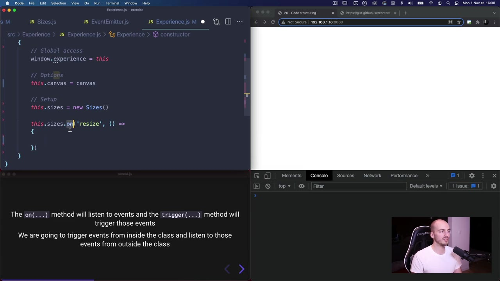
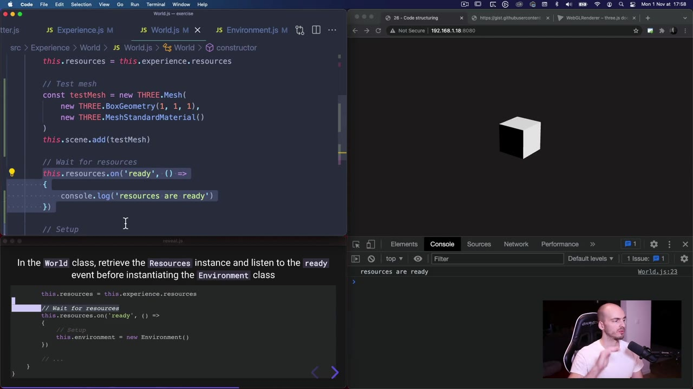

# 第 17 章 大型项目的代码组织

随着 Three.js 项目的复杂度提升，将所有代码放在单个文件中的做法会迅速演变成难以维护的“意大利面式代码”。本章将介绍如何使用类与模块将 WebGL 体验拆分为职责明确、便于复用和团队协作的代码结构，并重点讲解以 Experience 单例为核心的架构设计模式。

## 为什么要重构代码结构

在小型项目中，我们通常把所有代码——包括加载器、相机、渲染器、材质更新、事件处理——都写在一个文件中，仅通过注释分隔不同功能。这种做法的弊端在项目规模扩大时会凸显：

1. **难以定位代码**：需要频繁滚动文件才能找到特定功能；
2. **难以复用部件**：要复用某个功能（如狐狸模型）时，无法将其独立提取；
3. **命名冲突风险**：不同部分容易使用相同变量名（如 `i`、`j`）；
4. **团队协作困难**：多人同时修改同一文件会导致频繁的版本冲突；
5. **代码健康度下降**：文件过长会影响开发效率和代码质量。

模块化的目标正是解决这些问题：通过合理的职责划分，让每个文件只关心单一功能，并通过明确定义的接口与其他部分通信。

## 模块基础：文件拆分与导入导出

模块（Module）的核心思想是将代码拆分为多个文件，在需要时导入它们。我们已经在使用模块：导入 Three.js、GSAP 等库时，使用的就是模块机制。

### 创建与导出模块

每个模块文件可以采用默认导出或命名导出。一个文件最多只能有一个默认导出；命名导出则可以有多个。本课程通常让每个文件承担一个主要职责，并以默认导出一个类或函数为主。

```javascript
// test.js：一个默认导出和两个命名导出
export default function logHello() {
  console.log('Hello Module');
}

export const message = 'Hello Module';
export const settings = { enabled: true };
```

### 导入模块

在另一个文件中使用 `import` 语句导入模块内容。默认导入的名称由导入方决定，命名导入则要与导出名称一致：

```javascript
// script.js
import logHello, { message, settings } from './test.js';

logHello();
console.log(message);
console.log(settings.enabled);
```

导入路径前的 `./` 表示相对路径，非常重要。没有 `./` 时，系统会将导入说明符解释为包名或包内路径，通常会在 `node_modules` 中查找模块。

## 类（Class）的基本概念

类是面向对象编程的基础，它封装了数据（属性）和行为（方法）。

### 类的定义与实例化

```javascript
// 定义 Robot 类
class Robot {
  constructor(name) {
    this.name = name;
    console.log(`Robot ${name} created`);
  }

  sayHi() {
    console.log(`Hello, my name is ${this.name}`);
  }
}

// 实例化类
const robot1 = new Robot('WALL-E');
const robot2 = new Robot('Ultron');
const robot3 = new Robot('Astro Boy');

robot1.sayHi(); // 输出: 'Hello, my name is WALL-E'
```

### 类的继承

继承允许一个类基于另一个类创建，复用父类的功能并添加新的特性。

```javascript
// 基类
class Robot {
  constructor(name) {
    this.name = name;
  }

  sayHi() {
    console.log(`Hello, my name is ${this.name}`);
  }
}

// 派生类
class FlyingRobot extends Robot {
  constructor(name) {
    super(name); // 调用父类构造函数
  }

  takeOff() {
    console.log(`${this.name} takes off`);
  }

  land() {
    console.log(`${this.name} lands`);
  }
}

// 使用派生类
const flyingRobot = new FlyingRobot('Astro Boy');
flyingRobot.sayHi();   // 继承自 Robot
flyingRobot.takeOff(); // FlyingRobot 特有方法
```

## 构建 Experience 单例架构

在 Experience 架构中，我们创建一个名为 `Experience` 的单例类作为整个 WebGL 体验的入口和控制中心。



*图 17-1 Experience 单例负责实例化并协调所有核心组件*

### 项目结构规划

建议的项目组织结构如下：

```
src/
├── Experience/          # 体验相关核心类
│   ├── Experience.js    # 主单例类
│   ├── Camera.js        # 相机控制
│   ├── Renderer.js      # 渲染器
│   ├── World/           # 3D 世界内容
│   │   ├── World.js     # 世界容器
│   │   ├── Fox.js       # 狐狸模型
│   │   └── Floor.js     # 地面
│   └── Utils/           # 工具类
│       ├── Sizes.js     # 尺寸管理
│       ├── Time.js      # 时间管理
│       ├── Resources.js # 资源加载
│       └── EventEmitter.js # 事件系统
└── script.js            # 应用入口
```

### 实现单例模式

单例模式确保 `Experience` 类在整个应用中只被实例化一次。

```javascript
// Experience/Experience.js
import * as THREE from 'three';

let instance = null;

export default class Experience {
  constructor() {
    // 单例检查
    if (instance) {
      return instance;
    }
    instance = this;

    // 全局访问（可选）
    window.experience = this;

    // 初始化工具类
    this.sizes = new Sizes();
    this.time = new Time();
    this.scene = new THREE.Scene();

    // 初始化核心组件
    this.camera = new Camera();
    this.renderer = new Renderer();
    this.world = new World();

    // 开始渲染循环
    this.time.on('tick', () => {
      this.update();
    });
  }

  update() {
    this.camera.update();
    this.world.update();
    this.renderer.update();
  }
}
```

## 工具类（Utils）详解

工具类封装通用功能，便于在多个项目中复用。

### Sizes：尺寸与视口管理

```javascript
// Experience/Utils/Sizes.js
import EventEmitter from './EventEmitter.js';

export default class Sizes extends EventEmitter {
  constructor() {
    super();

    this.width = window.innerWidth;
    this.height = window.innerHeight;
    this.pixelRatio = Math.min(window.devicePixelRatio, 2);

    // 响应视口变化
    window.addEventListener('resize', () => {
      this.width = window.innerWidth;
      this.height = window.innerHeight;
      this.pixelRatio = Math.min(window.devicePixelRatio, 2);

      // 触发resize事件
      this.trigger('resize');
    });
  }
}
```

### Time：时间与帧率管理

```javascript
// Experience/Utils/Time.js
import EventEmitter from './EventEmitter.js';

export default class Time extends EventEmitter {
  constructor() {
    super();

    this.start = Date.now();
    this.current = this.start;
    this.elapsed = 0;
    this.delta = 16; // 假设16ms（60fps）

    // 开始动画循环
    window.requestAnimationFrame(() => {
      this.tick();
    });
  }

  tick() {
    const currentTime = Date.now();
    this.delta = currentTime - this.current;
    this.current = currentTime;
    this.elapsed = this.current - this.start;

    this.trigger('tick');

    // 继续下一帧
    window.requestAnimationFrame(() => {
      this.tick();
    });
  }
}
```

### Resources：异步资源加载

```javascript
// Experience/Utils/Resources.js
import EventEmitter from './EventEmitter.js';
import * as THREE from 'three';
import { GLTFLoader } from 'three/examples/jsm/loaders/GLTFLoader.js';
import { DRACOLoader } from 'three/examples/jsm/loaders/DRACOLoader.js';

export default class Resources extends EventEmitter {
  constructor(sources) {
    super();

    this.sources = sources;
    this.items = {};
    this.toLoad = this.sources.length;
    this.loaded = 0;

    this.setLoaders();
    this.startLoading();
  }

  setLoaders() {
    this.loaders = {
      gltfLoader: new GLTFLoader(),
      textureLoader: new THREE.TextureLoader(),
      cubeTextureLoader: new THREE.CubeTextureLoader()
    };

    // 配置DRACO压缩
    const dracoLoader = new DRACOLoader();
    dracoLoader.setDecoderPath('/draco/');
    this.loaders.gltfLoader.setDRACOLoader(dracoLoader);
  }

  startLoading() {
    for (const source of this.sources) {
      this.loaders[source.loader].load(
        source.path,
        (file) => {
          this.sourceLoaded(source, file);
        }
      );
    }
  }

  sourceLoaded(source, file) {
    this.items[source.name] = file;
    this.loaded++;

    if (this.loaded === this.toLoad) {
      this.trigger('ready');
    }
  }
}
```

### EventEmitter：事件系统基类

```javascript
// Experience/Utils/EventEmitter.js
export default class EventEmitter {
  constructor() {
    this.callbacks = {};
  }

  on(event, callback) {
    if (!this.callbacks[event]) {
      this.callbacks[event] = [];
    }
    this.callbacks[event].push(callback);
  }

  trigger(event, ...args) {
    const callbacks = this.callbacks[event];
    if (callbacks) {
      callbacks.forEach(callback => {
        callback(...args);
      });
    }
  }
}
```

## 核心组件实现

### Camera：相机与控制器

```javascript
// Experience/Camera.js
import * as THREE from 'three';
import { OrbitControls } from 'three/examples/jsm/controls/OrbitControls.js';
import Experience from './Experience.js';

export default class Camera {
  constructor() {
    this.experience = new Experience(); // 获取单例
    this.sizes = this.experience.sizes;
    this.scene = this.experience.scene;
    this.canvas = this.experience.canvas;

    this.setInstance();
    this.setControls();
  }

  setInstance() {
    this.instance = new THREE.PerspectiveCamera(
      35,
      this.sizes.width / this.sizes.height,
      0.1,
      100
    );
    this.instance.position.set(6, 4, 8);
    this.scene.add(this.instance);
  }

  setControls() {
    this.controls = new OrbitControls(this.instance, this.canvas);
    this.controls.enableDamping = true;
  }

  resize() {
    this.instance.aspect = this.sizes.width / this.sizes.height;
    this.instance.updateProjectionMatrix();
  }

  update() {
    this.controls.update();
  }
}
```

### Renderer：WebGL渲染器

```javascript
// Experience/Renderer.js
import * as THREE from 'three';
import Experience from './Experience.js';

export default class Renderer {
  constructor() {
    this.experience = new Experience();
    this.canvas = this.experience.canvas;
    this.sizes = this.experience.sizes;
    this.scene = this.experience.scene;
    this.camera = this.experience.camera;

    this.setInstance();
  }

  setInstance() {
    this.instance = new THREE.WebGLRenderer({
      canvas: this.canvas,
      antialias: true,
      alpha: true
    });
    this.instance.setSize(this.sizes.width, this.sizes.height);
    this.instance.setPixelRatio(this.sizes.pixelRatio);
    this.instance.setClearColor('#211d20', 1);

    // 物理渲染配置
    this.instance.physicallyCorrectLights = true;
    this.instance.outputEncoding = THREE.sRGBEncoding;
    this.instance.toneMapping = THREE.ACESFilmicToneMapping;
    this.instance.toneMappingExposure = 1;
  }

  resize() {
    this.instance.setSize(this.sizes.width, this.sizes.height);
    this.instance.setPixelRatio(this.sizes.pixelRatio);
  }

  update() {
    this.instance.render(this.scene, this.camera.instance);
  }
}
```

### World：3D世界内容容器

```javascript
// Experience/World/World.js
import * as THREE from 'three';
import Experience from '../Experience.js';
import Environment from './Environment.js';
import Fox from './Fox.js';

export default class World {
  constructor() {
    this.experience = new Experience();
    this.scene = this.experience.scene;
    this.resources = this.experience.resources;

    // 等待资源加载完成后创建世界
    this.resources.on('ready', () => {
      this.environment = new Environment();
      this.fox = new Fox();
    });
  }

  update() {
    if (this.fox) {
      this.fox.update();
    }
  }
}
```



*图 17-2 各组件通过事件系统和单例实例相互协作*

## 组件间通信的三种模式

在复杂架构中，组件需要相互通信。本课程介绍了三种主要模式：

### 1. 参数传递模式
通过构造函数参数显式传递依赖项：

```javascript
class Camera {
  constructor(experience) {
    this.experience = experience;
    this.sizes = experience.sizes;
  }
}

// 使用
const camera = new Camera(experience);
```

**优点**：依赖关系明确，便于理解
**缺点**：深度嵌套时传递链过长

### 2. 全局变量模式
通过全局对象（如 `window.experience`）访问：

```javascript
class Camera {
  constructor() {
    this.experience = window.experience;
    this.sizes = window.experience.sizes;
  }
}
```

**优点**：使用简单，无需传递参数
**缺点**：依赖隐藏，类型检查困难

### 3. 单例模式（推荐）
通过单例类的静态实例访问：

```javascript
// 在 Experience.js 中
let instance = null;

export default class Experience {
  constructor() {
    if (instance) return instance;
    instance = this;
    // ... 初始化
  }
}

// 在其他类中
import Experience from './Experience.js';

class Camera {
  constructor() {
    this.experience = new Experience(); // 实际返回已有实例
    this.sizes = this.experience.sizes;
  }
}
```

**优点**：兼顾明确性和便利性
**缺点**：实现相对复杂

## 资源管理与清理

### 统一资源管理
通过 `Resources` 类集中管理所有外部资源（模型、纹理、声音等），确保：
- 统一加载进度跟踪
- 一致的错误处理
- 内存使用监控
- 按需释放资源

### 销毁模式
当用户离开页面或需要重新初始化场景时，应正确清理资源：

```javascript
// Experience.js 中添加销毁方法
destroy() {
  // 清理渲染相关资源
  this.renderer.instance.dispose();

  // 移除事件监听
  this.sizes.off('resize');
  this.time.off('tick');

  // 清理子组件
  this.world.destroy();
  this.camera.controls.dispose();

  // 清理 Three.js 资源
  this.scene.traverse((object) => {
    if (object.geometry) object.geometry.dispose();
    if (object.material) {
      Object.values(object.material).forEach(value => {
        if (value && typeof value.dispose === 'function') {
          value.dispose();
        }
      });
    }
  });
}
```

## 性能与调试考虑

### 模块化带来的性能影响
使用模块和类会略微增加初始加载时间，因为需要加载多个小文件。但通过以下方式可以缓解：

1. **Webpack 打包**：将所有模块合并为单个文件
2. **代码分割**：按需加载非核心模块
3. **Tree Shaking**：移除未使用的代码

### 开发体验优化
1. **热重载支持**：模块化结构更容易与 Webpack 的热模块替换集成
2. **类型检查**：结合 TypeScript 可获得更好的类型安全和代码提示
3. **调试友好**：每个类的命名会在错误堆栈中显示，便于定位问题

## 应用入口与模块整合

最终的主入口文件变得极为简洁：

```javascript
// script.js
import Experience from './Experience/Experience.js';

// 创建体验实例
const experience = new Experience();

// 开发调试：将实例挂载到 window
if (process.env.NODE_ENV === 'development') {
  window.experience = experience;
}
```

## 本章小结

本章系统地介绍了适用于大型 Three.js 项目的代码组织方法，核心要点包括：

1. **模块化分割**：通过将不同功能拆分为独立文件，提升代码的可维护性和复用性。每个文件专注单一职责，通过明确接口与其他模块通信。

2. **类与继承**：使用类封装数据和行为，建立清晰的层次结构。派生类可复用基类功能，同时添加或修改特定行为，适合构建组件家族（如不同相机类型）。

3. **Experience 单例架构**：采用以 Experience 为中心的设计模式，将整个 WebGL 体验封装为可自包含的单元。单例模式确保全局状态的一致性，便于组件间通信。

4. **工具类抽象**：将尺寸管理、时间控制、资源加载、事件系统等通用功能提取为独立工具类，便于跨项目复用和独立测试。

5. **组件通信策略**：对比分析了参数传递、全局变量和单例访问三种通信模式，并建议在复杂项目中使用单例模式平衡明确性与便利性。

6. **资源生命周期**：强调统一资源管理的重要性，提供资源加载、使用和释放的完整模式，防止内存泄漏。

这种结构化方法虽然初期会增加一些复杂性，但在处理包含数千行代码的真实商业项目时，它能显著提升开发效率、团队协作质量和长期维护性。实际项目中，可以根据团队习惯和技术栈调整具体实现，但保持清晰的职责分离和接口定义是可持续代码架构的核心。