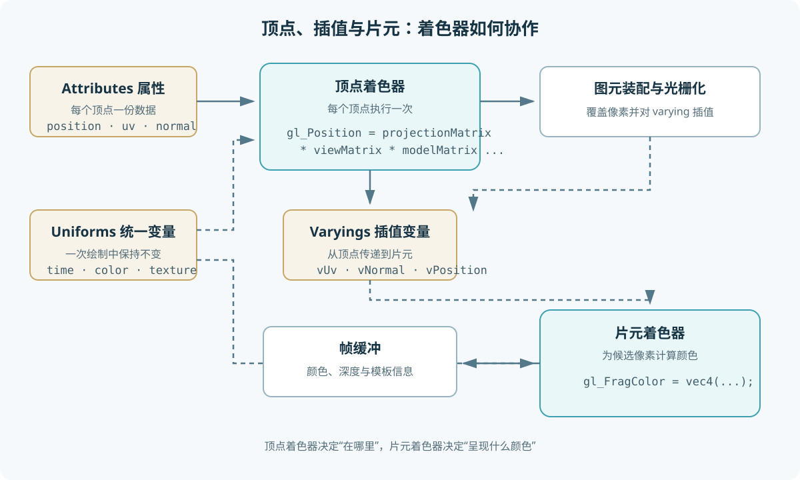
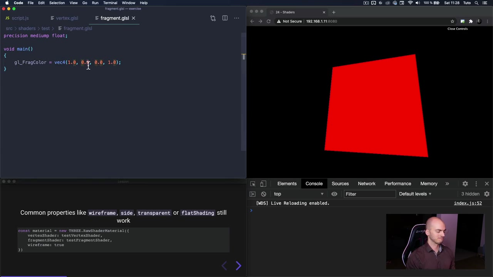
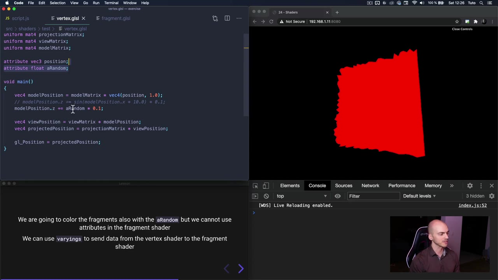

# 第 18 章 着色器基础

本章是 Three.js 着色器编程的入门指南。虽然我们从课程开始就一直使用着色器（Three.js 内置材质均由着色器构成），但现在是时候亲手创建自定义着色器了。通过本章的学习，你将掌握 GLSL 语法、顶点与片元着色器的工作原理、uniforms、attributes、varyings 等核心概念，并能实现旗帜飘扬、颜色调节、纹理贴图等基础着色效果。

## 着色器是什么

着色器是 WebGL 的核心组件之一，如果用原生 WebGL 而不借助 Three.js，着色器将是必须掌握的基础知识，这也正是原生 WebGL 入门门槛高的原因。

着色器是用 GLSL（OpenGL Shading Language）编写的程序，发送到 GPU 执行。它主要有两个任务：**定位几何体的每个顶点**以及**为几何体每个可见像素（确切地说是片元）着色**。术语"像素"并不准确，因为渲染中的每个点不一定对应屏幕的一个像素，因此通常使用"片元"一词。

我们需要向着色器发送大量数据，如顶点坐标、网格变换、相机信息、颜色参数、纹理、光照、雾效等。GPU 根据着色器指令处理这些数据，最终在渲染中呈现几何体。

### 顶点着色器

顶点着色器的用途是定位几何体的顶点。我们将顶点位置、网格变换（位置、旋转、缩放）、相机信息（位置、旋转、视场角）发送给顶点着色器，GPU 根据其中的指令处理这些信息，将顶点投影到最终成为渲染（即画布）的 2D 空间。

顶点着色器的代码会应用于几何体的每个顶点。像顶点位置这样的数据在不同顶点间会变化，这类数据被称为 **attribute（属性）**。而像网格位置这种对所有顶点产生相同影响的数据，则被称为 **uniform（统一变量）**。

顶点着色器完成计算后，还会经过图元装配、裁剪和光栅化等阶段，确定三角形覆盖的片元，再执行片元着色器。

### 片元着色器

片元着色器的用途是为几何体每个可见片元着色。

同一个片元着色器会应用于几何体的每个可见片元。我们可以通过 **uniform** 向其发送数据（与顶点着色器类似），也可以从顶点着色器向片元着色器传递数据，这类数据被称为 **varying**。

最简单的片元着色器指令是为所有片元赋予相同颜色，这相当于只设置 `color` 属性的 `MeshBasicMaterial`。如果向着色器发送更多数据，如光源位置，就能根据面朝向光源的程度着色片元，效果类似于只有一个光源场景中的 `MeshPhongMaterial`。

### 小结

- **顶点着色器** 在渲染上定位顶点
- **片元着色器** 为几何体每个可见片元（或像素）着色
- **片元着色器** 在 **顶点着色器** 之后执行
- 在每个顶点间变化的数据（如顶点位置）称为 **attribute**，只能在 **顶点着色器** 中使用
- 在顶点间不变的数据（如网格位置或颜色）称为 **uniform**，可在 **顶点着色器** 和 **片元着色器** 中使用
- 通过 **varying** 可以从 **顶点着色器** 向 **片元着色器** 传递数据



*图 18-1 attributes、uniforms 和 varyings 在可编程渲染管线中的传递方式*

## 为何编写自定义着色器

Three.js 材质虽然覆盖了许多场景，但存在局限性。要突破这些限制，就需要编写自定义着色器。

性能也是重要考量。像 `MeshStandardMaterial` 这样复杂的材质包含大量代码和计算。编写自制着色器时，可以只保留必要的功能和计算，从而更精确地控制性能。

自制着色器还是为渲染添加后期处理效果的绝佳方式（相关内容将在后续章节介绍）。一旦掌握着色器编程，它将成为所有项目的必备工具。

## 使用 RawShaderMaterial 创建首个着色器

要创建首个着色器，我们需要使用特殊材质：`ShaderMaterial` 或 `RawShaderMaterial`。两者的区别在于，`ShaderMaterial` 会在着色器代码中自动添加一些代码，而 `RawShaderMaterial`（如其名所示）则完全空白。为更好地理解底层机制，我们从 `RawShaderMaterial` 开始。

首先创建一个简单平面，在其上使用 `RawShaderMaterial`：

```javascript
const material = new THREE.RawShaderMaterial({
    vertexShader: ``,
    fragmentShader: ``
})
```

我们需要为 `RawShaderMaterial` 同时提供顶点着色器和片元着色器。这里使用了模板字符串（反引号），允许代码跨多行。

这是首个着色器的完整示例代码：

```javascript
const material = new THREE.RawShaderMaterial({
    vertexShader: `
        uniform mat4 projectionMatrix;
        uniform mat4 viewMatrix;
        uniform mat4 modelMatrix;

        attribute vec3 position;

        void main()
        {
            gl_Position = projectionMatrix * viewMatrix * modelMatrix * vec4(position, 1.0);
        }
    `,
    fragmentShader: `
        precision mediump float;

        void main()
        {
            gl_FragColor = vec4(1.0, 0.0, 0.0, 1.0);
        }
    `
})
```

此时应该看到一个红色平面。恭喜你创建了第一个着色器！

## 在独立文件中编写着色器

虽然模板字符串适用于简短代码，但随着着色器代码量的增加，缺乏语法高亮会让开发变得困难。更好的做法是将着色器代码移至独立文件。

### 着色器文件

分别将顶点着色器和片元着色器代码保存到 `/src/shaders/test/vertex.glsl` 和 `/src/shaders/test/fragment.glsl`。即使项目中只有一个着色器，这也是良好的编码习惯。

要在 VSCode 中获得 GLSL 语法高亮，可安装 "Shader languages support for VS Code" 插件。

### 导入着色器文件

尝试在 JavaScript 中导入着色器文件：

```javascript
import testVertexShader from './shaders/test/vertex.glsl'
import testFragmentShader from './shaders/test/fragment.glsl'
```

项目默认无法处理 `.glsl` 文件，需要借助插件。推荐使用 `vite-plugin-glsl`：

1. 安装插件：`npm install vite-plugin-glsl`
2. 在 `vite.config.js` 中配置：

```javascript
import glsl from 'vite-plugin-glsl'

export default {
    // ... 其他配置
    plugins: [glsl()]
}
```

配置完成后，`testVertexShader` 和 `testFragmentShader` 将包含着色器代码的纯字符串：

```javascript
const material = new THREE.RawShaderMaterial({
    vertexShader: testVertexShader,
    fragmentShader: testFragmentShader
})
```

### 材质属性

大多数材质通用属性如 `wireframe`、`side`、`transparent`、`flatShading` 等仍可用于 `RawShaderMaterial`：

```javascript
const material = new THREE.RawShaderMaterial({
    vertexShader: testVertexShader,
    fragmentShader: testFragmentShader,
    wireframe: true
})
```

但像 `map`、`alphaMap`、`opacity`、`color` 等需要着色器实现的功能属性将不再生效。



*图 18-2 使用 RawShaderMaterial 创建的红色平面*

## GLSL 语法

GLSL 代表 OpenGL Shading Language，语法类似于 C 语言。以下是其基础语法要点。

### 变量声明

GLSL 是强类型语言，声明变量时必须指定类型，且不能为变量赋值不同类型的值。

声明格式：`类型 变量名 = 值;`

```glsl
float fooBar = 0.123;
```

#### 浮点数（float）
浮点数必须有小数点：
```glsl
float foo = -0.123;
float bar = 1.0;
```

支持 `+`、`-`、`*`、`/` 运算：
```glsl
float a = 1.0;
float b = 2.0;
float c = a / b;
```

#### 整数（int）
整数没有小数点：
```glsl
int foo = 123;
int bar = -1;
```

不能混合 `float` 和 `int` 运算，但可以进行类型转换：
```glsl
float a = 1.0;
int b = 2;
float c = a * float(b);  // 正确：先转换类型
```

#### 布尔值（bool）
```glsl
bool foo = true;
bool bar = false;
```

#### 向量类型
- `vec2`：二维向量，属性 `x`、`y`
  ```glsl
  vec2 foo = vec2(1.0, 2.0);
  foo.x = 3.0;
  ```
- `vec3`：三维向量，属性 `x`、`y`、`z` 或 `r`、`g`、`b`
  ```glsl
  vec3 color = vec3(0.0);
  color.r = 0.5;
  color.b = 1.0;  // 紫色
  ```
- `vec4`：四维向量，属性 `x`、`y`、`z`、`w` 或 `r`、`g`、`b`、`a`

向量支持**调换**（swizzle）操作，可重新排列分量：
```glsl
vec3 foo = vec3(1.0, 2.0, 3.0);
vec2 bar = foo.yx;  // bar = vec2(2.0, 1.0)
```

#### 矩阵类型
- `mat2`：2×2 矩阵
- `mat3`：3×3 矩阵
- `mat4`：4×4 矩阵

矩阵在坐标变换中扮演重要角色。

### 函数

GLSL 支持函数定义和调用，必须指定返回值类型：

```glsl
float add(float a, float b)
{
    return a + b;
}

void doSomething()
{
    float result = add(1.0, 2.0);
}
```

### 内置函数

GLSL 提供丰富的内置函数：
- 三角函数：`sin`、`cos`、`tan`
- 数学运算：`max`、`min`、`pow`、`exp`、`mod`、`clamp`
- 向量运算：`cross`（叉积）、`dot`（点积）、`mix`（混合）、`step`、`smoothstep`
- 几何运算：`length`（长度）、`distance`（距离）、`reflect`（反射）、`refract`（折射）、`normalize`（归一化）

## 理解顶点着色器

顶点着色器的目标是将几何体的每个顶点定位到渲染 2D 空间，即将 3D 顶点坐标转换为画布 2D 坐标。

### main 函数

```glsl
void main()
{
    // 顶点定位逻辑
}
```

`main` 函数被自动调用，不返回任何值（`void`）。

### gl_Position

`gl_Position` 是预定义变量，需要为其赋值。它保存顶点的**裁剪空间坐标**，后续还要经过透视除法、裁剪和视口变换，才会映射为屏幕上的位置。

顶点着色器标准流程：

```glsl
void main()
{
    gl_Position = projectionMatrix * viewMatrix * modelMatrix * vec4(position, 1.0);
}
```

这段代码将顶点通过一系列矩阵变换最终映射到裁剪空间。

### 位置属性

通过 `attribute` 获取顶点位置：

```glsl
attribute vec3 position;
```

`position` 属性随顶点而变化，每个顶点执行着色器时都会获得自己的坐标值。

### 矩阵统一变量

三个矩阵通过 `uniform` 获取，它们对所有顶点具有相同的值：

```glsl
uniform mat4 projectionMatrix;
uniform mat4 viewMatrix;
uniform mat4 modelMatrix;
```

各矩阵的作用：
- `modelMatrix`：应用与网格相关的变换（缩放、旋转、移动）
- `viewMatrix`：应用与相机相关的变换
- `projectionMatrix`：将坐标转换为最终的裁剪空间坐标

将矩阵重新组织以获得更好控制和理解：

```glsl
void main()
{
    vec4 modelPosition = modelMatrix * vec4(position, 1.0);
    vec4 viewPosition = viewMatrix * modelPosition;
    vec4 projectedPosition = projectionMatrix * viewPosition;

    gl_Position = projectedPosition;
}
```

这样就能在 `modelPosition` 阶段操作顶点：

```glsl
void main()
{
    vec4 modelPosition = modelMatrix * vec4(position, 1.0);
    modelPosition.y += 1.0;  // 将整个平面上移

    // 后续变换...
}
```

或者实现波浪效果：

```glsl
void main()
{
    vec4 modelPosition = modelMatrix * vec4(position, 1.0);
    modelPosition.z += sin(modelPosition.x * 10.0) * 0.1;

    // 后续变换...
}
```

这种效果很难用 Three.js 内置材质实现。

## 理解片元着色器

片元着色器代码应用于几何体的每个可见片元，在顶点着色器之后执行。

### main 函数

```glsl
void main()
{
    // 着色逻辑
}
```

### 精度声明

```glsl
precision mediump float;
```

`precision` 指令决定 `float` 的精度等级：
- `highp`：高精度，可能影响性能，某些设备不支持
- `mediump`：中等精度（默认推荐）
- `lowp`：低精度，可能因精度不足产生错误

使用 `ShaderMaterial` 时会自动处理精度设置。

### gl_FragColor

`gl_FragColor` 类似于 `gl_Position`，但用于颜色。它是 `vec4` 类型，前三个分量对应 RGB 通道，第四个分量对应 Alpha：

```glsl
gl_FragColor = vec4(0.5, 0.0, 1.0, 1.0);  // 紫色
```

每个分量范围是 `0.0` 到 `1.0`。要使用 Alpha 透明度，还需在材质中设置 `transparent: true`。

## 属性（Attributes）

属性是随顶点变化的值。我们已经使用了 `position` 属性，它包含每个顶点的坐标 `vec3`。

可以添加自定义属性到 `BufferGeometry`：

```javascript
// JavaScript 代码
const count = geometry.attributes.position.count;
const randoms = new Float32Array(count);

for(let i = 0; i < count; i++)
{
    randoms[i] = Math.random();
}

geometry.setAttribute('aRandom', new THREE.BufferAttribute(randoms, 1));
```

- `setAttribute` 第一个参数是属性名（将在着色器中使用）
- `BufferAttribute` 第一个参数是数据数组，第二个参数是每个属性的值数量

在顶点着色器中获取并使用该属性：

```glsl
attribute float aRandom;

void main()
{
    vec4 modelPosition = modelMatrix * vec4(position, 1.0);
    modelPosition.z += aRandom * 0.1;  // 根据随机值偏移 z 轴

    // 后续变换...
}
```

现在得到一个由随机高度组成的平面。



*图 18-3 使用自定义属性实现随机高度变化的平面*

## 可变量（Varyings）

要从顶点着色器向片元着色器传递数据，需要使用**可变量**。例如，我们希望用 `aRandom` 属性影响片元颜色。

在顶点着色器中声明并赋值可变量：

```glsl
attribute float aRandom;
varying float vRandom;

void main()
{
    // ... 顶点变换
    vRandom = aRandom;
}
```

在片元着色器中接收并使用可变量：

```glsl
precision mediump float;

varying float vRandom;

void main()
{
    gl_FragColor = vec4(0.5, vRandom, 1.0, 1.0);
}
```

现在得到带有颜色变化的随机高度平面。

可变量的关键特性是**插值**：当 GPU 在两个顶点之间绘制片元时（一个顶点可变量为 `1.0`，另一个为 `0.0`），中间片元的可变量值将是 `0.5`。

## 统一变量（Uniforms）

统一变量用于从 JavaScript 向着色器发送数据，在顶点和片元着色器中均可用，且对所有顶点和片元具有相同值。Three.js 已经提供了 `projectionMatrix`、`viewMatrix`、`modelMatrix` 等统一变量。

### 创建自定义统一变量

通过材质的 `uniforms` 属性添加统一变量：

```javascript
const material = new THREE.RawShaderMaterial({
    vertexShader: testVertexShader,
    fragmentShader: testFragmentShader,
    uniforms: {
        uFrequency: { value: 10 }
    }
})
```

统一变量命名约定：前缀 `u` 表示 uniform。

在着色器中获取统一变量：

```glsl
// 顶点着色器
uniform float uFrequency;

void main()
{
    vec4 modelPosition = modelMatrix * vec4(position, 1.0);
    modelPosition.z += sin(modelPosition.x * uFrequency) * 0.1;

    // 后续变换...
}
```

### 向量统一变量

统一变量也可以是向量类型：

```javascript
uniforms: {
    uFrequency: { value: new THREE.Vector2(10, 5) }
}
```

```glsl
uniform vec2 uFrequency;

void main()
{
    vec4 modelPosition = modelMatrix * vec4(position, 1.0);
    modelPosition.z += sin(modelPosition.x * uFrequency.x) * 0.1;
    modelPosition.z += sin(modelPosition.y * uFrequency.y) * 0.1;

    // 后续变换...
}
```

### 动态统一变量

可以随时间更新统一变量实现动画：

```javascript
// 添加时间统一变量
uniforms: {
    uFrequency: { value: new THREE.Vector2(10, 5) },
    uTime: { value: 0 }
}

// 在动画循环中更新
const tick = () => {
    const elapsedTime = clock.getElapsedTime();
    material.uniforms.uTime.value = elapsedTime;
    // ...
}
```

```glsl
uniform float uTime;

void main()
{
    vec4 modelPosition = modelMatrix * vec4(position, 1.0);
    modelPosition.z += sin(modelPosition.x * uFrequency.x - uTime) * 0.1;
    modelPosition.z += sin(modelPosition.y * uFrequency.y - uTime) * 0.1;

    // 后续变换...
}
```

现在平面像旗帜一样在风中飘扬。

### 颜色统一变量

统一变量也可用于片元着色器控制颜色：

```javascript
uniforms: {
    uColor: { value: new THREE.Color('orange') }
}
```

```glsl
// 片元着色器
uniform vec3 uColor;

void main()
{
    gl_FragColor = vec4(uColor, 1.0);
}
```

## 纹理

纹理处理稍微复杂，需要几个步骤。

### 加载纹理

```javascript
const flagTexture = textureLoader.load('/textures/flag-french.jpg');
```

### 添加纹理统一变量

```javascript
uniforms: {
    // ... 其他统一变量
    uTexture: { value: flagTexture }
}
```

### UV 坐标与可变量

要将纹理映射到几何体，需要 UV 坐标。`PlaneGeometry` 会自动生成 UV 坐标，可通过 `geometry.attributes.uv` 访问。

在顶点着色器中获取 UV 属性并通过可变量传递给片元着色器：

```glsl
// 顶点着色器
attribute vec2 uv;
varying vec2 vUv;

void main()
{
    // ... 顶点变换
    vUv = uv;
}
```

### 采样纹理颜色

在片元着色器中使用 `texture2D()` 函数采样纹理颜色：

```glsl
// 片元着色器
uniform sampler2D uTexture;
varying vec2 vUv;

void main()
{
    vec4 textureColor = texture2D(uTexture, vUv);
    gl_FragColor = textureColor;
}
```

`texture2D()` 第一个参数是纹理采样器，第二个参数是 UV 坐标，返回包含 RGBA 通道的 `vec4`。

### 结合高度变化实现明暗效果

要实现类似光影的明暗变化，可将高度信息传递给片元着色器：

```glsl
// 顶点着色器
varying float vElevation;

void main()
{
    // 计算波浪高度
    float elevation = sin(modelPosition.x * uFrequency.x - uTime) * 0.1;
    elevation += sin(modelPosition.y * uFrequency.y - uTime) * 0.1;
    modelPosition.z += elevation;

    vElevation = elevation;
    // ... 后续变换
}
```

```glsl
// 片元着色器
varying float vElevation;

void main()
{
    vec4 textureColor = texture2D(uTexture, vUv);
    textureColor.rgb *= vElevation * 2.0 + 0.5;  // 根据高度调整亮度
    gl_FragColor = textureColor;
}
```

现在旗帜根据波浪高度呈现明暗变化，虽然不物理精确但效果良好。

## ShaderMaterial

目前为止我们使用了 `RawShaderMaterial`。`ShaderMaterial` 功能相同，但会自动在着色器代码前添加预置的统一变量和属性，并自动设置精度。

切换为 `ShaderMaterial`：

```javascript
const material = new THREE.ShaderMaterial({
    vertexShader: testVertexShader,
    fragmentShader: testFragmentShader,
    uniforms: { /* 统一变量 */ }
})
```

然后可以从着色器中移除以下代码，因为它们会被自动添加：
- `uniform mat4 projectionMatrix;`
- `uniform mat4 viewMatrix;`
- `uniform mat4 modelMatrix;`
- `attribute vec3 position;`
- `attribute vec2 uv;`
- `precision mediump float;`

简化后的顶点着色器：

```glsl
uniform vec2 uFrequency;
uniform float uTime;

varying float vElevation;
varying vec2 vUv;

void main()
{
    // 着色器逻辑（无需手动处理矩阵）
}
```

`ShaderMaterial` 让代码更加简洁，同时隐藏了部分底层复杂性。

## 调试着色器

调试着色器具有挑战性，因为无法像 JavaScript 那样输出日志——GPU 为每个顶点和片元执行着色器代码，输出日志没有意义。

### 错误定位

Three.js 在编译时会传递错误信息。如果遗漏分号，Three.js 会记录完整着色器并指明错误位置，如 `ERROR: 0:71: 'vec4' : syntax error`。这表明第 71 行有语法错误，但问题可能来自上一行。

### 检查着色器代码

Three.js 记录完整着色器代码，这也是查看使用 `ShaderMaterial` 时 Three.js 自动添加内容的好方法。

### 使用颜色调试值

调试值的另一种方法是通过 `gl_FragColor` 显示它们。虽然不够精确（只能看到颜色变化），但有时足以定位问题。

例如，要查看 UV 坐标的样子：

```glsl
gl_FragColor = vec4(vUv, 1.0, 1.0);
```

这会将 UV 坐标映射到颜色：U 分量对应红色通道，V 分量对应绿色通道。

## 本章小结

本章系统介绍了 Three.js 着色器编程的核心概念和实践方法：

1. **着色器本质**：GLSL 编写的 GPU 程序，分为顶点着色器（定位几何体顶点）和片元着色器（为每个可见片元着色）。

2. **数据类型与传递**：
   - **Attributes**：随顶点变化的数据，只能在顶点着色器中使用
   - **Uniforms**：所有顶点/片元共享的数据，可在两个着色器中使用
   - **Varyings**：从顶点着色器向片元着色器传递数据，过程中会自动插值

3. **GLSL 语法基础**：
   - 强类型语言：必须声明变量类型（`float`、`int`、`bool`、`vec2/3/4`、`mat2/3/4`）
   - 丰富的内置函数：数学运算、几何计算、向量操作
   - 灵活的向量操作：分量访问、调换操作、类型转换

4. **完整工作流程**：
   - 使用 `RawShaderMaterial` 理解底层机制
   - 分离着色器到独立文件并使用 GLSL 插件
   - 通过 JavaScript 向着色器传递统一变量实现动态控制
   - 纹理处理：UV 坐标传递与 `texture2D()` 采样
   - 切换 `ShaderMaterial` 简化代码结构

5. **调试策略**：利用 Three.js 的错误信息、检查自动生成的着色器代码、通过 `gl_FragColor` 可视化调试值。

着色器编程是 Three.js 进阶的核心技能，虽然起步阶段需要较多练习，但掌握它能为项目带来前所未有的灵活性和性能优化空间。在后续章节中，我们会基于这些基础知识实践更复杂的着色效果和图案生成技术。