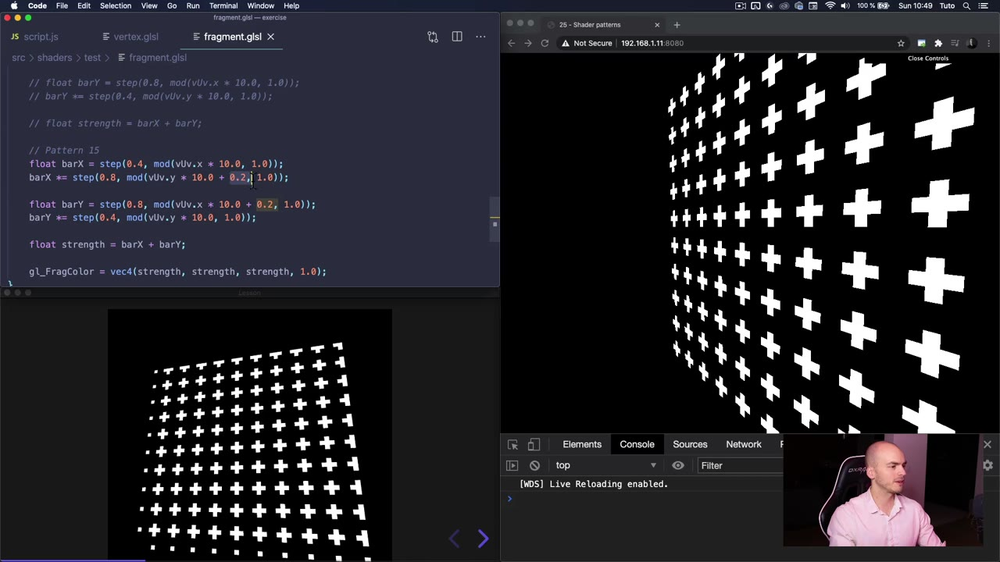
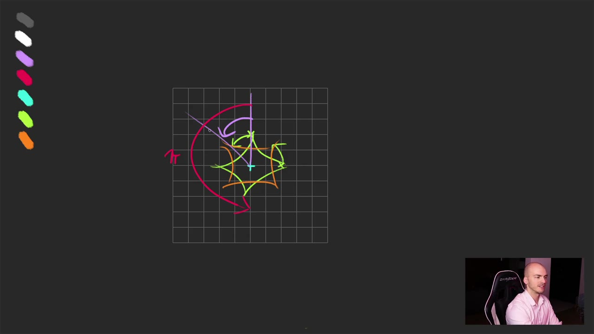

# 第 19 章 着色器图案

在掌握 GLSL 基础语法后，我们面临一个实际挑战：如何仅凭坐标和数学运算在着色器中绘制特定图案。无论是星星、圆圈、光透镜还是波浪，纹理虽然可行，但程序化绘制能提供更好的控制能力——无需纹理加载、便于参数动画、更易与其他着色效果组合。本章将系统探索 GLSL 中常见的图案生成技法，从基本渐变到复杂噪声，逐步构建对坐标变换、数学函数和组合逻辑的深入理解。

着色器绘图与传统绘图 API（如 Canvas 2D）有本质区别：每个片段独立执行相同代码，没有状态保存、没有绘制指令堆栈，所有效果只能通过坐标运算和数学函数实现。这种约束既是挑战也是机遇——它迫使我们以函数式、并行化的思维方式思考图形生成，这正是 GPU 计算的精髓所在。

## 为什么需要着色器图案

在 Three.js 项目中，经常需要在几何体表面绘制特定形状：粒子系统中的星光、水面模拟中的波浪、科幻界面中的光晕等。虽然有纹理贴图方案，但程序化绘制具有独特优势：

1. **无需资源加载**：避免纹理文件的加载时间和带宽消耗
2. **参数完全可控**：通过 Uniform 变量实时调整图案参数
3. **无缝动画能力**：数学运算的参数变化可直接转换为视觉动画
4. **独立于纹理分辨率**：图案由数学函数生成，不依赖源图像尺寸，但最终边缘仍受屏幕采样和抗锯齿影响
5. **性能优化**：避免过多纹理切换带来的 GPU 状态更改开销

更重要的是，着色器图案是理解 GPU 并行计算思维的窗口。后续的顶点动画、粒子特效、后期处理等高级效果都需要这些基础图案作为构建模块。

## 项目设置与准备工作

本章练习基于一个简单的平面几何体（`PlaneGeometry`）和 `ShaderMaterial`。与 `RawShaderMaterial` 不同，`ShaderMaterial` 会自动为着色器添加 Three.js 标准的内置变量和矩阵运算，简化了基础设置。

### UV 坐标传递机制

图案绘制主要在片元着色器中完成，因此需要将 UV 坐标从顶点着色器传递到片元着色器。在 `ShaderMaterial` 中，`uv` 属性已由 Three.js 自动声明，只需通过 varying 变量建立连接通道：

```glsl
// 顶点着色器中
varying vec2 vUv;

void main()
{
    // ... 其他代码 ...
    vUv = uv;
}
```

```glsl
// 片元着色器中
varying vec2 vUv;

void main()
{
    // 在此处绘制图案
}
```

`vUv` 的取值范围从左下角 `(0.0, 0.0)` 到右上角 `(1.0, 1.0)`。后续所有图案都将基于这一坐标系展开。

## 基础渐变图案

最简单的图案是利用 UV 坐标本身作为颜色值，直观展示坐标系分布：

```glsl
// 图案 1：UV 映射为 RGB
gl_FragColor = vec4(vUv, 1.0, 1.0);  // 红绿通道使用 UV，蓝色固定为 1
```

```glsl
// 图案 2：蓝色通道设为 0
gl_FragColor = vec4(vUv, 0.0, 1.0);
```

为简化黑白图案的表达，我们引入 `strength` 变量统一控制亮度：

```glsl
// 图案 3：X 轴渐变
float strength = vUv.x;
gl_FragColor = vec4(vec3(strength), 1.0);
```

```glsl
// 图案 4：Y 轴渐变
float strength = vUv.y;
gl_FragColor = vec4(vec3(strength), 1.0);
```

```glsl
// 图案 5：反转 Y 轴渐变
float strength = 1.0 - vUv.y;
gl_FragColor = vec4(vec3(strength), 1.0);
```

这些基础渐变虽简单，却是理解坐标空间的关键第一步。UV 坐标系的 `(0.0, 0.0)` 到 `(1.0, 1.0)` 范围对应平面的不同区域：左下角为坐标原点，向右为 X 轴正方向，向上为 Y 轴正方向。所有后续复杂图案都建立在这一坐标系理解之上。

在实际项目中，建议保存这些基础渐变代码作为参考模板。通过注释而非删除的方式保留历史版本，便于后续回溯和组合。

## 重复与阶梯图案

通过缩放和取模运算，可以创建重复的图案元素：

```glsl
// 图案 6：压缩渐变
float strength = vUv.y * 10.0;  // 值迅速达到 1.0，后续部分保持白色
```

`mod()` 函数实现周期性重复，它能计算除法后的余数，让数值在特定范围内循环。理解取模运算的关键在于：当数值超过模数时立即"重置"回起点，形成周期性。例如：

- `0.5 mod 1.0 = 0.5`（未超过模数，保持不变）
- `1.2 mod 1.0 = 0.2`（超过 1.0，重置为 0.2）
- `2.4 mod 1.0 = 0.4`（超过两次模数，重置两次）

这一特性使 `mod()` 成为创建重复图案的基石工具。

```glsl
// 图案 7：重复渐变条纹
float strength = mod(vUv.y * 10.0, 1.0);
```

`step()` 函数将连续值转换为二值阶梯，其第一个参数为阈值（edge），第二个为待比较值（x）。其数学定义为：

```glsl
step(edge, x) = 0.0 当 x < edge
step(edge, x) = 1.0 当 x ≥ edge
```

这一简单函数却有重要应用价值：
1. **向量化表达**：`step()` 可以直接用数值函数表达阈值逻辑，避免手动编写分支；实际性能取决于 GPU、编译器和具体着色器
2. **数学连续性**：作为纯函数，易于求导和组合
3. **阈值控制**：通过调整 edge 参数精确控制图案边界

初学者常犯错误是参数顺序混淆，记住 GLSL 的 `step(edge, x)` 遵循"阈值在前，比较值在后"的约定。

```glsl
// 图案 8：黑白条纹
float strength = mod(vUv.y * 10.0, 1.0);
strength = step(0.5, strength);  // 大于 0.5 为 1，否则为 0
```

```glsl
// 图案 9：更窄的白条
float strength = mod(vUv.y * 10.0, 1.0);
strength = step(0.8, strength);
```

## 网格与组合图案

将 X 和 Y 轴的图案组合可生成网格效果：

```glsl
// 图案 10：水平条纹
float strength = mod(vUv.x * 10.0, 1.0);
strength = step(0.8, strength);
```

```glsl
// 图案 11：垂直与水平条纹叠加
float strength = step(0.8, mod(vUv.x * 10.0, 1.0));
strength += step(0.8, mod(vUv.y * 10.0, 1.0));
```

```glsl
// 图案 12：网格交点（乘法组合）
float strength = step(0.8, mod(vUv.x * 10.0, 1.0));
strength *= step(0.8, mod(vUv.y * 10.0, 1.0));
```

通过调整阈值和偏移可创造更丰富的图案：

```glsl
// 图案 13：非对称网格
float strength = step(0.4, mod(vUv.x * 10.0, 1.0));
strength *= step(0.8, mod(vUv.y * 10.0, 1.0));
```

```glsl
// 图案 14：十字交叉图案（重构版）
float barX = step(0.4, mod(vUv.x * 10.0, 1.0)) * step(0.8, mod(vUv.y * 10.0, 1.0));
float barY = step(0.8, mod(vUv.x * 10.0, 1.0)) * step(0.4, mod(vUv.y * 10.0, 1.0));
float strength = barX + barY;
```

```glsl
// 图案 15：偏移十字
float barX = step(0.4, mod(vUv.x * 10.0 - 0.2, 1.0)) * step(0.8, mod(vUv.y * 10.0, 1.0));
float barY = step(0.8, mod(vUv.x * 10.0, 1.0)) * step(0.4, mod(vUv.y * 10.0 - 0.2, 1.0));
float strength = barX + barY;
```

## 对称性与距离函数

对称图案在视觉设计中广泛应用，GLSL 通过 `abs()` 函数和坐标偏移实现各种对称效果。`abs()` 取绝对值，将负值转换为其正值，这一简单操作却能产生围绕中心的对称渐变。

```glsl
// 图案 16：中心对称渐变
float strength = abs(vUv.x - 0.5);  // 使 X 坐标围绕中心对称
```

`min()` 和 `max()` 函数分别取最小值和最大值，用于组合两个轴的图案：

```glsl
// 图案 17：菱形渐变（取最小值）
float strength = min(abs(vUv.x - 0.5), abs(vUv.y - 0.5));
```

```glsl
// 图案 18：方形渐变（取最大值）
float strength = max(abs(vUv.x - 0.5), abs(vUv.y - 0.5));
```

```glsl
// 图案 19：方形边框
float strength = step(0.2, max(abs(vUv.x - 0.5), abs(vUv.y - 0.5)));
```

```glsl
// 图案 20：嵌套方框
float strength = step(0.2, max(abs(vUv.x - 0.5), abs(vUv.y - 0.5)));
strength *= 1.0 - step(0.25, max(abs(vUv.x - 0.5), abs(vUv.y - 0.5)));
```

## 离散化与随机图案

`floor()` 函数将浮点数向下取整到最接近的小于或等于该值的整数。配合除法可实现区块化效果，这是将连续空间离散化为网格单元的关键技术。

```glsl
// 图案 21：水平区块
float strength = floor(vUv.x * 10.0) / 10.0;
```

```glsl
// 图案 22：网格区块
float strength = floor(vUv.x * 10.0) / 10.0 * floor(vUv.y * 10.0) / 10.0;
```

## 伪随机数生成

GLSL 没有内置随机函数，这是 GPU 确定性计算特性的体现。但通过精心设计的数学变换，可模拟出足够"随机"的伪随机数。经典算法基于三角函数和取小数运算：

```glsl
// 随机数生成函数
float random(vec2 st)
{
    return fract(sin(dot(st.xy, vec2(12.9898, 78.233))) * 43758.5453123);
}
```

```glsl
// 图案 23：连续随机噪声
float strength = random(vUv);
```

```glsl
// 图案 24：区块随机
vec2 gridUv = vec2(floor(vUv.x * 10.0) / 10.0, floor(vUv.y * 10.0) / 10.0);
float strength = random(gridUv);
```

```glsl
// 图案 25：斜向区块随机
vec2 gridUv = vec2(floor(vUv.x * 10.0) / 10.0, floor((vUv.y + vUv.x * 0.5) * 10.0) / 10.0);
float strength = random(gridUv);
```



*图 19-1 基础渐变到复杂组合的图案演变过程*

## 距离函数与圆形图案

`length()` 函数计算向量长度，`distance()` 计算两点间距离：

```glsl
// 图案 26：径向渐变（基于长度）
float strength = length(vUv);  // 左下角为 0，右上角最大
```

```glsl
// 图案 27：中心距离渐变
float strength = distance(vUv, vec2(0.5));  // 到中心 (0.5, 0.5) 的距离
```

```glsl
// 图案 28：反转中心渐变
float strength = 1.0 - distance(vUv, vec2(0.5));
```

## 光学效果模拟

距离函数的倒数（`1.0 / distance()`）是模拟物理光学现象的利器。当距离趋近于零时，倒数趋近无穷大，产生"发光"效果。通过合适的系数缩放，可模拟透镜光晕、辉光、能量场等视觉效果。

```glsl
// 图案 29：透镜光晕
float strength = 0.015 / distance(vUv, vec2(0.5));
```

```glsl
// 图案 30：Y 轴压缩透镜
float strength = 0.15 / (distance(vec2(vUv.x, (vUv.y - 0.5) * 5.0 + 0.5), vec2(0.5)));
```

```glsl
// 图案 31：十字透镜
float strength = 0.15 / (distance(vec2(vUv.x, (vUv.y - 0.5) * 5.0 + 0.5), vec2(0.5)));
strength *= 0.15 / (distance(vec2(vUv.y, (vUv.x - 0.5) * 5.0 + 0.5), vec2(0.5)));
```

## 坐标变换与三角函数

实现坐标旋转是 2D 图形中的基本操作，需要三角函数计算。绕点旋转的数学原理基于旋转矩阵，在着色器中可封装为实用函数以提高代码复用性。

```glsl
// 坐标旋转函数
vec2 rotate(vec2 uv, float rotation, vec2 mid)
{
    return vec2(
      cos(rotation) * (uv.x - mid.x) + sin(rotation) * (uv.y - mid.y) + mid.x,
      cos(rotation) * (uv.y - mid.y) - sin(rotation) * (uv.x - mid.x) + mid.y
    );
}
```

### 常量定义与性能考量

GLSL 不像 JavaScript 有内置的 Math.PI，需要手动定义圆周率常量。定义常量有两种方式：

1. **`#define` 宏**：编译时替换，无运行时开销
2. **`const` 变量**：类型安全的常量

对于像 π 这样永不改变的数学常量，建议使用 `#define` 并遵循 UPPERCASE 命名约定，既提高性能又增强可读性。

```glsl
#define PI 3.1415926535897932384626433832795
#define TWO_PI 6.283185307179586476925286766559
#define HALF_PI 1.5707963267948966192313216916398
```

```glsl
#define PI 3.1415926535897932384626433832795
```

```glsl
// 图案 32：旋转十字透镜
vec2 rotatedUv = rotate(vUv, PI * 0.25, vec2(0.5));
float strength = 0.15 / (distance(vec2(rotatedUv.x, (rotatedUv.y - 0.5) * 5.0 + 0.5), vec2(0.5)));
strength *= 0.15 / (distance(vec2(rotatedUv.y, (rotatedUv.x - 0.5) * 5.0 + 0.5), vec2(0.5)));
```

## 圆形绘制技术

圆形是图形学中最基础的几何形状之一。GLSL 中绘制圆有多种技术路径，每种有其适用场景：

1. **距离阈值法**：`step(radius, distance(uv, center))` 生成实心圆
2. **环形差值法**：`abs(distance(uv, center) - radius)` 生成渐变圆环
3. **平滑边缘法**：`smoothstep()` 替代 `step()` 实现抗锯齿

这些技术的选择取决于最终效果需求：硬边缘、渐变边缘还是带抗锯齿的边缘。

```glsl
// 图案 33：圆环
float strength = step(0.5, distance(vUv, vec2(0.5)) + 0.25);
```

```glsl
// 图案 34：渐变圆环
float strength = abs(distance(vUv, vec2(0.5)) - 0.25);
```

```glsl
// 图案 35：细线圆环
float strength = step(0.02, abs(distance(vUv, vec2(0.5)) - 0.25));
```

```glsl
// 图案 36：实心圆形
float strength = 1.0 - step(0.01, abs(distance(vUv, vec2(0.5)) - 0.25));
```

## 波动效果与三角函数应用

`sin()` 函数是创建周期性波动效果的核心工具。其参数中的频率系数（如 `* 30.0`）控制波纹密度，振幅系数（如 `* 0.1`）控制波动幅度。正弦波的数学特性使其非常适合模拟水面涟漪、布料摆动、能量场扰动等自然现象。

```glsl
// 图案 37：波纹圆形
vec2 wavedUv = vec2(vUv.x, vUv.y + sin(vUv.x * 30.0) * 0.1);
float strength = 1.0 - step(0.01, abs(distance(wavedUv, vec2(0.5)) - 0.25));
```

```glsl
// 图案 38：双向波纹
vec2 wavedUv = vec2(
    vUv.x + sin(vUv.y * 30.0) * 0.1,
    vUv.y + sin(vUv.x * 30.0) * 0.1
);
float strength = 1.0 - step(0.01, abs(distance(wavedUv, vec2(0.5)) - 0.25));
```

```glsl
// 图案 39：高频波纹
vec2 wavedUv = vec2(
    vUv.x + sin(vUv.y * 100.0) * 0.1,
    vUv.y + sin(vUv.x * 100.0) * 0.1
);
float strength = 1.0 - step(0.01, abs(distance(wavedUv, vec2(0.5)) - 0.25));
```

## 极坐标变换与角度计算

直角坐标系（Cartesian）适合处理矩形区域，但当图案围绕中心对称分布时，极坐标系（Polar）更为自然。`atan()` 函数计算两点连线与 X 轴夹角，是直角坐标到极坐标转换的关键。

```glsl
// 图案 40：角度渐变
float angle = atan(vUv.x, vUv.y);  // 返回值范围：-π 到 +π
float strength = angle;
```

```glsl
// 图案 41：中心角度
float angle = atan(vUv.x - 0.5, vUv.y - 0.5);
float strength = angle;
```

```glsl
// 图案 42：归一化角度（0.0 到 1.0）
float angle = atan(vUv.x - 0.5, vUv.y - 0.5) / (PI * 2.0) + 0.5;
float strength = angle;
```

```glsl
// 图案 43：重复角度条纹
float angle = atan(vUv.x - 0.5, vUv.y - 0.5) / (PI * 2.0) + 0.5;
float strength = mod(angle * 20.0, 1.0);
```

```glsl
// 图案 44：角度正弦条纹
float angle = atan(vUv.x - 0.5, vUv.y - 0.5) / (PI * 2.0) + 0.5;
float strength = sin(angle * 100.0);
```

```glsl
// 图案 45：波纹圆形
float angle = atan(vUv.x - 0.5, vUv.y - 0.5) / (PI * 2.0) + 0.5;
float radius = 0.25 + sin(angle * 100.0) * 0.02;
float strength = 1.0 - step(0.01, abs(distance(vUv, vec2(0.5)) - radius));
```

## Perlin 噪声图案

Perlin 噪声是生成自然形态（云、水、地形等）的关键算法。以下是 Stefan Gustavson 的经典 2D Perlin 噪声实现：

```glsl
vec4 permute(vec4 x)
{
    return mod(((x * 34.0) + 1.0) * x, 289.0);
}

vec2 fade(vec2 t)
{
    return t * t * t * (t * (t * 6.0 - 15.0) + 10.0);
}

// 经典 Perlin 2D 噪声
float cnoise(vec2 P)
{
    vec4 Pi = floor(P.xyxy) + vec4(0.0, 0.0, 1.0, 1.0);
    vec4 Pf = fract(P.xyxy) - vec4(0.0, 0.0, 1.0, 1.0);
    Pi = mod(Pi, 289.0); // 避免排列中的截断效应
    vec4 ix = Pi.xzxz;
    vec4 iy = Pi.yyww;
    vec4 fx = Pf.xzxz;
    vec4 fy = Pf.yyww;
    vec4 i = permute(permute(ix) + iy);
    vec4 gx = 2.0 * fract(i * 0.0243902439) - 1.0; // 1/41 = 0.024...
    vec4 gy = abs(gx) - 0.5;
    vec4 tx = floor(gx + 0.5);
    gx = gx - tx;
    vec2 g00 = vec2(gx.x, gy.x);
    vec2 g10 = vec2(gx.y, gy.y);
    vec2 g01 = vec2(gx.z, gy.z);
    vec2 g11 = vec2(gx.w, gy.w);
    vec4 norm = 1.79284291400159 - 0.85373472095314 *
        vec4(dot(g00, g00), dot(g01, g01), dot(g10, g10), dot(g11, g11));
    g00 *= norm.x;
    g01 *= norm.y;
    g10 *= norm.z;
    g11 *= norm.w;
    float n00 = dot(g00, vec2(fx.x, fy.x));
    float n10 = dot(g10, vec2(fx.y, fy.y));
    float n01 = dot(g01, vec2(fx.z, fy.z));
    float n11 = dot(g11, vec2(fx.w, fy.w));
    vec2 fade_xy = fade(Pf.xy);
    vec2 n_x = mix(vec2(n00, n01), vec2(n10, n11), fade_xy.x);
    float n_xy = mix(n_x.x, n_x.y, fade_xy.y);
    return 2.3 * n_xy;
}
```

应用噪声生成多种图案：

```glsl
// 图案 46：基础噪声
float strength = cnoise(vUv * 10.0);
```

```glsl
// 图案 47：二值化噪声
float strength = step(0.0, cnoise(vUv * 10.0));
```

```glsl
// 图案 48：反相绝对值噪声
float strength = 1.0 - abs(cnoise(vUv * 10.0));
```

```glsl
// 图案 49：正弦调制噪声
float strength = sin(cnoise(vUv * 10.0) * 20.0);
```

```glsl
// 图案 50：离散噪声点
float strength = step(0.9, sin(cnoise(vUv * 10.0) * 20.0));
```



*图 19-2 Perlin 噪声图案及其在自然形态模拟中的应用*

## 颜色混合与视觉增强

纯黑白图案虽能展示算法原理，但视觉效果单调。`mix()` 函数根据混合系数在两种颜色间线性插值，是实现渐变着色、材质混合的关键工具。其数学定义为：

```glsl
mix(x, y, a) = x × (1.0 - a) + y × a
```

其中 `a` 为混合系数，范围为 `[0.0, 1.0]`。当 `a` 超出此范围时，结果会外推（extrapolate），可能产生"过曝"效果，这正是图案 11、14、15 中出现异常亮区的原因。

```glsl
vec3 blackColor = vec3(0.0);
vec3 uvColor = vec3(vUv, 1.0);
vec3 mixedColor = mix(blackColor, uvColor, strength);
gl_FragColor = vec4(mixedColor, 1.0);
```

### 数值范围控制与 `clamp()` 函数

在图案组合时，相加操作可能导致值域溢出（如 `1.0 + 1.0 = 2.0`）。`clamp()` 函数将值限制在指定范围内：

```glsl
clamp(x, minVal, maxVal) = min(max(x, minVal), maxVal)
```

对于需要在 `[0.0, 1.0]` 范围内安全混合的颜色值，应在混合前对强度值进行钳位：

```glsl
// 图案 11 的安全版本
float strength = step(0.8, mod(vUv.x * 10.0, 1.0));
strength += step(0.8, mod(vUv.y * 10.0, 1.0));
strength = clamp(strength, 0.0, 1.0);  // 确保在有效范围内
```

## 实践应用：从图案到效果

掌握了基础图案生成技术后，需要理解如何将这些"图案"转化为实际项目中的"效果"。本节将探讨几个典型应用场景。

### 顶点位移：从强度到几何变形

在上一章的旗帜动画中，我们已经看到如何用 `sin()` 函数驱动顶点位移。实际上，任何图案都可作为顶点位移的高度图：

```glsl
// 顶点着色器中
varying vec2 vUv;
varying float vDisplacement;

void main()
{
    vUv = uv;

    // 生成波浪图案作为位移强度
    float waveStrength = sin(vUv.x * 10.0 + uTime) * 0.1;

    // 应用到位移
    vDisplacement = waveStrength;
    vec3 newPosition = position + normal * waveStrength;

    gl_Position = projectionMatrix * modelViewMatrix * vec4(newPosition, 1.0);
}
```

更复杂的图案（如 Perlin 噪声）可模拟更自然的地形起伏、布料褶皱或水面波动。

### 粒子系统：图案作为粒子外观

在粒子着色器中，图案可决定粒子的形状、透明度和颜色变化：

```glsl
// 粒子圆形
float circle = 1.0 - step(0.1, distance(vUv, vec2(0.5)));

// 带柔边的圆形
float softCircle = 1.0 - smoothstep(0.08, 0.1, distance(vUv, vec2(0.5)));

// 星形图案（基于角度）
float angle = atan(vUv.x - 0.5, vUv.y - 0.5) / (PI * 2.0) + 0.5;
float star = step(0.5, mod(angle * 5.0, 1.0));  // 五角星
```

这些图案可与粒子生命期、尺寸等属性结合，创建丰富的粒子效果。

### 后期处理：屏幕空间图案

在后期处理着色器中，UV 坐标对应屏幕空间，图案可直接作为滤镜效果：

```glsl
// 渐晕效果（边缘变暗）
float vignette = 1.0 - distance(vUv, vec2(0.5)) * 1.5;
vignette = clamp(vignette, 0.0, 1.0);

// 扫描线效果
float scanline = sin(vUv.y * 500.0) * 0.05 + 0.95;

// 旧电影噪点
float filmGrain = random(vUv + uTime) * 0.1;
```

这些屏幕空间图案无需修改场景几何体，直接在最终渲染画面上叠加效果。

### 材质混合：基于图案的多材质

通过 `mix()` 函数，不同材质可根据图案强度值混合：

```glsl
// 生成混合蒙版
float blendMask = step(0.5, cnoise(vUv * 5.0));

// 两种材质颜色的混合
vec3 materialA = texture(uTextureA, vUv).rgb;
vec3 materialB = texture(uTextureB, vUv).rgb;
vec3 finalColor = mix(materialA, materialB, blendMask);
```

这种方法常用于地形渲染（草地/岩石）、建筑表面（干净/肮脏）等需要自然过渡的多材质场景。

## 性能优化与最佳实践

着色器性能直接影响应用帧率，特别是在移动设备或复杂场景中。以下实践有助于保持良好性能：

### 1. 避免条件分支

GPU 的 SIMD（单指令多数据）架构不擅长处理分支预测。尽可能用数学函数替代 `if` 语句：

```glsl
// 避免：
// if (x > threshold) {
//     result = a;
// } else {
//     result = b;
// }

// 推荐：
float result = mix(b, a, step(threshold, x));
```

### 2. 预计算与常量优化

重复计算的数学常量应该提取为预计算值或宏定义：

```glsl
// 避免每次计算 π 相关值
float angle = atan(vUv.x - 0.5, vUv.y - 0.5) / 6.283185307179586 + 0.5;

// 推荐：预定义常量
#define TWO_PI 6.283185307179586
float angle = atan(vUv.x - 0.5, vUv.y - 0.5) / TWO_PI + 0.5;
```

### 3. 合理使用纹理采样

虽然本章重点在程序化图案，但纹理采样在某些场景效率更高。平衡原则：

- 规则重复图案：程序化生成
- 复杂非重复细节：纹理贴图
- 动画效果：程序化控制
- 静态细节：纹理存储

### 4. 复杂度渐进增加

从简单效果开始测试，逐步增加复杂度。突然的性能下降更容易定位到具体函数或运算。

### 5. 利用 Three.js 调试工具

Three.js 的 `ShaderMaterial` 支持动态 Uniform 更新，可通过 dat.GUI 等调试界面实时调整参数，观察图案变化，加速开发迭代。

## 延伸思考：数学与创意的交汇

着色器图案生成本质上是数学可视化过程。每个数学函数都有其对应的视觉特征：

- **线性函数**（`f(x) = x`）：均匀渐变
- **三角函数**（`sin`, `cos`）：周期性波动
- **指数函数**（`pow`）：加速变化
- **取整函数**（`floor`, `ceil`）：离散化
- **随机函数**：无序性

将这些基础"视觉词汇"组合，即可创造出无限可能的"视觉语言"。几个创意组合方向：

### 分形与自相似

通过递归或迭代，将简单图案在不同尺度重复，创建分形效果：

```glsl
float fractalPattern(vec2 uv, float scale)
{
    float p = 0.0;
    for (int i = 0; i < 5; i++) {
        uv = uv * 2.0 - 1.0;  // 缩放并居中
        p += abs(distance(uv, vec2(0.0))) * scale;
        scale *= 0.5;
    }
    return p;
}
```

### 域扭曲与坐标变换链

将一种图案的输出作为另一种图案的输入坐标，创建扭曲、漩涡等非线性效果：

```glsl
// 基础噪声
float n = cnoise(vUv * 3.0);

// 用噪声扭曲坐标
vec2 distortedUv = vUv + vec2(n) * 0.1;

// 在扭曲坐标上绘制图案
float finalPattern = circle(distortedUv, vec2(0.5), 0.3);
```

### 时间维度动画

引入时间变量 `uTime`，让数学参数随时间变化，静态图案即刻"活"起来：

```glsl
// 脉动圆形
float pulsatingRadius = 0.2 + sin(uTime) * 0.05;
float circle = 1.0 - step(pulsatingRadius, distance(vUv, vec2(0.5)));

// 旋转条纹
float rotatingStripes = step(0.5, mod(vUv.x * 10.0 + uTime, 1.0));

// 移动噪声
float movingClouds = cnoise(vUv * 2.0 + vec2(uTime * 0.1));
```

这些动画不仅增强视觉效果，更重要的是演示了数学参数与视觉输出的直接对应关系。

## 常见的陷阱与调试技巧

即使掌握了所有函数，实际开发中仍可能遇到问题。以下常见陷阱及解决方案：

### 1. 坐标空间混淆

错误：在顶点着色器中使用未经变换的模型坐标，或在片元着色器中错误解释 `vUv` 范围。

解决：明确每个变量的坐标空间，绘制参考网格验证坐标系理解。

### 2. 值域溢出

错误：强度值超出 `[0.0, 1.0]` 范围，导致颜色异常或 NaN 值。

解决：使用 `clamp()` 限制范围，或通过 `abs()`、`fract()` 等函数将值映射回合理区间。

### 3. 性能悬崖

错误：突然引入高复杂度运算（如多层循环噪声），帧率急剧下降。

解决：性能基准测试，复杂度渐进增加，考虑简化或预处理。

### 4. 跨设备兼容性

错误：某些设备不支持特定精度或函数重载。

解决：使用 Three.js 推荐的精度限定符（`highp`、`mediump`、`lowp`），测试多设备。

### 5. 调试可视化

当图案不如预期时，分步可视化中间值：

```glsl
// 调试技巧：颜色映射中间值
float intermediateValue = someComplexCalculation(vUv);
gl_FragColor = vec4(vec3(intermediateValue), 1.0);
// 观察灰度图，理解值分布
```

## 资源与进一步学习

本章介绍的 50 种图案只是 GLSL 潜力的冰山一角。以下资源有助于深入学习：

### 在线探索平台

1. **ShaderToy**：全球最大的着色器分享社区，数万实例代码
2. **The Book of Shaders**：渐进式着色器教程，强调数学基础
3. **GLSL Sandbox**：实时编辑测试环境

### 数学参考

1. **图形学数学**：向量、矩阵、三角函数在图形学中的应用
2. **信号处理**：傅里叶变换、滤波与频域分析
3. **分形几何**：曼德博集合、朱利亚集合等

### Three.js 生态

1. **自定义着色器库**：收集实用 GLSL 函数
2. **后期处理通道**：组合多个着色器效果
3. **ShaderMaterial 扩展**：Uniform 自动化管理

## 本章小结

本章系统探索了 GLSL 着色器中图案生成的全方位技术体系，从基础坐标理解到高级数学应用，建立起程序化图形生成的完整思维框架。

### 核心知识体系回顾

1. **坐标空间与变换**：
   - UV 坐标系的范围 `(0.0, 0.0)` 到 `(1.0, 1.0)` 是所有图案生成的画布
   - 坐标变换（平移、缩放、旋转、扭曲）改变观察视角，产生不同图案变体
   - 直角坐标与极坐标各有适用场景：矩形分布与中心对称分布

2. **函数工具箱分层**：
   - **基础运算层**：加减乘除、取模、取整，构建图案基本结构
   - **数学函数层**：三角函数（周期波动）、绝对值（对称性）、幂函数（非线性变化）
   - **专用函数层**：`step()`（二值化）、`clamp()`（范围控制）、`mix()`（插值混合）
   - **距离计算层**：`length()`、`distance()`，创建圆形、径向和空间关系

3. **组合方法论**：
   - **算术组合**：加法（叠加并集）、乘法（交集过滤）、混合（平滑过渡）
   - **逻辑组合**：`min()`/`max()` 取极值，创建几何形状边界
   - **函数组合**：一种函数的输出作为另一种函数的输入，创造复杂变换链

4. **自然效果模拟**：
   - **伪随机数**：模拟无序性，用于噪点、纹理变化
   - **Perlin 噪声**：结构化随机，模拟自然形态（云、水、地形）
   - **三角函数动画**：周期性变化，模拟波浪、脉动、旋转

### 思维模式转变

着色器绘图与命令式绘图的最大区别在于思维模式的转变：

- **从指令到函数**：不再说"画一条线"，而是定义"线上点的条件"
- **从局部到全局**：不再逐个处理像素，而是描述所有像素的统一规则
- **从状态到纯函数**：输出完全由输入决定，无副作用，适合并行计算

这种函数式、声明式的思维方式正是 GPU 并行计算的核心。虽然初期需要适应，但掌握后能将复杂视觉效果简洁表达。

### 实用技能提升

通过本章练习，应获得以下具体技能：

1. **视觉诊断能力**：看到图案能推测其生成算法，看到算法能想象其视觉效果
2. **问题分解能力**：复杂效果拆解为基础图案的组合与变换
3. **数学直觉培养**：建立数学表达式与视觉表现的直接关联
4. **性能敏感度**：识别高开销运算，选择高效实现方案

### 通向高阶应用

这些图案技术不是孤立的练习，而是通往 Three.js 高级应用的基石：

- **顶点着色器**：图案作为高度图驱动几何变形
- **粒子系统**：图案定义粒子形状与生命期变化
- **后期处理**：屏幕空间图案创建滤镜特效
- **材质系统**：程序化图案替代或增强纹理贴图
- **GPGPU 计算**：数学模式在通用 GPU 计算中的应用

着色器图案的本质是数学可视化——将抽象数学关系转化为具体视觉表现。这种转化能力不仅用于创建炫酷效果，更重要的是建立了一种理解图形、算法和计算的统一框架。随着练习深入，数学表达式与视觉想象之间的鸿沟逐渐消弭，最终达到"所思即所见"的创作境界。

记住：每个大师级的着色器开发者都曾从 `vUv.x` 这样的简单渐变开始。持续实践、大胆实验，将这些基础构件组合成属于你自己的视觉语言。