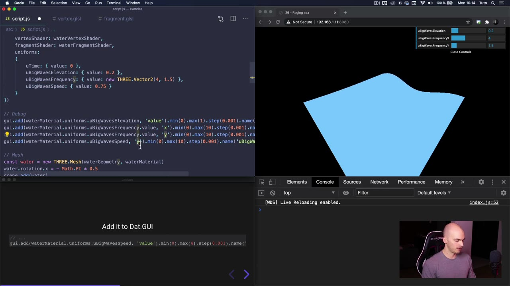
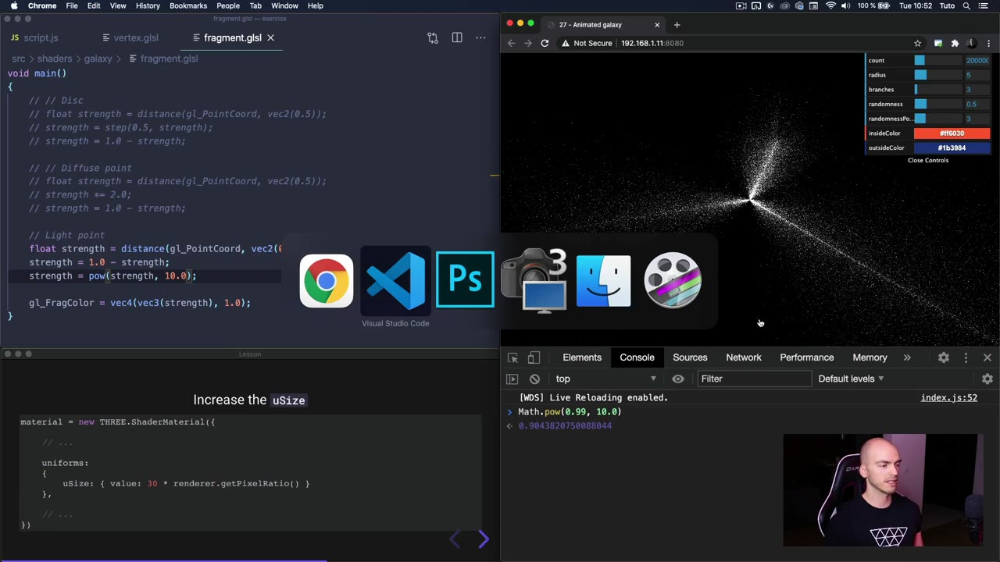

# 第 20 章 海面与动态银河

本章结合着色器技术，实现两个具有代表性的动态效果：波动的海洋场景与旋转的银河粒子系统。首先通过顶点着色器修改平面几何体顶点位置，创建可控制频率、振幅与速度的海浪。接着将同样的着色器思想应用于粒子系统，在 GPU 中实现基于距离的差异化旋转动画，并恢复粒子尺寸与衰减控制。这两个项目演示了如何在顶点和片元阶段利用 GLSL 实现完全自主的视觉表达。

## 创建波动海面

海浪效果的核心在于通过正弦函数改变网格顶点的 y 坐标。我们从一个平面几何体开始，为其创建自定义的 ShaderMaterial。

### 基础几何体与着色器材质

使用细分度较高的 `PlaneGeometry`（128×128）作为海面基础：

```javascript
const waterGeometry = new THREE.PlaneGeometry(2, 2, 128, 128)
const waterMaterial = new THREE.ShaderMaterial()

const water = new THREE.Mesh(waterGeometry, waterMaterial)
water.rotation.x = -Math.PI * 0.5
scene.add(water)
```

创建对应的顶点与片元着色器文件。顶点着色器包含标准的位置变换流水线：

```glsl
// vertex.glsl
void main()
{
    vec4 modelPosition = modelMatrix * vec4(position, 1.0);
    vec4 viewPosition = viewMatrix * modelPosition;
    vec4 projectedPosition = projectionMatrix * viewPosition;
    gl_Position = projectedPosition;
}
```

片元着色器输出基础海蓝色，并在末尾添加 Three.js 提供的色彩空间转换：

```glsl
// fragment.glsl
void main()
{
    gl_FragColor = vec4(0.5, 0.8, 1.0, 1.0);
    #include <colorspace_fragment>
}
```

在 JavaScript 中导入并应用这两个着色器：

```javascript
import waterVertexShader from './shaders/water/vertex.glsl'
import waterFragmentShader from './shaders/water/fragment.glsl'

const waterMaterial = new THREE.ShaderMaterial({
    vertexShader: waterVertexShader,
    fragmentShader: waterFragmentShader
})
```

### 通过正弦函数创建波浪

在顶点着色器中，基于模型位置的 x 坐标计算正弦值，将结果乘以高度系数后加到 y 坐标上：

```glsl
uniform float uBigWavesElevation;

void main()
{
    vec4 modelPosition = modelMatrix * vec4(position, 1.0);

    // 创建波浪形变
    float elevation = sin(modelPosition.x) * uBigWavesElevation;
    modelPosition.y += elevation;

    vec4 viewPosition = viewMatrix * modelPosition;
    vec4 projectedPosition = projectionMatrix * viewPosition;
    gl_Position = projectedPosition;
}
```

在材质中定义 `uBigWavesElevation` uniform 并提供调试面板控制：

```javascript
const waterMaterial = new THREE.ShaderMaterial({
    vertexShader: waterVertexShader,
    fragmentShader: waterFragmentShader,
    uniforms: {
        uBigWavesElevation: { value: 0.2 }
    }
})

gui.add(waterMaterial.uniforms.uBigWavesElevation, 'value')
   .min(0).max(1).step(0.001).name('uBigWavesElevation')
```

### 控制波浪频率与多方向波动

单一 x 方向的波浪不够真实。引入 `uBigWavesFrequency`（vec2 类型）分别控制 x 和 z 方向的正弦频率：

```javascript
uniforms: {
    uBigWavesElevation: { value: 0.2 },
    uBigWavesFrequency: { value: new THREE.Vector2(4, 1.5) }
}
```

在顶点着色器中结合两个方向的正弦函数：

```glsl
uniform vec2 uBigWavesFrequency;

void main()
{
    vec4 modelPosition = modelMatrix * vec4(position, 1.0);

    // 结合 x 和 z 方向的正弦波
    float elevation = sin(modelPosition.x * uBigWavesFrequency.x)
                   * sin(modelPosition.z * uBigWavesFrequency.y)
                   * uBigWavesElevation;

    modelPosition.y += elevation;
    // ... 后续变换
}
```

此时在调试面板中添加两个独立的频率控制：

```javascript
gui.add(waterMaterial.uniforms.uBigWavesFrequency.value, 'x')
   .min(0).max(10).step(0.001).name('uBigWavesFrequencyX')
gui.add(waterMaterial.uniforms.uBigWavesFrequency.value, 'y')
   .min(0).max(10).step(0.001).name('uBigWavesFrequencyY')
```

### 添加时间动画

创建 `uTime` uniform 并在每次渲染时更新，将其作为正弦函数的相位偏移：

```javascript
const clock = new THREE.Clock()

const tick = () => {
    const elapsedTime = clock.getElapsedTime()
    waterMaterial.uniforms.uTime.value = elapsedTime
    // ... 渲染循环
}

// 材质 uniform 定义
uniforms: {
    uTime: { value: 0 },
    // ... 其他 uniform
}
```

在顶点着色器中应用时间偏移：

```glsl
uniform float uTime;

float elevation = sin(modelPosition.x * uBigWavesFrequency.x + uTime)
                * sin(modelPosition.z * uBigWavesFrequency.y + uTime)
                * uBigWavesElevation;
```

还可以通过 `uBigWavesSpeed` uniform 控制波浪移动速度：

```javascript
uniforms: {
    uBigWavesSpeed: { value: 0.75 }
}

// 调试面板控制
gui.add(waterMaterial.uniforms.uBigWavesSpeed, 'value')
   .min(0).max(4).step(0.001).name('uBigWavesSpeed')
```

顶点着色器中最终的计算公式为：

```glsl
uniform float uBigWavesSpeed;

float elevation = sin(modelPosition.x * uBigWavesFrequency.x + uTime * uBigWavesSpeed)
                * sin(modelPosition.z * uBigWavesFrequency.y + uTime * uBigWavesSpeed)
                * uBigWavesElevation;
```

### 小型细节波浪与颜色渐变

为了提高真实感，添加第二层小型波浪（`uSmallWaves`），并基于高度数值着色。

首先在材质中添加更多控制参数：

```javascript
uniforms: {
    // ... 已有参数
    uSmallWavesElevation: { value: 0.15 },
    uSmallWavesFrequency: { value: new THREE.Vector2(3, 1.5) },
    uSmallWavesSpeed: { value: 0.2 },
    uSmallIterations: { value: 4 }
}
```

顶点着色器中添加更多层的正弦计算：

```glsl
uniform float uSmallWavesElevation;
uniform vec2 uSmallWavesFrequency;
uniform float uSmallWavesSpeed;
uniform float uSmallIterations;

void main()
{
    vec4 modelPosition = modelMatrix * vec4(position, 1.0);

    // 大型波浪
    float elevation = sin(modelPosition.x * uBigWavesFrequency.x + uTime * uBigWavesSpeed)
                    * sin(modelPosition.z * uBigWavesFrequency.y + uTime * uBigWavesSpeed)
                    * uBigWavesElevation;

    // 小型细节波浪
    for(float i = 1.0; i <= uSmallIterations; i++) {
        elevation -= sin(modelPosition.x * uSmallWavesFrequency.x * i + uTime * uSmallWavesSpeed)
                   * sin(modelPosition.z * uSmallWavesFrequency.y * i + uTime * uSmallWavesSpeed)
                   * uSmallWavesElevation / i;
    }

    modelPosition.y += elevation;
    // ... 后续变换
}
```

为了可视化波浪高度，我们在片元着色器中基于 `elevation` 值调整颜色：

```glsl
// 需要在顶点着色器中传递高度值到片元着色器
varying float vElevation;

void main() {
    vec4 modelPosition = modelMatrix * vec4(position, 1.0);
    // ... 计算 elevation
    vElevation = elevation;

    gl_Position = projectedPosition;
}

// 片元着色器
varying float vElevation;

void main()
{
    float strength = vElevation + 0.5; // 标准化到 0-1 范围
    vec3 color = mix(
        vec3(0.2, 0.5, 0.8),  // 深蓝色（低谷）
        vec3(0.8, 0.9, 1.0),  // 浅蓝色（波峰）
        strength
    );
    gl_FragColor = vec4(color, 1.0);
    #include <colorspace_fragment>
}
```

此时已获得具备完整参数控制的海浪效果。平面细分程度（128×128）提供了足够的顶点密度来表现平滑波浪，但顶点数量与着色复杂度仍会影响性能，应根据目标设备控制细分规模。



*图 20-1 通过顶点着色器生成的波浪效果，颜色基于高程渐变*

## 粒子系统的着色器动画

第二个项目将着色器技术应用于粒子系统。银河粒子需要实现基于中心距离的差异化旋转速度，并恢复原生 `PointsMaterial` 的尺寸与衰减特性。

### 从 PointsMaterial 迁移到 ShaderMaterial

银河生成器的初始设置使用 `PointsMaterial`。为获得完全控制，我们替换为 `ShaderMaterial`：

```javascript
// 原始代码
material = new THREE.PointsMaterial({
    size: 0.02,
    sizeAttenuation: true,
    depthWrite: false,
    blending: THREE.AdditiveBlending,
    vertexColors: true
})

// 替换为
material = new THREE.ShaderMaterial({
    depthWrite: false,
    blending: THREE.AdditiveBlending,
    vertexColors: true,
    vertexShader: `...`,
    fragmentShader: `...`
})
```

直接转换会丢失 `size` 和 `sizeAttenuation` 功能，这需要在着色器中重新实现。

### 基础顶点着色器与粒子尺寸

创建基本的顶点着色器，包含标准的位置变换并设置粒子尺寸：

```glsl
void main()
{
    // 位置变换
    vec4 modelPosition = modelMatrix * vec4(position, 1.0);
    vec4 viewPosition = viewMatrix * modelPosition;
    vec4 projectedPosition = projectionMatrix * viewPosition;
    gl_Position = projectedPosition;

    // 粒子尺寸
    gl_PointSize = 2.0;
}
```

此时粒子以固定 2×2 片段大小渲染，无视相机距离。片元着色器输出白色：

```glsl
void main()
{
    gl_FragColor = vec4(1.0, 1.0, 1.0, 1.0);
    #include <colorspace_fragment>
}
```

### 恢复尺寸衰减

为模拟透视效果，需要让远处的粒子变小。根据顶点到相机的距离计算衰减尺寸：

```glsl
// 计算到相机的距离（视图空间中的 z 坐标）
float distanceToCamera = -viewPosition.z;

// 使用 uSize 基础值和衰减系数
uniform float uSize;
uniform float uSizeAttenuation;

void main()
{
    vec4 modelPosition = modelMatrix * vec4(position, 1.0);
    vec4 viewPosition = viewMatrix * modelPosition;
    vec4 projectedPosition = projectionMatrix * viewPosition;
    gl_Position = projectedPosition;

    // 尺寸衰减计算
    float distanceToCamera = -viewPosition.z;
    gl_PointSize = uSize * (uSizeAttenuation ? distanceToCamera : 1.0);
}
```

对应的 uniform 定义与调试面板控制：

```javascript
uniforms: {
    uSize: { value: 0.02 * renderer.getPixelRatio() },
    uSizeAttenuation: { value: true }
}

// 调试面板
gui.add(material.uniforms.uSize, 'value').min(0).max(0.1).step(0.001).name('uSize')
gui.add(material.uniforms.uSizeAttenuation, 'value').name('uSizeAttenuation')
```

### 处理高像素比设备

不同设备像素比会导致物理尺寸不一致。通过 `renderer.getPixelRatio()` 校正：

```javascript
uSize: { value: 0.02 * renderer.getPixelRatio() }
```

但对于着色器，更好的方案是在初始化时校正设备像素比：

```javascript
const pixelRatio = Math.min(window.devicePixelRatio, 2)
renderer.setPixelRatio(pixelRatio)

uSize: { value: 0.02 }
```

此时着色器中的 `gl_PointSize` 自动适配设备像素比。

### 圆形粒子图案

默认方形粒子不够美观。在片元着色器中实现圆形遮罩：

```glsl
void main()
{
    // 粒子坐标系（-0.5 到 0.5）
    vec2 particleUV = gl_PointCoord - 0.5;

    // 计算距离并裁剪
    float distanceFromCenter = length(particleUV);
    if(distanceFromCenter > 0.5) {
        discard; // 丢弃方形角落的片段
    }

    // 柔化边缘（可选）
    float strength = 1.0 - (distanceFromCenter * 2.0);

    gl_FragColor = vec4(vec3(strength), strength);
    #include <colorspace_fragment>
}
```

### 基于距离的差异化旋转

银河粒子的核心动画效果是内圈旋转快、外圈旋转慢。需要在 JavaScript 中计算每个粒子到中心的距离，并将此属性存储在几何体中：

```javascript
const generateGalaxy = () => {
    const positions = new Float32Array(particlesCount * 3)
    const colors = new Float32Array(particlesCount * 3)
    const distances = new Float32Array(particlesCount) // 新增：存储距中心距离

    for(let i = 0; i < particlesCount; i++) {
        // ... 位置和颜色计算
        const radius = Math.random() * parameters.radius
        const distance = Math.sqrt(position.x * position.x + position.y * position.y + position.z * position.z)
        distances[i] = distance
    }

    geometry.setAttribute('position', new THREE.BufferAttribute(positions, 3))
    geometry.setAttribute('color', new THREE.BufferAttribute(colors, 3))
    geometry.setAttribute('aDistance', new THREE.BufferAttribute(distances, 1)) // 新增属性
}
```

顶点着色器中读取距离属性，基于此值计算旋转角度：

```glsl
attribute float aDistance;
uniform float uRotationSpeed;
uniform float uTime;

void main()
{
    // 原始位置
    vec4 modelPosition = modelMatrix * vec4(position, 1.0);

    // 基于距离计算旋转角度（距离越近旋转越快）
    float angle = aDistance * uRotationSpeed * uTime;

    // 绕 Y 轴旋转
    float cosAngle = cos(angle);
    float sinAngle = sin(angle);

    modelPosition.x = position.x * cosAngle - position.z * sinAngle;
    modelPosition.z = position.x * sinAngle + position.z * cosAngle;

    vec4 viewPosition = viewMatrix * modelPosition;
    vec4 projectedPosition = projectionMatrix * viewPosition;
    gl_Position = projectedPosition;

    // 尺寸计算...
}
```

通过 `uRotationSpeed` uniform 控制整体旋转速度，调试面板可实时调整：

```javascript
uniforms: {
    // ... 其他 uniform
    uRotationSpeed: { value: 1.0 }
}

gui.add(material.uniforms.uRotationSpeed, 'value').min(0).max(5).step(0.001).name('uRotationSpeed')
```

### 结合粒子颜色与旋转

原始银河生成器已为粒子分配了从中心到外沿的渐变颜色（内蓝外橙）。此颜色属性随旋转保留：

```glsl
attribute vec3 color;
varying vec3 vColor;

void main()
{
    vColor = color;
    // ... 位置与旋转计算
}

void main()
{
    // ... 圆形遮罩计算
    gl_FragColor = vec4(vColor * strength, strength);
    #include <colorspace_fragment>
}
```

最终获得一个视觉丰富的动态银河：不同半径的粒子以不同速度旋转，圆形粒子外观减轻边缘锯齿，尺寸衰减增强了空间纵深感。



*图 20-2 实现尺寸衰减与差异化旋转的银河粒子系统*

## 本章小结

本章重点展示了 GLSL 着色器在两个典型场景中的深度应用：

1. **波动海面**：通过顶点着色器并行修改平面网格的 y 坐标，结合多层正弦函数创建可调节频率、振幅、速度的波浪动画。高度数据传递到片元着色器后生成基于波浪幅度的颜色渐变，实现了传统材质难以达到的动态细节与控制精度。

2. **动态银河**：将粒子系统的渲染迁移到自定义着色器，恢复了尺寸与衰减功能，实现了圆形粒子外观。更重要的是，通过距离属性驱动差异化旋转速度，在 GPU 中完成粒子动画，减少了 JavaScript 逐粒子计算与状态管理。

两个项目共同证明了着色器技术在以下方面的优势：
- **性能**：并行处理顶点与片段，适用于高密度几何体与粒子系统
- **灵活性**：完全控制渲染管线的每个阶段，突破内置材质限制
- **动态效果**：结合时间变量实现平滑动画，参数实时可调

这些技术为后续更复杂的着色器应用奠定了基础，包括后期处理、GPGPU 计算以及基于物理的渲染等高级话题。