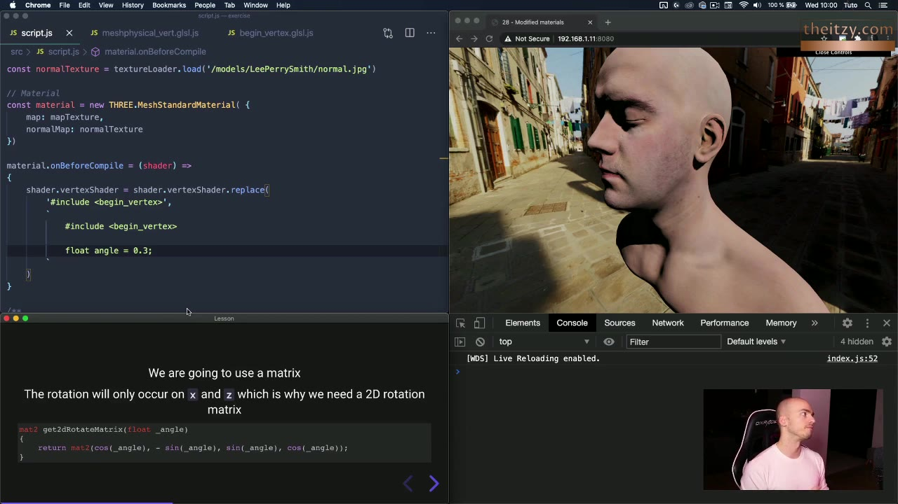
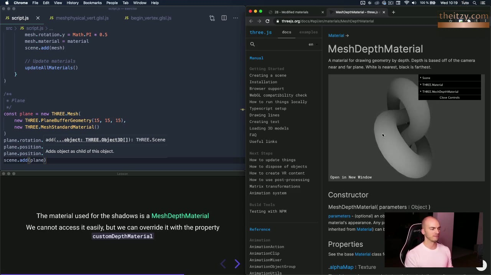

# 第 21 章 修改内置材质

在前面的章节中，我们学习了如何创建自定义着色器材质。但在实际项目中，Three.js 内置的材质已经提供了许多成熟功能，如物理渲染、光照、环境贴图和各种纹理支持。如果只需要在现有材质基础上添加少量特效，重新实现整个材质体系显然不切实际。本章将学习如何通过注入代码的方式修改内置材质，保留其原有功能的同时添加自定义着色器逻辑。

## 问题背景与解决方案

在 Three.js 中，内置材质如 `MeshStandardMaterial` 已经实现了复杂的光照模型、纹理映射和物理渲染特性。当我们需要添加简单的顶点动画、扭曲效果或表面变形时，无需重新实现整个材质系统。有两种可行方案：

1. **钩子注入**：使用 `onBeforeCompile` 钩子在材质编译前修改其着色器代码
2. **完整重写**：参照 Three.js 源码重新实现整个材质

其中第二种方法需要深入理解 Three.js 内部实现，工作量巨大且容易出错。因此，本章重点介绍第一种方案，通过钩子方式将自定义代码注入到内置材质的着色器中。

## 准备示例场景

我们将使用 `MeshStandardMaterial` 材质配合一个头部模型作为示例。场景配置包括平行光、环境光、阴影和平面背景，以便观察光影效果与阴影问题。

基本设置代码如下：

```javascript
// 材质配置
const material = new THREE.MeshStandardMaterial({
    map: textureLoader.load('/models/LeePerrySmith/color.jpg'),
    normalMap: textureLoader.load('/models/LeePerrySmith/normal.jpg')
})

// 模型加载与材质应用
gltfLoader.load('/models/LeePerrySmith/LeePerrySmith.glb', (gltf) => {
    mesh = gltf.scene.children[0]
    mesh.material = material
    scene.add(mesh)
})
```

## 使用 onBeforeCompile 钩子

每个 Three.js 材质都提供了 `onBeforeCompile` 属性，在着色器编译前会被调用。我们可以通过这个钩子访问并修改材质的着色器代码：

```javascript
material.onBeforeCompile = (shader) => {
    console.log(shader)
}
```

`shader` 对象包含：
- `vertexShader`：顶点着色器代码
- `fragmentShader`：片元着色器代码
- `uniforms`：uniform 变量定义

## Three.js 着色器代码结构

Three.js 的着色器采用模块化设计，通过 `#include <chunk_name>` 指令引用预定义的代码块。这些代码块位于 `three/src/renderers/shaders/ShaderChunk/` 目录中，称为"着色器块"（shader chunks）。

例如，顶点着色器通常包含以下块引用：
```glsl
#include <common>
#include <uv_pars_vertex>
#include <uv_vertex>
#include <beginnormal_vertex>
#include <begin_vertex>
// ... 其他块
```

这种设计使得我们可以替换或扩展特定的功能块，而不必处理完整的着色器代码。

## 修改顶点位置

首先尝试简单的位置修改。`begin_vertex` 块负责初始化顶点位置，存储在 `transformed` 变量中。我们可以替换这个块并添加自定义代码：

```javascript
material.onBeforeCompile = (shader) => {
    shader.vertexShader = shader.vertexShader.replace(
        '#include <begin_vertex>',
        `
            #include <begin_vertex>

            // 将所有顶点上移 3 个单位
            transformed.y += 3.0;
        `
    )
}
```

此时模型会整体上移，但阴影可能出现问题，这是因为阴影渲染使用不同的材质。



*图 21-1 修改顶点位置后模型上移但阴影异常*

## 实现扭曲效果

为了实现扭曲效果，我们需要在顶点着色器中添加旋转矩阵。首先创建一个 GLSL 函数，将其注入到 `common` 块中：

```javascript
material.onBeforeCompile = (shader) => {
    // 注入旋转矩阵函数到 common 块
    shader.vertexShader = shader.vertexShader.replace(
        '#include <common>',
        `
            #include <common>

            uniform float uTime;

            mat2 get2dRotateMatrix(float _angle) {
                return mat2(cos(_angle), -sin(_angle), sin(_angle), cos(_angle));
            }
        `
    )

    // 添加扭曲效果到顶点
    shader.vertexShader = shader.vertexShader.replace(
        '#include <begin_vertex>',
        `
            #include <begin_vertex>

            float angle = (position.y + uTime) * 0.9;
            mat2 rotateMatrix = get2dRotateMatrix(angle);

            transformed.xz = rotateMatrix * transformed.xz;
        `
    )
}
```

这个实现会根据顶点 y 坐标和随时间变化的角度对 xz 平面进行旋转，产生扭曲效果。

## 添加 uniform 变量与动画

`onBeforeCompile` 的 `shader` 参数提供了 `uniforms` 对象。为了让 JavaScript 动画代码与着色器共享同一份数值，通常先在外部创建 uniform，再把它关联到 `shader.uniforms`：

```javascript
// 在外部定义 uniform，便于动画更新
const customUniforms = {
    uTime: { value: 0 }
}

material.onBeforeCompile = (shader) => {
    shader.uniforms.uTime = customUniforms.uTime

    // ... 其他着色器修改
}

// 在动画循环中更新时间
const tick = () => {
    const elapsedTime = clock.getElapsedTime()
    customUniforms.uTime.value = elapsedTime
    // ... 渲染与更新
}
```

## 修复阴影问题

当我们移动顶点时，阴影可能出现错误。这是因为阴影渲染时，Three.js 会使用专门的 `MeshDepthMaterial` 材质进行深度渲染，而我们修改的 `MeshStandardMaterial` 不直接影响深度材质。

解决方案是创建自定义的深度材质并应用到模型：

```javascript
const depthMaterial = new THREE.MeshDepthMaterial({
    depthPacking: THREE.RGBADepthPacking
})

// 将相同的扭曲效果应用到深度材质
depthMaterial.onBeforeCompile = (shader) => {
    shader.uniforms.uTime = customUniforms.uTime
    shader.vertexShader = shader.vertexShader.replace(
        '#include <common>',
        `
            #include <common>

            uniform float uTime;

            mat2 get2dRotateMatrix(float _angle) {
                return mat2(cos(_angle), -sin(_angle), sin(_angle), cos(_angle));
            }
        `
    )
    shader.vertexShader = shader.vertexShader.replace(
        '#include <begin_vertex>',
        `
            #include <begin_vertex>

            float angle = (position.y + uTime) * 0.9;
            mat2 rotateMatrix = get2dRotateMatrix(angle);

            transformed.xz = rotateMatrix * transformed.xz;
        `
    )
}

// 应用深度材质到模型
gltfLoader.load('/models/LeePerrySmith/LeePerrySmith.glb', (gltf) => {
    mesh = gltf.scene.children[0]
    mesh.material = material
    mesh.customDepthMaterial = depthMaterial
    scene.add(mesh)
})
```

`depthPacking` 属性设置为 `THREE.RGBADepthPacking`，这是 Three.js 阴影渲染需要的标准深度打包方式。



*图 21-2 修复阴影与法线后的完整扭曲效果*

## 处理法线问题

扭曲顶点后，模型表面的光照可能出错，这是因为法线方向没有相应更新。法线用于光照计算，需要与变形后的几何保持一致。

Three.js 使用 `beginnormal_vertex` 块初始化法线，存储在 `objectNormal` 变量中。我们需要同时修改法线：

```javascript
material.onBeforeCompile = (shader) => {
    // ... common 块替换（包含 get2dRotateMatrix 和 uTime）

    // 注意：需要在 beginnormal_vertex 中定义 angle 和 rotateMatrix
    // 因为 begin_vertex 会共享这些变量
    shader.vertexShader = shader.vertexShader.replace(
        '#include <beginnormal_vertex>',
        `
            #include <beginnormal_vertex>

            float angle = (position.y + uTime) * 0.9;
            mat2 rotateMatrix = get2dRotateMatrix(angle);

            objectNormal.xz = rotateMatrix * objectNormal.xz;
        `
    )

    // begin_vertex 中引用已定义的变量
    shader.vertexShader = shader.vertexShader.replace(
        '#include <begin_vertex>',
        `
            #include <begin_vertex>

            transformed.xz = rotateMatrix * transformed.xz;
        `
    )
}
```

注意变量定义必须在 `beginnormal_vertex` 块中，因为该块在 `begin_vertex` 之前执行。如果在两个块中都定义相同的变量，会导致 GLSL 编译错误。

## 完整代码结构

以下是完整的实现代码结构：

```javascript
// 1. 定义外部 uniform
const customUniforms = {
    uTime: { value: 0 }
}

// 2. 创建主材质
const material = new THREE.MeshStandardMaterial({
    map: textureLoader.load('/models/LeePerrySmith/color.jpg'),
    normalMap: textureLoader.load('/models/LeePerrySmith/normal.jpg')
})

// 3. 创建深度材质
const depthMaterial = new THREE.MeshDepthMaterial({
    depthPacking: THREE.RGBADepthPacking
})

// 4. 配置主材质的 onBeforeCompile
material.onBeforeCompile = (shader) => {
    shader.uniforms.uTime = customUniforms.uTime

    // 注入旋转函数和 uniform
    shader.vertexShader = shader.vertexShader.replace(
        '#include <common>',
        `
            #include <common>

            uniform float uTime;

            mat2 get2dRotateMatrix(float _angle) {
                return mat2(cos(_angle), -sin(_angle), sin(_angle), cos(_angle));
            }
        `
    )

    // 修改法线（定义变量）
    shader.vertexShader = shader.vertexShader.replace(
        '#include <beginnormal_vertex>',
        `
            #include <beginnormal_vertex>

            float angle = (position.y + uTime) * 0.9;
            mat2 rotateMatrix = get2dRotateMatrix(angle);

            objectNormal.xz = rotateMatrix * objectNormal.xz;
        `
    )

    // 修改顶点位置（使用已定义的变量）
    shader.vertexShader = shader.vertexShader.replace(
        '#include <begin_vertex>',
        `
            #include <begin_vertex>

            transformed.xz = rotateMatrix * transformed.xz;
        `
    )
}

// 5. 配置深度材质的 onBeforeCompile（简化版，无需处理法线）
depthMaterial.onBeforeCompile = (shader) => {
    shader.uniforms.uTime = customUniforms.uTime

    shader.vertexShader = shader.vertexShader.replace(
        '#include <common>',
        `
            #include <common>

            uniform float uTime;

            mat2 get2dRotateMatrix(float _angle) {
                return mat2(cos(_angle), -sin(_angle), sin(_angle), cos(_angle));
            }
        `
    )

    shader.vertexShader = shader.vertexShader.replace(
        '#include <begin_vertex>',
        `
            #include <begin_vertex>

            float angle = (position.y + uTime) * 0.9;
            mat2 rotateMatrix = get2dRotateMatrix(angle);

            transformed.xz = rotateMatrix * transformed.xz;
        `
    )
}
```

## 更多可能性

掌握了修改内置材质的基本方法后，可以尝试更多效果：

1. **参数控制**：通过 uniform 控制扭曲强度、方向、频率
2. **复杂变形**：使用噪声函数、正弦波组合创建更有机的变形
3. **多材质支持**：遍历模型的所有网格并统一修改
4. **代码组织**：将 GLSL 代码提取到外部文件以便复用和维护
5. **交互反馈**：根据鼠标位置、滚动位置动态调整效果

示例：使用正弦波创造波浪式扭曲：
```glsl
float angle = sin(position.y * 2.0 + uTime) * 0.4;
```

## 注意事项

1. **变量作用域**：GLSL 变量定义必须在首次使用前，注意不同着色器块的执行顺序
2. **性能影响**：复杂的顶点变形可能影响渲染性能，特别是对于高多边形模型
3. **阴影一致性**：必须同时修改 `customDepthMaterial` 以确保阴影正确
4. **法线处理**：旋转、扭曲等会改变局部表面方向的变形，需要相应调整法线；单纯平移不需要改变法线方向
5. **程序缓存**：不同材质若注入不同代码，应通过 `customProgramCacheKey()` 提供可区分的缓存键，避免 Three.js 错用已有着色器程序
6. **多网格模型**：复杂模型可能有多个网格和材质，需要遍历处理

## 本章小结

本章学习了如何通过 `onBeforeCompile` 钩子修改 Three.js 内置材质，在保留原有功能的基础上添加自定义着色器逻辑。主要内容包括：

- **钩子机制**：理解 `onBeforeCompile` 的工作原理和着色器代码访问方式
- **着色器块**：掌握 Three.js 模块化着色器的结构，能够定位和替换特定功能块
- **顶点变形**：实现基于旋转矩阵的扭曲效果，并正确处理变量作用域
- **阴影处理**：创建和应用自定义深度材质以确保阴影与变形同步
- **法线更新**：在变形后更新法线方向以保持正确的光照计算
- **uniform 管理**：通过外部对象统一管理 uniform 变量便于动画更新

这种方法平衡了功能完整性与开发效率，使我们能够利用 Three.js 成熟的材质系统，同时添加个性化的视觉效果。在实际项目中，这种技术可以应用于角色变形、环境互动、特效增强等多种场景。