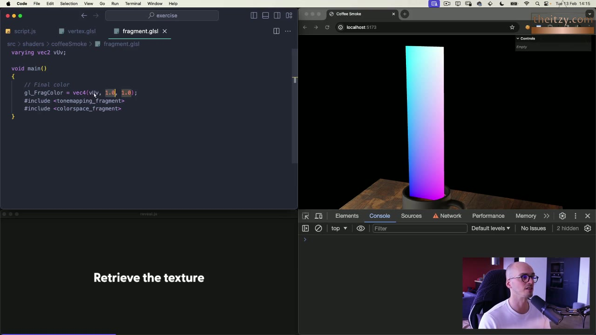
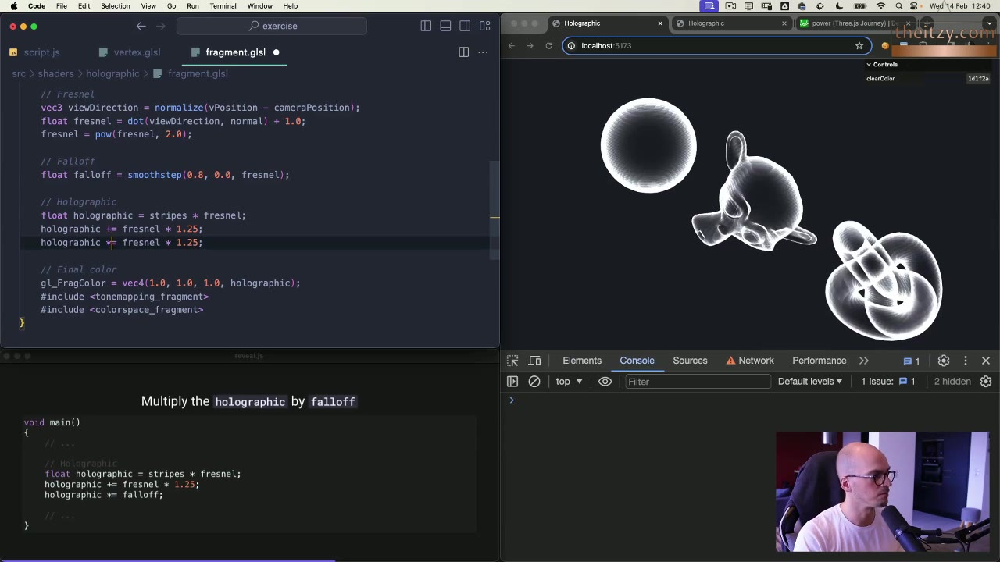

# 第 22 章 咖啡烟雾与全息影像

在前面的章节中，我们已经掌握了定制化着色器的基础。本章将运用这些知识实现两个典型视觉效果：模拟从咖啡杯升起的动态烟雾，以及创建科幻风格的全息影像。这两个案例分别代表两类典型的着色器应用场景：前者侧重于纹理采样和平滑透明度过渡，后者结合菲涅耳效应、重复条纹和顶点扭曲来模拟科幻全息效果。

两个案例展示了不同的着色器组合策略：烟雾使用预计算噪声纹理和透明边缘控制成本，全息影像则通过菲涅耳、条纹、透明度衰减和顶点扭曲构造风格化效果。本章将详细讲解平面几何体的基础设置、Perlin 纹理的采样技巧、边缘柔化处理、顶点扭曲动画，以及如何在片段着色器中融合条纹图案与菲涅耳效应。

## 烟雾着色器的性能考量

在实现咖啡烟雾效果前，首先需要明确一个性能关键点：使用预渲染的 Perlin 噪声纹理替代实时噪声函数。之前的章节中，我们频繁使用 Perlin 函数创建海面、星系和各种图案，但在每帧对大量顶点或片元执行复杂噪声计算，成本可能很高。烟雾案例改用预计算纹理，把噪声生成从逐帧计算转化为纹理采样。

大多数视频游戏采用更高效的方法：预先渲染噪声纹理，然后在着色器中采样。这种方法特别适合片元数量较多的透明烟雾，也能避免每个帧重复生成相同结构的噪声。

### 噪声纹理的来源与选择标准

我们可以从多种来源获取噪声纹理：
- **在线生成器**：如 PerlinNoiseMaker、EffectTextureMaker 等工具
- **纹理资源包**：OpenGameArt 等网站提供打包好的噪声纹理
- **设计软件**：Figma、Photoshop、Blender 等软件支持噪声生成
- **运行时生成**：使用 WebGLRenderTarget 在初始化时生成一次噪声纹理

选择噪声纹理时应考虑三个标准：
1. **足够的变异度**：避免明显的重复图案
2. **适当的尺寸**：128×128 通常足够，像素会在采样时插值
3. **可重复性**：纹理应能无缝平铺，边缘衔接自然

本章提供的 Perlin 噪声纹理（`perlin.png`）满足上述标准，且仅使用红色通道存储灰度信息。实际开发中，可以考虑将不同频率或特征的噪声分别存储在 RGBA 四个通道中，这样单张纹理就能提供多种噪声变化。

## 烟雾平面与基础设置

烟雾效果需要一个平面几何体作为载体：

```javascript
// 创建足够细分的平面几何体
const smokeGeometry = new THREE.PlaneGeometry(1, 1, 16, 64)

// 调整几何体位置，使底部位于原点
smokeGeometry.translate(0, 0.5, 0)

// 缩放几何体以适应烟雾形状
smokeGeometry.scale(1.5, 6, 1.5)
```

这里直接在几何体上应用变换（而非通过网格变换），是为了让后续的顶点着色器计算更简单。平面被细分为 16×64 个网格，提供足够的顶点进行平滑变形。

几何体准备好后，放置在咖啡杯上方合适位置：

```javascript
const smoke = new THREE.Mesh(smokeGeometry, material)
smoke.position.y = 1.83
scene.add(smoke)
```

### 着色器材质基础

烟雾效果使用自定义着色器材质。首先创建基础着色器文件：

**顶点着色器 (`coffeeSmoke/vertex.glsl`)**:
```glsl
varying vec2 vUv;

void main()
{
    vUv = uv;
    gl_Position = projectionMatrix * modelViewMatrix * vec4(position, 1.0);
}
```

**片段着色器 (`coffeeSmoke/fragment.glsl`)**:
```glsl
varying vec2 vUv;

void main()
{
    // 初始颜色（后续会被替换）
    gl_FragColor = vec4(0.0, 1.0, 0.0, 1.0);

    // 包含 Three.js 的色调映射和色彩空间支持
    #include <tonemapping_fragment>
    #include <colorspace_fragment>
}
```

这些着色器在 Three.js 中加载并应用到材质：

```javascript
// 导入 GLSL 文件
import vertexShader from './shaders/coffeeSmoke/vertex.glsl'
import fragmentShader from './shaders/coffeeSmoke/fragment.glsl'

// 创建着色器材质
const material = new THREE.ShaderMaterial({
    vertexShader: vertexShader,
    fragmentShader: fragmentShader,
    transparent: true,  // 启用透明度
    side: THREE.DoubleSide  // 双面渲染
})
```

## 纹理采样与烟雾密度

烟雾效果的核心是使用 Perlin 噪声纹理控制透明度分布。首先需要在 JavaScript 侧加载纹理并将其作为 uniform 传递到着色器：

```javascript
// 加载噪声纹理
const textureLoader = new THREE.TextureLoader()
const perlinTexture = textureLoader.load('./perlin.png')

// 配置纹理重复
perlinTexture.wrapS = THREE.RepeatWrapping
perlinTexture.wrapT = THREE.RepeatWrapping

// 创建材质并传递纹理
const material = new THREE.ShaderMaterial({
    vertexShader: vertexShader,
    fragmentShader: fragmentShader,
    transparent: true,
    uniforms: {
        uPerlinTexture: { value: perlinTexture },
        uTime: { value: 0 }
    }
})
```

在片段着色器中，根据 UV 坐标和时间采样噪声纹理，并将采样结果转换为透明度值：

```glsl
// 声明 uniform
uniform sampler2D uPerlinTexture;
uniform float uTime;

// 在 main() 函数中
void main()
{
    // 计算动态 UV（添加时间偏移）
    vec2 smokeUv = vUv;
    smokeUv.x *= 0.5;
    smokeUv.y *= 0.3;
    smokeUv.y -= uTime * 0.03;

    // 采样噪声纹理
    float perlin = texture(uPerlinTexture, smokeUv).r;

    // 重映射噪声值
    perlin = smoothstep(0.4, 1.0, perlin);
    perlin *= 0.8;

    // 应用透明度
    gl_FragColor = vec4(0.5, 0.5, 0.5, perlin);
}
```

`smoothstep` 函数将噪声值从 `[0.4, 1.0]` 范围映射到 `[0.0, 1.0]`，然后乘以 `0.8` 降低整体透明度，避免烟雾过于浓密。

### 边缘柔化处理

当前效果虽然有了烟雾的基本形态，但边缘过于锐利。为此，我们需要对 UV 坐标的边缘进行柔化处理：

```glsl
void main()
{
    // ... 之前的噪声采样代码

    // 边缘柔化
    float edgeStrength = 1.0;

    // 左侧边缘衰减
    float leftEdge = smoothstep(0.0, 0.1, vUv.x);
    edgeStrength *= leftEdge;

    // 右侧边缘衰减
    float rightEdge = smoothstep(0.0, 0.1, 1.0 - vUv.x);
    edgeStrength *= rightEdge;

    // 顶部边缘衰减
    float topEdge = smoothstep(0.0, 0.1, vUv.y);
    edgeStrength *= topEdge;

    // 底部边缘衰减
    float bottomEdge = smoothstep(0.0, 0.1, 1.0 - vUv.y);
    edgeStrength *= bottomEdge;

    // 应用边缘衰减到透明度
    perlin *= edgeStrength;

    gl_FragColor = vec4(0.5, 0.5, 0.5, perlin);
}
```

`vUv.x` 和 `vUv.y` 是顶点着色器通过 varying 传来的纹理坐标，取值在 `[0.0, 1.0]` 范围内。片元着色器不能直接使用顶点属性 `uv`，因此必须保留这一传递关系。`smoothstep` 在指定阈值范围内创建平滑过渡，使边缘逐渐变透明。

## 顶点扭曲动画

烟雾的上升主要通过片元着色器中的 UV 偏移完成，而顶点着色器负责让平面发生扭转和横向摆动。扭转在 XZ 平面进行，不能直接平移整个平面的 Y 坐标，否则只会让所有顶点一起漂移。

```glsl
uniform sampler2D uPerlinTexture;
uniform float uTime;
varying vec2 vUv;

vec2 rotate2D(vec2 value, float angle)
{
    float s = sin(angle);
    float c = cos(angle);
    return mat2(c, -s, s, c) * value;
}

void main()
{
    vUv = uv;
    vec3 newPosition = position;

    // 扭转：不同高度采样不同噪声，并随时间变化
    float twistPerlin = texture(
        uPerlinTexture,
        vec2(0.5, uv.y * 0.2 - uTime * 0.005)
    ).r;
    float angle = twistPerlin * 10.0;
    newPosition.xz = rotate2D(newPosition.xz, angle);

    // 风力：底部较弱，越接近顶部横向偏移越明显
    vec2 windOffset = vec2(
        texture(uPerlinTexture, vec2(0.25, uTime * 0.01)).r - 0.5,
        texture(uPerlinTexture, vec2(0.75, uTime * 0.01)).r - 0.5
    );
    windOffset *= pow(uv.y, 2.0) * 10.0;
    newPosition.xz += windOffset;

    gl_Position = projectionMatrix * modelViewMatrix * vec4(newPosition, 1.0);
}
```

`rotate2D` 只改变 XZ 坐标，使烟雾各高度产生不同朝向。风力采样使用两条不同的纹理列，避免 X 与 Z 偏移完全相同；`pow(uv.y, 2.0)` 则让底部保持稳定、顶部摆动更明显。片元着色器中的噪声 UV 动画与顶点动画共同形成上升、扭转和随风变化的效果。



*图 22-1 通过噪声采样、UV 动画和透明边缘形成上升的咖啡烟雾*

## 全息影像着色器基础

全息效果常用于科幻场景，特点是边缘发光、内部有扫描线或条纹图案，以及半透明外观。我们将在一个包含球体、苏珊猴头和环面结的场景中实现这个效果。

首先建立基础着色器结构：

**全息顶点着色器 (`holographic/vertex.glsl`)**:
```glsl
void main()
{
    // 分离模型位置计算，后续需要修改
    vec4 modelPosition = modelMatrix * vec4(position, 1.0);

    // 标准变换
    gl_Position = projectionMatrix * viewMatrix * modelPosition;
}
```

**全息片段着色器 (`holographic/fragment.glsl`)**:
```glsl
void main()
{
    // 初始颜色
    gl_FragColor = vec4(1.0, 1.0, 0.0, 1.0);

    // Three.js 标准支持
    #include <tonemapping_fragment>
    #include <colorspace_fragment>
}
```

应用材质时需要开启透明度和禁用深度写入，避免半透明表面的渲染问题：

```javascript
const material = new THREE.ShaderMaterial({
    vertexShader: holographicVertexShader,
    fragmentShader: holographicFragmentShader,
    transparent: true,
    depthWrite: false,  // 禁用深度写入
    side: THREE.DoubleSide
})
```

## 条纹图案生成

全息效果的标志性特征之一是扫描线或条纹图案。我们在片段着色器中根据世界空间的位置创建条纹：

```glsl
// 在片段着色器中
void main()
{
    // 计算条纹
    float stripes = mod(vWorldPosition.y * 20.0, 1.0);

    // 锐化条纹边缘
    stripes = pow(stripes, 3.0);

    // 应用条纹到透明度
    gl_FragColor = vec4(1.0, 1.0, 1.0, stripes);
}
```

这里使用模型的世界坐标 Y 值乘以缩放因子生成重复条纹。`mod` 函数创建 `[0, 1)` 范围内的周期性图案，`pow` 函数锐化条纹边缘，使亮暗区域对比更强烈。

### 改进的条纹算法

上述简单条纹存在两个问题：1）条纹方向固定，与模型旋转无关；2）条纹在模型内部不连续。改进方案是使用基于视角的条纹：

```glsl
// 在顶点着色器中传递视角方向
varying vec3 vViewPosition;

void main()
{
    // ... 位置计算

    // 计算并传递视角位置
    vec4 viewPosition = viewMatrix * modelPosition;
    vViewPosition = viewPosition.xyz;
}

// 在片段着色器中
varying vec3 vViewPosition;

void main()
{
    // 使用视角空间的 Y 坐标创建条纹
    float stripes = mod(vViewPosition.y * 10.0, 1.0);
    stripes = pow(stripes, 3.0);
}
```

这种方法产生的条纹始终相对于摄像机，更符合真实全息投影的物理特性。

## 菲涅耳效应

菲涅耳效应描述表面反射率随观察角度变化的现象：当视线与表面法线垂直时（正面观察），反射较弱；当视线与表面接近平行时（侧面观察），反射增强。这正是全息影像边缘发光的原因。

在片段着色器中实现菲涅耳效应：

```glsl
// 在顶点着色器中传递法线
varying vec3 vNormal;

void main()
{
    // ... 位置计算

    // 计算并传递世界空间法线
    vNormal = normalize(normalMatrix * normal);
}

// 在片段着色器中
varying vec3 vNormal;

void main()
{
    // 计算视角方向（从片段到摄像机）
    vec3 viewDirection = normalize(-vViewPosition);

    // 计算菲涅耳值
    float fresnel = dot(viewDirection, vNormal);

    // 调整值域并增强效果
    fresnel = clamp(fresnel + 1.0, 0.0, 1.0);
    fresnel = pow(fresnel, 2.0);

    gl_FragColor = vec4(1.0, 1.0, 1.0, fresnel);
}
```

这里的关键步骤：
1. **点积计算**：`dot(viewDirection, vNormal)` 返回 `[-1, 1]` 的值，平行时接近 `1`，垂直时接近 `0`
2. **值域调整**：加上 `1.0` 使范围变为 `[0, 2]`，再使用 `clamp` 限制到 `[0, 1]`
3. **幂函数增强**：`pow(fresnel, 2.0)` 使效果更集中在边缘

### 顶点故障特效

为了模拟全息投影的不稳定特性，可以在顶点着色器中添加随机扰动：

```glsl
// 在顶点着色器中
uniform float uTime;

void main()
{
    vec4 modelPosition = modelMatrix * vec4(position, 1.0);

    // 添加随机扰动
    float glitch = sin(uTime * 10.0 + modelPosition.y * 5.0) * 0.1;
    glitch *= step(0.8, fract(uTime));  // 间歇性触发

    modelPosition.x += glitch;
    modelPosition.z += glitch * 0.5;

    gl_Position = projectionMatrix * viewMatrix * modelPosition;
}
```

这种间歇性顶点位移模拟了全息投影的信号干扰效果。使用 `step` 函数和 `fract` 函数可以控制故障发生的频率和持续时间。

## 效果融合与最终外观

将条纹图案与菲涅耳效应结合，创建完整的全息外观：

```glsl
void main()
{
    // 计算条纹
    float stripes = mod(vViewPosition.y * 10.0, 1.0);
    stripes = pow(stripes, 3.0);

    // 计算菲涅耳
    vec3 viewDirection = normalize(-vViewPosition);
    float fresnel = dot(viewDirection, vNormal);
    fresnel = clamp(fresnel + 1.0, 0.0, 1.0);
    fresnel = pow(fresnel, 2.0);

    // 融合效果
    float holographic = stripes * fresnel;
    holographic += fresnel * 1.25;  // 增强边缘亮度

    // 应用颜色
    vec3 color = vec3(0.0, 1.0, 1.0);  // 青色全息
    gl_FragColor = vec4(color, holographic);
}
```

融合策略是乘法结合叠加增强：`stripes * fresnel` 让条纹受到边缘权重调制，额外的 `fresnel * 1.25` 进一步强化轮廓发光，而不是只强调模型中心。

### 全息颜色控制

为全息效果添加可配置的颜色参数：

```glsl
// 添加 uniform
uniform vec3 uColor;

void main()
{
    // ... 效果融合计算

    // 应用颜色
    gl_FragColor = vec4(uColor, holographic);
}
```

在 JavaScript 侧可以动态调整颜色：

```javascript
const material = new THREE.ShaderMaterial({
    // ... 其他配置
    uniforms: {
        uColor: { value: new THREE.Color(0.0, 1.0, 1.0) },
        uTime: { value: 0 }
    }
})

// 在动画循环中更新时间
const clock = new THREE.Clock()
const tick = () => {
    const elapsedTime = clock.getElapsedTime()
    material.uniforms.uTime.value = elapsedTime
}
```



*图 22-2 完整全息效果：融合条纹、菲涅耳效应和顶点故障*

## 性能优化与调试技巧

### 透明度渲染优化

半透明表面的渲染顺序会影响最终效果。Three.js 默认情况下按物体添加到场景的顺序渲染，但对于同一物体的不同部分，可能需要手动控制：

```javascript
// 控制渲染顺序（值越大渲染越晚）
material.renderOrder = 1

// 禁用深度测试（避免全息内部被自身遮挡）
material.depthTest = false
```

### 纹理压缩与复用

对于噪声纹理等资源，考虑使用压缩格式和复用策略：

```javascript
// 使用 TextureLoader 的缓存
const textureLoader = new THREE.TextureLoader()
const perlinTexture = textureLoader.load('./perlin.png', (texture) => {
    // 配置纹理参数
    texture.wrapS = THREE.RepeatWrapping
    texture.wrapT = THREE.RepeatWrapping
    texture.magFilter = THREE.LinearFilter
    texture.minFilter = THREE.LinearFilter
})
```

### 着色器调试策略

调试着色器时，可以将中间变量可视化：

```glsl
// 调试方法：将中间值映射到颜色通道
void main()
{
    // 计算某个中间值
    float intermediateValue = /* 某个计算 */

    // 映射到颜色进行调试
    gl_FragColor = vec4(intermediateValue, 0.0, 0.0, 1.0);
}
```

## 本章小结

本章通过咖啡烟雾和全息影像两个案例，展示了着色器在实际项目中的应用：

1. **性能优先的纹理策略**：使用预渲染的噪声纹理替代实时噪声计算，显著提升渲染性能。这是游戏开发和复杂 WebGL 应用的通用优化手段。

2. **基础效果组合**：复杂视觉效果往往由多个基础效应组合而成。烟雾效果结合了纹理采样、边缘柔化和顶点扭曲；全息效果融合了条纹图案、菲涅耳效应和顶点故障。

3. **物理原理指导视觉效果**：菲涅耳效应基于真实的光学现象，理解其原理有助于创建更自然的外观。边缘发光效果通过菲涅耳计算实现，而非简单的位置衰减。

4. **透明度处理技巧**：半透明表面需要特殊处理，包括渲染顺序控制、深度缓冲区管理，以及边缘平滑过渡算法。

5. **动态效果的关键**：时间参数 `uTime` 是实现动画的基础，通过正弦函数、噪声采样和时间偏移创建各类动态效果。

这两个案例提供了实际可用的着色器模板，稍作调整即可应用到其他场景，如火焰、云层、水面、能量护盾等视觉效果中。它们展示了着色器编程的核心思维：将复杂问题分解为基础组件，通过数学函数和纹理采样组合这些组件，最终形成完整的视觉呈现。

在实际开发中，应始终在视觉质量和性能开销之间寻找平衡点，优先考虑纹理采样和基础数学运算的解决方案，仅在必要时使用复杂的过程式生成算法。通过本章的学习，读者应能独立设计和实现中等复杂度的着色器效果，为创建独特的视觉体验奠定基础。