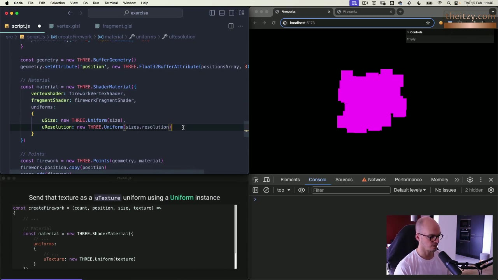
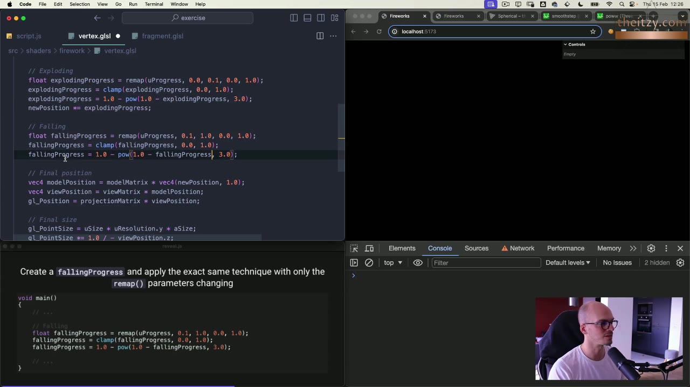

# 第 23 章 烟花着色器

烟花看似由大量彼此独立的火花组成，实际上可以用一组 `THREE.Points` 和一个自定义着色器统一完成。本章从粒子几何体开始，依次解决透视下的大小、屏幕分辨率与像素比适配、纹理透明、球面分布、生命周期动画和资源释放，最后加入随机交互与黄昏天空。实现的重点不是逐帧用 JavaScript 移动对象，而是把统一的进度值和逐粒子属性送入 GPU，让顶点着色器并行计算爆炸、下落、缩放与闪烁。

## 粒子方案与项目组织

如果用许多平面分别表示火花，就需要在 JavaScript 中持续更新大量对象的位置和矩阵。粒子方案则让所有顶点共享同一套着色器逻辑：每次绘制只更新少量 uniform，粒子的差异由 attribute 提供，主要动画计算由 GPU 并行完成。这里的“统一”并不意味着所有粒子完全相同；方向、大小、时间和纹理仍然可以随机化。

起始项目已经包含场景、相机、渲染器、`OrbitControls`、`TextureLoader` 和 Lil-GUI，并通过 `vite-plugin-glsl` 支持导入 GLSL 文件。测试立方体只用于确认项目能够运行，正式开始时应移除。GSAP 在本章只负责推动一个进度值，天空参数才需要使用调试面板。

将烟花封装为 `createFirework`，而不是只在初始化时写一组粒子，是因为页面加载和后续点击都要复用同一流程。函数最终接收六个参数：粒子数量、整组烟花的位置、基础点大小、纹理、球面半径和颜色。独立的 GLSL 文件保持顶点与片元职责清晰：

```text
src/
├─ script.js
└─ shaders/
   ├─ firework/
   │  ├─ vertex.glsl
   │  └─ fragment.glsl
   └─ includes/
      └─ remap.glsl
```

JavaScript 中分别导入两个着色器，再交给 `THREE.ShaderMaterial`。初期也可以先用 `THREE.PointsMaterial` 验证几何体和 `THREE.Points` 已经正确显示，再替换为自定义材质；这样能对着色器错误建立明确的排查起点。

## 构建粒子几何体与基础着色器

每个粒子的位置需要三个浮点数，因此先建立长度为 `count * 3` 的 `Float32Array`。循环按粒子递增，`i3 = i * 3` 给出当前粒子在数组中的起点，三个连续元素分别保存 x、y、z。`position` 是 Three.js 约定的属性名，`Float32BufferAttribute` 的第二个参数 `3` 则告诉 GPU 每个顶点读取三个分量。

最终几何体还包含每粒子大小 `aSize` 和时间倍率 `aTimeMultiplier`，它们每顶点只有一个值，所以数组长度都是 `count`，属性的 itemSize 也都是 `1`：

```js
const createFirework = (count, position, size, texture, radius, color) => {
    const positionsArray = new Float32Array(count * 3)
    const sizesArray = new Float32Array(count)
    const timeMultipliersArray = new Float32Array(count)

    for (let i = 0; i < count; i++) {
        const i3 = i * 3

        const spherical = new THREE.Spherical(
            radius * (0.75 + Math.random() * 0.25),
            Math.random() * Math.PI,
            Math.random() * Math.PI * 2
        )
        const particlePosition = new THREE.Vector3()
        particlePosition.setFromSpherical(spherical)

        positionsArray[i3] = particlePosition.x
        positionsArray[i3 + 1] = particlePosition.y
        positionsArray[i3 + 2] = particlePosition.z
        sizesArray[i] = Math.random()
        timeMultipliersArray[i] = 1 + Math.random()
    }

    const geometry = new THREE.BufferGeometry()
    geometry.setAttribute('position', new THREE.Float32BufferAttribute(positionsArray, 3))
    geometry.setAttribute('aSize', new THREE.Float32BufferAttribute(sizesArray, 1))
    geometry.setAttribute('aTimeMultiplier', new THREE.Float32BufferAttribute(timeMultipliersArray, 1))
}
```

先用独立随机数填充三个坐标可以快速得到测试点云，但结果是一个立方体区域，而且 `[0, 1)` 的坐标会让分布偏向一侧；若采用这种临时写法，应减去 `0.5` 使其围绕原点居中。上面的最终实现直接使用球坐标，后文再解释其分布特点。

新建的 `Float32Array` 初始内容全为零，必须逐粒子写入有效数据。检查数组时，除了确认长度分别为 `count * 3` 和 `count`，还应抽查开头与末尾，避免循环索引或 itemSize 错误只在尾部暴露。`position` 必须遵守 Three.js 的约定名称；`aSize` 与 `aTimeMultiplier` 是自定义属性，可以自由命名，但 JavaScript 的 `setAttribute`、GLSL 的 `attribute` 声明和实际使用处必须完全一致。自定义属性只存在于顶点阶段，片元着色器若需要相关数据，还要通过 varying 显式传递。

基础顶点着色器把模型、视图和投影变换分开书写。这样既能得到最终的 `gl_Position`，也能保留位于视图空间的 `viewPosition`，其 z 分量随后用于透视点大小计算。片元着色器先输出固定颜色即可验证管线；接入最终颜色后，保留 Three.js 的色调映射与颜色空间代码块，避免自定义材质绕过渲染输出处理：

```glsl
// vertex.glsl 的基础变换
vec4 modelPosition = modelMatrix * vec4(position, 1.0);
vec4 viewPosition = viewMatrix * modelPosition;
gl_Position = projectionMatrix * viewPosition;
gl_PointSize = 20.0;
```

```glsl
// fragment.glsl 的输出尾部
gl_FragColor = vec4(uColor, textureAlpha);
#include <tonemapping_fragment>
#include <colorspace_fragment>
```

`THREE.Points` 而不是 `THREE.Mesh` 负责绘制几何体。创建后将函数参数中的整组位置复制到 `firework.position`，再加入场景；粒子自身的 `position` 属性仍是相对于烟花中心的局部坐标，两种位置不能混为一谈。

## 点大小、透视与渲染分辨率

`gl_PointSize` 控制点图元的大小。固定值虽然能显示粒子，却不会随相机距离变化，也没有处理不同屏幕和视口尺寸。完整计算由两部分组成：先根据 uniform、逐粒子属性和动画阶段得到基础大小，再除以视图空间深度 `-viewPosition.z`：

```glsl
gl_PointSize = uSize * uResolution.y * aSize * sizeProgress * sizeTwinkling;
gl_PointSize *= 1.0 / -viewPosition.z;
```

除以 `-viewPosition.z` 后，近处粒子更大、远处粒子更小。乘以 `uResolution.y` 则让点大小随渲染高度变化，与普通网格在垂直视场角下随视口缩放的行为一致。这里使用高度而非宽度，是因为当前透视相机采用垂直视场角；宽高比变化主要改变水平可见范围。

分辨率还需要包含设备像素比。CSS 尺寸为 600 像素、像素比为 2 时，实际渲染高度是 1200 像素；只传 CSS 高度会让高像素比设备上的粒子相对变小。把宽、高和像素比集中保存在 `sizes` 中，并共享一个 `Vector2` 给所有烟花材质的 `uResolution`，即可在窗口变化时一次更新全部引用：

```js
const sizes = {
    width: window.innerWidth,
    height: window.innerHeight,
    pixelRatio: Math.min(window.devicePixelRatio, 2)
}
sizes.resolution = new THREE.Vector2(
    sizes.width * sizes.pixelRatio,
    sizes.height * sizes.pixelRatio
)

window.addEventListener('resize', () => {
    sizes.width = window.innerWidth
    sizes.height = window.innerHeight
    sizes.pixelRatio = Math.min(window.devicePixelRatio, 2)
    sizes.resolution.set(
        sizes.width * sizes.pixelRatio,
        sizes.height * sizes.pixelRatio
    )

    camera.aspect = sizes.width / sizes.height
    camera.updateProjectionMatrix()
    renderer.setSize(sizes.width, sizes.height)
    renderer.setPixelRatio(sizes.pixelRatio)
})
```

像素比上限设为 `2` 与渲染器设置保持一致，避免极高像素比设备承担不成比例的片元渲染成本。窗口跨屏移动时，设备像素比可能改变，因此 resize 回调中要同时重算像素比、共享分辨率和渲染器状态。材质内部使用 `uResolution: new THREE.Uniform(sizes.resolution)`，不要在每次创建烟花时新建互不相连的向量，否则后续更新难以覆盖已有点云。

还需要注意硬件对点图元大小的限制：部分实现会把最大 `gl_PointSize` 限制在较小范围，调试超大粒子时不同设备可能出现差异；一些 Windows 图形实现则无法显示小于一个像素的点。后者会在生命周期末尾留下顽固的单像素亮点，本章在最终顶点着色器中通过隐藏这些微小点处理。



*图 23-1 点大小、透视和逐粒子差异共同形成烟花火花*

## 球面分布、纹理与透明混合

`THREE.Spherical` 用半径、phi 和 theta 描述球坐标，`Vector3.setFromSpherical` 将其转换成着色器需要的笛卡尔坐标。phi 的随机范围是 `0` 到 `Math.PI`，覆盖从一端到另一端的极角；theta 的范围是 `0` 到 `Math.PI * 2`，覆盖完整水平圆周。若把 theta 也限制为 `Math.PI`，就只会得到部分朝向。

完全相同的半径会形成过于规则的球壳，因此实际半径使用 `radius * (0.75 + Math.random() * 0.25)`，即基础半径的 75%—100%。`aSize = Math.random()` 再为每个粒子提供不同大小。此时 uniform 与 attribute 的分工已经明确：`uSize`、`uColor` 等控制整组烟花，`aSize`、`aTimeMultiplier` 和初始 `position` 描述单个粒子。

直接随机 phi 与 theta 能快速形成球体，却不等于按球面面积均匀采样，极点附近的粒子会显得更密集。本章保留这种简单分布，因为半径和生命周期的随机化已经能弱化规则感；若项目需要严格均匀的球面，应改用面积正确的采样方法，而不是继续无依据地调整两个角度。循环内临时创建 `Spherical` 和 `Vector3` 对这里的粒子规模通常可以接受，若创建频率成为实际瓶颈，也可以复用对象并在每次迭代中重新设置值。

粒子贴图放在 `static/particles` 中，Vite 的公共目录在代码里不写成 `static` 前缀。项目加载 `1.png` 至 `8.png` 形成数组，创建每组烟花时选择其中一张。灰度贴图的红色通道足以作为透明度，无需把 RGBA 全部当作颜色输出：

```js
const textures = [
    textureLoader.load('./particles/1.png'),
    textureLoader.load('./particles/2.png'),
    textureLoader.load('./particles/3.png'),
    textureLoader.load('./particles/4.png'),
    textureLoader.load('./particles/5.png'),
    textureLoader.load('./particles/6.png'),
    textureLoader.load('./particles/7.png'),
    textureLoader.load('./particles/8.png')
]
```

```glsl
uniform sampler2D uTexture;
uniform vec3 uColor;

void main()
{
    float textureAlpha = texture(uTexture, gl_PointCoord).r;
    gl_FragColor = vec4(uColor, textureAlpha);
    #include <tonemapping_fragment>
    #include <colorspace_fragment>
}
```

点图元没有普通网格那样的表面 UV，片元着色器应使用内置的 `gl_PointCoord` 在当前点内采样。若贴图上下颠倒，在创建材质前设置 `texture.flipY = false`，以匹配这里的点坐标方向。最终 RGB 来自 `uColor`，alpha 来自纹理红通道，因此一张灰度图可以配合任意烟花颜色重复使用。

仅设置 `transparent: true` 仍可能让透明粒子相互遮挡，因为材质默认还会写入深度缓冲区。烟花由发光火花组成，适合关闭深度写入并采用加法混合：

```js
texture.flipY = false
const material = new THREE.ShaderMaterial({
    vertexShader: fireworkVertexShader,
    fragmentShader: fireworkFragmentShader,
    uniforms: {
        uSize: new THREE.Uniform(size),
        uResolution: new THREE.Uniform(sizes.resolution),
        uTexture: new THREE.Uniform(texture),
        uColor: new THREE.Uniform(color),
        uProgress: new THREE.Uniform(0)
    },
    transparent: true,
    depthWrite: false,
    blending: THREE.AdditiveBlending
})
```

`depthWrite: false` 避免同一透明点云内的片元借深度写入挡住后续粒子；`THREE.AdditiveBlending` 把重叠光点亮度相加，使密集区域更明亮。这里的透明策略服务于发光效果，并不意味着它适合所有需要正确前后排序的半透明物体。

## 用单一进度驱动生命周期

每组烟花只需一个 `uProgress`，从 `0` 线性变化到 `1`。GSAP 对 `material.uniforms.uProgress` 的 `value` 属性建立补间，持续时间设为 3 秒：

```js
const destroy = () => {
    scene.remove(firework)
    geometry.dispose()
    material.dispose()
}

gsap.to(material.uniforms.uProgress, {
    value: 1,
    ease: 'linear',
    duration: 3,
    onComplete: destroy
})
```

外层进度保持线性，是因为爆炸、下落等阶段需要各自的缓动；如果这里再使用非线性 easing，各阶段的时间区间会变得难以推理。动画完成时必须先把 `firework` 从场景移除，再释放几何体和材质。若只调用 `dispose` 而保留场景引用，后续渲染仍可能让 Three.js 再次为对象建立 GPU 资源。纹理数组会被后续烟花复用，所以不在单组烟花结束时销毁纹理。

每次调用 `createFirework` 都会建立独立的几何体、材质和进度 uniform，`destroy` 闭包也只捕获当前这一组对象。因此快速连续点击可以产生多组生命周期互不干扰的烟花，每组在三秒后各自清理。反之，如果把所有烟花共享的进度或材质误当成全局对象，一组结束时就可能影响其他组。纹理共享是有意的资源复用，几何体和材质按实例销毁则是生命周期管理，两者需要明确区分。

一个总进度要表达多个交错阶段，关键是重映射。下面的 `remap` 将输入从 `[originMin, originMax]` 仿射转换到 `[destinationMin, destinationMax]`，目标区间也允许反向：

```glsl
float remap(
    float value,
    float originMin,
    float originMax,
    float destinationMin,
    float destinationMax
)
{
    return destinationMin
        + (value - originMin)
        * (destinationMax - destinationMin)
        / (originMax - originMin);
}
```

该函数不会自动限制结果。输入落在原区间之外时会继续外推，因此各阶段通常还要执行 `clamp(value, 0.0, 1.0)`。爆炸和下落需要“开始快、接近终点慢”的曲线，可以在重映射并限制范围后使用：

```glsl
progress = 1.0 - pow(1.0 - progress, 3.0);
```

直接把 `pow(progress, 3.0)` 用于 `[0, 1]` 会产生先慢后快的曲线。先反转输入、求幂、再反转输出，便得到符合爆炸与余烬减速运动的方向。把 `remap` 移入 `shaders/includes/remap.glsl`，再通过 `#include ../includes/remap.glsl` 复用，可以让主顶点着色器集中表达动画阶段。

## 组合爆炸、下落、缩放和闪烁

动画并不是把总时间切成互不重叠的几段，而是在同一个 `progress` 上建立多条曲线。爆炸在最前 10% 的总进度内完成；下落从 10% 后开始并持续到结束；点大小在前 12.5% 内张开，随后逐渐收缩；闪烁强度从 20% 开始增加，到 80% 时达到最大。不同曲线相互叠加，才形成连续的烟花生命过程。

| 动画分量 | 输入区间与目标 | 对最终结果的贡献 |
| --- | --- | --- |
| 爆炸 | `[0, 0.1] → [0, 1]` | 局部位置从中心扩展到球面 |
| 下落 | `[0.1, 1] → [0, 1]` | y 坐标最多减去 `0.2` |
| 大小张开 | `[0, 0.125] → [0, 1]` | 初期迅速增大点尺寸 |
| 大小闭合 | `[0.125, 1] → [1, 0]` | 中后期逐渐缩小点尺寸 |
| 闪烁强度 | `[0.2, 0.8] → [0, 1]` | 逐渐放大正弦尺寸波动的影响 |

这些数值是视觉调节参数，而不是必须遵守的物理常量。修改时应保留独立的阶段变量，并分别检查每条曲线；把爆炸、下落、大小和闪烁写成清晰区块后，可以暂时移除某一项来判断它对最终画面的贡献，也能避免调一个参数时无意间改变全部阶段。

逐粒子时间倍率进一步打破同步。`aTimeMultiplier` 位于 `[1, 2)`，所以 `progress = uProgress * aTimeMultiplier` 只会让粒子提前完成各阶段，而不会把寿命延长到统一销毁之后。这个上限与三秒后的 `onComplete` 清理相互配合；若允许倍率小于 1，部分粒子在整组对象被移除时仍未走完动画。

最终顶点着色器将上述关系组合如下：

```glsl
uniform float uSize;
uniform vec2 uResolution;
uniform float uProgress;

attribute float aSize;
attribute float aTimeMultiplier;

#include ../includes/remap.glsl

void main()
{
    float progress = uProgress * aTimeMultiplier;
    vec3 newPosition = position;

    // 爆炸：迅速展开，然后减速
    float explodingProgress = remap(progress, 0.0, 0.1, 0.0, 1.0);
    explodingProgress = clamp(explodingProgress, 0.0, 1.0);
    explodingProgress = 1.0 - pow(1.0 - explodingProgress, 3.0);
    newPosition *= explodingProgress;

    // 下落：稍后启动，并逐粒子下移
    float fallingProgress = remap(progress, 0.1, 1.0, 0.0, 1.0);
    fallingProgress = clamp(fallingProgress, 0.0, 1.0);
    fallingProgress = 1.0 - pow(1.0 - fallingProgress, 3.0);
    newPosition.y -= fallingProgress * 0.2;

    // 缩放：张开曲线与闭合曲线取较小值
    float sizeOpeningProgress = remap(progress, 0.0, 0.125, 0.0, 1.0);
    float sizeClosingProgress = remap(progress, 0.125, 1.0, 1.0, 0.0);
    float sizeProgress = min(sizeOpeningProgress, sizeClosingProgress);
    sizeProgress = clamp(sizeProgress, 0.0, 1.0);

    // 闪烁：正弦波提供周期，阶段进度控制强度
    float twinklingProgress = remap(progress, 0.2, 0.8, 0.0, 1.0);
    twinklingProgress = clamp(twinklingProgress, 0.0, 1.0);
    float sizeTwinkling = sin(progress * 30.0) * 0.5 + 0.5;
    sizeTwinkling = 1.0 - sizeTwinkling * twinklingProgress;

    vec4 modelPosition = modelMatrix * vec4(newPosition, 1.0);
    vec4 viewPosition = viewMatrix * modelPosition;
    gl_Position = projectionMatrix * viewPosition;

    gl_PointSize = uSize * uResolution.y * aSize
        * sizeProgress * sizeTwinkling;
    gl_PointSize *= 1.0 / -viewPosition.z;

    if (gl_PointSize < 1.0)
        gl_Position = vec4(9999.9);
}
```

爆炸通过缩放局部 `position` 实现：进度为零时所有点位于烟花中心，进度上升后回到各自的球面位置。下落只修改 `newPosition.y`。大小曲线使用 `min` 很巧妙：张开阶段闭合曲线仍大于 1，较小值由张开曲线决定；张开完成后，张开曲线不再小于 1，较小值转而由逐渐减小的闭合曲线决定。虽然当前区间已经能让结果保持有效，最后再次 `clamp` 可以在调整时间区间时防止意外越界。

正弦函数原本输出 `[-1, 1]`，乘以 `0.5` 再加 `0.5` 后映射到 `[0, 1]`。闪烁因子使用 `1.0 - sizeTwinkling * twinklingProgress`，使早期强度为零时因子保持 1，而不是错误地把所有粒子缩没。随着 `twinklingProgress` 增大，周期变化对点大小的影响越来越强；逐粒子时间倍率也让闪光不再同频。

顶点着色器没有片元着色器的 `discard`。为处理某些平台上最小点大小为 1 的限制，当计算结果小于 1 时，把 `gl_Position` 设为课程使用的极值 `vec4(9999.9)`，使这些微小点不再形成可见粒子。这里是针对特定渲染问题的实用处理，不是常规的对象销毁方式；真正的 GPU 资源释放仍由 JavaScript 完成。

## 随机烟花、点击交互与天空背景

`createRandomFirework` 负责生成参数并调用 `createFirework`，使基础创建函数保持可测试、可复用。数量取 400—1400 的整数；x 和 z 位于 `[-1, 1)`，y 位于 `[0, 1)`，避免烟花生成到地面以下；基础大小为 0.1—0.2，球面半径为 0.5—1.5。纹理通过向下取整的随机索引从数组中选择：

```js
const createRandomFirework = () => {
    const count = Math.round(400 + Math.random() * 1000)
    const position = new THREE.Vector3(
        (Math.random() - 0.5) * 2,
        Math.random(),
        (Math.random() - 0.5) * 2
    )
    const size = 0.1 + Math.random() * 0.1
    const texture = textures[Math.floor(Math.random() * textures.length)]
    const radius = 0.5 + Math.random()
    const color = new THREE.Color()
    color.setHSL(Math.random(), 1, 0.7)

    createFirework(count, position, size, texture, radius, color)
}

createRandomFirework()
window.addEventListener('click', createRandomFirework)
```

事件监听器接收函数引用，不应写成 `createRandomFirework()`，否则只会在注册时执行一次。颜色采用 HSL：随机色相遍历整个色环，饱和度固定为 1，亮度固定为 0.7，比分别随机 RGB 三个通道更容易得到鲜明且明亮的烟花色彩。页面初始化时主动调用一次，确保不点击也能看到效果。

纯色背景难以衬托发光粒子，可以引入 Three.js 附带的 `Sky` 对象。它不是本章自定义的烟花着色器，而是可调整太阳方向、大气散射和曝光的天空实现：

```js
import { Sky } from 'three/addons/objects/Sky.js'

const sky = new Sky()
sky.scale.setScalar(450000)
scene.add(sky)

const sun = new THREE.Vector3()
const skyParameters = {
    turbidity: 10,
    rayleigh: 3,
    mieCoefficient: 0.005,
    mieDirectionalG: 0.95,
    elevation: -2.2,
    azimuth: 180,
    exposure: renderer.toneMappingExposure
}

const updateSky = () => {
    const uniforms = sky.material.uniforms
    uniforms.turbidity.value = skyParameters.turbidity
    uniforms.rayleigh.value = skyParameters.rayleigh
    uniforms.mieCoefficient.value = skyParameters.mieCoefficient
    uniforms.mieDirectionalG.value = skyParameters.mieDirectionalG

    const phi = THREE.MathUtils.degToRad(90 - skyParameters.elevation)
    const theta = THREE.MathUtils.degToRad(skyParameters.azimuth)
    sun.setFromSphericalCoords(1, phi, theta)
    uniforms.sunPosition.value.copy(sun)

    renderer.toneMappingExposure = skyParameters.exposure
}
```

`elevation` 和 `azimuth` 先转换成球坐标，再更新 `sunPosition`。把太阳高度设为 `-2.2` 可得到接近日暮的暗色天空；调试面板可将高度范围扩展到 `-3` 至 `10`、步长设为 `0.01`，便于精细调整。浑浊度、瑞利散射、米氏系数和方向性、方位角及曝光都可以通过 Lil-GUI 的 `onChange(updateSky)` 联动。若沿用官方示例，应删除重复的 GUI 实例，并把示例中的外部变量和函数命名整理到当前项目结构中。



*图 23-2 多组随机烟花与 Sky 黄昏背景形成完整场景*

## 本章小结

本章用一组 `THREE.Points` 完成了烟花系统。CPU 侧负责创建球面几何数据、准备纹理与 uniform、推动总进度、响应点击并释放资源；GPU 侧根据逐粒子属性并行计算位置、点大小和片元颜色。点大小同时考虑透视深度、实际渲染高度和设备像素比，纹理则通过 `gl_PointCoord` 采样，并配合关闭深度写入与加法混合表现发光叠加。

多阶段动画的核心是重映射而非堆积独立计时器。爆炸、下落、缩放和闪烁共享一个线性进度，却拥有各自的时间区间与曲线；逐粒子时间倍率负责打破同步，统一的完成回调负责清理几何体和材质。最后，随机 HSL 颜色与 Sky 黄昏背景补齐了视觉层次。

继续扩展时，可为 `createFirework` 增加默认参数、用额外 attribute 实现逐粒子颜色、改进球面均匀采样，或尝试声音和非球体轮廓。增加效果时仍应保留阶段清晰、资源可销毁和参数来源明确这三个原则。
