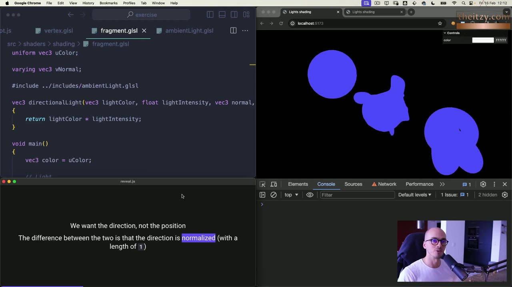
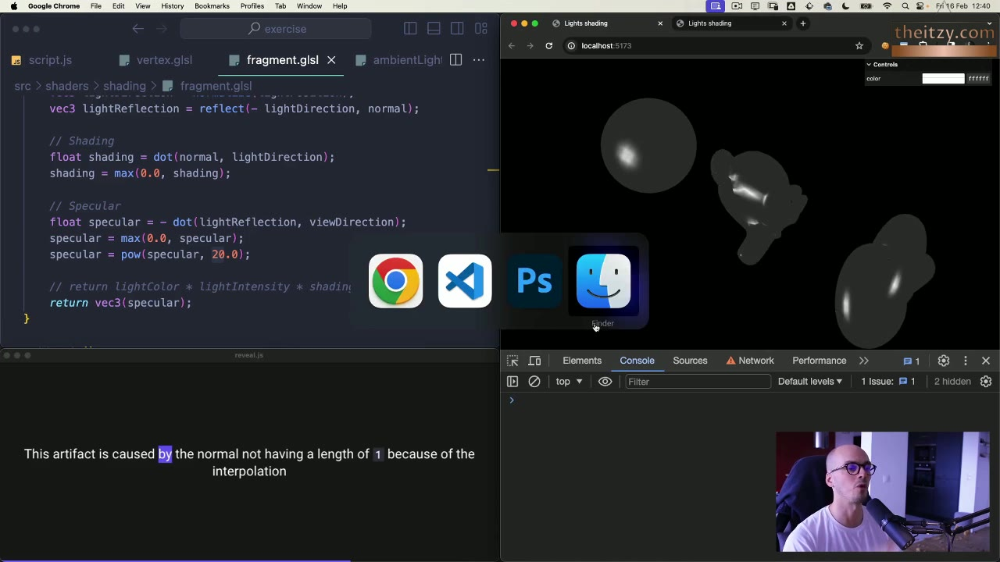

# 第 24 章 光照着色模型

Three.js 的内置材质可以自动响应场景灯光，但 `ShaderMaterial` 中的颜色完全由编写者决定。本章不依赖内置光源注入，而是在 GLSL 中直接实现环境光、平行光和点光源，并为平行光与点光源加入简化的镜面高光。通过这组函数，可以把法线变换、点积、反射、视线方向、插值归一化和距离衰减连成一条完整的光照着色流程。模型采用非基于物理的 Phong 风格近似，目标是结构清晰、便于复用，并以较低复杂度获得平滑结果。

## 从内置灯光到自定义着色

使用 `MeshStandardMaterial`、`MeshPhysicalMaterial`、`MeshPhongMaterial` 或 `MeshLambertMaterial` 时，通常只需创建 `DirectionalLight`、`PointLight`、`AmbientLight` 等对象并加入场景，Three.js 就会把灯光数据传递给相应的材质着色器。便利的背后是完整的光照管理、着色器组合和大量物理近似公式，尤其是标准材质与物理材质的基于物理渲染流程。

自定义着色器并不自动获得这套结果。虽然可以尝试把 Three.js 的灯光数据接入自己的 shader，但对于只需要少量特定灯光的效果，直接编写用途明确的函数往往更容易理解，也避免引入不需要的计算。它适用于自定义旗帜、风格化物体以及后续的程序化材质；代价是阴影、环境贴图、法线贴图和完整的能量守恒模型都需要另行处理。

光照可以在顶点或片元阶段计算。逐顶点计算常称为 Gouraud 着色，计算次数较少，再把结果插值到三角形内部，但高光等区域容易出现插值伪影。本章把主要计算放在片元着色器中，让每个片元根据插值后的法线和位置独立求值，以获得更平滑的明暗过渡。

练习场景包含球体、环面结和 Suzanne 猴头，它们持续旋转并共享同一个 `ShaderMaterial`。材质只暴露物体颜色 `uColor`，可用 Lil-GUI 修改。额外的平面和二十面体只是光源位置助手，使用不受光照影响的 `MeshBasicMaterial`；它们不是 Three.js 灯光对象，也不会自动参与计算。

## 光的累加与物体颜色调制

环境光用于近似来自各个方向的均匀照明。它不能表现真实的光线反弹、接触阴影或缝隙遮蔽，但小剂量使用可以让背光面保留基础可见性。例如只有顶部光源时，物体底部仍可能因环境反射而可见，环境光就是对这种复杂结果的低成本近似。

每个光照函数返回 `vec3`，因为光既有强度，也可以有颜色。环境光函数只需将光颜色与光强度相乘：

```glsl
vec3 ambientLight(vec3 lightColor, float lightIntensity)
{
    return lightColor * lightIntensity;
}
```

把颜色与强度拆成两个参数，虽然可以用一个预先乘好的 `vec3` 替代，但职责更清楚。以后若从 JavaScript 传入 `THREE.Color` 作为 vec3 uniform，仍能独立调整亮度，而不必改变颜色本身。

在 `main` 中，先令总光照为零，再把各光源的贡献相加。最终的物体颜色则应乘以总光照，而不是与光照相加：

```glsl
vec3 color = uColor;
vec3 light = vec3(0.0);

light += ambientLight(
    vec3(1.0), // 光颜色
    0.03       // 光强度
);
// 继续累加平行光和点光源

color *= light;
gl_FragColor = vec4(color, 1.0);
```

这一区别可以用无光环境检验：总光照为零时，任何物体都应为黑色。若使用 `color + light`，没有光时反而会直接显示物体的固有色。乘法还解释了颜色过滤现象：理想纯蓝光为 `(0, 0, 1)`，理想纯红物体为 `(1, 0, 0)`，逐通道相乘得到 `(0, 0, 0)`，因为该简化模型中的红色表面没有可反射的蓝色通道。现实材质和光谱更复杂，但这个测试能有效检查颜色组合是否符合预期。

为了复用，将函数分别放入 `shaders/includes/ambientLight.glsl`、`directionalLight.glsl` 和 `pointLight.glsl`，由片元着色器包含。增加一盏同类灯只需再次调用函数并累加结果，不必复制整套 `main`。这种直接实现便于控制，但每增加一盏灯都会增加片元计算，不能把“可重复调用”理解为没有性能成本。

## 世界空间中的法线、位置与视线

平行光和点光源都需要知道表面朝向。几何体的 `normal` attribute 位于局部空间，如果物体旋转而法线不变，光照就会像粘在物体上一样一起转动，无法保持光源在世界中的固定方向。因此顶点着色器除了变换顶点位置，还要变换法线：

```glsl
varying vec3 vNormal;
varying vec3 vPosition;

void main()
{
    vec4 modelPosition = modelMatrix * vec4(position, 1.0);
    gl_Position = projectionMatrix * viewMatrix * modelPosition;

    vec4 modelNormal = modelMatrix * vec4(normal, 0.0);

    vNormal = modelNormal.xyz;
    vPosition = modelPosition.xyz;
}
```

位置的第四个分量是 `1.0`，使模型矩阵中的平移能够作用于顶点；法线的第四个分量是 `0.0`，从而排除平移，只保留方向变换。平移一个原本向上的法线不应改变它的朝向，旋转物体时才需要同步旋转法线。`vPosition` 保存模型变换后的世界空间位置，供视线和点光源方向计算使用。

varying 会从顶点插值到片元。两个长度均为 1 的端点法线经过线性插值后，中间向量通常短于 1，因此不能把插值结果直接当作单位法线。片元着色器开始时应重新归一化，否则点积会受到向量长度影响，球面等区域可能出现不协调的明暗或高光：

```glsl
vec3 normal = normalize(vNormal);
vec3 viewDirection = normalize(vPosition - cameraPosition);
vec3 color = uColor;
```

`cameraPosition` 是 `ShaderMaterial` 可直接使用的 Three.js 内置 uniform，表示相机的世界空间位置。`vPosition - cameraPosition` 得到从相机指向当前片元的向量，归一化后称为 `viewDirection`。它在 `main` 中计算一次即可供多盏灯共享，因为视线与具体光源无关。

这里必须区分“位置”和“方向”：位置描述空间中的点，方向用于比较朝向并应具有单位长度。两点相减可得到连接向量，但只有在归一化后，后续点积才主要表达夹角而不是距离。法线变换、位置传递和片元归一化共同构成后续所有灯光函数的空间基础。



*图 24-1 光源助手和旋转测试物体用于验证世界空间光照方向*

## 平行光：用法线与光方向的点积计算漫射明暗

平行光把光线视为彼此平行且强度不随距离衰减，适合近似太阳等极远光源。函数仍接收一个便于理解的 `lightPosition`，但只用它确定方向，不计算光源到每个片元的不同距离：

```glsl
vec3 lightDirection = normalize(lightPosition);
float shading = dot(normal, lightDirection);
shading = max(0.0, shading);
```

对于单位向量，点积等于两向量夹角的余弦。法线与指向光源的方向一致时，结果接近 1，表面接收全部漫射照明；两者垂直时结果为 0；背向光源时结果为负。介于正对和垂直之间的表面得到连续过渡，因此球体自然形成亮面与暗面。

负值不能直接保留。若背光面返回负的平行光贡献，即使再加上正值环境光，也可能把总光照压到零以下，造成背面异常变黑或颜色通道失真。`max(0.0, shading)` 把背光面的贡献截断为零，让环境光能够独立保留基础亮度。

可以先返回 `vec3(shading)` 单独检查方向，再乘以光颜色与强度。调试期间放置一个与光颜色相同的平面助手很有帮助。例如蓝色平行光的位置为 `(0, 0, 3)`，相应的 `PlaneGeometry` 助手也放在该处，并将材质设为 `THREE.DoubleSide`，以便从两侧观察。助手只提供视觉参照，真正决定光照的仍是 shader 参数。

## 镜面高光：反射方向、视线与幂曲线

只有漫射明暗时，表面缺少随相机移动的高光。简化镜面项的思路是：先求入射光在法线所定义表面上的反射方向，再比较反射方向与观察方向。二者越满足观察到反射光的几何关系，高光越强。

GLSL 的 `reflect` 接收入射向量和法线。`lightDirection` 指向光源，而真正射向表面的入射向量是它的反方向，所以必须写成 `reflect(-lightDirection, normal)`。随后计算：

```glsl
vec3 lightReflection = reflect(-lightDirection, normal);

float specular = -dot(lightReflection, viewDirection);
specular = max(0.0, specular);
specular = pow(specular, specularPower);
```

本章的 `viewDirection` 从相机指向片元，与期望观察到的反射方向相反，因此点积前加负号，使正确对齐时得到正值。`max` 必须在 `pow` 之前执行：若保留负点积，偶次幂会把负值变成正值，在物体背面制造第二个错误高光；奇次幂又会保留负值并污染颜色。先截断到零可以从根本上避免这两种问题。

`specularPower` 控制高光集中程度。指数越大，`[0, 1]` 中较小的值被压缩得越明显，高光越集中；指数较小则形成宽而柔的亮斑。示例使用 `20.0`，这是视觉调节参数，不应解释为某种真实表面的完整物理粗糙度。

平行光函数最终把漫射与高光相加，再统一乘以光颜色和强度：

```glsl
vec3 directionalLight(
    vec3 lightColor,
    float lightIntensity,
    vec3 normal,
    vec3 lightPosition,
    vec3 viewDirection,
    float specularPower
)
{
    vec3 lightDirection = normalize(lightPosition);
    vec3 lightReflection = reflect(-lightDirection, normal);

    float shading = dot(normal, lightDirection);
    shading = max(0.0, shading);

    float specular = -dot(lightReflection, viewDirection);
    specular = max(0.0, specular);
    specular = pow(specular, specularPower);

    return lightColor * lightIntensity * (shading + specular);
}
```

若只写 `lightColor * lightIntensity * shading + specular`，高光会是与灯光无关的白色，也不会随光强度变化。把 `(shading + specular)` 作为共同系数，蓝色光源就产生蓝色高光，提高光强度时漫射和高光也会一起增强。其他模型可以独立控制高光颜色，但本章优先保持这种直观的一致性。

## 点光源：逐片元方向与距离衰减

点光源与平行光复用法线点积和镜面高光，但有两个根本差异。第一，光从一个点向四周发出，每个片元的入射方向都可能不同，不能只归一化一个固定的 `lightPosition`。第二，光源有明确距离，远处表面应获得更少能量。

函数额外接收当前片元的 `position` 和 `lightDecay`。先求片元指向光源的向量，同时保留其长度与单位方向：

```glsl
vec3 lightDelta = lightPosition - position;
float lightDistance = length(lightDelta);
vec3 lightDirection = normalize(lightDelta);
```

`lightDelta` 不能立即被归一化结果覆盖，因为衰减还需要原始向量的长度。漫射与镜面部分和平行光相同，随后使用简化的线性衰减：

```glsl
float decay = 1.0 - lightDistance * lightDecay;
decay = max(0.0, decay);

return lightColor * lightIntensity * decay * (shading + specular);
```

`lightDecay` 越小，同样距离造成的损失越小，可见照明范围越大。直接使用 `1.0 - lightDistance` 往往衰减过快，所以红色点光源采用 `0.25`，另一盏绿色点光源采用 `0.2`。结果同样用 `max` 限制为非负值，避免远距离灯光从总光照中减去颜色。这个公式便于控制，但并非真实平方反比衰减，也不等同于 `MeshStandardMaterial` 等内置材质的物理光照。

完整点光源函数如下，可以清楚看到它与平行光共享的部分：

```glsl
vec3 pointLight(
    vec3 lightColor,
    float lightIntensity,
    vec3 normal,
    vec3 lightPosition,
    vec3 viewDirection,
    float specularPower,
    vec3 position,
    float lightDecay
)
{
    vec3 lightDelta = lightPosition - position;
    float lightDistance = length(lightDelta);
    vec3 lightDirection = normalize(lightDelta);
    vec3 lightReflection = reflect(-lightDirection, normal);

    float shading = max(0.0, dot(normal, lightDirection));

    float specular = -dot(lightReflection, viewDirection);
    specular = max(0.0, specular);
    specular = pow(specular, specularPower);

    float decay = max(0.0, 1.0 - lightDistance * lightDecay);
    return lightColor * lightIntensity * decay * (shading + specular);
}
```

调试时可用半径 `0.1`、细分级别 `2` 的 `IcosahedronGeometry` 创建小球助手，并让助手颜色和位置与函数参数一致。若助手位于物体上方，而亮面仍出现在其他方向，首先检查传给 shader 的位置、世界空间 `vPosition` 和 `lightPosition - position` 的减法顺序。

## 多光源组合与完整输出

三种函数拆分后，片元着色器的主流程保持简洁：归一化插值法线，计算共享视线，逐盏累加光照，最后调制物体颜色。练习场景使用低强度白色环境光、一盏蓝色平行光和两盏彩色点光源：

```glsl
uniform vec3 uColor;
varying vec3 vNormal;
varying vec3 vPosition;

#include ../includes/ambientLight.glsl
#include ../includes/directionalLight.glsl
#include ../includes/pointLight.glsl

void main()
{
    vec3 normal = normalize(vNormal);
    vec3 viewDirection = normalize(vPosition - cameraPosition);
    vec3 color = uColor;
    vec3 light = vec3(0.0);

    light += ambientLight(vec3(1.0), 0.03);

    light += directionalLight(
        vec3(0.1, 0.1, 1.0),
        1.0,
        normal,
        vec3(0.0, 0.0, 3.0),
        viewDirection,
        20.0
    );

    light += pointLight(
        vec3(1.0, 0.1, 0.1),
        1.0,
        normal,
        vec3(0.0, 2.5, 0.0),
        viewDirection,
        20.0,
        vPosition,
        0.25
    );

    light += pointLight(
        vec3(0.1, 1.0, 0.5),
        1.0,
        normal,
        vec3(2.0, 0.0, 2.0),
        viewDirection,
        20.0,
        vPosition,
        0.2
    );

    color *= light;
    gl_FragColor = vec4(color, 1.0);
    #include <tonemapping_fragment>
    #include <colorspace_fragment>
}
```

环境光让背面不至于全黑；位于 `(0, 0, 3)` 的蓝色平行光照亮对应一侧；红色点光源位于 Suzanne 上方的 `(0, 2.5, 0)`，绿色点光源位于 `(2, 0, 2)`，两者根据片元方向与距离形成局部亮度和高光。两个点光源调用的是同一个函数，仅参数不同。

输出末尾的 `tonemapping_fragment` 与 `colorspace_fragment` 将自定义颜色接回 Three.js 的色调映射和输出颜色空间流程。排错时应分层进行：先单独返回法线或位置检查数据，再只保留 `shading` 检查漫射方向，随后加入 `specular`，最后启用衰减和多光叠加。一次混入所有项会让符号、坐标空间和插值问题难以区分。



*图 24-2 环境光、蓝色平行光与两盏彩色点光源的组合效果*

## 本章小结

自定义光照的基本结构可以概括为“求空间数据、计算单灯贡献、累加灯光、调制物体颜色”。环境光直接提供均匀的低强度补光；平行光用固定方向的法线点积形成漫射明暗；点光源从每个片元重新计算光方向，并乘以距离衰减。镜面高光则通过反射向量与视线的点积、非负截断和幂函数形成随观察方向变化的亮斑。

本章最重要的排错原则也与数学含义一致：法线需要随模型方向变换，但不能接受平移；插值后的法线要重新归一化；入射方向与观察方向的符号必须和点积约定一致；负的漫射、高光及衰减都要在参与后续运算前截断。光颜色与强度共同作用于漫射和高光，而各灯贡献相加后才与物体颜色相乘。

这些函数是便于学习的简化模型，并未覆盖 PBR、真实距离衰减、阴影、环境贴图或法线贴图。进一步扩展时，可以把灯光参数改为 uniform、接入调试面板，或研究半球光与聚光灯；同时也应重新评估片元指令数、视觉效果和所需物理准确度之间的平衡。
