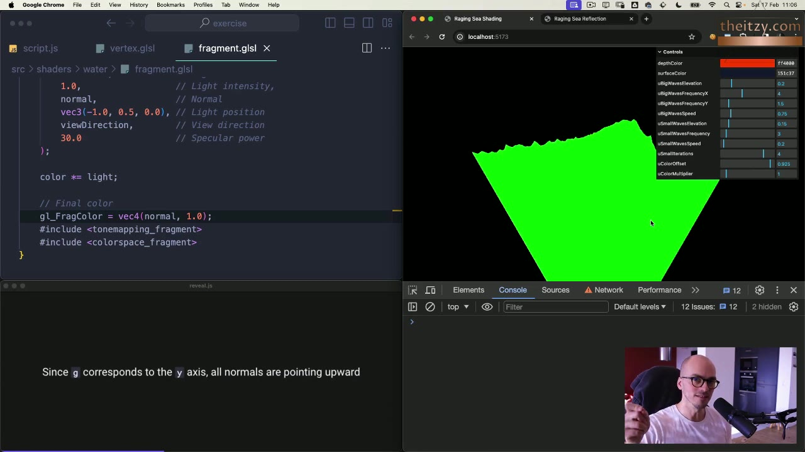
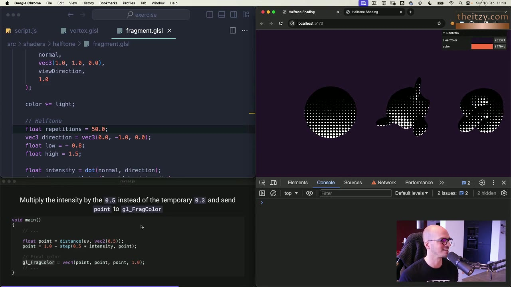

# 第 25 章 海面与半调着色

海面动态与材质细节是创建逼真场景的关键环节，而半调着色则为三维对象增添了独特的视觉风格。本章将深入探讨如何在 Three.js 中为动态海面添加光照与反射效果，并实现基于屏幕空间网格点的半调着色。通过学习这两种效果，您将掌握从动态法线、光照模型到风格化渲染的核心着色技能。

## 海面着色基础：从动态水波到真实光照

在前期课程中，我们实现了动态海面效果，通过噪声函数模拟了大浪与小波纹的叠加。然而，当时的渲染仅依赖颜色渐变，缺乏真实的光影交互。要实现真实的海面表现，必须考虑水面法线变化与光照计算。

### 初始配置调整

在开始光照计算前，我们首先调整海面的颜色配置以适应光影效果。原本的颜色设置（浅色波峰与深色谷底）是为强化颜色对比而设计，但在加入光照后，这一对比自然产生，因此可以改用更具视觉冲击力的配色方案：

```javascript
debugObject.depthColor = '#ff4000'    // 深部颜色：亮橙色
debugObject.surfaceColor = '#151c37'  // 表面颜色：深蓝色
```

同时调整颜色渐变参数，将偏移设置为 `0.925`，乘数设为 `1`：

```javascript
const waterMaterial = new THREE.ShaderMaterial({
    // ...
    uniforms: {
        // ...
        uColorOffset: { value: 0.925 },
        uColorMultiplier: { value: 1 }
    }
})
```

这样的调整让海面呈现更富戏剧性的视觉效果，为后续的光照计算奠定基础。

## 法线计算：从静态几何到动态表面

光照渲染的核心是表面法线——每个顶点指向表面的“朝外”向量。对于静态几何体，法线由建模软件预计算；但动态海面的法线必须实时计算，因为波浪会持续改变表面朝向。

### 问题分析：静态法线的局限性

使用几何体自带的法线属性存在根本问题——静态法线无法跟随波浪变化。即使显式传递原始法线也无效，因为其方向始终垂直向上，无法反映波峰波谷的实际朝向：

```glsl
vNormal = (modelMatrix * vec4(normal, 0.0)).xyz;  // 错误：始终指向正 Y 轴
```



*图 25-1 静态法线无法反映波浪导致的表面变化*

如图所示，无论波浪如何起伏，最终的显示结果呈现单调的绿色（RGB 中的 G 对应 Y 轴），意味着所有法线均垂直向上，无法产生真实的光照变化。

### 解决方案：邻居顶点法线计算法

针对网格形态的几何体，可采用“邻居顶点法线计算法”：围绕当前顶点构建两个“理论邻居”，计算它们的相对高程，并以此推算表面法向。

#### 构建理论邻居

首先定义与当前顶点的偏移距离 `shift`。此距离需足够小以捕捉细节波纹，又足够大以避免数值不稳定。我们设置 `shift = 0.01`：

```glsl
float shift = 0.01;
vec3 modelPositionA = modelPosition.xyz + vec3(shift, 0.0, 0.0);  // X 轴正方向邻居
vec3 modelPositionB = modelPosition.xyz + vec3(0.0, 0.0, -shift); // Z 轴负方向邻居
```

选择负数 Z 方向而非正数，是为了后续叉积计算获得正确的法线方向。

#### 统一高程计算函数

为便于复用，将波浪计算封装为独立函数：

```glsl
float waveElevation(vec3 position) {
    float elevation = sin(position.x * uBigWavesFrequency.x + uTime * uBigWavesSpeed) *
                      sin(position.z * uBigWavesFrequency.y + uTime * uBigWavesSpeed) *
                      uBigWavesElevation;

    for(float i = 1.0; i <= uSmallIterations; i++) {
        elevation -= abs(perlinClassic3D(vec3(position.xz * uSmallWavesFrequency * i,
                                              uTime * uSmallWavesSpeed)) *
                        uSmallWavesElevation / i);
    }

    return elevation;
}
```

此函数计算任意位置的波浪高程，已移除对 `modelPosition` 的直接依赖。

#### 应用高程并计算向量

为每个顶点及其邻居计算高程：

```glsl
float elevation = waveElevation(modelPosition.xyz);
modelPosition.y += elevation;
modelPositionA.y += waveElevation(modelPositionA);
modelPositionB.y += waveElevation(modelPositionB);
```

随后计算从当前顶点到邻居的向量，并进行归一化：

```glsl
vec3 toA = normalize(modelPositionA - modelPosition.xyz);
vec3 toB = normalize(modelPositionB - modelPosition.xyz);
```

#### 叉积求法线

通过叉积（cross product）计算垂直于两个向量的法线：

```glsl
vec3 computedNormal = cross(toA, toB);
```

叉积的方向遵循右手定则：食指指向第一个向量 `toA`，中指指向第二个向量 `toB`，拇指所指方向即为 `toA × toB`。这正是之前选择负数 Z 方向邻居的原因——确保法线指向表面外侧。

### 转向函数优化与工程规范

为提升代码可维护性，将噪声函数移至独立文件 `perlinClassic3D.glsl`，并使用 `#include` 指令引入：

```glsl
// src/shaders/includes/perlinClassic3D.glsl
// Classic Perlin 3D Noise by Stefan Gustavson

vec4 permute(vec4 x) {
    return mod(((x*34.0)+1.0)*x, 289.0);
}

vec4 taylorInvSqrt(vec4 r) {
    return 1.79284291400159 - 0.85373472095314 * r;
}

vec3 fade(vec3 t) {
    return t*t*t*(t*(t*6.0-15.0)+10.0);
}

float perlinClassic3D(vec3 P) {
    // ... 详细实现
}
```

顶点着色器简化为：

```glsl
#include ../includes/perlinClassic3D.glsl

// ... 后续代码
```

## 光照实现：点光源与方向光

计算动态法线后，便可实现真实的交互光照。

### 着色准备

片段着色器需接收法线与视图方向：

```glsl
// fragment.glsl
varying float vElevation;
varying vec3 vNormal;
varying vec3 vPosition;

void main() {
    vec3 viewDirection = normalize(vPosition - cameraPosition);
    vec3 normal = normalize(vNormal);

    // 颜色计算
    float mixStrength = (vElevation + uColorOffset) * uColorMultiplier;
    mixStrength = smoothstep(0.0, 1.0, mixStrength);
    vec3 color = mix(uDepthColor, uSurfaceColor, mixStrength);

    // 灯光计算
    // ...
}
```

### 点光源实现

使用点光源模拟水面附近的动态照明：

```glsl
#include ../includes/pointLight.glsl

void main() {
    // ... 之前的代码

    vec3 light = vec3(0.0);
    light += pointLight(
        vec3(1.0),            // 光源颜色
        10.0,                  // 光源强度
        normal,                // 法线
        vec3(0.0, 0.25, 0.0),  // 光源位置（水面附近）
        viewDirection,        // 视图方向
        30.0,                 // 高光指数
        vPosition,            // 当前顶点位置
        0.95                  // 衰减系数
    );

    color *= light;

    // 输出
    gl_FragColor = vec4(color, 1.0);
    #include <tonemapping_fragment>
    #include <colorspace_fragment>
}
```

点光源位于海面上方，为波峰提供高光反射，同时随着距离衰减，模拟真实的水面光晕效果。

### 配置优化

完成法线计算后，可安全移除几何体中的原始法线属性，释放内存：

```javascript
const waterGeometry = new THREE.PlaneGeometry(2, 2, 512, 512)
waterGeometry.deleteAttribute('normal')
```

同时启用色调映射增强视觉冲击：

```javascript
const renderer = new THREE.WebGLRenderer({ canvas: canvas })
renderer.toneMapping = THREE.ACESFilmicToneMapping
```

## 半调着色：从印刷技术到三维渲染

半调（Halftone）是一种源自印刷工业的技术，通过尺寸变化的网格点模拟连续色调。在三维渲染中，这种技术可为对象添加风格化阴影与高光，产生类似《蜘蛛侠：平行宇宙》的视觉风格。

### 半调核心概念

传统印刷使用单一颜色墨点的网格，通过点的大小变化模拟色彩渐变。远处观察时，人眼会将这些点融合为连续色调。现代三维渲染借鉴这一原理，使用颜色不同的点网格创建风格化阴影：

- **阴影点**：位于对象暗部，通常为深色（如紫色）
- **高光点**：位于对象亮部，通常为浅色（如浅绿色）
- **网格保持**：点网格位置固定于屏幕空间，不随对象或相机移动

### 基础光照层

在添加半调效果前，先为对象创建基础光照：

```glsl
#include ../includes/ambientLight.glsl
#include ../includes/directionalLight.glsl

void main() {
    vec3 viewDirection = normalize(vPosition - cameraPosition);
    vec3 normal = normalize(vNormal);
    vec3 color = uColor;

    // 基础光照
    vec3 light = vec3(0.0);
    light += ambientLight(vec3(1.0), 1.0);  // 环境光

    light += directionalLight(
        vec3(1.0, 1.0, 1.0),  // 光源颜色
        1.0,                  // 强度
        normal,                // 法线
        vec3(1.0, 1.0, 0.0),  // 光源方向
        viewDirection,        // 视图方向
        1.0                   // 高光指数
    );

    color *= light;
    // ... 后续半调处理
}
```

### 屏幕空间网格创建

半调网格需固定于屏幕而非跟随对象，因此使用 `gl_FragCoord` 而非 UV 坐标：

```glsl
uniform vec2 uResolution;  // 屏幕分辨率（含像素比例）

void main() {
    // ... 光照计算

    // 半调网格
    float repetitions = 50.0;  // 垂直方向网格数
    vec2 uv = gl_FragCoord.xy / uResolution.y;  // 使用 y 分辨率确保方形网格
    uv *= repetitions;
    uv = mod(uv, 1.0);  // 限制到 0-1 范围

    // ... 后续处理
}
```

此处使用 `uResolution.y` 而非 `uResolution.xy`，可确保网格单元保持方形，避免因宽高比导致的变形。

### 点绘制与强度控制

在半调单元中心绘制圆形点，其半径随表面朝向变化：

```glsl
// 半调方向设置
vec3 direction = vec3(0.0, -1.0, 0.0);  // 阴影方向（朝下）
float low = -0.8;      // 强度下限
float high = 1.5;      // 强度上限

// 强度计算
float intensity = dot(normal, direction);
intensity = smoothstep(low, high, intensity);  // 平滑过渡

// 点绘制
float point = distance(uv, vec2(0.5));  // 到单元中心距离
point = 1.0 - step(0.5 * intensity, point);  // 强度控制半径
```

`smoothstep` 函数将 `-0.8` 至 `1.5` 的范围映射到 `0-1`，确保阴影与高光区域间的平滑过渡。

### 颜色混合与封装函数

将点网格与基础颜色混合：

```glsl
vec3 pointColor = vec3(1.0, 0.0, 0.0);  // 点颜色（例如红色）
color = mix(color, pointColor, point);  // 混合
```

为提升代码复用性，将半调逻辑封装为函数：

```glsl
vec3 halftone(
    vec3 color,          // 基础颜色
    float repetitions,   // 网格密度
    vec3 direction,      // 半调方向
    float low,           // 强度下限
    float high,          // 强度上限
    vec3 pointColor,     // 点颜色
    vec3 normal          // 表面法线
) {
    float intensity = dot(normal, direction);
    intensity = smoothstep(low, high, intensity);

    vec2 uv = gl_FragCoord.xy / uResolution.y;
    uv *= repetitions;
    uv = mod(uv, 1.0);

    float point = distance(uv, vec2(0.5));
    point = 1.0 - step(0.5 * intensity, point);

    return mix(color, pointColor, point);
}
```

### 多重半调叠加

通过多次调用函数可创建复杂效果：

```glsl
// 阴影半调
color = halftone(
    color,                     // 输入颜色
    100.0,                     // 阴影网格密度
    vec3(0.0, -1.0, 0.0),      // 阴影方向（朝下）
    -0.8,                      // 阴影下限
    1.5,                       // 阴影上限
    uShadowColor,              // 阴影点颜色
    normal                     // 法线
);

// 高光半调
color = halftone(
    color,                     // 输入颜色
    130.0,                     // 高光网格密度
    vec3(1.0, 1.0, 0.0),       // 高光方向（右上前方）
    0.5,                       // 高光下限
    1.5,                       // 高光上限
    uLightColor,               // 高光点颜色
    normal                     // 法线
);
```



*图 25-2 半调着色通过屏幕空间网格点表现明暗与高光层次*

### 调试面板配置

通过 lil-gui 配置半调参数：

```javascript
const materialParameters = {
    color: '#ff794d',
    shadowColor: '#8e19b8',    // 紫色阴影
    lightColor: '#e5ffe0'      // 浅绿色高光
};

// 阴影参数
material.uniforms.uShadowRepetitions = new THREE.Uniform(100);
material.uniforms.uShadowColor = new THREE.Uniform(
    new THREE.Color(materialParameters.shadowColor)
);

// 高光参数
material.uniforms.uLightRepetitions = new THREE.Uniform(130);
material.uniforms.uLightColor = new THREE.Uniform(
    new THREE.Color(materialParameters.lightColor)
);

// GUI 配置
gui
    .add(material.uniforms.uShadowRepetitions, 'value')
    .min(1).max(300).step(1)
    .name('阴影网格密度');

gui
    .addColor(materialParameters, 'shadowColor')
    .onChange(() => {
        material.uniforms.uShadowColor.value.set(materialParameters.shadowColor);
    })
    .name('阴影颜色');
```

## 性能优化与注意事项

### 海面渲染性能

计算动态法线会显著增加计算负荷，因为每个顶点需计算三次波浪高程（当前顶点加两个邻居）。优化策略包括：

1. **顶点密度控制**：确保网格细分级别与视觉需求匹配
2. **噪声函数优化**：限制柏林噪声的迭代次数
3. **距离衰减**：远距离区域可使用简化计算

### 半调渲染考量

屏幕空间渲染的开销相对较低，但需注意：

1. **网格密度**：过高密度会导致视觉噪点，过低则失去半调特征
2. **抗锯齿**：半调网格本身产生锯齿，需通过滤波或后处理平滑
3. **分辨率适配**：使用统一分辨率参照（`uResolution.y`）确保不同设备的一致性

## 本章小结

本章系统性地介绍了两种高级着色技术：动态海面光照与半调风格化渲染。两者虽应用场景不同，却都体现了三维渲染的核心原则——通过数学计算模拟视觉现象。

**海面光照的关键要点**：
- 动态表面必须实时计算法线，静态几何法线无法适应变形
- 邻居顶点法线计算法适用于网格几何体，通过叉积推导表面朝向
- 点光源配合表面动态法线可产生真实的水面高光与反射

**半调渲染的核心原理**：
- 源于印刷技术的网格点模拟，通过点尺寸变化而非颜色变化创建色调
- 屏幕空间固定网格确保效果稳定，不受对象与相机运动影响
- 表面朝向决定点的大小，通过平滑过渡函数实现自然阴影高光过渡

**统一的技术关联**：
- 两者都依赖表面法线计算，虽目的不同但数学基础相通
- 光照计算与风格化效果可叠加，创建既有物理基础又具艺术风格的结果
- 性能优化需平衡视觉效果与计算资源，根据场景需求动态调整参数

通过本章学习，您已掌握从基础光照模型到高级风格化渲染的全套技能。这为后续的复杂着色器开发奠定了坚实基础，无论是追求物理准确的真实渲染，还是创作独特视觉风格的艺术渲染，都有了充分的技术储备。