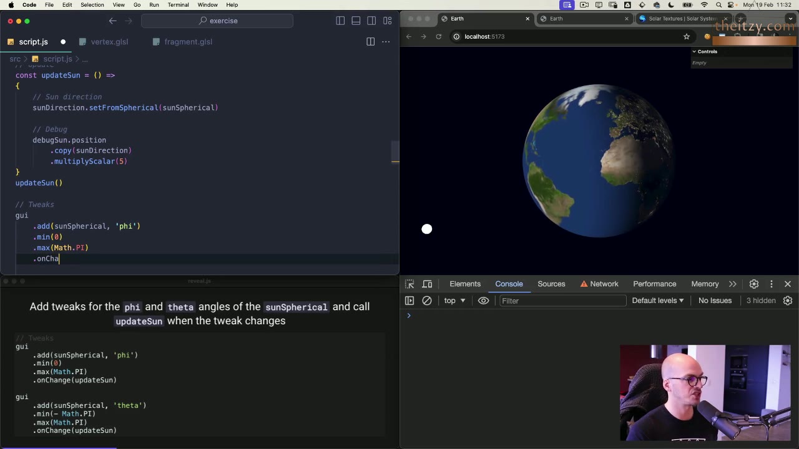
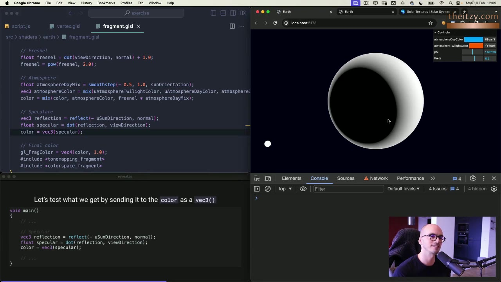

# 第 26 章 地球着色器

创建逼真的地球效果远比看起来复杂。仅仅给球体贴上地球纹理是不够的——真实的地球有许多视觉特征：暗面亮起的城市灯光、覆盖地表的云层、只在海洋上强烈的太阳反光、昼夜交界处的红色暮光，以及周围环绕的具有体积感的大气层。本章将逐步构建这些效果，最终实现一个可交互且视觉逼真的地球渲染效果。

## 准备工作

初始项目已经包含几个基础组件：
- 一个细分充分的球体几何体，正在缓慢旋转
- 基本的着色器文件结构（`src/shaders/earth/vertex.glsl` 和 `fragment.glsl`）
- `lil-gui` 调试界面
- `vite-plugin-glsl` 插件，用于处理 GLSL 导入
- `OrbitControls` 相机控制
- `TextureLoader` 实例

顶点着色器已处理好几个关键变量的传递：`uv` 作为 `vUv` 传入片元着色器，模型位置作为 `vPosition` 传入，并用于计算 `viewDirection`（从相机到片元位置的向量），法线作为 `vNormal` 传入并在片元着色器中重新归一化，避免网格伪影。

## 地球纹理加载与基础效果

我们将使用 [Solar System Scope](https://www.solarsystemscope.com/textures/) 网站提供的地球纹理，这些纹理遵循 CC Attribution 4.0 许可，在发布时需要注明出处。

### 纹理类型

项目中准备了三种核心纹理：

**日间纹理（`day.jpg`）**
用于展示地球白天的景象，包含陆地、海洋和植被颜色。

**夜间纹理（`night.jpg`）**
用于展示地球夜晚的景象，包含城市灯光和黑暗的陆地海洋。

**叠加纹理（`specularClouds.jpg`）**
该纹理巧妙地编码了两类信息：
- R 通道：高光贴图，标明水面反光区域
- G 通道：云层透明度图，定义云层覆盖范围

这种将相关信息打包到单一纹理 RG 通道的做法能有效减少 GPU 内存占用。

### 纹理加载与配置

```javascript
// 纹理加载
const earthDayTexture = textureLoader.load('./earth/day.jpg')
earthDayTexture.colorSpace = THREE.SRGBColorSpace
earthDayTexture.anisotropy = 8

const earthNightTexture = textureLoader.load('./earth/night.jpg')
earthNightTexture.colorSpace = THREE.SRGBColorSpace
earthNightTexture.anisotropy = 8

const earthSpecularCloudsTexture = textureLoader.load('./earth/specularClouds.jpg')
earthSpecularCloudsTexture.anisotropy = 8
```

纹理均被缩放到 4096×2048 分辨率并进行了 web 优化压缩。`anisotropy` 设为 8 能够改善斜视角下的纹理锐度，但实际可用上限取决于 GPU 和驱动，过高设置也会增加采样成本。

### 基础着色器结构

通过 Three.js 的 `ShaderMaterial` 创建地球材质，将三个纹理作为 uniform 传递：

```javascript
const earthMaterial = new THREE.ShaderMaterial({
    vertexShader: earthVertexShader,
    fragmentShader: earthFragmentShader,
    uniforms: {
        uDayTexture: new THREE.Uniform(earthDayTexture),
        uNightTexture: new THREE.Uniform(earthNightTexture),
        uSpecularCloudsTexture: new THREE.Uniform(earthSpecularCloudsTexture),
        // 其他 uniform 将在后续添加
    },
    // 开启透明度相关处理
    transparent: true
})
```



*图 26-1 地球的基础纹理包含日间、夜间和云层高光信息*

## 太阳方向与昼夜交替

真实的昼夜效果由地球相对于太阳的方向决定。我们将定义太阳方向，并依据该方向混合日夜纹理。

### 太阳方向计算

首先定义太阳方向矢量，通常初始化为 `(0, 0, 1)`（正 Z 方向）。片元着色器中计算该方向与法线的点积：

```glsl
// 片元着色器关键代码
uniform vec3 uSunDirection;

void main() {
    // 归一化法线
    vec3 normal = normalize(vNormal);

    // 太阳方向与法线的点积，正值表示朝向太阳（白天），负值表示远离太阳（夜晚）
    float sunOrientation = dot(uSunDirection, normal);

    // 昼夜混合系数，平滑化处理
    float dayMix = smoothstep(-0.25, 0.5, sunOrientation);

    // 采样日夜纹理
    vec3 dayColor = texture(uDayTexture, vUv).rgb;
    vec3 nightColor = texture(uNightTexture, vUv).rgb;

    // 混合日夜颜色
    vec3 color = mix(nightColor, dayColor, dayMix);
}
```

`smoothstep()` 函数用于创建平滑的过渡区域，避免了生硬的分界线，-0.25 到 0.5 的范围经过调试能产生自然的晨昏线。

### 可交互的太阳控制

为了方便调试和观察，我们在 JavaScript 中实现太阳位置的交互控制：

```javascript
// 使用球坐标系存储太阳位置
const sunSpherical = new THREE.Spherical(1, Math.PI * 0.5, 0.5)
const sunDirection = new THREE.Vector3()

// 更新函数
const updateSun = () => {
    sunDirection.setFromSpherical(sunSpherical)

    // 更新着色器 uniform
    earthMaterial.uniforms.uSunDirection.value.copy(sunDirection)

    // 调试小球（可选）
    debugSun.position.copy(sunDirection).multiplyScalar(5)
}

// 调试界面控制
gui
    .add(sunSpherical, 'phi')
    .min(0)
    .max(Math.PI)
    .onChange(updateSun)

gui
    .add(sunSpherical, 'theta')
    .min(-Math.PI)
    .max(Math.PI)
    .onChange(updateSun)
```

通过 `phi`（纬度角）和 `theta`（经度角）控制太阳位置，从而实现不同季节和时间的模拟。

## 云层效果

云层是地球视觉效果的重要组成部分。我们利用 `specularClouds.jpg` 的 G 通道（云层图）来添加云层效果。

### 云层提取与处理

```glsl
// 提取云层和高光信息
vec2 specularCloudColor = texture(uSpecularCloudsTexture, vUv).rg;

// 处理云层：仅显示高密度区域
float cloudsMix = smoothstep(0.5, 1.0, specularCloudColor.g);

// 云层在夜晚不可见，以避免遮挡夜间城市灯光
cloudsMix *= dayMix;

// 与基础颜色混合
color = mix(color, vec3(1.0), cloudsMix);
```

`smoothstep(0.5, 1.0, ...)` 的阈值设定使得只有较浓的云团被渲染，薄云被过滤掉。云层乘以 `dayMix` 确保其在夜晚自然消失，不会影响城市灯光的可见性。



*图 26-2 昼夜交替与动态云层效果展示*

## 大气与菲涅耳效应

真实的地球大气具有两个重要特征：一是昼夜两侧颜色不同（白天偏蓝，黄昏偏红），二是大气亮度随视角变化（边缘比中心更亮）。我们通过菲涅耳（Fresnel）公式实现后者。

### 大气颜色渐变

首先定义大气颜色参数：

```javascript
// 大气参数定义
const earthParameters = {
    atmosphereDayColor: '#00aaff',
    atmosphereTwilightColor: '#ff6600'
}

// 调试控制
gui
    .addColor(earthParameters, 'atmosphereDayColor')
    .onChange(() => {
        earthMaterial.uniforms.uAtmosphereDayColor.value.set(earthParameters.atmosphereDayColor)
    })

gui
    .addColor(earthParameters, 'atmosphereTwilightColor')
    .onChange(() => {
        earthMaterial.uniforms.uAtmosphereTwilightColor.value.set(earthParameters.atmosphereTwilightColor)
    })
```

### 菲涅尔效应计算

菲涅耳效应描述了光线在不同角度表面的反射率变化。对于球体，视线与表面法线的点积能表征视角的倾斜程度：

```glsl
// 视角方向与法线的点积
float viewDotNormal = dot(normalize(viewDirection), normal);

// 面向相机的区域较弱，轮廓附近逐渐增强
float fresnel = clamp(viewDotNormal + 1.0, 0.0, 1.0);
fresnel = pow(fresnel, 2.0);

// 大气颜色混合（昼夜差异）
float atmosphereDayMix = smoothstep(-0.5, 1.0, sunOrientation);
vec3 atmosphereColor = mix(uAtmosphereTwilightColor, uAtmosphereDayColor, atmosphereDayMix);

// 应用菲涅耳效果
vec3 atmosphere = atmosphereColor * fresnel * 0.5; // 0.5 为强度系数
color += atmosphere;
```

`pow(fresnel, 2.0)` 会让边缘效果更加突出，形成明显的亮边。强度系数可根据实际效果调整。

## 海洋太阳反光

`specularCloudColor.r` 提供水面高光遮罩。太阳反射方向由 `reflect(-uSunDirection, normal)` 计算，再与视线方向比较。课程的 `viewDirection` 从相机指向片元，因此点积前需要取负；截断负值后用幂函数压缩高光范围：

```glsl
vec3 reflection = reflect(-uSunDirection, normal);
float specular = -dot(reflection, normalize(viewDirection));
specular = max(specular, 0.0);
specular = pow(specular, 32.0);

// 仅在水面保留太阳反光，并让边缘高光带有大气颜色
specular *= specularCloudColor.r;
vec3 specularColor = mix(vec3(1.0), atmosphereColor, fresnel);
color += specular * specularColor;
```

`pow(specular, 32.0)` 使高光集中在反射方向与观察方向接近的区域。R 通道将高光限制在海洋，避免陆地出现过强反射；`specularColor` 则让轮廓附近的反光与暮光颜色保持协调。

## 分层材质与优化

### 内层与外层分离

前面实现的大气效果有一个局限：它会随着地球表面细节的变化而起伏。为了解决这个问题，我们可以采用两层球体的方案：

**内层球体（地球表面）**
使用原有的着色器，渲染陆地、海洋、云层等表面细节。

**外层球体（大气层）**
体积稍大，专门处理大气颜色与菲涅耳效果，设定为半透明材质。

这种分离方案能让大气层均匀地包裹地球，不受地形起伏影响，更接近真实的大气视觉效果。实现时可复用地球几何体与材质，放大外层球体，并只渲染其背面：

```javascript
const atmosphereMaterial = earthMaterial.clone()
atmosphereMaterial.side = THREE.BackSide

const atmosphere = new THREE.Mesh(earthGeometry, atmosphereMaterial)
atmosphere.scale.set(1.04, 1.04, 1.04)
scene.add(atmosphere)
```

背面渲染与略大的球体共同形成包裹轮廓，避免外层与地球表面重合造成深度冲突。

### 性能考量与优化

1. **纹理压缩与尺寸**：所有纹理压缩到 4096×2048，平衡质量与显存占用。
2. **各向异性过滤**：设置合适的 `anisotropy` 值（通常 8-16），改善斜视角清晰度。
3. **分层渲染**：为大气建立独立图层，避免每帧重复执行大气相关的大样本计算。
4. **精度优化**：着色器中留意浮点数精度与操作优化，减少 GPU 负载。

## 本章小结

本章从基础纹理入手，逐步构建了一个逼真的交互式地球渲染效果，涵盖了以下核心技术点：

1. **多层纹理融合**：巧妙利用 `specularClouds.jpg` 的 RG 通道，将高光与云层信息打包存储，减少了纹理采样次数。
2. **昼夜系统**：基于法线与太阳方向的点积计算，配合 `smoothstep` 函数平滑过渡，实现了自然的晨昏线效果。
3. **云层动态**：云层在 G 通道中以梯度形式存储，通过阈值筛选与昼夜系数控制，实现了云层随昼夜变化的动态效果。
4. **大气与菲涅耳**：结合日夜颜色渐变与视角相关的菲涅耳公式，生成了随角度变化的大气光晕，增强了体积感。
5. **分层渲染架构**：将表面细节与大气效果分离到多层球体，既优化了视觉效果，也为后续扩展（如大气散射、体积云）奠定了基础。

实现的最终效果不仅仅是一个静态的地球模型，而是一个具有昼夜变化、大气光晕、动态云层等丰富视觉特征的可交互系统。这些技术不仅适用于地球，稍加调整同样可以应用于火星、类地行星等天体的渲染，为天文可视化、地理教育、太空模拟等应用提供了实用的技术路径。