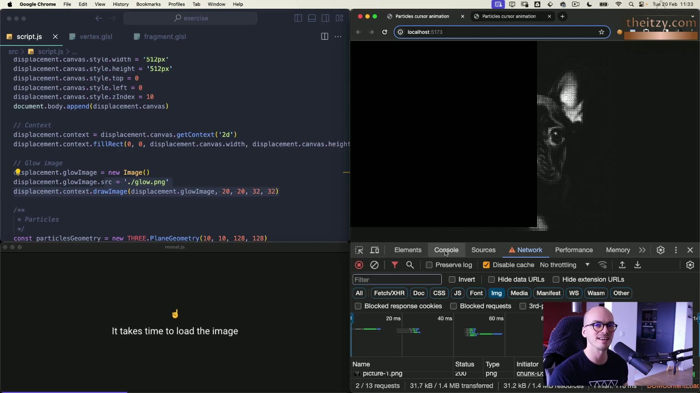
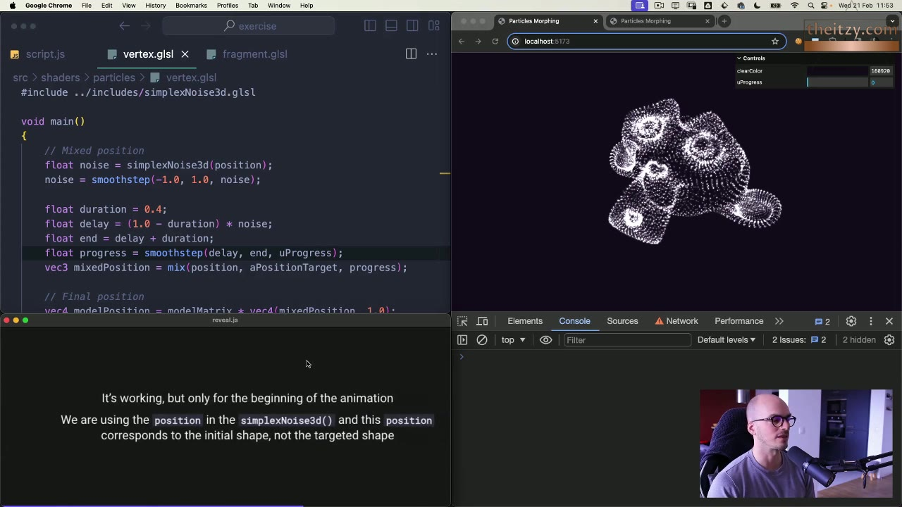

# 第 27 章 粒子光标与形变

本章将学习如何创建粒子光标动画和粒子形变效果。在光标动画部分，我们将使用 2D 画布作为纹理并在自定义着色器中控制粒子位移；在形变部分，将学习如何在顶点着色器中混合两种几何形态，实现平滑的模型转换。这两项技术都是粒子系统中交互与动态表现的核心方法。

## 粒子光标动画：创建交互式粒子图像

粒子光标动画能创建响应鼠标移动的交互效果。我们将从静态粒子网格开始，逐步添加图片纹理、圆形粒子、亮度关联的大小变化，最终实现基于光标位置的动态偏移。

### 初始设置与粒子形状

项目已包含一个粒子网格，使用 `ShaderMaterial` 并加载了位于 `src/shaders/particles/` 目录下的顶点与片段着色器。粒子大小已在 `vertex.glsl` 中处理，使用了与渲染高度成比例的尺寸计算，确保在不同宽高比下保持视觉一致性。

第一步是将方形粒子改为圆形。在 `fragment.glsl` 中，我们可以使用 `gl_PointCoord` 获取粒子内部的 UV 坐标：

```glsl
void main()
{
    vec2 uv = gl_PointCoord;

    // 计算到中心的距离
    float distanceToCenter = distance(uv, vec2(0.5));

    // 当距离大于0.5时丢弃片段，创建圆形
    if(distanceToCenter > 0.5)
        discard;

    gl_FragColor = vec4(1.0);
}
```

使用 `discard` 指令可以避免透明度带来的视觉问题，也能确保只绘制圆形区域。

### 加载并应用图片纹理

为了在粒子上显示图片，我们需要将图片加载为纹理并发送到着色器。可从 `static/` 文件夹选择灰度方形图片，例如 `picture-1.png`：

```javascript
const particlesMaterial = new THREE.ShaderMaterial({
    uniforms: {
        // ...其他uniforms...
        uPictureTexture: new THREE.Uniform(textureLoader.load('./picture-1.png'))
    }
})
```

在 `vertex.glsl` 中，声明纹理采样器并从 UV 坐标读取亮度：

```glsl
uniform sampler2D uPictureTexture;

void main()
{
    // 读取图片亮度（假设为灰度图）
    float pictureIntensity = texture(uPictureTexture, uv).r;

    // 用亮度影响点大小
    gl_PointSize = uSize * uSizeMultiplier * pictureIntensity;

    // ...位置计算...
}
```

此时，较亮的图片区域将产生较大的粒子，较暗区域则产生较小的粒子，从而在整体上形成图片的轮廓。

### 基于亮度的颜色映射

不仅要调整大小，还可以让粒子颜色匹配图片。在 `fragment.glsl` 中，可以直接从纹理读取颜色：

```glsl
uniform sampler2D uPictureTexture;

void main()
{
    vec2 uv = gl_PointCoord;
    float distanceToCenter = distance(uv, vec2(0.5));

    if(distanceToCenter > 0.5)
        discard;

    // 从纹理获取颜色
    vec3 pictureColor = texture(uPictureTexture, vUv).rgb;

    gl_FragColor = vec4(pictureColor, 1.0);
}
```

注意 `vUv` 需要在顶点着色器中传递到片段着色器。通过这种方式，每个粒子都将呈现图片对应位置的颜色。

### 2D 画布纹理与光标交互

光标交互的核心是动态生成纹理，记录鼠标轨迹。首先创建画布和纹理对象：

```javascript
const displacement = {
    canvas: document.createElement('canvas'),
    context: null,
    texture: null,
    canvasCursor: { x: 0, y: 0 }
}
displacement.canvas.width = 512
displacement.canvas.height = 512
displacement.context = displacement.canvas.getContext('2d')
displacement.texture = new THREE.CanvasTexture(displacement.canvas)
```

使用射线检测获取鼠标在粒子平面上的 UV 坐标。`THREE.Points` 的相交结果不能直接提供这里所需的平面 UV，因此课程额外放置一张与粒子区域重合的平面，并将它隐藏。双面设置保证从背面观察时仍能检测：

```javascript
displacement.interactivePlane = new THREE.Mesh(
    new THREE.PlaneGeometry(10, 10),
    new THREE.MeshBasicMaterial({ side: THREE.DoubleSide })
)
displacement.interactivePlane.visible = false
scene.add(displacement.interactivePlane)

displacement.raycaster = new THREE.Raycaster()
displacement.screenCursor = new THREE.Vector2()

window.addEventListener('mousemove', (event) => {
    displacement.screenCursor.set(
        event.clientX / window.innerWidth * 2 - 1,
        -(event.clientY / window.innerHeight) * 2 + 1
    )
})
```

渲染循环中从相机发射射线，检测这张交互平面，再把交点 UV 转换为画布坐标：

```javascript
displacement.raycaster.setFromCamera(displacement.screenCursor, camera)
const intersects = displacement.raycaster.intersectObject(displacement.interactivePlane)

if(intersects.length) {
    const uv = intersects[0].uv
    displacement.canvasCursor.x = uv.x * displacement.canvas.width
    displacement.canvasCursor.y = (1 - uv.y) * displacement.canvas.height
}
```

绘制光晕效果并设置叠加模式。注意 canvas 的 Y 轴方向与 UV 相反：

```javascript
// 绘制光晕
const glowSize = displacement.canvas.width * 0.25
displacement.context.globalCompositeOperation = 'lighten'
displacement.context.drawImage(
    glowImage,  // 预加载的光晕图片
    displacement.canvasCursor.x - glowSize * 0.5,
    displacement.canvasCursor.y - glowSize * 0.5,
    glowSize,
    glowSize
)
```

为了实现光晕痕迹逐渐消失的效果，每帧绘制半透明黑色矩形：

```javascript
// 渐变消失
displacement.context.globalCompositeOperation = 'source-over'
displacement.context.globalAlpha = 0.02
displacement.context.fillRect(0, 0, displacement.canvas.width, displacement.canvas.height)

// 绘制完成后通知 Three.js 重新上传画布内容
displacement.texture.needsUpdate = true
```

然后将画布纹理发送到着色器：

```javascript
uniforms: {
    uDisplacementTexture: { value: displacement.texture },
    // ...其他uniforms
}
```

在顶点着色器中，基于纹理值偏移顶点位置：

```glsl
uniform sampler2D uDisplacementTexture;

void main()
{
    vec3 newPosition = position;
    float displacementIntensity = texture(uDisplacementTexture, uv).r;
    displacementIntensity = smoothstep(0.1, 0.3, displacementIntensity);

    // 主要沿 Z 方向形成凸起
    vec3 displacement = vec3(0.0, 0.0, 1.0);
    displacement *= displacementIntensity * 3.0;
    newPosition += displacement;

    vec4 modelPosition = modelMatrix * vec4(newPosition, 1.0);
    // ...后续矩阵变换
}
```

`smoothstep(0.1, 0.3, ...)` 把较弱痕迹截断，并让有效区域更快达到最大位移。顶点着色器只根据当前纹理计算新位置，不需要 JavaScript 逐粒子更新坐标。

### 优化与性能调整

完成基本效果后，可以调整参数提升视觉质量：

1. **增加粒子密度**：减少粒子间距，增加数量，让图片更清晰
2. **调整光标影响半径**：控制交互区域大小
3. **添加平滑过渡**：在鼠标移动时插值光标位置，避免突兀变化
4. **颜色增强**：对图片颜色进行后期处理，增加对比度或饱和度

最终效果应能清晰呈现图片轮廓，同时平滑响应鼠标移动，形成自然流动感。



*图 27-1 粒子光标动画效果*

## 粒子形变：在着色器中混合几何形态

粒子形变技术允许同一套粒子从一种几何形态平滑过渡到另一种形态。传统方法是在 JavaScript 中更新顶点属性，但性能较差。我们将学习在顶点着色器中混合两种位置属性的高效方法。

### 形变原理与数据准备

形变的核心思想是：向顶点着色器发送两组位置数据（初始形态和目标形态），然后通过进度值混合两者。需要准备：

1. `position` 属性：初始几何形态的顶点位置
2. `aPositionTarget` 属性：目标形态的顶点位置
3. `uProgress` uniform：控制混合进度的浮点数（0.0 到 1.0）

数据可从 GLTF 模型获取。假设 `models.glb` 包含多个模型，可以这样加载并提取顶点数据：

```javascript
gltfLoader.load(
    './models.glb',
    (gltf) => {
        const sphereModel = gltf.scene.children[0]
        const targetModel = gltf.scene.children[1]

        // 提取几何体
        const sphereGeometry = sphereModel.geometry
        const targetGeometry = targetModel.geometry

        // 创建粒子系统
        const particlesGeometry = new THREE.BufferGeometry()

        // 设置初始位置
        particlesGeometry.setAttribute('position', sphereGeometry.attributes.position)

        // 设置目标位置（需要顶点数匹配）
        particlesGeometry.setAttribute('aPositionTarget',
            new THREE.BufferAttribute(targetGeometry.attributes.position.array, 3))
    }
)
```

目标几何体的 `position.count` 必须与源几何体一致，并且相同索引应表示对应的粒子。若两个模型的顶点数量或排列不同，不能直接复用属性数组，需要先重建索引对应关系或重新采样。

### 顶点着色器中的形态混合

在顶点着色器中实现混合逻辑：

```glsl
attribute vec3 aPositionTarget;
uniform float uProgress;

void main()
{
    // 混合初始位置和目标位置
    vec3 mixedPosition = mix(position, aPositionTarget, uProgress);

    // 转换为世界空间
    vec4 modelPosition = modelMatrix * vec4(mixedPosition, 1.0);
    vec4 viewPosition = viewMatrix * modelPosition;
    vec4 projectedPosition = projectionMatrix * viewPosition;

    gl_Position = projectedPosition;

    // 传递到片段着色器
    vProgress = uProgress;
}
```

通过控制 `uProgress`，可以实现从初始形态到目标形态的平滑过渡。可以使用 GSAP 等动画库创建补间动画：

```javascript
gsap.to(particlesMaterial.uniforms.uProgress, {
    value: 1,
    duration: 2,
    ease: 'power2.inOut',
    onComplete: () => {
        // 反向动画
        gsap.to(particlesMaterial.uniforms.uProgress, {
            value: 0,
            duration: 2,
            ease: 'power2.inOut'
        })
    }
})
```

### 粒子样式与视觉增强

形变过程中，粒子外观也可以随进度变化。首先改进粒子着色器，创建光晕效果：

```glsl
void main()
{
    vec2 uv = gl_PointCoord;
    float distanceToCenter = length(uv - 0.5);

    // 创建光晕：中心亮，边缘暗
    float alpha = 0.05 / distanceToCenter;

    // 基于进度调整颜色
    vec3 color = mix(vec3(1.0, 0.5, 0.2), vec3(0.2, 0.5, 1.0), vProgress);

    gl_FragColor = vec4(color, alpha);
}
```

这种着色方式会产生中心明亮、边缘渐隐的粒子，在形变过程中颜色也会从暖色过渡到冷色。

### 噪声延迟与错落形变

为了创建更自然的形变效果，可以使用 Simplex 噪声为每个顶点生成唯一的延迟值。首先创建 GLSL 噪声函数文件 `src/shaders/includes/simplexNoise3d.glsl`：

```glsl
// Simplex 3D Noise by Ian McEwan, Ashima Arts
vec4 permute(vec4 x){ return mod(((x*34.0)+1.0)*x, 289.0); }
vec4 taylorInvSqrt(vec4 r){ return 1.79284291400159 - 0.85373472095314 * r; }

float simplexNoise3d(vec3 v)
{
    const vec2 C = vec2(1.0/6.0, 1.0/3.0);
    const vec4 D = vec4(0.0, 0.5, 1.0, 2.0);

    // First corner
    vec3 i = floor(v + dot(v, C.yyy));
    vec3 x0 = v - i + dot(i, C.xxx);

    // Other corners
    vec3 g = step(x0.yzx, x0.xyz);
    vec3 l = 1.0 - g;
    vec3 i1 = min(g.xyz, l.zxy);
    vec3 i2 = max(g.xyz, l.zxy);

    vec3 x1 = x0 - i1 + C.xxx;
    vec3 x2 = x0 - i2 + C.yyy;
    vec3 x3 = x0 - 0.5;

    // Permutations
    i = mod(i, 289.0);
    vec4 p = permute(permute(permute(i.z + vec4(0.0, i1.z, i2.z, 1.0)) + i.y + vec4(0.0, i1.y, i2.y, 1.0)) + i.x + vec4(0.0, i1.x, i2.x, 1.0));

    // Gradients
    float n_ = 1.0/7.0;
    vec3 ns = n_ * D.wyz - D.xzx;

    vec4 j = p - 49.0 * floor(p * ns.z * ns.z);
    vec4 x_ = floor(j * ns.z);
    vec4 y_ = floor(j - 7.0 * x_);

    vec4 x = x_ * ns.x + ns.yyyy;
    vec4 y = y_ * ns.x + ns.yyyy;
    vec4 h = 1.0 - abs(x) - abs(y);

    vec4 b0 = vec4(x.xy, y.xy);
    vec4 b1 = vec4(x.zw, y.zw);

    vec4 s0 = floor(b0)*2.0 + 1.0;
    vec4 s1 = floor(b1)*2.0 + 1.0;
    vec4 sh = -step(h, vec4(0.0));

    vec4 a0 = b0.xzyw + s0.xzyw*sh.xxyy;
    vec4 a1 = b1.xzyw + s1.xzyw*sh.zzww;

    // ...噪声计算（完整函数）
}
```

在顶点着色器中包含噪声函数并应用：

```glsl
#include ../includes/simplexNoise3d.glsl

attribute float aDelay;  // 可选的随机延迟属性
uniform float uProgress;

void main()
{
    // 使用 Simplex 噪声生成自然延迟
    float noise = simplexNoise3d(position);
    float noiseDelay = noise * 0.5 + 0.5;  // 映射到 0-1 范围

    // 结合随机延迟属性
    float delay = mix(noiseDelay, aDelay, 0.5);

    // 应用缓动曲线的延迟进度
    float easedProgress = smoothstep(0.0, 1.0, uProgress);
    float delayedProgress = clamp(easedProgress * 2.0 - delay, 0.0, 1.0);

    // 使用延迟进度混合位置
    vec3 mixedPosition = mix(position, aPositionTarget, delayedProgress);

    // 传递进度到片段着色器
    vProgress = delayedProgress;

    // ...后续矩阵变换
}
```

在 JavaScript 中，可以通过 GSAP 动画库控制进度动画：

```javascript
// 创建形变动画
const morphAnimation = gsap.to(particlesMaterial.uniforms.uProgress, {
    value: 1,
    duration: 3,
    ease: "power2.inOut",
    paused: true
})

// 点击触发形变
document.addEventListener('click', () => {
    morphAnimation.restart()
})
```

这种基于噪声的延迟系统能产生有机、分层次的形变效果，避免所有粒子同步移动的机械感。

### 物理感与缓动曲线

添加物理感可以让形变更生动。可以结合多种缓动曲线和随机因素：

```glsl
// 添加弹性效果
float elasticProgress = sin(delayedProgress * 3.14159) * 0.5 + 0.5;

// 添加随机偏移
vec3 randomOffset = vec3(
    sin(aDelay * 12.345) * 0.1,
    cos(aDelay * 23.456) * 0.1,
    sin(aDelay * 34.567) * 0.1
);

// 最终位置计算
vec3 finalPosition = mix(position, aPositionTarget + randomOffset, elasticProgress);
```

### 多目标形变与序列控制

扩展到多目标形变时，需要管理多个目标位置和进度。可以：

1. 预烘焙多个目标形态到纹理中
2. 使用多个进度值控制不同区域的形变
3. 添加区域遮罩控制形变传播

这种方法适合创建复杂的形态转换序列，如从球体到立方体再到字母等。

### 性能考量与最佳实践

顶点着色器中的形变虽然高效，仍需注意：

1. **顶点数量**：过多的粒子仍会影响性能，需平衡数量与质量
2. **属性内存**：每个额外的属性都会增加内存使用
3. **纹理精度**：用于存储位置数据的纹理需要足够精度
4. **手机兼容**：移动设备对大量粒子的处理能力有限

一般情况下，数千到数万粒子在桌面设备上可以流畅运行形变动画。



*图 27-2 粒子形变过程*

## 技术整合：结合光标与形变

粒子光标动画和形变技术可以结合创建更丰富的交互体验。例如：

1. **光标触发的形变**：鼠标悬停区域触发局部形变
2. **形变过程中的交互**：在形态转换时仍可进行光标交互
3. **多层粒子系统**：不同层使用不同技术，组合成复杂效果

核心思想是将两种技术的 uniform 和属性系统协调工作，确保状态一致性和性能平衡。

## 本章小结

本章学习了粒子系统的两种高级交互技术：

1. **粒子光标动画**通过 2D 画布纹理将鼠标位置信息传递到着色器，实现了基于光标的粒子位移。技术要点包括：
   - 使用 `discard` 创建完美圆形粒子
   - 纹理亮度控制粒子大小与颜色
   - Canvas 2D API 生成动态纹理
   - 顶点着色器中的位置偏移计算

2. **粒子形变**在顶点着色器中混合多个几何形态，实现了高性能的平滑过渡。关键技术包括：
   - 多位置属性混合
   - 随机延迟与错落效果
   - 基于进度的颜色与透明度变化
   - 弹性与物理感增强

这两项技术展示了如何将交互逻辑从 CPU 转移到 GPU，充分利用着色器的并行计算能力，在处理大量粒子时仍能保持流畅性能。它们为创建动态、响应式的 3D 视觉效果提供了强大工具，适用于数据可视化、艺术装置和交互媒体等场景。