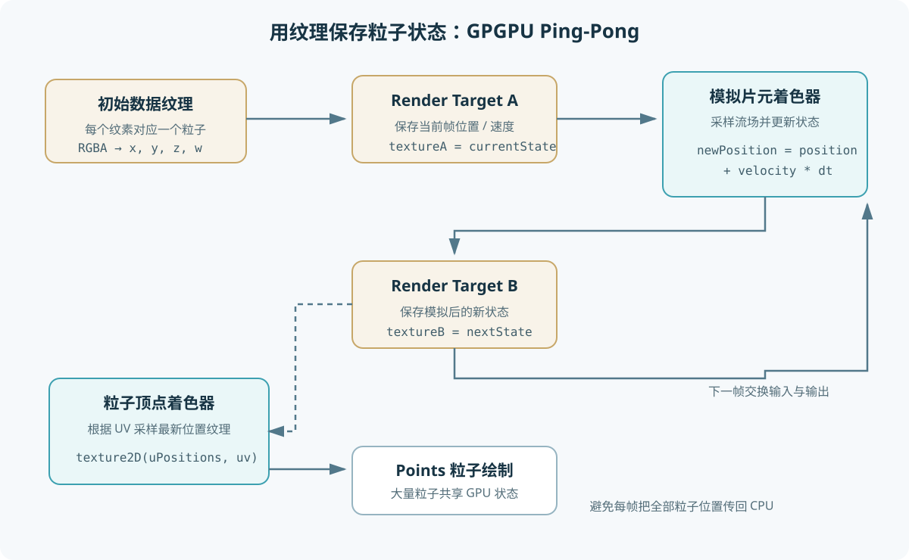
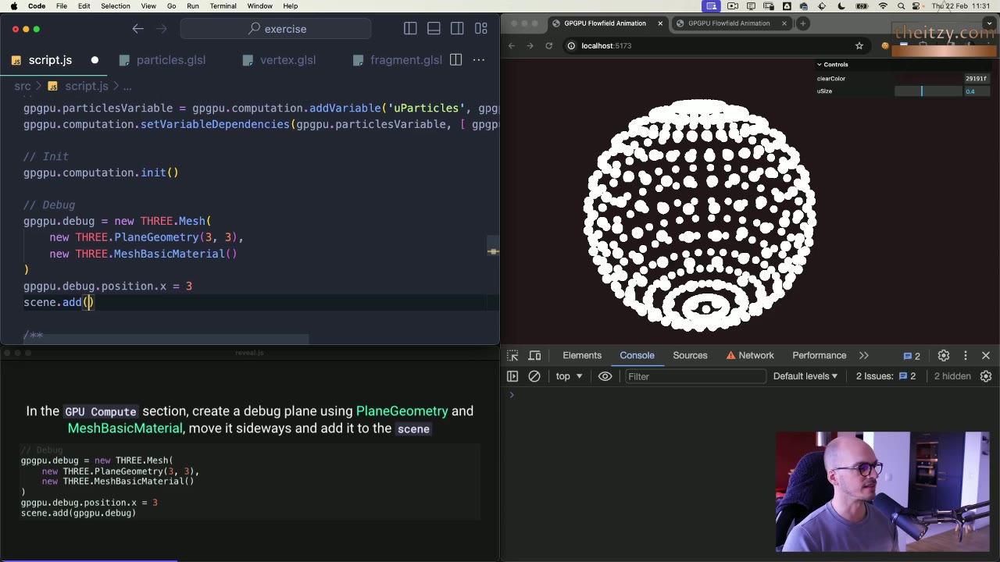
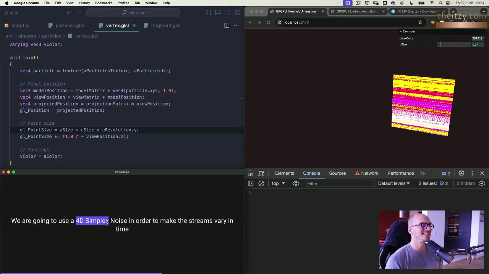

# 第 28 章 GPGPU 流场粒子

本章把一个 glTF 模型的顶点转化为持续运动的粒子，并使粒子在流动、消散和重生之间反复变化，同时保留模型的整体轮廓。效果由两项技术共同完成：GPGPU 负责在 GPU 上并行更新大量粒子的状态，流场负责根据粒子的空间位置和时间计算运动方向。实现过程会涉及数据纹理、帧缓冲对象、乒乓缓冲、自定义 BufferGeometry、顶点纹理采样、四维单纯形噪声、粒子生命周期以及与帧率无关的时间步进。理解这些环节之间的数据流，比单独记住某个着色器公式更重要。

## GPGPU 与流场：计算和规则的分工

GPGPU 是 General-Purpose computing on Graphics Processing Units 的缩写，即“图形处理器上的通用计算”。常规 WebGL 渲染把 GPU 的计算结果作为像素显示在画布上，而 GPGPU 把像素当作数据载体：着色器仍然并行处理许多片元，但输出不一定直接呈现给用户，也可以保存起来供后续计算或渲染使用。它尤其适合“计算规则相同、输入数据不同、数据量很大”的任务。为每个粒子计算一次方向正属于这种任务，因此可以把大量粒子的更新交给 GPU，而不是在 JavaScript 中逐个遍历。

GPGPU 并不规定粒子应该怎样运动，它只提供并行计算和保存结果的机制。运动规则来自流场（flow field）。流场可以表示为一个函数：输入空间中的三维位置，输出该位置的方向向量。粒子处于不同位置时会得到不同方向，许多粒子便呈现出类似风或水流推动的效果。若再让函数接受时间参数，同一位置在不同时刻也能得到不同方向，运动会更加自然。

可以把本章的更新关系概括为：

```text
方向 = 流场(当前位置, 时间)
新位置 = 当前位置 + 归一化方向 × 位移强度 × 时间增量
```

这与直接根据初始坐标和总时间计算位置的动画有本质区别。若动画只是 `position = f(initialPosition, elapsedTime)`，任何时候都能独立求出某一帧的位置，粒子此前经历过什么并不重要。流场动画则依赖上一状态：当前位置决定下一步方向，下一步位移又成为后续计算的输入。粒子的轨迹具有积累性，不能仅靠一个绝对时间公式重建，所以必须逐帧保存位置和生命周期等状态。

因此，两项技术各自解决一个问题：流场定义“往哪里走”，GPGPU 解决“如何为成千上万个粒子持续计算并保存状态”。GPU 的并行能力也不意味着所有任务都应迁移过去。数据是否适合并行、纹理读写是否方便、状态是否需要在帧之间保留，都是设计 GPGPU 方案时要先确认的条件。



*图 28-1 GPGPU 粒子模拟中状态纹理、模拟着色器与粒子绘制之间的数据流*

## 用数据纹理与 FBO 保存状态

本章为每个粒子分配数据纹理中的一个纹素。纹理的 RGB 通道不再表示颜色，而是分别保存粒子位置的 X、Y、Z；Alpha 通道保存从 0 增长到 1 的生命进度。一个 `vec4` 因而可以同时表达 `(x, y, z, life)`。使用浮点数据十分重要，因为位置可以是负数，也可能远大于 1，不能把普通图像常见的颜色范围误认为粒子坐标的有效范围。

CPU 侧可以通过 `DataTexture` 准备初始数据。它的像素保存在类似 `Float32Array` 的数组中，每个纹素占连续的四个值。几何体的 `position` 属性则以每顶点三个值保存 XYZ，所以复制数据时，源数组的步幅是 3，目标数组的步幅是 4。纹理后来由 GPU 更新，最初用于填入位置的 CPU 数组仍可作为不变的初始状态保留下来。

计算结果不能直接写入普通画布，而要写入帧缓冲对象（Framebuffer Object，FBO）。Three.js 中的 `WebGLRenderTarget` 可以作为这一离屏渲染目标的封装。调用相关接口取得的通常是渲染目标，真正能够赋给材质或采样器的是它的 `.texture` 属性，二者不能混用。本章所说的“位置纹理”，就是离屏渲染目标中保存粒子状态的纹理。

从概念上看，可以建立一个独立的离屏场景：用正交相机正对一张铺满视图的平面，在平面材质中运行更新粒子状态的片元着色器。每次离屏渲染都处理整张数据纹理，每个片元读取一个粒子的旧状态并写入新状态。主场景随后读取这张纹理，把数据转换为顶点位置。用户只需要看到最后的粒子，不需要看到中间的计算平面。

这里还有一个读写冲突：同一次计算不能一边采样某张纹理，一边把结果写回同一张纹理。解决办法是准备两个渲染目标，本轮从 A 读取、向 B 写入，下一轮交换角色，从 B 读取、向 A 写入。这种方式称为乒乓缓冲（ping-pong buffering）。它也解释了为什么“当前输出纹理”会在帧之间变化，外部材质不能永远固定引用其中一个目标。

Three.js 附加组件中的 `GPUComputationRenderer` 封装了离屏场景、全屏平面、渲染目标格式、乒乓交换和计算调用等基础工作。本章使用它而不从头实现整套 GPGPU 框架，但仍需明确它并没有替我们决定粒子的运动规则。初始数据、更新着色器、变量依赖、结果采样和最终粒子渲染仍由项目代码完成。



*图 28-2 以调试图像观察 GPGPU 数据纹理中的粒子状态*

调试时可以把输出纹理贴到主场景的一张 `PlaneGeometry` 上，并使用 `MeshBasicMaterial` 显示。此时看到的红、绿、蓝变化实际上对应 X、Y、Z 数值变化，而不是粒子的最终配色。普通显示会把负值截掉，也会把大于 1 的颜色表现为饱和色，因此画面停止变色并不代表数据停止增长。调试平面适合确认纹理是否更新，不适合直接判断精确的坐标数值。

## 初始化 GPUComputationRenderer

### 根据顶点数量确定纹理尺寸

先保存基础几何体及其顶点数。早期可以用球体验证计算流程，之后再替换为模型几何体。`position.count` 给出顶点数量，也就是需要存储和绘制的粒子数量：

```js
import * as THREE from 'three';
import { GPUComputationRenderer } from 'three/addons/misc/GPUComputationRenderer.js';
import gpgpuParticlesShader from './shaders/gpgpu/particles.glsl';

const baseGeometry = {};
baseGeometry.instance = new THREE.SphereGeometry(3);
baseGeometry.count = baseGeometry.instance.attributes.position.count;

const gpgpu = {};
gpgpu.size = Math.ceil(Math.sqrt(baseGeometry.count));
gpgpu.computation = new GPUComputationRenderer(
  gpgpu.size,
  gpgpu.size,
  renderer
);
```

`GPUComputationRenderer` 的前两个参数是计算纹理的宽和高，第三个参数复用主项目的 `renderer`，不必为离屏计算再创建一个 WebGL 渲染器。为简化索引，本章使用正方形纹理。边长取顶点数平方根的向上取整，可以保证纹理容量不小于粒子数。例如 561 个粒子需要 24×24 的纹理，共 576 个纹素，末尾多出的纹素不参与粒子绘制。少量冗余通常比设计非正方形索引更简单。

### 把初始位置写入 RGBA 数组

`createTexture()` 创建与计算尺寸匹配的数据纹理。初始数组中的值通常为 0，需要把基础几何体的位置复制进去：

```js
const baseParticlesTexture = gpgpu.computation.createTexture();
const positions = baseGeometry.instance.attributes.position.array;
const textureData = baseParticlesTexture.image.data;

for (let i = 0; i < baseGeometry.count; i++) {
  const i3 = i * 3;
  const i4 = i * 4;

  textureData[i4 + 0] = positions[i3 + 0]; // X -> R
  textureData[i4 + 1] = positions[i3 + 1]; // Y -> G
  textureData[i4 + 2] = positions[i3 + 2]; // Z -> B
  textureData[i4 + 3] = 0;                 // 初始生命进度
}
```

这里应区分 `baseParticlesTexture` 与计算过程中的输出纹理。前者保存创建粒子时的原始坐标，之后还要用于把死亡粒子放回初始位置；后者每帧变化，保存当前状态。不能因为更新着色器中的 `uParticles` 最初也来自这张基础纹理，就把二者当成会同步变化的同一份数据。

### 创建变量、自依赖与逐帧计算

在 `GPUComputationRenderer` 中，variable 是需要被计算的一类数据及其相关材质、渲染目标的组合，不只是 GLSL 中的一个普通变量。本章只需一个粒子变量：

```js
gpgpu.particlesVariable = gpgpu.computation.addVariable(
  'uParticles',
  gpgpuParticlesShader,
  baseParticlesTexture
);

gpgpu.computation.setVariableDependencies(
  gpgpu.particlesVariable,
  [gpgpu.particlesVariable]
);

gpgpu.computation.init();
```

`addVariable()` 的第一个参数决定更新着色器中采样器的名称，第二个参数是状态更新片元着色器，第三个参数提供初始纹理。把粒子变量本身放进依赖数组，会让上一轮输出成为下一轮输入，从而形成持续反馈。更复杂的模拟可以同时维护位置、速度等多个变量并相互依赖，本章把所需状态压缩在同一个 RGBA 变量中。

更新着色器先把所有像素写成纯红色，可以验证计算管线是否接通；确认后再改为读取上一状态。`GPUComputationRenderer` 会为依赖注入采样器声明，并提供计算目标的分辨率定义，因此不要重复声明同名的 `uParticles`：

```glsl
void main()
{
  vec2 uv = gl_FragCoord.xy / resolution.xy;
  vec4 particle = texture(uParticles, uv);

  gl_FragColor = particle;
}
```

`gl_FragCoord.xy` 是离屏渲染中的片元坐标，除以目标分辨率后得到采样 UV。上述代码暂时没有移动粒子，只把输入重新写出，却是很有价值的中间检查：调试平面应显示由初始坐标形成的颜色分布，而不是纯红或全黑。还可以临时添加 `particle.y += 0.01;`，观察绿色通道是否逐帧增强，以确认自依赖和状态持久化均已生效。

最后，在动画循环中调用 `gpgpu.computation.compute()`。如果只计算一次，得到的只是一次性数据变换；只有每帧执行，反馈纹理才会成为模拟状态。初始化阶段的推荐顺序是“读取几何体—确定纹理尺寸—填充基础纹理—创建变量和依赖—初始化—进入逐帧计算”，其中任何一步未完成，都可能让后续调试失去可靠依据。

## 让渲染顶点读取计算结果

GPGPU 输出仍然只是一张纹理，`GPUComputationRenderer` 不知道项目要怎样使用它。要在主场景中显示粒子，需要另外建立 `THREE.Points` 所需的几何关系，并在显示粒子的顶点着色器中采样当前位置。这个显示着色器与前面的状态更新片元着色器职责不同，不能混在同一个文件中修改。

### 用绘制范围和自定义 UV 代替 position 属性

最终位置来自纹理，所以不必再把基础几何体的 `position` 属性用于绘制。可以创建空的 `BufferGeometry`，再用 `setDrawRange()` 明确绘制多少个点：

```js
const particles = {};
particles.geometry = new THREE.BufferGeometry();
particles.geometry.setDrawRange(0, baseGeometry.count);
```

第二个参数是绘制数量，不是结束顶点的索引。若完全依赖空几何体，Three.js 无法从通常的 `position.count` 推断点数量；若把方形纹理的全部纹素都画出来，又会产生没有对应模型顶点的冗余粒子。绘制范围把实际渲染数量固定为基础几何体的顶点数。

每个顶点还需要知道自己应读取哪个纹素。为此建立 `aParticlesUv` 属性，每个顶点保存两个浮点数。二维纹理索引展平为一维数组时使用 `i = y * gpgpu.size + x`，属性内部则使用 `i2 = i * 2` 作为写入起点：

```js
const particlesUvArray = new Float32Array(baseGeometry.count * 2);

for (let y = 0; y < gpgpu.size; y++) {
  for (let x = 0; x < gpgpu.size; x++) {
    const i = y * gpgpu.size + x;
    if (i >= baseGeometry.count) continue;

    const i2 = i * 2;
    particlesUvArray[i2 + 0] = (x + 0.5) / gpgpu.size;
    particlesUvArray[i2 + 1] = (y + 0.5) / gpgpu.size;
  }
}

particles.geometry.setAttribute(
  'aParticlesUv',
  new THREE.BufferAttribute(particlesUvArray, 2)
);
```

加上 `0.5` 是为了采样纹素中心，避免坐标恰好落在纹素边界时产生不明确的邻接选择。UV 的取值从接近 0 延伸到小于 1，而不是包含 1。纹理初始化与 UV 生成都按相同的行优先顺序排列，因此第 `i` 个顶点会读到第 `i` 份位置数据。

### 每帧传递“当前”纹理

在显示粒子的 `ShaderMaterial` 中增加 `uParticlesTexture` uniform，但不要在初始化时只赋一次纹理。每次计算后都要重新获取当前渲染目标：

```js
// tick：执行本轮状态计算
gpgpu.computation.compute();

particles.material.uniforms.uParticlesTexture.value =
  gpgpu.computation
    .getCurrentRenderTarget(gpgpu.particlesVariable)
    .texture;
```

由于乒乓缓冲会交换读写目标，计算前保存的纹理引用可能在计算后不再是刚写入的结果。固定使用其中一个目标还可能让显示端每隔一帧才读到新状态，造成更新节奏异常。把获取语句放在 `compute()` 之后，可以保证显示材质引用本轮最新输出。后续加入 `uTime`、`uDeltaTime` 等计算 uniform 时，则必须先更新它们的 `.value`，再调用 `compute()`。

顶点着色器通过自定义 UV 取得 `vec4`，用 XYZ 替换原来的几何位置，Alpha 则留作生命周期控制：

```glsl
uniform sampler2D uParticlesTexture;
uniform float uSize;
uniform vec2 uResolution;
attribute vec2 aParticlesUv;
attribute vec3 aColor;
attribute float aSize;
varying vec3 vColor;

void main()
{
  vec4 particle = texture(uParticlesTexture, aParticlesUv);

  vec4 modelPosition = modelMatrix * vec4(particle.xyz, 1.0);
  vec4 viewPosition = viewMatrix * modelPosition;
  vec4 projectedPosition = projectionMatrix * viewPosition;
  gl_Position = projectedPosition;

  // 保留项目原有的尺寸、画布高度和透视衰减计算
  gl_PointSize = aSize * uSize * uResolution.y;
  gl_PointSize *= 1.0 / -viewPosition.z;

  vColor = aColor;
}
```

至此形成两条相连的渲染管线：离屏片元着色器负责更新状态纹理，主场景顶点着色器负责把状态纹理解释为位置，主场景片元着色器再负责点的颜色与形状。排错时应先确认数据纹理是否变化，再检查顶点 UV 和 uniform，最后检查点的大小与颜色，避免同时修改三层而难以定位问题。

## 从 glTF 模型构造彩色粒子

球体验证完成后，可以把基础几何体替换为模型中的网格几何体。课程模型来自摄影测量，即根据多张照片重建网格。此类模型能保留丰富的表面细节，顶点分布也不一定像程序化几何体那样规则，适合作为粒子化的对象。模型在 Blender 中完成居中处理，并把表面纹理颜色烘焙到顶点颜色中。这样，粒子系统只需读取几何属性，不必再为每个点查询原始材质贴图。

模型加载必须先于 GPGPU 初始化，因为纹理尺寸、绘制范围、UV 属性和颜色属性都依赖模型几何体。使用 `loadAsync()` 可以让写法保持线性：

```js
const gltf = await gltfLoader.loadAsync('./model.glb');
baseGeometry.instance = gltf.scene.children[0].geometry;
baseGeometry.count = baseGeometry.instance.attributes.position.count;
```

这里的 `children[0]` 建立在课程资源只有一个网格的前提下；结构不同的 glTF 不能直接照搬这一假设。加载器已经关联 DracoLoader，资源路径与加载方式保持不变即可。`await` 会等待 Promise 完成，再把结果交给后续初始化代码。位于模块顶层的这种写法称为 top-level await，课程项目的 Vite 构建需要把目标设为现代环境：

```js
// vite.config.js 的 build 配置
export default {
  build: {
    target: 'esnext'
  }
};
```

该配置表达的是不再以旧浏览器为构建目标，而不是解决模型加载体验。模型较大或网络较慢时，顶层等待会推迟其后的场景初始化；需要加载界面或更细粒度控制时，可以把初始化组织到异步函数或加载回调中，但应确保几何体就绪后再创建 GPGPU。

顶点颜色已经以 `BufferAttribute` 形式存在于基础几何体上，可以直接复用，同时为每个点生成一个随机尺寸：

```js
const sizesArray = new Float32Array(baseGeometry.count);
for (let i = 0; i < baseGeometry.count; i++) {
  sizesArray[i] = Math.random();
}

particles.geometry.setAttribute(
  'aColor',
  baseGeometry.instance.attributes.color
);
particles.geometry.setAttribute(
  'aSize',
  new THREE.BufferAttribute(sizesArray, 1)
);
```

`aColor` 每项包含 RGB 三个值，`aSize` 每项只有一个值。顶点着色器把 `aColor` 传给 `vColor`，主场景片元着色器再用它设置最终颜色；`aSize` 则乘入 `gl_PointSize`，避免所有粒子大小完全一致。换成模型后可以适当降低 `uSize`，课程使用的调整值为 `0.07`，使摄影测量模型的细节不被过大的点遮蔽。颜色、尺寸和位置分别来自不同数据，但在顶点着色器里按照同一个顶点索引组合起来。

## 用四维单纯形噪声生成流场

流场需要同时具有局部连续性和足够丰富的方向变化。直接给每个粒子完全独立的随机方向会产生跳变，而单纯形噪声能让相邻位置得到平滑变化的值。本章使用四维单纯形噪声：前三个维度接收空间坐标，第四个维度接收时间，因此同一空间位置的噪声也会随时间连续变化。项目通过 `vite-plugin-glsl` 引入已有的函数实现：

```glsl
#include ../includes/simplexNoise4d.glsl
```

一个噪声调用只返回一个标量，三维方向需要调用三次。如果三次都传入完全相同的 `vec4`，三个输出也相同，归一化前可表示为 `(n, n, n)`，所有方向就会偏向同一条对角线。给第二、第三次调用的空间输入加入不同常量偏移，可以在保持平滑性的同时得到三个不同的分量：

```glsl
uniform float uTime;
uniform float uDeltaTime;
uniform float uFlowFieldFrequency;
uniform float uFlowFieldStrength;

void main()
{
  vec2 uv = gl_FragCoord.xy / resolution.xy;
  vec4 particle = texture(uParticles, uv);

  float time = uTime * 0.2;
  vec3 samplePosition = particle.xyz * uFlowFieldFrequency;
  vec3 flowField = vec3(
    simplexNoise4d(vec4(samplePosition, time)),
    simplexNoise4d(vec4(samplePosition + 1.0, time)),
    simplexNoise4d(vec4(samplePosition + 2.0, time))
  );
  flowField = normalize(flowField);

  particle.xyz += flowField * uDeltaTime * uFlowFieldStrength;
  gl_FragColor = particle;
}
```

单纯形噪声输出大致位于 -1 到 1，归一化把三个分量组成的方向调整为单位长度，使后续强度参数主要控制位移大小，而不是同时受到噪声向量长度影响。最初可以用很小的固定系数测试运动，但最终应乘上 `uDeltaTime`，否则高刷新率设备会在同一秒内施加更多次位移。

`uTime` 需要逐帧更新，时间再乘以 `0.2` 以减慢噪声第四维的变化。如果第四维始终为常量，流场在空间中固定不变，粒子可能沿重复轨迹运动或困在局部循环中，模型也会逐渐失去可辨识度。时间维度让方向场本身不断演化，减少这种重复。`uFlowFieldFrequency` 控制空间采样频率：较低频率形成较大、较统一的运动区域，较高频率形成更细碎、更剧烈的方向差异。频率和时间变化速度是两个不同参数，不应混为一谈。



*图 28-3 四维单纯形噪声驱动模型粒子形成连续流动*

## 生命周期、影响范围与时间一致性

### 用 Alpha 管理消散和重生

仅靠流场持续推动，粒子最终会远离模型，初始形状无法恢复。为此让每个粒子经历“出生—流动—死亡—回到初始位置”的循环。Alpha 从 0 向 1 增长，到达或超过 1 时重置位置和生命进度；尚未到达终点时才施加流场位移。状态更新材质需要额外的时间、时间增量和基础位置纹理 uniform：

```js
const computeUniforms = gpgpu.particlesVariable.material.uniforms;
computeUniforms.uTime = new THREE.Uniform(0);
computeUniforms.uDeltaTime = new THREE.Uniform(0);
computeUniforms.uBase = new THREE.Uniform(baseParticlesTexture);
computeUniforms.uFlowFieldInfluence = new THREE.Uniform(0.5);
computeUniforms.uFlowFieldStrength = new THREE.Uniform(2);
computeUniforms.uFlowFieldFrequency = new THREE.Uniform(0.5);
```

基础位置纹理不能被不断更新的 `uParticles` 替代，否则死亡时读到的仍是当前位置，无法回到模型表面。`uBase` 与当前状态使用相同的 UV 采样，因此同一粒子能取回自己的原始坐标。下面的完整片段把方向、生命周期和位移整合起来，其中 `flowField` 使用上一节的三次噪声计算：

```glsl
uniform float uTime;
uniform float uDeltaTime;
uniform sampler2D uBase;
uniform float uFlowFieldInfluence;
uniform float uFlowFieldStrength;
uniform float uFlowFieldFrequency;

#include ../includes/simplexNoise4d.glsl

void main()
{
  vec2 uv = gl_FragCoord.xy / resolution.xy;
  vec4 particle = texture(uParticles, uv);
  vec4 base = texture(uBase, uv);

  float time = uTime * 0.2;
  vec3 samplePosition = particle.xyz * uFlowFieldFrequency;
  vec3 flowField = vec3(
    simplexNoise4d(vec4(samplePosition, time)),
    simplexNoise4d(vec4(samplePosition + 1.0, time)),
    simplexNoise4d(vec4(samplePosition + 2.0, time))
  );
  flowField = normalize(flowField);

  // 用初始位置划分流场影响区域
  float strength = simplexNoise4d(vec4(base.xyz * 0.2, time + 1.0));
  float influence = (uFlowFieldInfluence - 0.5) * -2.0;
  strength = smoothstep(influence, 1.0, strength);

  particle.a += uDeltaTime * 0.3;

  if (particle.a >= 1.0) {
    particle.a = mod(particle.a, 1.0);
    particle.xyz = base.xyz;
  } else {
    particle.xyz += flowField * uDeltaTime * uFlowFieldStrength * strength;
  }

  gl_FragColor = particle;
}
```

如果所有粒子的初始 Alpha 都是 0，又以相同速度增长，它们就会同时死亡和重置，画面出现整体闪回。把基础纹理初始化中的 Alpha 改为 `Math.random()`，可以让不同粒子从随机生命阶段开始，重置时刻自然错开。这个修改只影响初始生命，不影响 RGB 中的原始坐标。

`uTime` 和 `uDeltaTime` 必须在每次 `compute()` 前更新。位移和生命增长都乘时间增量后，同一秒内的总变化不再直接取决于帧数。浏览器标签页进入后台后，动画循环可能暂停或降低频率，恢复时会出现很大的 `deltaTime`。若此时简单地把 Alpha 清零，大量粒子又会被同步到同一生命阶段。`mod(particle.a, 1.0)` 保留超过整周期后的小数部分，例如 1.2 变为 0.2，配合随机初始生命可以维持相位差。`fract()` 在此类非负生命进度上也能取得小数部分。另一种常见防护是把 CPU 侧的 `deltaTime` 限制到 `1 / 30` 等上限，但课程采用模运算处理生命循环。

### 让模型的不同区域受到不同程度的影响

如果所有位置始终受到同等强度的流场作用，模型仍会很快变得混乱。额外的 `strength` 噪声相当于空间遮罩，决定某个粒子本次受到多大位移。这里使用 `base.xyz` 而不是当前位置作为空间输入，使影响区域跟随粒子的初始身份和模型部位，而不是粒子飘走后的位置。乘以 `0.2` 降低遮罩频率，可以形成较大的静止区与活动区；第四维使用 `time + 1.0`，让遮罩随时间变化，同时与方向噪声的采样有所区别。

噪声值位于 -1 到 1，而位移遮罩需要位于 0 到 1。`smoothstep(influence, 1.0, strength)` 同时完成重映射、平滑和限制范围：低于阈值的区域基本不动，高于上界的区域获得完整强度，中间区域平滑过渡。`uFlowFieldInfluence` 的界面范围是 0 到 1，公式 `(value - 0.5) * -2.0` 把它反向映射为 1 到 -1。影响值越接近 0，阈值越接近 1，活动区域越少；越接近 1，阈值越接近 -1，越多区域参与流动。

三个主要 uniform 分别控制不同层面：`uFlowFieldInfluence` 控制有多少粒子受到影响，`uFlowFieldStrength` 控制受影响粒子的移动强度，`uFlowFieldFrequency` 控制方向场的空间细节。课程把强度默认值设为 2，调试范围扩展到 0 至 10；频率默认值为 0.5，并在 0 至 1 内细调。调参时应一次改变一个维度，先确认模型轮廓，再增加运动强度，避免把“影响范围过大”误判为“噪声频率过高”。

### 让粒子大小随生命周期平滑变化

位置突然重置仍会造成可见的跳变。可以让粒子在出生和死亡附近缩小，在中间生命阶段保持正常尺寸。显示粒子的顶点着色器能够直接读取同一个 `particle.a`，不需要再增加一张生命周期纹理：

```glsl
float sizeIn = smoothstep(0.0, 0.1, particle.a);
float sizeOut = 1.0 - smoothstep(0.7, 1.0, particle.a);
float lifeSize = min(sizeIn, sizeOut);

gl_PointSize = lifeSize * aSize * uSize * uResolution.y;
gl_PointSize *= 1.0 / -viewPosition.z;
```

`sizeIn` 在生命前段从 0 平滑增长到 1，`sizeOut` 在生命末段从 1 平滑降为 0，取二者最小值便得到两端收缩、中间展开的包络。这个系数再与随机尺寸、全局尺寸和透视衰减相乘。粒子回到初始位置时接近不可见，随后逐渐长大，因此重生不再表现为明显的瞬间弹出。位置重置与尺寸包络共同作用，才形成连续而可辨认的模型流动效果。

## 调试、调参和扩展方向

GPGPU 的中间结果默认不可见，调试应保留明确的分层策略。第一层用纯色输出检查离屏渲染是否执行；第二层直接显示基础纹理，核对 RGB 与 XYZ 的对应以及末尾空纹素；第三层对当前位置做微小增量，验证自依赖和乒乓缓冲；第四层检查 `aParticlesUv` 是否命中纹素中心；第五层才加入模型颜色、噪声和生命周期。若粒子全部聚在原点，应优先检查绘制范围、纹理 uniform 和顶点采样，而不是先调整噪声参数。

确认效果后，可以把调试平面的 `visible` 设为 `false`，保留代码以便需要时重新开启，也可以把可见性加入调试界面。流场影响、强度和频率适合做成实时控件，因为不同模型、尺寸和粒子数量需要不同组合。还可以继续暴露时间变化速度、生命增长速度、影响遮罩频率等参数。调参的目标不是让运动越强越好，而是在模型轮廓、局部流动和重生节奏之间取得平衡。

性能判断也应区分计算与显示。增加粒子会同时扩大计算纹理、顶点绘制数量和片元覆盖；复杂的四维噪声会在每个计算纹素上重复执行。数据纹理很小并不代表最终点精灵的覆盖成本一定很低。替换模型时还要确认它含有可用的顶点颜色，否则需要重新烘焙或提供其他配色方式。

在此架构上可以增加全局风向，使粒子整体偏向某一方向；可以用纹理或 `gl_PointCoord` 改变点精灵外观；也可以加入光标交互。光标交互不宜直接对高顶点数模型做射线检测，而应使用对应的低多边形不可见网格取得交点，再把交点坐标传给粒子着色器，根据粒子与交点的距离调节流场强度。无论增加哪种功能，都应保持现有职责边界：交互输入只修改参数，GPGPU 更新状态，主场景负责显示。

## 本章小结

GPGPU 流场粒子的核心不是某一段噪声代码，而是一条可持久反馈的数据管线。基础几何体提供初始位置和粒子数量，数据纹理用 RGB 保存 XYZ、用 Alpha 保存生命进度，`GPUComputationRenderer` 通过离屏渲染和乒乓缓冲逐帧更新纹理，显示粒子的顶点着色器再用自定义 UV 把纹素还原为空间位置。每帧必须先更新 uniform，再调用 `compute()`，随后读取当前渲染目标的 `.texture`。

四维单纯形噪声提供随空间和时间连续变化的方向，生命周期与基础位置纹理让粒子能够回到模型表面，随机初始生命和模运算避免整体同步重置，时间增量则降低帧率差异。影响遮罩、运动强度、空间频率和生命尺寸包络共同决定最终观感。掌握这些关系后，粒子数量、模型来源和交互方式都可以替换，而不必改变整条模拟架构。
