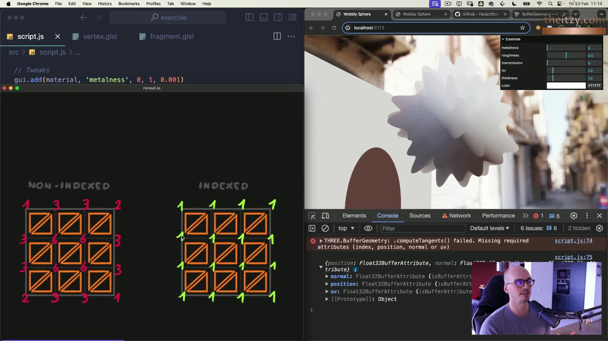
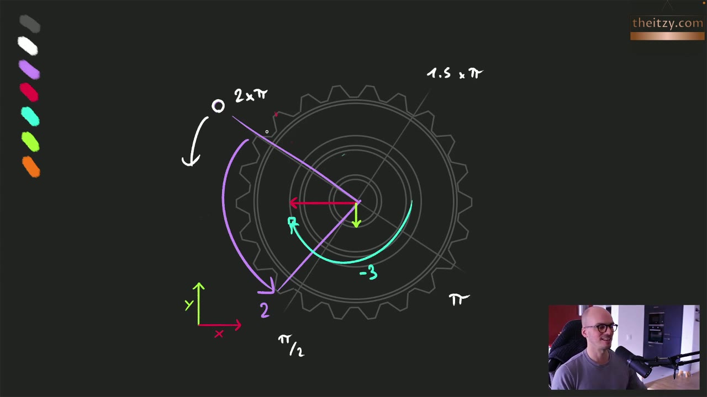

# 第 29 章 摆动球体与切片模型

本章将探讨两种基于自定义着色器的实时渲染效果：有机摆动的透明球体和剖面切片展示的机械模型。两者都使用 `three-custom-shader-material` 库来增强内置材质，既能保持物理材质的所有属性（金属度、粗糙度、透射、折射率等），又能通过顶点与片段着色器实现顶点动画与剖面剔除。

## 使用 CustomShaderMaterial 实现摆动球体

要创建表面有机摆动的球体，同时保留物理材质的全部属性，我们需要使用 `three-custom-shader-material` 库。该库的优势在于可以直接向 Three.js 内置材质注入自定义着色器代码，而无须深入研究 Three.js 复杂的内部着色器结构。

### 安装与基础配置

首先安装依赖库：

```bash
npm install three-custom-shader-material@5.4
```

在 JavaScript 中导入并使用：

```javascript
import CustomShaderMaterial from 'three-custom-shader-material/vanilla'

const material = new CustomShaderMaterial({
    // CSM 配置
    baseMaterial: THREE.MeshPhysicalMaterial,
    vertexShader: wobbleVertexShader,
    fragmentShader: wobbleFragmentShader,
    silent: true,  // 抑制警告信息

    // MeshPhysicalMaterial 属性
    metalness: 0,
    roughness: 0.5,
    color: '#ffffff',
    transmission: 0,
    ior: 1.5,
    thickness: 1.5,
    transparent: true
})
```

关键配置项 `silent: true` 可抑制库在无法匹配 Three.js 内部着色器片段时产生的警告。它只影响日志，不应被用来掩盖实际的 GLSL 编译错误。

### 摆动效果的顶点着色器基本原理

摆动效果的核心思想是根据顶点位置计算一个噪声值，然后沿法线方向移动顶点：

```glsl
// 顶点着色器基本结构
#include ../includes/simplexNoise4d.glsl

void main()
{
    // 基于顶点位置计算摆动值
    float wobble = simplexNoise4d(vec4(
        csm_Position,  // XYZ: 顶点位置
        0.0            // W: 时间（暂设为0）
    ));

    // 沿法线方向移动顶点
    csm_Position += wobble * normal;
}
```

这里使用的 `simplexNoise4d` 是四维单纯形噪声，前三维对应空间坐标，第四维可用于时间动画。

### 切线空间与法线重构

当顶点位置改变后，原有的表面法线信息不再正确，会导致光照异常。需要基于修改后的几何重新计算法线。

Three.js 提供了切线（tangent）属性，但需要满足特定条件才能生成：

1. **索引几何体**：必须是有索引的几何体
2. **必要属性**：需要 position、normal、uv 属性

```javascript
import { mergeVertices } from 'three/addons/utils/BufferGeometryUtils.js'

let geometry = new THREE.IcosahedronGeometry(2.5, 50)
geometry = mergeVertices(geometry)  // 转换为索引几何体
geometry.computeTangents()           // 计算切线
```

在着色器中，可以使用切线和叉积推导出副切线：

```glsl
void main()
{
    // 从切线属性计算副切线
    vec3 biTangent = cross(normal, tangent.xyz);

    // 邻居位置（用于法线计算）
    float shift = 0.01;
    vec3 positionA = csm_Position + tangent.xyz * shift;
    vec3 positionB = csm_Position + biTangent * shift;
}
```

### 重构表面法线的数学原理

正确地重新计算表面法线需要两个相邻顶点位置：

1. **获取相邻点**：沿切线和副切线方向小幅偏移得到 `positionA` 和 `positionB`
2. **应用相同摆动**：对相邻点应用相同的噪声函数
3. **计算方向向量**：从当前顶点指向相邻点
4. **叉积求法线**：两个方向向量叉积得到新的表面法线

```glsl
// 获取摆动值的辅助函数
float getWobble(vec3 position)
{
    return simplexNoise4d(vec4(
        position,  // XYZ: 输入位置
        0.0        // W: 时间
    ));
}

void main()
{
    // ... 计算切线和副切线 ...

    // 计算邻居位置
    vec3 positionA = csm_Position + tangent.xyz * 0.01;
    vec3 positionB = csm_Position + biTangent * 0.01;

    // 对当前顶点和邻居应用摆动
    float wobble = getWobble(csm_Position);
    csm_Position += wobble * normal;
    positionA += getWobble(positionA) * normal;
    positionB += getWobble(positionB) * normal;

    // 重新计算法线
    vec3 toA = normalize(positionA - csm_Position);
    vec3 toB = normalize(positionB - csm_Position);
    csm_Normal = cross(toA, toB);
}
```



*图 29-1 法线重构示意图：通过切线与副切线方向上的相邻点重新计算表面法线*

### 时间动画与参数控制

让摆动效果随时间变化，并添加参数控制：

```glsl
uniform float uTime;
uniform float uSpeed;
uniform float uWobbleStrength;
uniform float uTwist;

// 改进的摆动函数
float getWobble(vec3 position)
{
    // 添加时间维度
    return simplexNoise4d(vec4(
        position,                           // XYZ: 空间坐标
        uTime * uSpeed                      // W: 时间动画
    ));
}

void main()
{
    // 应用摆动强度
    float wobble = getWobble(csm_Position) * uWobbleStrength;
    csm_Position += wobble * normal;

    // 应用扭曲效果（绕法线旋转位置）
    float angle = wobble * uTwist;
    vec3 rotatedOffset = vec3(
        cos(angle) * tangent.x - sin(angle) * biTangent.x,
        cos(angle) * tangent.y - sin(angle) * biTangent.y,
        cos(angle) * tangent.z - sin(angle) * biTangent.z
    );

    // 对邻居应用相同的变换
    positionA += getWobble(positionA) * uWobbleStrength * rotatedOffset;
    positionB += getWobble(positionB) * uWobbleStrength * rotatedOffset;

    // ... 重新计算法线 ...
}
```

JavaScript 端对应的 Uniform 设置：

```javascript
const material = new CustomShaderMaterial({
    baseMaterial: THREE.MeshPhysicalMaterial,
    vertexShader: wobbleVertexShader,
    fragmentShader: wobbleFragmentShader,
    silent: true,

    uniforms: {
        uTime: { value: 0 },
        uSpeed: { value:她们.5 },
        uWobbleStrength: { value: 0.5 },
        uTwist: { value: 0.5 }
    },

    // ... 其他物理材质属性
});
```

## 剖面切片展示机械模型

切片效果适用于展示机械内部结构，仅显示指定角度范围内的模型部分，隐藏其余部分。

### 材质与模型准备

首先加载机械模型并准备两种材质：

```javascript
// 常规材质（用于齿轮等内部零件）
const material = new THREE.MeshStandardMaterial({
    metalness: 0.5,
    roughness: 0.25,
    envMapIntensity: 0.5,
    color: '#858080'
});

// 切片材质（用于外壳）
const slicedMaterial = new CustomShaderMaterial({
    baseMaterial: THREE.MeshStandardMaterial,
    vertexShader: slicedVertexShader,
    fragmentShader: slicedFragmentShader,
    silent: true
});

// 加载模型并应用不同材质
gltfLoader.load('./gears.glb', (gltf) => {
    model = gltf.scene;
    scene.add(model);

    model.traverse((child) => {
        if(child.isMesh) {
            if(child.name === 'outerHull') {
                child.material = slicedMaterial;  // 外壳使用切片材质
            } else {
                child.material = material;        // 内部零件使用常规材质
            }
            child.castShadow = true;
            child.receiveShadow = true;
        }
    });
});
```

### 径向切片与角度归一化

切片在顶点着色器中把局部位置保存为 `vPosition`，片元着色器再计算 XY 平面的极角。`atan(y, x)` 的结果位于 `-π` 到 `π`。为避免切片跨过正负角度边界时失效，先减去起始角，再用 `mod()` 将结果映射到 `[0, 2π)`：

```glsl
// 顶点着色器
varying vec3 vPosition;

void main()
{
    vPosition = csm_Position.xyz;
}
```

```glsl
// 片元着色器
varying vec3 vPosition;
uniform float uSliceStart;
uniform float uSliceArc;

void main()
{
    float angle = atan(vPosition.y, vPosition.x);
    angle -= uSliceStart;
    angle = mod(angle, PI * 2.0);

    // 去除指定扇形区域
    if(angle > 0.0 && angle < uSliceArc)
        discard;
}
```

这样只需要判断相对角度是否位于 `0` 到 `uSliceArc`，无须分别处理多个跨边界分支。GLSL 的 `mod()` 对负值的行为与 JavaScript 的 `%` 不同，不能直接用 JavaScript 取余直觉替代。`PI` 已由 Three.js 内置着色器的 `common` 块提供。

### 双面显示与剖面颜色

单纯丢弃片元会暴露模型内部。可将材质设为 `THREE.DoubleSide`，再用 `gl_FrontFacing` 区分背面，为剖面指定统一颜色。为了让正面继续保留内置材质的光照，课程使用 `patchMap` 在 `#include <colorspace_fragment>` 后追加处理，而不是用 `csm_FragColor` 覆盖整个输出：

```javascript
const patchMap = {
    csm_Slice: {
        '#include <colorspace_fragment>': `
            #include <colorspace_fragment>

            if(!gl_FrontFacing)
                gl_FragColor = vec4(0.75, 0.15, 0.3, 1.0);
        `
    }
}

const slicedMaterial = new CustomShaderMaterial({
    baseMaterial: THREE.MeshStandardMaterial,
    vertexShader: slicedVertexShader,
    fragmentShader: slicedFragmentShader,
    uniforms: uniforms,
    patchMap: patchMap,
    side: THREE.DoubleSide,
    silent: true
})
```

在 GLSL 的 `main()` 中声明 `float csm_Slice;` 即可激活这组补丁。这样，正面仍由 `MeshStandardMaterial` 完成光照，只有背面被指定为剖面颜色。

### 同步深度材质与阴影

外壳被切掉后，如果深度材质仍绘制完整模型，阴影就会保留原来的轮廓。需要创建使用相同顶点/片元着色器、uniforms 和 `patchMap` 的深度材质，并赋给外壳的 `customDepthMaterial`：

```javascript
const slicedDepthMaterial = new CustomShaderMaterial({
    baseMaterial: THREE.MeshDepthMaterial,
    vertexShader: slicedVertexShader,
    fragmentShader: slicedFragmentShader,
    uniforms: uniforms,
    patchMap: patchMap,
    silent: true,
    depthPacking: THREE.RGBADepthPacking
})

// 在模型遍历中处理 outerHull
child.material = slicedMaterial
child.customDepthMaterial = slicedDepthMaterial
```

相同的角度剔除会同时作用于颜色渲染和深度渲染，剖面、背面与阴影才能保持一致。



*图 29-2 通过角度剔除显示指定剖面，并用独立颜色标出背面*

### 用 uniform 驱动切片动画

切片动画不必另写一套角度公式。保留上述归一化逻辑，通过 GSAP 或交互事件更新 `uSliceStart` 和 `uSliceArc` 即可：

```javascript
gsap.to(uniforms.uSliceStart, {
    value: uniforms.uSliceStart.value + Math.PI * 0.5,
    duration: 1.5,
    ease: 'power2.inOut'
})

gsap.to(uniforms.uSliceArc, {
    value: 1.25,
    duration: 1.5,
    ease: 'power2.inOut'
})
```

颜色材质与深度材质共享同一组 uniform，因此动画期间阴影也会同步变化。

## 性能优化与注意事项

### 几何体预处理性能

`mergeVertices()` 将非索引几何体转换为索引几何体时可能产生明显的预处理开销，顶点越多，越需要关注初始化停顿。课程特别提醒不要在每帧重复执行这一操作。建议：

1. **开发环境预处理**：在构建阶段处理静态几何体
2. **模型优化**：导入时检查 `.bufferAttributes` 确认是否已有索引
3. **渐进加载**：对大型模型实施分步加载策略

### CustomShaderMaterial 的限制

使用 CustomShaderMaterial 需要注意：

1. **属性命名空间**：使用 `csm_` 前缀访问内置变量（如 `csm_Position`, `csm_Normal`, `csm_FragColor`）
2. **Shader 兼容性**：部分 Three.js 内置功能可能与自定义着色器冲突
3. **Uniform 管理**：内置材质 Uniform 需要正确传递

### 法线重构的精度控制

`shift` 参数控制法线计算精度，过小会导致数值不稳定，过大则可能跨接不同几何特征：

```glsl
// 自适应 shift 参数
float adaptiveShift = 0.01 * length(position);
```

### 多模型兼容性

两种效果都需要处理不同来源的几何体：

1. **Three.js 原生几何体**：需要 `computeTangents()` 前调用 `mergeVertices()`
2. **导入的 GLTF 模型**：通常已包含索引和切线数据
3. **自定义 BufferGeometry**：手动添加 `tangent` 属性

## 结合应用：动态展示内部结构

结合摆动效果和切片技术，可以创建展示机械内部运作的动态可视化：

```javascript
// 综合应用：摆动内部的齿轮结构
const combinedMaterial = new CustomShaderMaterial({
    baseMaterial: THREE.MeshPhysicalMaterial,
    vertexShader: combinedVertexShader,
    fragmentShader: combinedFragmentShader,
    silent: true,

    uniforms: {
        uTime: { value: 0 },
        uWobbleStrength: { value: 0.2 },      // 轻微摆动
        uSliceStart: { value: 0.0 },
        uSliceArc: { value: 2.0 },            // 显示120度范围
        uShowBackface: { value: true },
        uBackfaceOpacity: { value: 0.3 }
    },

    // 物理材质属性
    transmission: 0.2,
    thickness: 0.5,
    roughness: 0.1,
    metalness: 0.8
});
```

## 本章小结

本章介绍了两种基于 CustomShaderMaterial 的高级渲染技术：

### 1. 摆动球体效果的核心要点
- **CustomShaderMaterial 的作用**：在不破坏内置材质功能的前提下注入自定义着色器
- **法线重构的必要性**：顶点变形后必须重新计算表面法线以保证正确光照
- **噪声动画的原理**：使用四维单纯形噪声实现空间和时间上的有机运动
- **切线空间的应用**：通过切线和副切线推导相邻点位置，用于法线计算

### 2. 剖面切片效果的关键技术
- **角度判断算法**：使用 `atan2` 计算极坐标角度，根据范围决定片段去留
- **Discard 指令的使用**：高效剔除不需要渲染的片段
- **背面渲染增强**：通过 `gl_FrontFacing` 检测并特殊处理剖面背面
- **动态切片动画**：结合三角函数实现平滑的角度和弧长变化

### 3. 通用优化策略
- **几何体预处理**：合理使用 `mergeVertices()` 和 `computeTangents()`
- **性能监控**：注意高顶点数几何体的转换开销
- **参数调优**：摆动强度、切片平滑度等参数需要针对具体场景调整
- **多模型支持**：确保技术适用于不同来源的几何数据

这两种技术展示了如何将 GPU 着色器编程与 Three.js 的高级材质系统结合，既保持了物理渲染的真实性，又实现了特殊的视觉效果，为产品展示、数据可视化和艺术创作提供了新的可能性。