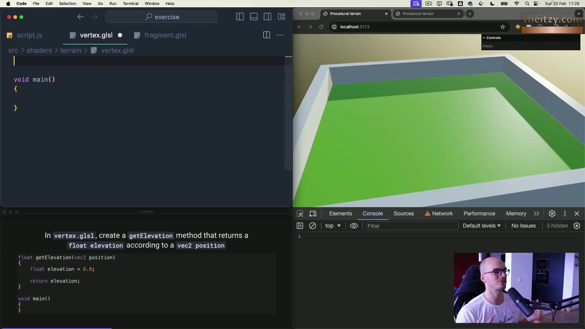
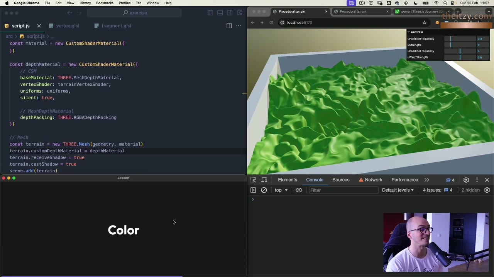

# 第 30 章 程序化地形着色器

本章将平面几何体转变为包含山脉、水域、沙滩和平原的逼真地形。我们将使用单纯形噪声生成高程、分形叠加增添细节、颜色分区识别不同地貌，配合定制法线计算与动态时间变化，实现完整的程序化地形着色系统。

## 起始项目与目标

起始项目已包含现代 WebGL 开发的基础配置：支持 GLSL 文件的 vite-plugin-glsl、操纵相机的 OrbitControls、用于材质增强的 three-custom-shader-material，以及作为 PBR 材质基础的 MeshStandardMaterial。地形的创建分为几个逻辑步骤：先构建展示地形边界的外框，再将平面几何体高程化，最后附着分层颜色。

### 边界框的布尔运算构建

直接在一个完整的几何体中挖孔较为困难，而 three-bvh-csg 库提供了简单几何体间的布尔运算能力。安装该库并创建两个 Brush（基座与切割体），通过相减操作形成中空边界框：

```javascript
import { SUBTRACTION, Evaluator, Brush } from 'three-bvh-csg'

// 基座尺寸 11×2×11，切割体尺寸 10×2.1×10
const boardFill = new Brush(new THREE.BoxGeometry(11, 2, 11))
const boardHole = new Brush(new THREE.BoxGeometry(10, 2.1, 10))

const evaluator = new Evaluator()
const board = evaluator.evaluate(boardFill, boardHole, SUBTRACTION)
board.geometry.clearGroups()
board.material = new THREE.MeshStandardMaterial({
    color: '#ffffff', metalness: 0, roughness: 0.3
})
board.castShadow = true
board.receiveShadow = true
scene.add(board)
```

清理几何体分组是为了防止后台上方残留材质信息，确保边界框正确投射和接受阴影。

## 地形几何体与基础着色器

移除占位球体，改用高度细分的 PlaneGeometry 作为地形基底。旋转几何体使其平面朝上，便于后续基于 XY 平面计算高程：

```javascript
const geometry = new THREE.PlaneGeometry(10, 10, 500, 500)
geometry.rotateX(-Math.PI * 0.5)
geometry.deleteAttribute('uv')
geometry.deleteAttribute('normal')
```

建立 CustomShaderMaterial 作为地形材质，分别配置常规渲染与深度渲染两种模式：

```javascript
import CustomShaderMaterial from 'three-custom-shader-material/vanilla'

const uniforms = {
    uTime: new THREE.Uniform(0),
    uPositionFrequency: new THREE.Uniform(0.2),
    uStrength: new THREE.Uniform(2.0),
    uWarpFrequency: new THREE.Uniform(5),
    uWarpStrength: new THREE.Uniform(0.5)
}

const material = new CustomShaderMaterial({
    baseMaterial: THREE.MeshStandardMaterial,
    vertexShader: terrainVertexShader,
    fragmentShader: terrainFragmentShader,
    uniforms: uniforms,
    silent: true,
    metalness: 0,
    roughness: 0.5,
    color: '#85d534'
})

const depthMaterial = new CustomShaderMaterial({
    baseMaterial: THREE.MeshDepthMaterial,
    vertexShader: terrainVertexShader,
    uniforms: uniforms,
    silent: true,
    depthPacking: THREE.RGBADepthPacking
})

const terrain = new THREE.Mesh(geometry, material)
terrain.customDepthMaterial = depthMaterial
terrain.receiveShadow = true
terrain.castShadow = true
scene.add(terrain)
```

顶点着色器从外部文件引入单纯形噪声函数 `simplexNoise2d`，片段着色器则专注于颜色组合，暂未填充逻辑。

### 顶点着色器高程计算

地形由平面 Y 方向的程序化位移产生。顶点着色器中创建 `getElevation` 函数，输入平面位置 `vec2`（对应世界坐标的 XZ 轴），返回起伏高度：

```glsl
#include ../includes/simplexNoise2d.glsl

float getElevation(vec2 position) {
    float elevation = 0.0;
    elevation += simplexNoise2d(position);
    return elevation;
}
```

主函数直接对当前顶点的 y 分量累加高程计算，结果反馈到 `csm_Position`：

```glsl
void main() {
    float elevation = getElevation(csm_Position.xz);
    csm_Position.y += elevation;
}
```



*图 30-1 带凹槽的边界框和平坦地形基准*

## 顶点法线恢复

修改顶点位置后，几何体自带法线不再适用，光照效果将严重失真。采用经典的邻域法重新计算法线：

1. 选定当前顶点 `csm_Position`
2. 在其正 X 方向和负 Z 方向偏移固定距离 `shift` 获得邻居坐标 `positionA` 和 `positionB`
3. 分别对邻居位置进行高程计算，更新其 Y 坐标
4. 分别计算当前顶点指向两个邻居的向量 `toA = positionA - csm_Position` 和 `toB = positionB - csm_Position`，再归一化
5. 两向量的叉积即为新法线

```glsl
void main() {
    float shift = 0.01;
    vec3 positionA = csm_Position.xyz + vec3(shift, 0.0, 0.0);
    vec3 positionB = csm_Position.xyz + vec3(0.0, 0.0, -shift);

    float elevation = getElevation(csm_Position.xz);
    csm_Position.y += elevation;
    positionA.y    += getElevation(positionA.xz);
    positionB.y    += getElevation(positionB.xz);

    vec3 toA = normalize(positionA - csm_Position);
    vec3 toB = normalize(positionB - csm_Position);
    csm_Normal = cross(toA, toB);
}
```

负 Z 方向选择保证法线朝上而非朝下，是保证正确光照的关键细节。

## 单层到多层噪声叠加

自然地形具有多尺度特征。为模拟这种特性，可将单一单纯形噪声扩展为多频叠加：

```glsl
float getElevation(vec2 position) {
    float uPositionFrequency = 0.2;

    float elevation = 0.0;
    elevation += simplexNoise2d(position * uPositionFrequency) / 2.0;
    elevation += simplexNoise2d(position * uPositionFrequency * 2.0) / 4.0;
    elevation += simplexNoise2d(position * uPositionFrequency * 4.0) / 8.0;

    return elevation;
}
```

频率依次倍增（0.2→0.4→0.8），振幅则减半（0.5→0.25→0.125）。高频噪声对应细节特征，低频噪声决定宏观轮廓。

随后施加一个平方运算强化平原地形，同时保留凹陷区负值：

```glsl
float getElevation(vec2 position) {
    // ... 噪声叠加

    float elevationSign = sign(elevation);
    elevation = pow(abs(elevation), 2.0) * elevationSign;

    return elevation;
}
```

`sign()` 提取原值符号，`abs()` 确保 `pow()` 处理正值，最终结果乘回原符号，完整保留正负起伏结构。

强度系数 `uStrength` 整体缩放地形幅度：

```glsl
float getElevation(vec2 position) {
    // ... 前期计算
    elevation *= uStrength;
    return elevation;
}
```

## 噪声扭曲与动态地形

在噪声叠加前对输入位置进行额外的噪声扭曲，可模拟流水侵蚀、风蚀等自然作用：

```glsl
float getElevation(vec2 position) {
    float uPositionFrequency = 0.2;
    float uWarpFrequency = 5.0;
    float uWarpStrength = 0.5;

    vec2 warpedPosition = position;
    warpedPosition += simplexNoise2d(
        warpedPosition * uPositionFrequency * uWarpFrequency
    ) * uWarpStrength;

    // 后续使用 warpedPosition 而非原 position 进行噪声采样...
}
```

结合 `uTime` 实现缓变动画，让地形“活”起来：

```glsl
float getElevation(vec2 position) {
    vec2 warpedPosition = position;
    warpedPosition += uTime * 0.2;  // 缓慢流动

    // ... 扭曲处理
    // ... 噪声叠加
}
```

## 从变量到 Uniform

将着色器内硬编码的值移至 Uniform，在 JavaScript 中集中管理并与调试面板绑定：

```javascript
const uniforms = {
    uTime: new THREE.Uniform(0),
    uPositionFrequency: new THREE.Uniform(0.2),
    uStrength: new THREE.Uniform(2.0),
    uWarpFrequency: new THREE.Uniform(5),
    uWarpStrength: new THREE.Uniform(0.5)
}

gui.add(uniforms.uPositionFrequency, 'value', 0, 1, 0.001).name('位置频率')
gui.add(uniforms.uStrength, 'value', 0, 10, 0.001).name('强度')
gui.add(uniforms.uWarpFrequency, 'value', 0, 10, 0.001).name('扭曲频率')
gui.add(uniforms.uWarpStrength, 'value', 0, 1, 0.001).name('扭曲强度')
```

着色器内相应改为：

```glsl
uniform float uPositionFrequency;
uniform float uStrength;
uniform float uWarpFrequency;
uniform float uWarpStrength;
uniform float uTime;
```

## 颜色分区与自然过渡

根据地貌特征设计六层颜色，自下而上分别为：深海、浅水、沙滩、草地、岩石、雪山。片段着色器通过高度阈值混合各层：

```javascript
// 颜色预设
debugObject.colorWaterDeep = '#002b3d'
debugObject.colorWaterSurface = '#66a8ff'
debugObject.colorSand = '#ffe894'
debugObject.colorGrass = '#85d534'
debugObject.colorSnow = '#ffffff'
debugObject.colorRock = '#bfbd8d'

// Uniform 绑定
const uniforms = {
    // ... 已有 Uniforms
    uColorWaterDeep: new THREE.Uniform(new THREE.Color('#002b3d')),
    uColorWaterSurface: new THREE.Uniform(new THREE.Color('#66a8ff')),
    uColorSand: new THREE.Uniform(new THREE.Color('#ffe894')),
    uColorGrass: new THREE.Uniform(new THREE.Color('#85d534')),
    uColorSnow: new THREE.Uniform(new THREE.Color('#ffffff')),
    uColorRock: new THREE.Uniform(new THREE.Color('#bfbd8d'))
}
```

顶点着色器传递位置信息到片段着色器：

```glsl
varying vec3 vPosition;
varying float vUpDot;

void main() {
    // ... 已有计算
    vUpDot = dot(csm_Normal, vec3(0.0, 1.0, 0.0));
    vPosition = csm_Position;
    vPosition.xz += uTime * 0.2;
}
```

片段着色器逐步混合各层，并保证流水侵蚀效果与时间同步：

```glsl
#include ../includes/simplexNoise2d.glsl

uniform vec3 uColorWaterDeep;
uniform vec3 uColorWaterSurface;
uniform vec3 uColorSand;
uniform vec3 uColorGrass;
uniform vec3 uColorSnow;
uniform vec3 uColorRock;

varying vec3 vPosition;
varying float vUpDot;

void main() {
    // 深海→浅水渐变
    float surfaceWaterMix = smoothstep(-1.0, -0.1, vPosition.y);
    vec3 color = mix(uColorWaterDeep, uColorWaterSurface, surfaceWaterMix);

    // 水面→沙滩硬切
    float sandMix = step(-0.1, vPosition.y);
    color = mix(color, uColorSand, sandMix);

    // 沙滩→草地硬切
    float grassMix = step(-0.06, vPosition.y);
    color = mix(color, uColorGrass, grassMix);

    // 岩石（计算陡峭表面）
    float upDot = vUpDot;
    float rockMix = 1.0 - step(0.8, upDot);
    rockMix *= step(-0.06, vPosition.y);  // 不覆盖水面
    color = mix(color, uColorRock, rockMix);

    // 雪山添加噪声自然化边界
    float snowThreshold = 0.45;
    snowThreshold += simplexNoise2d(vPosition.xz * 15.0) * 0.1;
    float snowMix = step(snowThreshold, vPosition.y);
    color = mix(color, uColorSnow, snowMix);

    csm_DiffuseColor = vec4(color, 1.0);
}
```



*图 30-2 地貌颜色分区生成的地形*

## 水表面效果

地面阴影、环境反射和波光效果由单独的水面平面承担。使用 `MeshPhysicalMaterial` 的 `transmission` 透光属性实现自然折射：

```javascript
const water = new THREE.Mesh(
    new THREE.PlaneGeometry(10, 10, 1, 1),
    new THREE.MeshPhysicalMaterial({
        transmission: 1,
        roughness: 0.3
    })
)
water.rotation.x = -Math.PI * 0.5
water.position.y = -0.1  // 配合着色器水面阈值
scene.add(water)
```

## 实时调节与优化

所有参数通过 lil-gui 面板统一控制：

```javascript
gui.addColor(debugObject, 'colorWaterDeep')
    .onChange(() => uniforms.uColorWaterDeep.value.set(debugObject.colorWaterDeep))
gui.addColor(debugObject, 'colorWaterSurface')
    .onChange(() => uniforms.uColorWaterSurface.value.set(debugObject.colorWaterSurface))
gui.addColor(debugObject, 'colorSand')
    .onChange(() => uniforms.uColorSand.value.set(debugObject.colorSand))
gui.addColor(debugObject, 'colorGrass')
    .onChange(() => uniforms.uColorGrass.value.set(debugObject.colorGrass))
gui.addColor(debugObject, 'colorSnow')
    .onChange(() => uniforms.uColorSnow.value.set(debugObject.colorSnow))
gui.addColor(debugObject, 'colorRock')
    .onChange(() => uniforms.uColorRock.value.set(debugObject.colorRock))
```

性能注意点：
- 顶点着色器内多次调用 `simplexNoise2d`，需控制频率和层数
- 地形几何顶点数控制在合理范围，五百万顶点适合演示，生产环境可考虑 LOD 或分块加载
- 阴影渲染需要自定义 DepthMaterial

## 本章小结

本章综合运用多种图形学技术创造程序化地形，核心知识要点：

**几何操作与布尔运算**：借助 `three-bvh-csg` 库通过简单几何体的合集求出复杂形状，创建带凹槽的展示框。

**顶点着色器高程映射**：编写 `getElevation` 函数，根据平面位置返回高度值，核心机制为单纯形噪声叠加与分形合成。

**动态法线计算**：顶点位置变更后必须重新计算法线，邻域法选取相邻顶点差分构建空间向量，叉积产生新法线。

**多频噪声组合**：通过频率倍增（×2）、振幅衰减（÷2）制造宏观与微观地形特征，平方运算突出平原区域。

**地形着色分层**：依据海拔高度与表面倾角设定颜色分层阈值。深海至浅水区域使用 `smoothstep` 制造平滑过渡，沙滩、草地、雪山则用 `step` 产生明显界限。岩石仅出现在陡峭坡面并与雪山界面随机化。

**水面折射模拟**：单独添加 `MeshPhysicalMaterial` 平面并开启 `transmission` 属性，位置细心地与着色器参数匹配。

本章教学为现代 WebGL 着色器开发的典型案例，将曲面生成、光影计算、材质定制和调试流程有机结合。演示系统开放全部参数调整并内置实时反馈，既能帮助理解各部件工作原理，又为功能扩展打下基础。读者可在此基础上添加纹理贴图、大气散射、植被系统、动态天气等进阶特征。