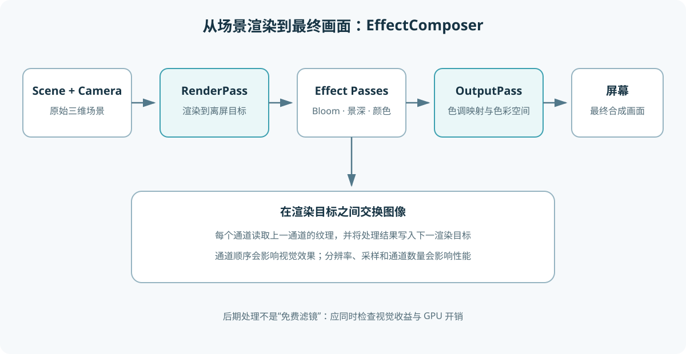
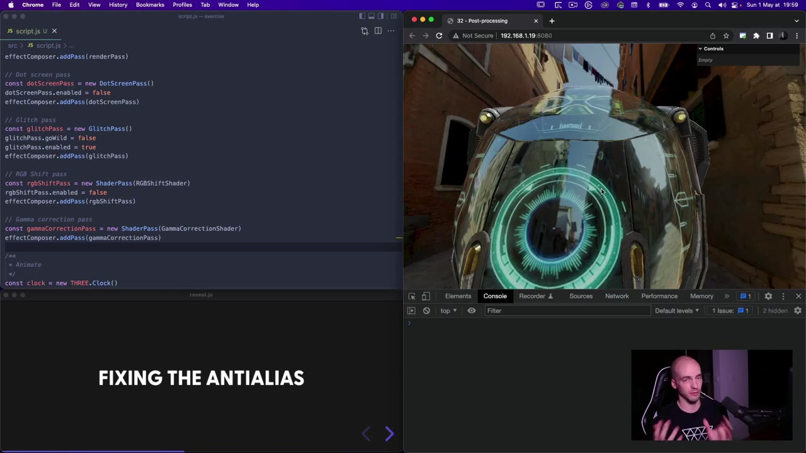
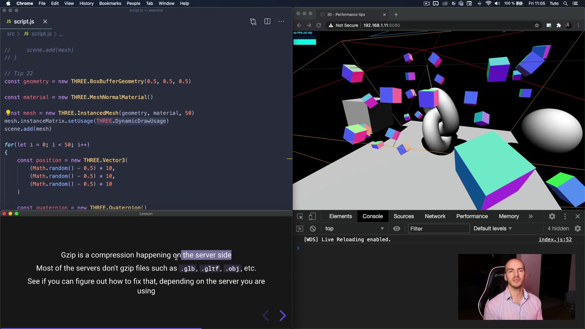

# 第 31 章 后期处理与性能优化

后期处理能够在最终渲染的图像上添加各种视觉效果，这在电影制作中极为常见，但也可以通过 WebGL 技术在网页中实现。无论是为场景增添景深模糊、光晕、运动模糊、故障效果，还是改善色彩风格与抗锯齿，后期处理都能显著提升视觉质量。然而，每个效果的背后都伴随着性能开销。本章将系统介绍 Three.js 后期处理链的实现方式，涵盖 EffectComposer、常见效果Pass、自定义Pass、色彩校正和抗锯齿处理，同时深入讲解如何监控和优化渲染性能，帮助开发者在视觉质量与运行效率间找到最佳平衡点。

## 后期处理的基本原理

后期处理的核心是在最终图像输出前对其施加额外处理。多数情况下，其工作机制遵循相同模式：

### 渲染目标

不同于直接在画布上渲染，后期处理先将场景渲染到一个被称为**渲染目标**的特殊纹理中。Three.js 中的渲染目标相当于其他图形编程上下文中的“缓冲区”。这张纹理随后会被应用到覆盖整个视图的正对相机的平面上，该平面使用具有特殊片段着色器的材质来实现后期处理效果。

### Ping-pong 缓冲

当需要多个Pass效果叠加时（如先实现运动模糊，再调整色彩，最后处理景深），后期处理系统需要两个渲染目标。原因是不能同时从正在绘制的渲染目标中读取纹理。解决方案是：在第一个渲染目标上绘制时读取第二个的纹理；下一个Pass切换这两个渲染目标，从第二个读取纹理并在第一个上绘制；如此反复交替，形成**Ping-pong 缓冲**机制。

### 最终输出到画布

最后一个Pass无需渲染到目标，可直接输出到画布供用户查看最终结果。

Three.js 提供了 [EffectComposer](https://threejs.org/docs/#examples/en/postprocessing/EffectComposer) 类，它封装了创建渲染目标、处理Ping-pong缓冲、在Pass间传递纹理、以及将最终结果绘制到画布等复杂逻辑，极大简化了后期处理的实现复杂度。



*图 31-1 场景经 RenderPass、效果通道和输出阶段传递的基本流程*

## 使用 EffectComposer

要使用后期处理，首先需要导入 EffectComposer 及其基础Pass：

```javascript
import { EffectComposer } from 'three/examples/jsm/postprocessing/EffectComposer.js'
import { RenderPass } from 'three/examples/jsm/postprocessing/RenderPass.js'
```

`RenderPass` 负责将场景首次渲染到 EffectComposer 创建的渲染目标中。实例化时需要传入场景和相机：

```javascript
const effectComposer = new EffectComposer(renderer)
effectComposer.setSize(sizes.width, sizes.height)
effectComposer.setPixelRatio(Math.min(window.devicePixelRatio, 2))

const renderPass = new RenderPass(scene, camera)
effectComposer.addPass(renderPass)
```

随后在动画循环中，用 `effectComposer.render()` 替代原有的 `renderer.render(scene, camera)` 调用：

```javascript
const tick = () => {
    // 更新逻辑...

    // 原渲染方式：renderer.render(scene, camera)
    effectComposer.render()

    // 继续循环...
}
```

此时若只包含 `renderPass`，渲染结果与直接输出到画布无异。添加更多Pass后，EffectComposer 便会启动Ping-pong缓冲机制。

## 常见后期处理效果

Three.js 提供了丰富的预置效果Pass，涵盖了多种常见的后期处理需求。用户可以在[官方文档](https://threejs.org/docs/#examples/en/postprocessing/EffectComposer)查看完整列表。

### DotScreenPass

`DotScreenPass` 施加黑白网点效果，类似印刷品的半调网屏：

```javascript
import { DotScreenPass } from 'three/examples/jsm/postprocessing/DotScreenPass.js'

const dotScreenPass = new DotScreenPass()
effectComposer.addPass(dotScreenPass)
```

可以通过 `enabled` 属性开关效果：

```javascript
const dotScreenPass = new DotScreenPass()
dotScreenPass.enabled = false  // 禁用以测试其他Pass
effectComposer.addPass(dotScreenPass)
```



*图 31-2 DotScreenPass 实现的黑白网点效果*

### GlitchPass

`GlitchPass` 模拟信号干扰故障效果，适合营造科技感或故障艺术：

```javascript
import { GlitchPass } from 'three/examples/jsm/postprocessing/GlitchPass.js'

const glitchPass = new GlitchPass()
effectComposer.addPass(glitchPass)
```

`GlitchPass` 提供 `goWild` 属性，设为 `true` 将产生持续不断的干扰效果。需注意，闪烁和快速变化可能对部分用户造成不适：

```javascript
glitchPass.goWild = true
```

### RGBShift 效果

RGB 偏移效果需要组合使用 `ShaderPass` 和 `RGBShiftShader`：

```javascript
import { ShaderPass } from 'three/examples/jsm/postprocessing/ShaderPass.js'
import { RGBShiftShader } from 'three/examples/jsm/shaders/RGBShiftShader.js'

const rgbShiftPass = new ShaderPass(RGBShiftShader)
effectComposer.addPass(rgbShiftPass)
```

此效果将红、绿、蓝通道略微错位，产生色彩分离的视觉效果。

### UnrealBloomPass

`UnrealBloomPass` 添加泛光效果，可用于模拟光晕、火焰热浪、激光、光剑或放射性物质的发光现象：

```javascript
import { UnrealBloomPass } from 'three/examples/jsm/postprocessing/UnrealBloomPass.js'

const unrealBloomPass = new UnrealBloomPass()
effectComposer.addPass(unrealBloomPass)
```

未调整参数时泛光可能过于强烈，需调节三个核心属性：
- `strength`：发光强度
- `radius`：发光扩散范围
- `threshold`：启动发光的最低亮度阈值

建议初始配置并添加到调试面板：

```javascript
unrealBloomPass.strength = 0.3
unrealBloomPass.radius = 1
unrealBloomPass.threshold = 0.6

gui.add(unrealBloomPass, 'enabled')
gui.add(unrealBloomPass, 'strength').min(0).max(2).step(0.001)
gui.add(unrealBloomPass, 'radius').min(0).max(2).step(0.001)
gui.add(unrealBloomPass, 'threshold').min(0).max(1).step(0.001)
```

## 色彩校正

启用后期处理后，可能发现色彩变暗，这是因为 `renderer.colorSpace = THREE.SRGBColorSpace` 在渲染目标中不再生效。需要添加 `GammaCorrectionShader` 修复色彩空间：

```javascript
import { GammaCorrectionShader } from 'three/examples/jsm/shaders/GammaCorrectionShader.js'

const gammaCorrectionPass = new ShaderPass(GammaCorrectionShader)
effectComposer.addPass(gammaCorrectionPass)  // 应置于最后（抗锯齿之前）
```

该Pass将线性色彩空间转换为 sRGB，确保显示色彩准确。更多关于Gamma校正的技术细节，可参考《What Every Coder Should Know About Gamma》一文。

在较新的 Three.js 版本中，通常也可以使用 `OutputPass` 统一处理输出色调映射和色彩空间，而不是单独添加 `GammaCorrectionShader`。两种写法不应机械叠加，输出阶段及抗锯齿Pass的顺序应以项目所用版本的文档为准。

## 抗锯齿处理

后期处理链会关闭默认的抗锯齿功能，因为 EffectComposer 的渲染目标默认不支持多重采样抗锯齿（MSAA）。此时用户有几种选择：

### 为渲染目标添加多重采样

可创建具有 `samples` 属性的自定义 `WebGLRenderTarget` 并传递给 EffectComposer：

```javascript
const renderTarget = new THREE.WebGLRenderTarget(
    800,  // 宽度（后续会被resize覆盖）
    600,  // 高度
    {
        samples: renderer.getPixelRatio() === 1 ? 2 : 0
    }
)

const effectComposer = new EffectComposer(renderer, renderTarget)
```

`renderer.getPixelRatio() === 1 ? 2 : 0` 表示：像素比为 1 时启用 2 次采样抗锯齿，像素比更高时则依赖高分辨率本身的抗锯齿效果。采样值越高，抗锯齿质量越好，但性能消耗越大。

需要注意的是，多重采样在某些浏览器的 WebGL1 环境下可能不被支持。

### 使用抗锯齿Pass

当多重采样不可用时，可选择多种后处理抗锯齿算法：
- **FXAA**：性能优秀，但效果一般且可能模糊
- **SMAA**：质量通常优于 FXAA 但性能稍差
- **SSAA**：最高质量，但性能开销最大
- **TAA**：性能良好但效果有限

以 SMAA 为例：

```javascript
import { SMAAPass } from 'three/examples/jsm/postprocessing/SMAAPass.js'

const smaaPass = new SMAAPass()
effectComposer.addPass(smaaPass)  // 置于 gammaCorrectionPass 之后
```

### 智能组合方案

最佳方案是检测浏览器支持情况：仅当像素比为 1 且不支持 WebGL2（即无硬件多重采样）时启用 SMAA：

```javascript
if (renderer.getPixelRatio() === 1 && !renderer.capabilities.isWebGL2) {
    const smaaPass = new SMAAPass()
    effectComposer.addPass(smaaPass)
    console.log('使用 SMAA 抗锯齿')
}
```

这样既保证了兼容性，又为不同硬件提供了最佳方案。

## 窗口尺寸调整与像素比

与 `WebGLRenderer` 类似，`EffectComposer` 也需要响应窗口变化：

```javascript
window.addEventListener('resize', () => {
    // 更新相机、渲染器等...

    // 更新 effect composer
    effectComposer.setSize(sizes.width, sizes.height)
    effectComposer.setPixelRatio(Math.min(window.devicePixelRatio, 2))
})
```

## 创建自定义Pass

实现自定义后期处理Pass本质上是编写着色器。每个Pass包含三个部分：
- `uniforms`：与之前一致的 uniform 定义格式
- `vertexShader`：通常采用固定代码将平面置于视图前
- `fragmentShader`：实现具体效果的片段着色器

### 基础色相Pass示例

创建一个简单的颜色调谐器Pass：

```javascript
const TintShader = {
    uniforms: {
        tDiffuse: { value: null },  // 前一个Pass的纹理
        uTint: { value: new THREE.Color(0x00ff00) }  // 调谐色
    },
    vertexShader: `
        void main() {
            gl_Position = projectionMatrix * modelViewMatrix * vec4(position, 1.0);
        }
    `,
    fragmentShader: `
        uniform sampler2D tDiffuse;
        uniform vec3 uTint;

        varying vec2 vUv;

        void main() {
            vec4 color = texture2D(tDiffuse, vUv);
            color.rgb += uTint * 0.1;
            gl_FragColor = color;
        }
    `
}

const tintPass = new ShaderPass(TintShader)
tintPass.uniforms['uTint'].value.set(0xff0000)  // 设为红色调谐
effectComposer.addPass(tintPass)
```

`tDiffuse` uniform 由 EffectComposer 自动填充为前一个Pass的输出纹理。通过添加 uniform 参数，可在运行时动态调整Pass效果。

自定义Pass的着色器可使用已有GLSL功能，实现复杂的效果层叠、屏幕空间计算等高级后期处理。



*图 31-3 自定义着色器Pass实现的色彩调谐效果*

## 性能监控与诊断

实现华丽效果的同时必须监控性能表现。WebGL应用应至少达到 60fps，某些高配置设备甚至需要更高帧率。性能瓶颈主要来自 CPU 和 GPU 两方面。

### 帧率监控

Chrome的FPS监控功能已移除，可使用 [stats.js](https://github.com/mrdoob/stats.js/) 库进行帧率统计：

```javascript
import Stats from 'stats.js'

const stats = new Stats()
stats.showPanel(0)  // 0: fps, 1: ms, 2: mb
document.body.appendChild(stats.dom)

const tick = () => {
    stats.begin()
    // 更新和渲染逻辑...
    stats.end()
}
```

### 解除浏览器帧率限制

开发环境下，可解除Chrome的帧率限制以更准确评估性能上限。正常配置的电脑应能维持 150-200fps，若仅达到 60fps（显示器的刷新率），可能在性能较差的设备上会跌破 60fps。

具体方法：
1. 完全关闭Chrome
2. 运行特定命令行参数（不同平台有不同命令）
3. 测试应用观察解锁后的实际帧率

需注意，高负载可能引发浏览器崩溃。

### 绘制调用监控

**绘制调用**是GPU绘制三角形的指令次数。场景越复杂，绘制调用越多。通常应尽量减少绘制调用。

可使用 Chrome 扩展 [Spector.js](https://chrome.google.com/webstore/detail/spectorjs/denbgaamihkadbghdceggmchnflmhpmk) 分析单个帧的绘制细节：
- 点击扩展图标激活
- 点击红色圆形按钮记录帧
- 分析"Commands"选项卡中的绘制调用（蓝色步骤）

### 渲染器信息

`renderer.info` 对象提供了详尽的性能统计信息：

```javascript
console.log(renderer.info)
```

包含渲染调用次数、面数、顶点数、纹理和几何体数量等关键指标。

## 性能优化指南

以下是经过验证的性能优化技巧，分为不同类别。

### 通用优化

1. **高效的JavaScript代码**：特别是 `tick` 函数中的代码，每帧都会执行，应保持最高效率。

2. **及时销毁资源**：不再需要的几何体、材质、纹理等应调用相应的 `dispose()` 方法：

   ```javascript
   scene.remove(mesh)
   mesh.geometry.dispose()
   mesh.material.dispose()
   ```

### 光照优化

3. **精简光照**：Three.js 光照计算消耗大。尽可能减少灯光数量，优先使用 `AmbientLight` 或 `DirectionalLight` 等轻量级光源。

4. **避免动态增减灯光**：添加或移除灯光会触发所有支持光照的材质重新编译，导致卡顿。应预先设置好所有灯光。

### 阴影优化

5. **慎用阴影**：阴影计算开销巨大。考虑使用烘焙阴影（纹理中的静态阴影）作为替代。

6. **优化阴影贴图**：当必须使用阴影时：
   - 使用 `CameraHelper` 可视化阴影相机范围，缩小至最小必要区域
   - 选择合适的 `mapSize`（如 1024×1024 而非默认 512×512）

   ```javascript
   directionalLight.shadow.camera.top = 3
   directionalLight.shadow.camera.right = 6
   directionalLight.shadow.camera.left = -6
   directionalLight.shadow.camera.bottom = -3
   directionalLight.shadow.camera.far = 10

   directionalLight.shadow.mapSize.set(1024, 1024)
   ```

7. **精准控制阴影投射与接收**：仅对必要的对象启用 `castShadow` 和 `receiveShadow`：

   ```javascript
   cube.castShadow = true
   cube.receiveShadow = false
   floor.castShadow = false
   floor.receiveShadow = true
   ```

8. **禁用阴影自动更新**：阴影贴图默认每帧更新，可关闭自动更新，仅在需要时手动标记：

   ```javascript
   renderer.shadowMap.autoUpdate = false
   renderer.shadowMap.needsUpdate = true  // 仅当阴影改变时调用
   ```

### 纹理优化

9. **压缩纹理分辨率**：纹理占用大量GPU内存（mipmap进一步增加开销）。在确保质量的前提下尽可能降低分辨率。

10. **使用2的幂次尺寸**：非2的幂次纹理需要运行时转换，影响性能和质量。保持宽度和高度均为2的幂次（不必是正方形）。

11. **选择合适的格式**：根据需求选择 JPG、PNG 或 Basis 格式：
    - JPG：适合无透明通道的图像，压缩率高
    - PNG：支持透明通道，无损压缩
    - Basis：超压缩格式，GPU读取效率高（但生成工具有门槛）

   使用 TinyPNG 等工具进一步压缩，或尝试 Basis 格式的高效压缩。

### 几何体优化

12. **确保使用 BufferGeometry**：Three.js r125+ 版本已全部采用 BufferGeometry。如果使用旧版本，务必避免非缓冲几何体。

13. **避免逐帧更新顶点**：在动画循环中更新顶点数据性能极差。应在初始化时完成，或使用顶点着色器实现顶点动画。

14. **几何体复用**：多个形状相同的 Mesh 应共享同一个几何体实例：

   ```javascript
   const geometry = new THREE.BoxGeometry(0.5, 0.5, 0.5)

   for(let i = 0; i < 50; i++) {
       const mesh = new THREE.Mesh(geometry, new THREE.MeshNormalMaterial())
       // 设置位置、旋转、缩放...
       scene.add(mesh)
   }
   ```

15. **几何体合并**：对于不移动的静态对象，可使用 `BufferGeometryUtils.mergeBufferGeometries()` 合并为一个几何体，大幅减少绘制调用：

   ```javascript
   import * as BufferGeometryUtils from 'three/examples/jsm/utils/BufferGeometryUtils.js'

   const geometries = []
   for(let i = 0; i < 50; i++) {
       const geometry = new THREE.BoxGeometry(0.5, 0.5, 0.5)
       // 平移、旋转几何体而非Mesh...
       geometries.push(geometry)
   }

   const mergedGeometry = BufferGeometryUtils.mergeBufferGeometries(geometries)
   const mesh = new THREE.Mesh(mergedGeometry, new THREE.MeshNormalMaterial())
   scene.add(mesh)
   ```

### 材质优化

16. **材质复用**：类似几何体，应尽量重用材质实例。

17. **合并材质**：通过 texture atlas（纹理集）合并多个材质为一张大纹理，减少材质切换。

18. **精简材质特性**：禁用不需要的特性，如关闭透明、减少光照计算类型等。

19. **使用标准或物理材质**：`MeshStandardMaterial` 和 `MeshPhysicalMaterial` 性能通常优于自定义着色器材质。

### 相机优化

20. **合理设置视锥体**：通过 `camera.near` 和 `camera.far` 限制渲染范围，剔除不可见物体。

21. **层级剔除**：利用 `THREE.LOD`（细节层级）为远处物体使用简化模型。

### 后期处理优化

22. **按需启用后期处理**：仅在需要时启用特效，避免不必要的计算。

23. **简化特效链**：每个Pass都增加开销，应保持最简特效组合。

24. **降低分辨率**：“脏矩形”技术：可在低分辨率渲染后期处理，再上采样到显示分辨率。

## 本章小结

后期处理与性能优化构成了WebGL应用开发的两个关键技术维度：前者提升视觉表现力，后者保障运行流畅性。

**后期处理技术体系**以 EffectComposer 为核心，通过 RenderPass 与多种效果Pass的组合，为场景添加景深、泛光、色彩校正等视觉效果。其底层机制依赖渲染目标与Ping-pong缓冲实现多Pass处理。实际应用中需注意：
- 为每个效果Pass正确排序
- 通过 GammaCorrectionShader 修复色彩空间
- 根据目标平台选择合适的抗锯齿方案（多重采样或后处理抗锯齿）
- 可创建自定义着色器Pass拓展效果库

**性能优化遵循分层优化原则**：
1. **监控先行**：使用 stats.js、Spector.js 和 renderer.info 建立性能基线
2. **几何体与材质优化**：复用、合并、精简，减少绘制调用与GPU内存占用
3. **光照与阴影控制**：减少动态光源，优化阴影参数，按需更新
4. **纹理管理**：压缩分辨率，格式优化，2的幂次尺寸
5. **后期处理权衡**：效果复杂度与帧率的平衡

两个领域紧密关联：更多后期处理效果意味着更高性能开销，而优化的渲染性能则能为复杂效果提供运行空间。开发实践中应建立持续的性能监控机制，在实现视觉效果目标的同时，确保应用在不同设备上都能维持流畅体验。通过理解渲染管线各阶段的开销特性，结合本章介绍的具体优化技巧，可系统性地提升Three.js应用的整体性能表现。