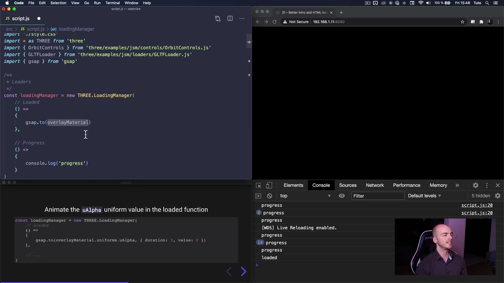
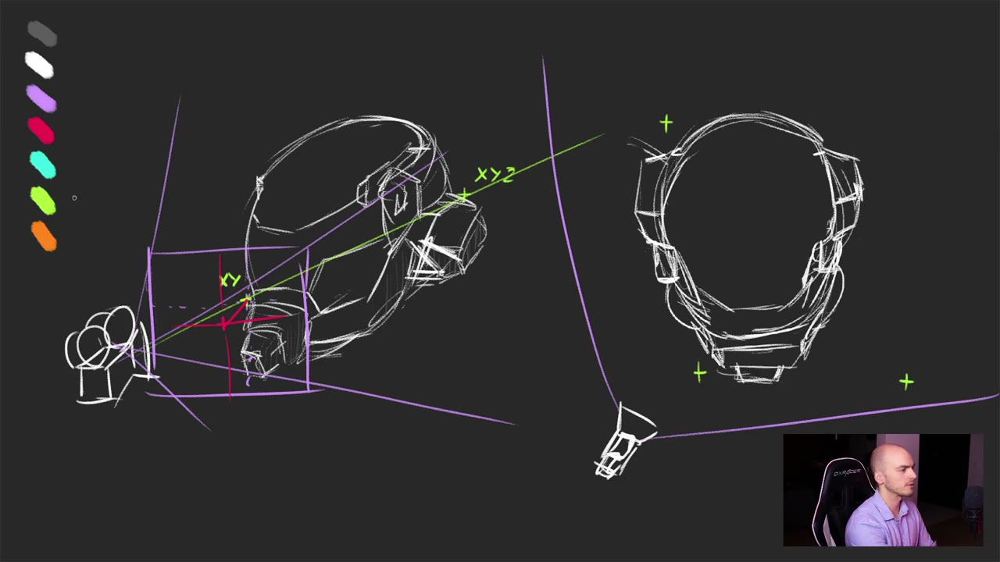

# 第 32 章 加载体验与 HTML/WebGL 融合

本章整合了加载过程管理、场景开场动画以及 HTML 与 WebGL 的交互融合。前半部分讲解如何使用 Three.js 的 LoadingManager 控制资源加载进度，并通过着色器材质实现开场遮罩的渐变消失；后半部分通过添加跟随三维空间坐标的 HTML 交互标签点，展示 HTML/CSS 元素与 WebGL 场景的深度结合方法。

## 资源加载进度管理

在真实的 WebGL 应用中，模型、纹理、环境贴图等资源需要时间下载和解码。Three.js 提供了 LoadingManager 类来统一管理这些异步加载任务，开发者可以注册回调函数来获取加载进度和最终完成通知。

### 创建 LoadingManager

将 GLTFLoader 和 CubeTextureLoader 等加载器配置为使用同一个 LoadingManager，即可在加载进度变化和全部完成时触发对应的回调函数：

```javascript
// 统一加载管理器
const loadingManager = new THREE.LoadingManager(
    // 加载完成回调
    () => {
        console.log('所有资源加载完成')
    },

    // 加载进度回调
    () => {
        console.log('有资源加载完成')
    }
)

// 两个加载器共享同一个管理器
const gltfLoader = new GLTFLoader(loadingManager)
const cubeTextureLoader = new THREE.CubeTextureLoader(loadingManager)
```

进度回调函数有三个参数：当前加载完毕资源的 URL、已加载的资源数量、需要加载的总资源数量。通过这些参数可以计算出当前进度比例，用于驱动进度条动画。

### 在本地测试时的网络节流

开发环境下，本地文件加载速度极快，不易观察加载效果。通过 Chrome 开发者工具的 Network 面板，可以禁用缓存并模拟较慢的网络环境：

1. 打开开发者工具（F12）选择 Network 标签
2. 勾选 `Disable cache` 选项
3. 在在线状态下拉菜单中选择 `Add custom profile`
4. 创建名为 "Pretty fast" 的自定义配置，将下载速度设置为 100000
5. 选择该配置文件后重新加载页面

这样就可以在本地环境中模拟出接近实际网络加载的延迟，以便调试加载进度动画。

## 开场遮罩与渐变过渡

在某些三维场景中，需要让所有内容准备好后再完整展示，避免资源交替加载带来的视觉干扰。常见的实现方式是添加一个覆盖全屏的黑色遮罩，随着资源加载完成而逐渐淡出。

### 使用着色器材质实现全屏遮罩

与其在 DOM 层叠加 HTML 元素，可以改在 WebGL 中绘制一个覆盖全屏的黑色矩形，使遮罩与场景资源、透明度和渲染循环由同一套代码控制。

创建 PlaneGeometry 和 ShaderMaterial 来构造这个遮罩，关键技巧是在顶点着色器中不应用投影和模型视图矩阵，让矩形直接映射到屏幕坐标系：

```javascript
// 2x2 大小的平面几何体，覆盖整个屏幕空间
const overlayGeometry = new THREE.PlaneGeometry(2, 2, 1, 1)

// 自定义着色器材质
const overlayMaterial = new THREE.ShaderMaterial({
    transparent: true,
    uniforms: {
        uAlpha: { value: 1.0 }  // 初始不透明度为 1，完全遮盖
    },
    vertexShader: `
        void main()
        {
            // 不使用任何矩阵变换，直接输出顶点坐标
            gl_Position = vec4(position, 1.0);
        }
    `,
    fragmentShader: `
        uniform float uAlpha;

        void main()
        {
            // 输出黑色，透明度由 uniform 控制
            gl_FragColor = vec4(0.0, 0.0, 0.0, uAlpha);
        }
    `
})

const overlay = new THREE.Mesh(overlayGeometry, overlayMaterial)
scene.add(overlay)
```

在这种设置下，平面几何体的坐标范围为 -1 到 +1，正好对应 WebGL 的标准设备坐标系，确保矩形能够覆盖整个渲染区域。

### 使用 GSAP 实现淡出动画

等待所有资源加载完成后，使用 GSAP 动画库平滑地将 `uAlpha` uniform 从 1 渐变到 0：

```javascript
// 导入 GSAP
import { gsap } from 'gsap'

// 在 LoadingManager 的完成回调中触发动画
const loadingManager = new THREE.LoadingManager(
    // 加载完成回调
    () => {
        // 等待 0.5 秒让进度条完成过渡
        window.setTimeout(() => {
            // 使用 GSAP 动画淡出遮罩
            gsap.to(overlayMaterial.uniforms.uAlpha, {
                duration: 3,
                value: 0,
                delay: 1  // 额外延迟 1 秒
            })
        }, 500)
    },
    // 进度回调
    (itemUrl, itemsLoaded, itemsTotal) => {
        // 进度条更新逻辑...
    }
)
```

这种实现方式相比 CSS 动画更为灵活，可以更精确地控制动画曲线和时序，并能与 Three.js 的渲染循环自然整合。

## HTML 加载进度条

虽然遮罩本身在 WebGL 中实现，但加载进度条更适合用 HTML/CSS 制作，因为这样可以充分利用 CSS 的过渡动画特性，也不必为它增加额外的 WebGL 绘制通道。

### HTML 结构与 CSS 样式

在 canvas 元素后添加一个简单的 div 作为进度条容器：

```html
<canvas class="webgl"></canvas>
<div class="loading-bar"></div>
```

通过 CSS 将其定位到屏幕中心，并通过 transform 的 scaleX 属性控制填充进度：

```css
.loading-bar {
    position: absolute;
    top: 50%;
    width: 100%;
    height: 2px;
    background: #ffffff;
    transform: scaleX(0);  /* 初始宽度为 0 */
    transform-origin: top left;  /* 从左向右扩展 */
    transition: transform 0.5s;  /* 平滑过渡效果 */
}

.loading-bar.ended {
    transform: scaleX(0);
    transform-origin: 100% 0;  /* 结束时从右向左收缩 */
    transition: transform 1.5s ease-in-out;  /* 更平缓的消失动画 */
}
```

### JavaScript 中的进度同步

在加载进度回调中更新进度条的 CSS transform 属性：

```javascript
// 获取 DOM 元素
const loadingBarElement = document.querySelector('.loading-bar')

const loadingManager = new THREE.LoadingManager(
    // 加载完成回调
    () => {
        window.setTimeout(() => {
            // 淡出遮罩
            gsap.to(overlayMaterial.uniforms.uAlpha, {
                duration: 3,
                value: 0,
                delay: 1
            })

            // 触发进度条结束动画
            loadingBarElement.classList.add('ended')
            loadingBarElement.style.transform = ''
        }, 500)
    },

    // 进度回调
    (itemUrl, itemsLoaded, itemsTotal) => {
        // 计算进度比例 (0 到 1)
        const progressRatio = itemsLoaded / itemsTotal

        // 更新进度条宽度
        loadingBarElement.style.transform = `scaleX(${progressRatio})`
    }
)
```

通过计算 `itemsLoaded / itemsTotal` 的比例，我们得到了一个从 0 到 1 的连续进度值，直接对应进度条的视觉填充。



*图 32-1 加载进度条在场景初始阶段的显示效果*

## HTML 标签与三维对象的对齐

加载体验优化后，我们可以进一步探索 HTML 与 WebGL 的深度融合。在许多交互式三维展示中，需要在三维物体表面或周围添加可交互的标签、说明或按钮，这些元素用 HTML/CSS 实现可以充分利用现代浏览器的样式能力和交互特性。

### HTML 标签结构设计

为每个兴趣点创建包含标签和详细说明的结构：

```html
<div class="point point-0">
    <div class="label">1</div>
    <div class="text">这是头盔前部的说明文字，当用户悬停标签时会显示</div>
</div>
```

### CSS 视觉效果与交互反馈

通过 CSS 设计圆形的标签元素和卡片式的文本容器，添加平滑的过渡效果：

```css
.point {
    position: absolute;
    top: 50%;
    left: 50%;
}

.point .label {
    position: absolute;
    top: -20px;
    left: -20px;
    width: 40px;
    height: 40px;
    border-radius: 50%;
    background: #00000077;
    border: 1px solid #ffffff77;
    color: #ffffff;
    font-family: Helvetica, Arial, sans-serif;
    text-align: center;
    line-height: 40px;
    font-weight: 100;
    font-size: 14px;
    cursor: help;  /* 帮助型光标 */
    transform: scale(0, 0);  /* 默认隐藏 */
    transition: transform 0.3s;  /* 缩放动画 */
}

.point.visible .label {
    transform: scale(1, 1);  /* 显示状态 */
}

.point .text {
    position: absolute;
    top: 30px;
    left: -120px;
    width: 200px;
    padding: 20px;
    border-radius: 4px;
    background: #00000077;
    border: 1px solid #ffffff77;
    color: #ffffff;
    line-height: 1.3em;
    font-family: Helvetica, Arial, sans-serif;
    font-weight: 100;
    font-size: 14px;
    opacity: 0;  /* 默认透明 */
    pointer-events: none;  /* 不接收鼠标事件 */
    transition: opacity 0.3s;
}

.point:hover .text {
    opacity: 1;  /* 悬停时显示 */
}
```

CSS 的设计要点包括：
- 使用半透明背景让标签自然地融入三维场景
- 通过 `pointer-events: none` 避免文本区域干扰标签的悬停检测
- 添加合适的过渡效果提升用户体验

### 三维坐标到屏幕坐标的转换

HTML 元素只存在于二维屏幕空间，而我们需要让它们跟随三维空间中的位置。这需要将三维坐标投影到二维屏幕坐标：

```javascript
// 存储所有兴趣点数据
const points = [
    {
        position: new THREE.Vector3(1.55, 0.3, -0.6),  // 三维空间位置
        element: document.querySelector('.point-0')   // 对应的 DOM 元素
    }
    // 可以添加更多点...
]

// 在动画循环中更新每个点的屏幕位置
const tick = () => {
    // 更新相机控制
    controls.update()

    // 只在场景就绪后更新标签位置
    if (sceneReady) {
        for (const point of points) {
            // 克隆位置避免修改原始坐标
            const screenPosition = point.position.clone()

            // 将三维坐标投影到标准设备坐标系 (-1 到 +1)
            screenPosition.project(camera)

            // 转换为像素坐标
            const translateX = screenPosition.x * sizes.width * 0.5
            const translateY = -screenPosition.y * sizes.height * 0.5  // Y 轴方向相反

            // 更新 DOM 元素位置
            point.element.style.transform =
                `translateX(${translateX}px) translateY(${translateY}px)`
        }
    }

    // 继续渲染循环
    requestAnimationFrame(tick)
}
```

转换过程中需要注意坐标系差异：Three.js 的 Y 轴正方向向上，而 CSS 的 translateY 正方向向下，因此需要对 Y 坐标取反。

### 深度检测与可见性管理

当三维物体在标签点前方时，标签应该自动隐藏，避免视觉冲突。这需要使用 Raycaster 进行深度检测：

```javascript
// 创建光线投射器
const raycaster = new THREE.Raycaster()

const tick = () => {
    // ... 其他代码 ...

    if (sceneReady) {
        for (const point of points) {
            const screenPosition = point.position.clone()
            screenPosition.project(camera)

            // 更新点的位置（如前所述）
            const translateX = screenPosition.x * sizes.width * 0.5
            const translateY = -screenPosition.y * sizes.height * 0.5
            point.element.style.transform =
                `translateX(${translateX}px) translateY(${translateY}px)`

            // 从相机向兴趣点发射射线检测遮挡
            raycaster.setFromCamera(screenPosition, camera)
            const intersects = raycaster.intersectObjects(scene.children, true)

            if (intersects.length === 0) {
                // 无遮挡：显示标签
                point.element.classList.add('visible')
            } else {
                // 有遮挡：计算距离比较
                const intersectionDistance = intersects[0].distance
                const pointDistance = point.position.distanceTo(camera.position)

                if (intersectionDistance < pointDistance) {
                    // 遮挡物比标签点更近：隐藏标签
                    point.element.classList.remove('visible')
                } else {
                    // 标签点在遮挡物前方：显示标签
                    point.element.classList.add('visible')
                }
            }
        }
    }

    // ... 其他代码 ...
}
```

这种深度检测逻辑确保了当模型表面在标签点前方时，标签自动隐藏，避免产生不自然的视觉重叠。

### 场景就绪状态控制

为了确保标签点在场景完全加载并开场动画结束后才出现，需要添加场景就绪状态控制：

```javascript
let sceneReady = false

const loadingManager = new THREE.LoadingManager(
    // 加载完成回调
    () => {
        // ... 进度条和遮罩动画 ...

        window.setTimeout(() => {
            sceneReady = true  // 2 秒后标记场景就绪
        }, 2000)
    },
    // ... 进度回调 ...
)

// 在 tick 函数中根据 sceneReady 状态决定是否更新标签点
```



*图 32-2 HTML 标签点跟随三维模型位置变化，当鼠标悬停时显示详细信息*

## 整合设计与性能考量

### 渲染性能优化

尽管 HTML/CSS 元素不消耗 WebGL 渲染资源，但大量频繁更新的元素仍会影响整体性能：

1. **避免频繁的样式更新**：减少在动画循环中对 `style` 属性的直接操作
2. **使用 CSS 变换而非布局属性**：优先使用 `transform` 而非 `top`/`left`
3. **批量更新操作**：尽可能在单次循环中完成所有点的位置计算
4. **适时启用/禁用检测**：当相机静止时可以减少 Raycaster 检测频率

### 跨浏览器兼容性

虽然现代浏览器对 CSS 变换和 Three.js 的支持较好，仍需注意：

1. 标准设备坐标到像素坐标的转换公式在不同渲染环境下保持一致
2. CSS 的 `pointer-events` 属性在某些旧版本浏览器中可能需要前缀
3. 半透明背景的混合效果在不同浏览器中可能有细微差异
4. transform-origin 的百分比计算方式应当测试验证

### 交互体验增强

为了让 HTML 与 WebGL 的融合效果更加自然，可以考虑：

1. 添加标签点的进入/退出动画，而不是简单的显示/隐藏
2. 根据标签点与相机的距离调整标签大小，模拟透视效果
3. 当标签点被其他物体遮挡时添加半透明效果而非完全隐藏
4. 为标签点添加点击事件，触发三维场景中的相应动作
5. 在标签点移动时添加平滑过渡，避免视觉跳跃

## 本章小结

本章系统地介绍了 Three.js 项目中加载体验优化及 HTML 与 WebGL 融合的实现方法：

1. **LoadingManager 的统一管理**：通过共享加载管理器跟踪所有资源的加载进度，提供平滑的加载体验反馈。

2. **开场遮罩的着色器实现**：使用自定义 ShaderMaterial 创建全屏覆盖的渐变遮罩，配合 GSAP 实现优雅的淡出动画，相比 DOM 层叠加具有更好的性能和渲染一致性。

3. **HTML/CSS 进度条**：结合 LoadingManager 的进度回调，动态更新 CSS transform 属性，实现视觉流畅的加载进度指示器。

4. **三维坐标到屏幕坐标的投影**：通过 Vector3 的 `project()` 方法将三维空间位置转换为标准化设备坐标，再结合渲染尺寸计算像素偏移量，实现 HTML 元素对三维位置的精确跟踪。

5. **Raycaster 深度检测**：使用光线投射判断标签点是否被三维物体遮挡，确保 HTML 标签只在可见时显示，避免视觉冲突。

6. **场景就绪状态控制**：通过状态变量协调开场动画与交互元素的启用时机，确保用户在合适的时机看到完整的交互界面。

这些技术的结合为创建专业级的三维 Web 应用提供了完整的交互体验解决方案——既能优雅地处理资源加载过程，又能让传统 Web 技术（HTML/CSS/JavaScript）与现代图形技术（WebGL）无缝协同工作。