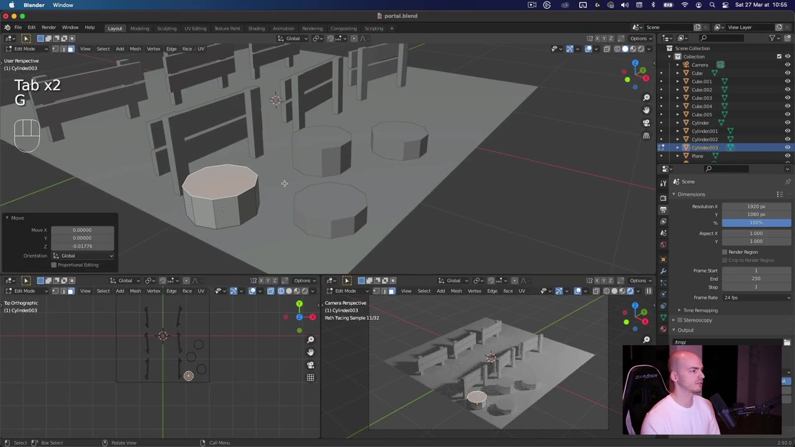
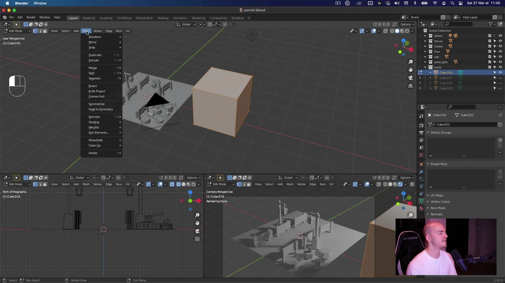

# 第 33 章 在 Blender 中创建场景

本章将带领你完成一个完整的三维场景创建流程，从构思规划到最终为 WebGL 渲染做好准备。我们将创建一个小型景观场景，包含路径、篱笆、树干、岩石和一个魔法传送门。通过学习 Blender 中的建模、布局、材质、灯光设置以及为后续烘焙做准备的各项操作，你将掌握将 DCC 工具制作的内容转化为 Three.js 可交互体验的核心工作流。

## 烘焙技术原理

在三维软件中进行渲染时，通常会比导入 Three.js 后的效果更加精美，无论你如何尝试复现相同的灯光和色彩。这种差异源于渲染时使用的技术原理。

光线追踪通过追踪光路来模拟光照。常见路径追踪会从相机穿过像素生成光线，计算它与几何体的交点，再根据材质继续追踪反射、折射或指向光源的二次光线。多次弹射的信息共同决定像素颜色，因此可以自然表现间接光照、颜色渗透和柔和阴影。

这种技术旨在模拟真实世界中的光照，并实现间接光照和柔和阴影等视觉效果。例如，将红色物体放置在白色物体附近时，你会看到白色物体被染上红色调，因为光线从红色表面反射到了白色表面。同样，靠近白色表面的红色物体部分也会显得更亮。

光线追踪能产生精美逼真的渲染效果，但完成一次渲染可能需要数分钟甚至数小时。交互式 WebGL 应用需要维持较高帧率，因此本课程主要使用光栅化及各类实时近似技术，而不是在每帧执行完整的路径追踪。

烘焙技术的核心理念是：将光线追踪渲染的结果保存为纹理贴图，然后在 WebGL 中使用这些贴图，而不是依赖 Three.js 提供的传统实时渲染技术。这样，我们就能在网格上直接看到光线追踪渲染的效果，并且在场景中移动时保持良好的性能，因为只需在几何体上显示纹理即可。

当然，烘焙技术也有其局限性：
- 需要在三维软件中烘焙所有内容，这是一个漫长的过程
- 需要加载纹理贴图，复杂场景可能需要大量纹理，影响加载性能，并在体验开始时可能出现短暂卡顿
- 光照无法动态调整，不能实时移动灯光或改变其强度和颜色，必须在三维软件中重新烘焙

是否使用烘焙技术取决于具体项目需求。需要注意的是，虽然可以混合使用烘焙和非烘焙材质，但要保持统一的外观效果会比较困难。

## 整体工作流程

要创建烘焙场景，需要经过以下步骤：
1. 在三维软件中创建场景
2. 优化所有对象，确保几何体干净且只保留可见表面
3. 对每个对象进行 UV 展开
4. 将渲染结果烘焙到纹理贴图上
5. 导出场景和纹理（纹理打包方式会影响有效分辨率、UV 空间利用率、文件数量和管理成本）
6. 将所有内容导入 Three.js 并将纹理应用到网格上

作为扩展，我们还可以在 Three.js 中添加一些细节，如萤火虫环绕的传送门效果，让场景更加生动。

## Blender 场景规划

我们将使用 Blender 创建场景、进行烘焙并导出。本章假设你已经掌握 Blender 的基本操作。我们将使用版本 2.92.0，但你可以使用更新的版本，需留意界面和快捷键的潜在变化。

### 初始设置

首先新建一个 Blender 文件。默认设置已包含一盏点光源，参数如下——如果你的参数不同，可能是使用了 Eevee 渲染引擎，我们稍后会进行调整。

*图 33-1 Blender 场景搭建与基础布局*

删除默认立方体等不需要的默认对象，但保留灯光。可以使用 `X` 键删除对象。完成设置后立即保存文件，并在后续操作中定期保存。

## 地板与基础布局

我们从创建地板开始，作为整个场景的基础平面。

使用 `Shift + A` 创建一个平面。将该平面缩放至覆盖 4 个单位的大小——你可以参考场景地板上的网格来判断 4 个单位的范围。这些单位对应 Three.js 中的单位，即使你的 Blender 配置为使用米制（显示为 `4m`），4 单位在 Blender 中仍对应 4 单位在 Three.js 中。

有两种缩放方式：创建时在出现的菜单中直接修改尺寸，或创建后使用 `S` 键进行缩放（可配合 `Ctrl` 键使用整数值）。需要注意的是，在非编辑模式下缩放对象会应用变换到对象本身而非几何体，这可能带来后续问题，不过我们稍后会为所有对象统一解决这个问题。

## 篱笆的创建

作为场景中的第一个对象，篱笆相对简单且能快速为场景增添生气。

我们将创建 2 个细长的立柱（柱子）和 2 个扁平的宽板（横杆）。从创建立方体开始（`Shift + A`），进入编辑模式（`Tab`）并进行缩放。即使初始形状不够精确也不必担心，后续可以随时调整。

在编辑模式下选择立方体，使用 `Shift + D` 复制并移动到另一侧。复制后立即按 `Y` 键可将移动限制在 Y 轴上。再次使用 `Shift + D` 复制，通过 `S` 缩放和 `G` 移动来创建另外两个横杆。

完成所有部件后，可以重新排列整个几何体，并使其原点（橙色小点）大致位于篱笆底部中心位置。满意后按 `Tab` 退出编辑模式。

现在可以在对象模式下使用 `Shift + D` 复制篱笆，创建 6 个篱笆，并为它们的位置和旋转添加一定的随机性，使其看起来更自然。不必在摆放上花费过多时间，等所有对象创建完成后可以统一调整。

## 首次渲染测试

虽然我们的最终目标是将场景导出到 Three.js，但通过 Blender 渲染预览效果仍然很重要，因为烘焙技术应该获得相同的结果。这也是制作精美渲染图的好机会。

### 相机设置

使用 `Shift + A` 创建相机。在其中一个 3D 视口区域悬停并选中相机时，按小键盘 `0` 键可使该视口显示相机视角。从其他 3D 视口选择相机并使用 `G` 键移动，使场景填充视口。

将相机着色模式改为 `Rendered`：按 `Z` 键一次调出着色轮盘并选择。现在你将看到相机视角的最终渲染预览。

默认情况下，Blender 使用 Eevee 渲染引擎。Eevee 类似于 WebGL——速度很快，不使用光线追踪，但效果不如 Cycles 引擎精美。为了获得最佳效果，我们将切换到 Cycles。

在属性区域的渲染属性标签页中，选择 Cycles 作为渲染引擎。相机预览将显示更好的渲染效果。

### 渲染质量与分辨率控制

渲染质量的重要参数是采样率，可以在同一渲染属性标签页的 `Sampling` 部分找到。值越高效果越好，但渲染时间也越长：
- `128` 是适中值，可能看到一些类似视觉噪点的伪影
- `256` 效果更好，噪点不应太明显
- `512` 通常足够获得良好效果
- `1024` 能确保质量，但需要计算机配置足够强大

可以使用诸如 `200` 等中间值，但建议使用 2 的幂次方。目前我们保持渲染采样为 `128`，视口采样为 `32`。

在输出属性标签页中，可以调整输出分辨率。我们将使用经典分辨率 `1920x1080`，缩放保持 `100%`。

### 执行首次渲染

按 `F12` 开始在新窗口中渲染。等待一段时间后，你会看到结果逐块显示。渲染完成后，在渲染窗口仍打开时按 `Alt + S` 保存图像，可选择格式、保存位置和质量参数。

*图 33-2 场景初步渲染效果展示*

## 树干的制作

继续丰富场景，创建一些树干。为了保持低多边形风格，我们将创建只有 10 个侧面的圆柱体。

使用 `Shift + A` 创建圆柱体，在左下角出现的创建菜单中选择 `10` 个顶点。使用 `G` 键将树干移动到靠近相机的一侧，并使用 `S` 键调整大小使其与篱笆比例协调。

使用 `Shift + D` 复制并创建一批高度不同的树干。可以通过移动圆柱体顶部的面或在 Z 轴上缩放来变换几何体形状。确保它们不悬浮在地面上方——这些不是魔法树干。

稍后，我们将在其中一个树干上添加一个卡住的斧头。现在可以先在地面添加一些劈开的木块，展示斧头工作的效果。

再次创建圆柱体，但在创建窗口中选择 `Triangle Fan` 作为 `Cap Fill Type`。切换到线框着色模式，你会看到圆柱体的顶部和底部现在都是三角形。这样就能去掉不需要的部分，最终只保留圆柱体的截面。

选择原木，通过 `Tab` 进入编辑模式，删除不需要的部分，每次选择面后按 `X` 键删除所选面。耐心操作，逐个删除部分，出错时可使用撤销功能。

此时会缺少一些面。在编辑模式下切换到顶点选择模式。选择要创建的面所需的 4 个顶点，然后按 `F` 键基于这 4 个顶点创建新面。对另一侧执行相同操作，得到外观良好的劈开木块。

调整原木大小，退出编辑模式，然后多次复制并将其散布在树干周围的地面上。

## 场景组织与管理

到目前为止，我们创建对象时没有考虑场景结构。像处理其他事物一样，进行一定组织是有益的。

Blender 中有 `集合` 功能，类似于可以放置对象的文件夹。但要注意，它们不像 Three.js 中的组那样可以缩放——这更像是一种组织对象的简便方式。虽然可以使用 Blender 的父子系统进行更传统的分组，但可能会创建复杂的场景图，在后续课程中破坏代码。如果可能，尽量保持场景图扁平。

在 `大纲视图` 区域，你可以看到已有两个集合：`Scene Collection` 是主要的集合，功能有限；`Collection` 是默认集合，所有对象默认添加其中。可以重命名它，也可以使用右侧的复选框停用它——这将在视口和渲染中隐藏对象。

通过点击 `大纲视图` 右上角的 `Filter` 按钮，可以添加更多控制按钮。激活以下按钮后，我们可以使用箭头图标使集合不可选但仍可见。

我们暂不重命名对象，而是创建集合并将对象放入其中。要创建新集合，可以在 `大纲视图` 的空白处右键选择 `新集合` 并输入名称，或选择场景中的对象并按 `M` 键，然后选择 `新集合`（或现有集合）。

可以按照以下方式组织大纲视图，并使 `others` 集合不可选：
- `floor_plane`：地板平面
- `fences`：所有篱笆
- `tree_trunks`：所有树干
- `split_logs`：所有劈开的木块
- `others`：其他暂时不操作的对象（设为不可选）

集合还可用于选择其包含的所有对象。右键点击集合并选择 `选择对象` 即可。从现在开始，我们将把所有对象组织到集合中。

## 斧头的制作

让我们创建场景中一个小型但较复杂的部分——斧头。不必立即按正确比例制作，这样可以在更大的形状上工作。

### 斧头部分

从扁平立方体开始，进入编辑模式并使用 `Ctrl + R` 添加一些环切线段（环切时可以使用滚轮添加更多环）。移动顶点以使底部变圆，顶部收缩。具体操作取决于你想要实现的形状，但尽量保持对称形状。选择要更改的顶点，使用 `G` 键移动它们，`S` 键缩放它们。进行变换时，可以通过在开始变换后按 `X`、`Y` 或 `Z` 键来强制约束轴向。

在切片中添加环切线段，选择以下顶点，然后按 `G` 键两次沿其边移动它们。这样就完成了斧头的头部，别忘了将其放入 `axe` 集合中。

### 手柄部分

现在创建手柄。从穿过斧头头部的盒子开始，在编辑模式下使用 `Ctrl + R` 创建环切线段并移动顶点来添加一些曲线。也可以通过选择面并按 `E` 键挤压来延伸手柄尖端。

调整大小并将斧头放置在其中一个树干上，别忘了将手柄也放入 `axe` 集合中。

## 柱灯的创建

对于柱灯，使用之前相同的技术，你应该能独立完成。别忘了将所有内容放入 `poleLights` 集合中。

创建基础部分、添加梁架、添加悬挂灯的绳索，然后是灯本身。为了使灯侧面有凹陷效果，在编辑模式下选择灯的 4 个侧面以及下方的一个面。

按 `I` 键创建内插面并立即点击鼠标左键（不移动光标）。虽然我们没有移动鼠标，但仍然可以通过左下角打开的菜单更改内插面的参数。勾选 `Individual` 并调整 `Thickness` 值，确保外框足够大。

现在需要将这些面推入内部。首先将 `Transform Pivot Point` 更改为 `Individual Origins`，这样挤压将独立应用于每个面。按 `E` 键与内插面相同操作，立即点击左键以使用左下角菜单调整挤压参数。将 `Orientation` 设置为 `Normal` 并调整 `Z` 值。

按 `P` 键打开分离菜单并选择 `Selection`，可将内部面拆分为独立网格，便于后续分别为框架和发光面设置材质。

选择整个柱灯并复制，但这次使用 `Alt + D` 而不是 `Shift + D`，将其放置在另一侧。这将创建 `链接复制`，编辑一个几何体将自动编辑所有链接的几何体，这样更容易保持两个柱灯完全相同。

现在是保存和进行渲染的好时机（按 `F12`）。

## 岩石的制作

岩石有点棘手但制作有趣。我们将从立方体开始并随机切割它们。

创建 `rocks` 集合并在其中创建一个立方体。现在要切割这个立方体。

进入编辑模式并选择所有面（如果尚未选中）。要切割立方体，可以使用 `Bisect` 工具，但这个工具有点难找。你可以在左侧的 `Tools` 菜单中找到它（按住左键点击图标并选择 `Bisect`，如果看不到左侧菜单，按 `T` 键）。也可以在 `三维视口` 顶部的 `Mesh` 菜单中访问，或者按 `F3` 搜索 `Bisect`。

激活 `Bisect` 后，点击并拖动穿过立方体以创建切割。在左下角菜单中，可以使用 `Clear Outer` 清除立方体的一侧，并使用 `Fill` 填充它所创建的孔洞。

对立方体的每一面执行相同操作，使其看起来更像岩石。完成第一个岩石后，通过按 `Shift + D` 进行复制来创建更多岩石。选择它们并使用 `Mesh > Transform > To Sphere`（或搜索 `To Sphere`）使其更加圆润。也可以对它们进行缩放和旋转，还可以进入编辑模式并使用 `Randomize Transform` 工具添加更多随机性。别忘了将它们放入 `rocks` 集合中。

## 传送门的创建

创建场景中最有趣的部分——传送门。我们将使其看起来具有魔幻效果。

创建 `portal` 集合。我们将从一个立方体开始，缩放它使其高而薄，然后进入编辑模式并在每侧添加环切线段。使用 `G` 键移动四个顶部顶点，使其更靠近中心，形成拱门形状。

将立方体旋转 45°，使角点位于顶部、底部、左侧和右侧。在编辑模式下选择所有面，按 `E` 键挤压但不移动，然后使用左下角菜单输入小的负收缩值来关闭顶部。

对底部执行相同操作，但现在可能太大，我们需要缩放它。可以通过先分离然后缩放那些内部面来实现。

创建一个圆柱体，添加环切线段，移动顶点使其更圆润，然后将环拖出以创建类似旧石头的岩石形状。创造一个有趣的底座，放置内部的圆石，添加一些藤蔓（小的拉长立方体）和苔藓（小的拉长立方体）。

现在需要为传送门添加一些“魔法”。创建一个新的立方体，在编辑模式下变形它，使其看起来像能量涌出的岩石。添加其他岩石并旋转它们，使能量看起来仿佛在旋转。也可以添加一些发光的球体。

## 场景布局与细节完善

现在有了所有主要对象，是时候进行最终布局了。移动、旋转和缩放对象，使它们填满场景并形成令人愉悦的构图。

不要把所有东西都放在一条线上，创造一些深度，有些物体离相机较近，有些较远。考虑添加一些山丘或地面变形，使地板更自然。

还可以添加一些小石头、棍子和其他细节，使场景更加生动。使用相同的技术创建它们，别忘了将它们放入相应的集合中。

## 素材整理与准备

组织场景的最后一步是整理对象变换。这对于后续的烘焙和导出至关重要。

选择所有对象（按 `A` 键），进入 `Object Mode`（如果不在该模式），然后使用 `Object > Apply > All Transforms`（或搜索 `Apply All Transforms`）。这将应用所有位置、旋转和缩放信息到几何体本身。

同时检查并确保所有法线都朝外。选择所有对象，进入编辑模式，选择所有面（按 `A` 键），按 `Shift + N` 重新计算法线，如果菜单出现，选择 `Outside`。

## 材质准备

即使我们稍后会烘焙所有内容，现在为对象分配基础材质仍然是个好主意。这会帮助我们在 Blender 中预览时获得更好的效果。

选择对象，在属性区域的 `Material Properties` 标签页中点击 `New`。你可以调整基础颜色、粗糙度和金属度等参数。不必太精细调整材质，因为我们稍后将用烘焙贴图替换它们。

对于玻璃或发光材质等特别效果，你可能需要进行更多调整。别忘了保存。

## 灯光设置调整

回顾刚开始时的点光源设置。现在场景更加完整，可以调整灯光以获得最佳效果。考虑将点光源替换为聚光灯或区域光以实现更好的控制。

调整灯光的位置、强度、颜色和尺寸。你还可以添加一些辅助光或补光来增强某些区域。

这是一个迭代过程。每次更改后进行渲染测试，看看效果如何，根据需要进行调整。

## UV 展开准备

在烘焙之前，我们需要为每个对象准备 UV 展开。良好的 UV 展开对于获得高质量的烘焙结果至关重要。

由于我们将在下一章专门介绍 UV 展开，这里只需确保所有几何体都干净且优化即可。

## 为烘焙做准备

在进行实际烘焙之前，需要确保场景已准备就绪：

1. **对象优化**：确保没有不必要的顶点、边或面。使用 `Edit Mode` 中的 `Merge by Distance`（或搜索 `Merge by Distance`）合并重复顶点。

2. **检查重叠**：确保对象没有意外重叠，这可能导致烘焙出现问题。

3. **集合整理**：确保所有对象都在适当的集合中，并且集合逻辑清晰。

4. **保存备份**：进行烘焙前保存文件的备份副本。

## 本章小结

本章详细介绍了在 Blender 中创建完整三维场景的全过程，从基础概念到具体实现：

1. **烘焙技术理解**：掌握了光线追踪与实时渲染的核心差异，理解了烘焙技术如何将高质量渲染转换为纹理贴图，以及在 WebGL 环境中使用的优势与限制。

2. **Blender 工作流程**：学习了从空白场景开始，逐步添加地板、篱笆、树干、斧头、柱灯、岩石和传送门等元素的完整建模流程。

3. **场景管理技巧**：掌握了使用集合组织复杂场景的方法，了解了父子系统与集合的差异及其在导出流程中的影响。

4. **材质与灯光基础**：虽然烘焙会覆盖材质效果，但掌握了基础材质和灯光的设置方法，为场景预览和后续调整奠定了基础。

5. **准备与优化**：完成了场景布局、对象变换应用、法线朝向检查等准备工作，确保场景已为后续的 UV 展开和烘焙操作做好准备。

通过本章的学习，你已经掌握了在 DCC 工具中创建三维场景的关键技能。在接下来的章节中，我们将深入探讨 UV 展开、纹理烘焙和场景导出，最终将 Blender 场景有效整合到 Three.js 项目中。