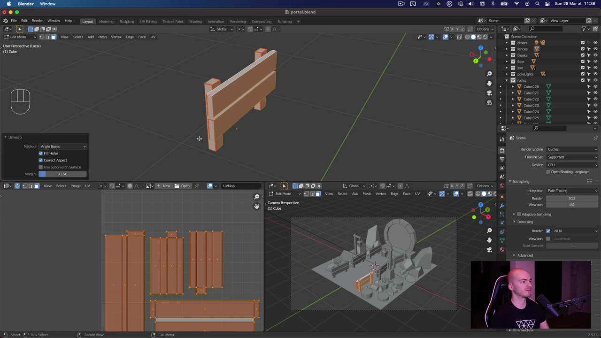
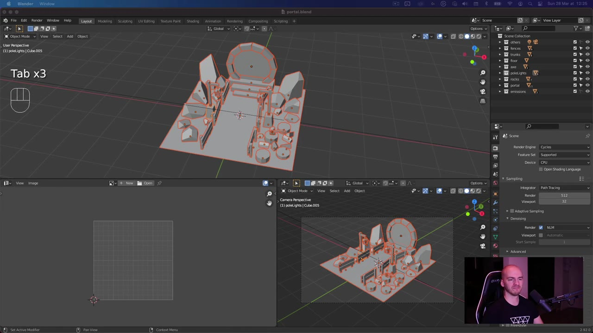

# 第 34 章 烘焙与导出场景

本章将详细介绍如何将 Blender 中的场景进行优化、UV 展开、光照贴图烘焙，并最终导出为 glTF/GLB 格式供 Three.js 使用。通过学习本章，你将掌握将数字内容创作工具制作的场景转化为网页可交互体验的核心流程。

## 场景优化准备

在开始烘焙之前，需要对场景进行优化，以提升导出效率和运行时性能。

### 删除隐藏面

首先需要删除所有不可见的面，包括：
- 与地面直接接触的面（如树干底部）
- 相互重叠的面（如楼梯台阶背面）

操作步骤：
1. 切换到线框或实体显示模式以便观察
2. 选择目标对象并进入编辑模式
3. 使用面选择模式选择要删除的面
4. 按 `X` 键删除选中面

这种做法能减少导入 Three.js 后的三角形数量，同时避免这些面在烘焙纹理中占用不必要的空间。

### 分离发光材质

对于发光物体（如灯柱和传送门的发光部分），应当单独处理：
1. 创建 `emissions` 集合并将发光物体移入其中
2. 将该集合设为不可选状态

单独处理发光物体的原因在于：它们在 Three.js 中通常使用纯色材质实现，烘焙这些物体会浪费纹理空间，增加文件大小且无法获得更好的视觉效果。

### 取消链接的重复对象

如果使用了链接副本（Linked Duplicates），需要先解除链接：

1. 选择所有对象（按 `A` 键）
2. 按 `F3` 搜索 `make single`
3. 选择 `Make Single User > Object & Data`

解除链接的原因：
- 每个对象需要独立的 UV 展开坐标
- 链接副本会共享 UV 坐标，导致烘焙重叠
- 方便独立编辑重叠部分（如楼梯中的砖块）

### 修正法线方向

不正确的法线方向在 Blender 渲染中可能不明显，但在烘焙过程中会产生问题：

1. 在 3D 视口右上角开启 `Face Orientation` 显示
2. 蓝色面表示法线朝向正确，红色面表示法线反了
3. 选择需要修正的对象，进入编辑模式
4. 选择红色面，按 `F3` 搜索 `flip` 选择 `Mesh > Normals > Flip`

法线方向影响 Three.js 中的面显示，默认背面会被剔除（Backface Culling），错误的方向会导致某些面不可见。

### 统一缩放比例

缩放操作可能发生在不同模式下，需要对几何体统一缩放：

1. 在对象模式下选择所有对象
2. 按 `Ctrl + A` 打开应用菜单
3. 选择 `Scale`

统一缩放的重要性：
- UV 自动展开会基于几何体实际尺寸而非对象变换
- 不一致的缩放导致 UV 展开比例失调
- 如斧头等对象可能只占用一半纹理空间，降低纹理利用率

## UV 展开技术

UV 展开是将 3D 几何体的表面映射到 2D 纹理坐标的过程，为后续烘焙奠定基础。

### 基本概念

UV 展开的目标是将所有几何体展开到单位正方形内（UV 空间），每个 3D 点对应一个 2D 坐标。整个过程类似于将 3D 模型"铺平"为 2D 图案。



*图 34-1 UV 展开的核心概念：将 3D 表面映射到 2D 纹理空间*

### UV 编辑器设置

在 Blender 中设置 UV 编辑器界面：
1. 将右下方面板切换为 `UV Editor`
2. 白色网格区域表示 UV 空间（0 到 1 的范围）
3. 所有几何体最终需要放置在该区域内

### 展开方法选择

根据对象复杂度选择不同的展开策略：

#### 简单几何体（地板等平面）
- Blender 会自动为基本几何体生成 UV 坐标
- 可以直接调整现有 UV 布局
- 使用 `A`（全选）、`G`（移动）、`S`（缩放）等快捷键操作

#### 复杂几何体（栅栏、灯柱等）
需要使用分割线（Seams）来指导展开过程：

1. 在编辑模式下选择要作为分割的边
2. 按 `U` 选择 `Mark Seam` 标记分割线
3. 选择几何体所有面
4. 按 `U` 选择 `Unwrap`
5. 调整展开参数（如 `Margin` 控制岛屿间距）

分割线的技巧：
- 选择易于展开的切割路径
- 尽量减少岛屿数量以优化纹理利用率
- 刚性物体（如立方体）通常沿棱角切割
- 曲线物体需要更策略性的切割规划

#### 复杂有机体（岩石等）
使用智能 UV 投影自动展开：

1. 选择所有岩石对象
2. 进入编辑模式全选所有面
3. 按 `U` 选择 `Smart UV Project`
4. 调整 `Island Margin` 参数（如 0.025）

智能 UV 投影的优势：
- 快速处理复杂形状
- 自动寻找较优的分割方案
- 适合不规则的有机物体

### 岛屿组织与布局优化

完成所有几何体的 UV 展开后，需要优化布局：

1. **比例统一**：使用 `Display Stretch > Area` 显示比例差异
   - 蓝色/绿色表示比例合适
   - 红色表示比例过大或过小
   - 调整岛屿大小使颜色趋向一致

2. **空间分配**：根据重要性分配纹理空间
   - 大表面或近景物体（如地板）适当放大
   - 次要物体（如细节装饰）相对缩小
   - 保持岛屿间适当间距（0.02-0.15）

3. **填充策略**：形状不规则的岛屿填充空隙
   - 岩石等小岛屿群适合填充大岛屿间的空隙
   - 类似俄罗斯方块的布局优化
   - 留出空余空间以备后续添加物体

最终 UV 布局应使所有岛屿整齐排列在单位正方形内，为烘焙做好准备。

## 光照贴图烘焙

烘焙（Baking）是将渲染结果保存为纹理的过程，包括光照、阴影、环境光遮蔽等效果。

### 创建烘焙纹理

在 UV 编辑器中创建烘焙用纹理：

1. 点击 `+ New` 按钮新建图像
2. 参数设置：
   - **名称**：`baked`
   - **尺寸**：4096×4096（2 的幂次方，兼容 WebGL）
   - **颜色**：白色（防止边缘出现深色边框）
   - **Alpha**：禁用（不需要透明度）
   - **Generated Type**：`Blank`（纯色填充）
   - **32-bit Float**：启用（HDR 精度）
   - **Tiled**：禁用

关键设置说明：
- **4096×4096 尺寸**：平衡质量与性能；更高尺寸还会受到 GPU 最大纹理规格、显存和加载时间限制
- **32-bit Float**：存储原始 HDR 数据，避免烘焙中丢失高光细节
- **初始白色**：mipmap 生成时边缘可能出现初始颜色，白色相对自然

3. 保存为 HDR 格式：`Image > Save As > Radiance HDR`
   - HDR 格式保留高动态范围数据
   - 文件尺寸较大但作为中间格式可接受
   - 与 .blend 文件存放在相同目录

### 材质与烘焙纹理关联

为每个材质关联烘焙纹理：

1. 切换至 `Shader Editor`
2. 确保 `Use Nodes` 已启用
3. 按 `Shift + A` 添加 `Texture > Image Texture` 节点
4. 选择之前创建的 `baked` 纹理
5. 确保该纹理节点处于选中状态（白色边框）

注意：每个材质可以关联多个纹理节点，但只有选中的节点会用于烘焙。

### Cycles 渲染引擎烘焙设置

切换到 Cycles 渲染引擎并进行烘焙配置：

1. **渲染属性面板 > Bake 部分**：
   - **Bake Type**：`Combined`（烘焙所有信息）
   - **View From**：`Active Camera`（从相机视角烘焙，保持透视一致）
   - **Margin**：`16 px`（岛屿间扩展边缘宽度）
   - **Margin Type**：`Extend`（扩展现有面而非复制相邻像素）
   - **Clear Image**：禁用（分批烘焙时保留已烘焙内容）

2. **采样设置**：
   - **Samples**：128（平衡质量与速度）
   - **Denoise**：禁用（后续统一降噪）

3. **分批次烘焙**：
   - 选择一组对象
   - 点击 `Bake` 按钮开始烘焙
   - 观察底部进度条
   - 按 `Alt + S` 保存烘焙结果

重要提示：烘焙过程可能较慢，特别是大尺寸纹理。4096×4096 纹理烘焙约需要 10-30 分钟，具体取决于场景复杂度。

### 分批烘焙策略

按材质或功能分组烘焙，便于问题排查：

1. **地板**：通常最先烘焙，占用最大纹理空间
2. **栅栏、灯柱**：中等复杂度对象
3. **传送门结构**：细节较多的组合对象
4. **岩石、树干**：使用智能 UV 投影的对象
5. **发光物体**：跳过，在 Three.js 中使用纯色材质

### 常见烘焙问题与解决方案

#### 岛屿重叠
- **原因**：UV 间距过小或岛屿移动后未重新烘焙
- **解决**：调整岛屿位置，增加间距，重新烘焙相关对象

#### 黑色区域
- **原因**：法线方向错误（红色面）
- **解决**：开启面方向显示，修正法线，重新烘焙

#### 噪点明显
- **原因**：采样数不足或降噪未启用
- **解决**：增加采样数，后续统一使用合成器降噪

#### 颜色过曝
- **原因**：烘焙时未应用 Filmic 色彩管理
- **解决**：在合成器中添加色彩校正节点



*图 34-2 烘焙完成的光照贴图，包含场景所有光照和材质信息*

## 色彩校正与降噪处理

烘焙得到的 HDR 纹理存在两个主要问题：颜色过曝和渲染噪点，需要通过 Blender 合成器修复。

### 问题分析

1. **颜色过曝**：烘焙过程未应用 Blender 的 Filmic 色彩管理
   - 烘焙结果对比度过高，缺乏渲染的自然色调映射
   - 需要重新应用色彩管理曲线

2. **渲染噪点**：烘焙时禁用了降噪以保持控制
   - 烘焙纹理包含明显噪点
   - 需要统一应用降噪滤波器

### 合成器设置

在 Blender 合成器中配置处理流程：

1. **创建合成器工作区**：将某一面板切换为 `Compositor`
2. **启用节点**：确保 `Use Nodes` 已勾选
3. **添加图像节点**：`Shift + A > Input > Image`
   - 选择 `baked` HDR 纹理
4. **添加降噪节点**：`Shift + A > Filter > Denoise`
   - 保持默认参数
5. **连接节点**：`Image` → `Denoise` → `Composite`
6. **静音渲染层**：选择 `Render Layers` 节点按 `M` 静音
7. **设置输出尺寸**：在输出属性中设为 4096×4096

### 渲染与导出

1. 渲染合成结果：按 `F12` 执行渲染
2. 保存最终纹理：在渲染窗口中按 `Alt + S`
   - **格式**：JPEG
   - **质量**：75%（平衡文件大小与质量）
   - **文件名**：`baked.jpg`
3. 应用 sRGB 色彩空间转换
   - JPEG 格式自动应用 sRGB 编码
   - Three.js 中同样配置为 sRGB 编码

这一流程将 HDR 烘焙纹理转换为适用于 WebGL 的标准 JPEG 纹理，同时应用了色彩校正和降噪处理。

## glTF/GLB 格式导出

将优化和烘焙后的场景导出为 Three.js 支持的格式。

### 导出准备

1. **选择导出对象**：
   - 检查大纲视图，确保所有需要的集合处于可选状态
   - 包括 `emissions` 集合（发光物体也需要导出）
   - 排除相机、灯光等 Three.js 中会独立创建的元素

2. **全选场景对象**：在对象模式按 `A` 选择所有可见对象

### glTF 2.0 导出设置

使用 Blender 内置的 glTF 2.0 导出器：

1. **基本设置**：
   - **格式**：`.glb`（二进制格式，文件更小）
   - **Selected Objects**：启用（仅导出选中的对象）
   - **+Y Up**：启用（匹配 Three.js 坐标系）
   - **Remember Export Settings**：启用（保存设置供后续使用）

2. **几何体选项**：
   - **UVs**：启用（必需，用于贴图坐标）
   - **Normals**：可选（Three.js 可自动计算）
   - **Vertex Colors**：禁用（烘焙纹理已包含颜色）
   - **Materials**：可选（Three.js 中会使用烘焙材质）

3. **压缩选项**：
   - **Compression**：启用 Draco 压缩
   - **Compression Level**：中等（平衡压缩率与解压速度）

4. **动画选项**：
   - **Animation**：全部禁用（本场景无动画）
   - **Shape Keys**：禁用（无形态键）

5. **文件命名**：`portal.glb`（与 `baked.jpg` 存放在相同目录）

### 文件组合与使用

导出完成后，需要两个文件配合使用：
- **portal.glb**：包含几何体和 UV 坐标的 3D 模型
- **baked.jpg**：包含光照和材质信息的烘焙纹理

在 Three.js 中加载时：
```javascript
const loader = new GLTFLoader();

loader.load('portal.glb', (gltf) => {
  const model = gltf.scene;
  scene.add(model);

  const textureLoader = new THREE.TextureLoader();
  const bakedTexture = textureLoader.load('baked.jpg');
  bakedTexture.flipY = false; // 按该 glTF/Blender 工作流的纹理朝向设置
  bakedTexture.encoding = THREE.sRGBEncoding; // 课程版本；新版本使用 colorSpace

  // 烘焙结果已包含光照，使用不受实时灯光影响的基础材质
  model.traverse((child) => {
    if (child.isMesh) {
      child.material = new THREE.MeshBasicMaterial({ map: bakedTexture });
    }
  });
});
```

`flipY` 应以实际导出模型的纹理朝向为准，不是所有 glTF 都必须固定为 `false`。若使用较新的 Three.js，可将 `bakedTexture.encoding = THREE.sRGBEncoding` 改为 `bakedTexture.colorSpace = THREE.SRGBColorSpace`。

## 常见导出错误与调试

### 纹理不匹配问题

**症状**：纹理在模型上出现错位或拉伸
- **UV 坐标偏移**：烘焙后调整了 UV 但未重新导出模型
- **纹理翻转**：Three.js 默认纹理 Y 轴向下，Blender 向上
  - **解决**：设置 `texture.flipY = false`
- **纹理编码不匹配**：sRGB/Linear 转换问题
  - **解决**：确保 `texture.encoding = THREE.sRGBEncoding`

### 性能相关问题

**症状**：模型加载缓慢或渲染帧率低
- **纹理尺寸过大**：4096×4096 在某些设备上压力较大
  - **解决**：尝试 2048×2048 并测试质量损失
- **几何体复杂度高**：未充分优化隐藏面
  - **解决**：重新检查并删除不必要的多边形
- **无 Draco 压缩**：GLB 文件体积过大
  - **解决**：启用 Draco 压缩，添加 Three.js Draco 解码器

### 视觉质量问题

**症状**：烘焙效果不如 Blender 中渲染效果
- **色彩暗淡**：未正确应用 sRGB 编码
  - **解决**：检查纹理编码设置
- **噪点明显**：降噪不充分或采样数过低
  - **解决**：增加烘焙采样数，调整合成器降噪参数
- **边缘瑕疵**：Margin 设置不当导致的采样溢出
  - **解决**：调整烘焙 Margin 参数，重新烘焙

### 兼容性问题

**症状**：在某些浏览器或设备上无法显示
- **不支持 Draco**：缺少 Draco 解码库
  - **解决**：包含 `draco_decoder.js` 或使用非压缩格式
- **纹理尺寸限制**：某些设备有最大纹理尺寸限制
  - **解决**：测试目标平台，必要时降低纹理尺寸
- **WebGL 限制**：旧设备 WebGL 功能有限
  - **解决**：提供兼容性回退方案

## 最佳实践总结

### 工作流程优化

1. **分层处理**：将场景按功能分离（建筑、装饰、灯光等）
2. **版本控制**：定期保存不同阶段的 .blend 文件
3. **增量烘焙**：先烘焙重要部分，测试后再继续
4. **质量检查**：在不同光照条件下检查烘焙结果

### 性能与质量平衡

1. **纹理尺寸选择**：
   - 远景或小物体：1024×1024 或 2048×2048
   - 中景或中等物体：2048×2048
   - 近景或重要物体：4096×4096

2. **几何体优化原则**：
   - 删除所有隐藏面
   - 简化远距离或次要物体的细分
   - 保持重要物体细节

3. **烘焙质量参数**：
   - 测试渲染：64 采样
   - 预览质量：128 采样
   - 最终质量：256-512 采样（根据耐心调整）

### 跨软件兼容性

1. **坐标系转换**：始终检查 +Y Up 设置
2. **单位一致**：Blender 与 Three.js 使用相同单位
3. **纹理格式**：JPEG 用于彩色纹理，PNG 用于需要透明通道的情况
4. **文件组织**：模型与纹理文件存放在相对路径中

## 本章小结

本章详细讲解了从 Blender 场景到 Three.js 可交互模型的完整工作流程，涵盖了优化、UV 展开、烘焙和导出等关键环节。

核心要点包括：

1. **场景优化**是性能基础：删除隐藏面、修正法线、统一缩放，减少不必要的几何复杂度，为高效运行奠定基础。

2. **UV 展开**是烘焙前提：合理规划切割线，根据物体特性选择手动展开或智能投影，优化岛屿布局以最大化纹理利用率。

3. **光照烘焙**是视觉核心：通过 Cycles 引擎将光照、阴影和材质信息烘焙到统一纹理，保存高质量渲染结果。

4. **后处理**是质量保证：利用合成器解决烘焙中的色彩过曝和噪点问题，生成适用于 WebGL 的标准格式纹理。

5. **格式导出**是桥梁工程：正确配置 glTF/GLB 导出参数，确保坐标系、UV 坐标和压缩选项与 Three.js 生态系统兼容。

这一流程不仅适用于本章的门户场景，同样可以应用于其他类型的 3D 项目。掌握烘焙与导出技术，意味着能够将数字内容创作工具的完整能力带入网页环境，创造高质量的实时 3D 体验。随着实践经验的积累，你将能够根据项目需求调整每个环节的参数，在视觉效果与运行性能之间找到最佳平衡点。