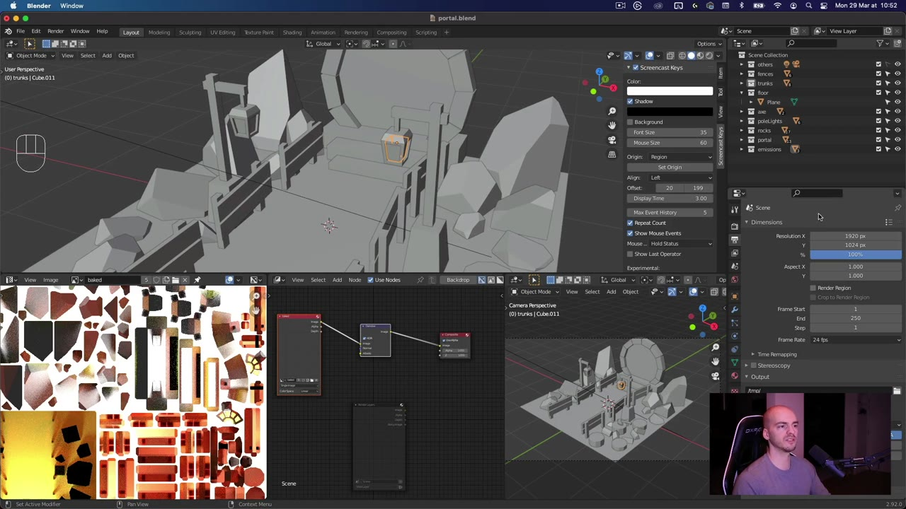
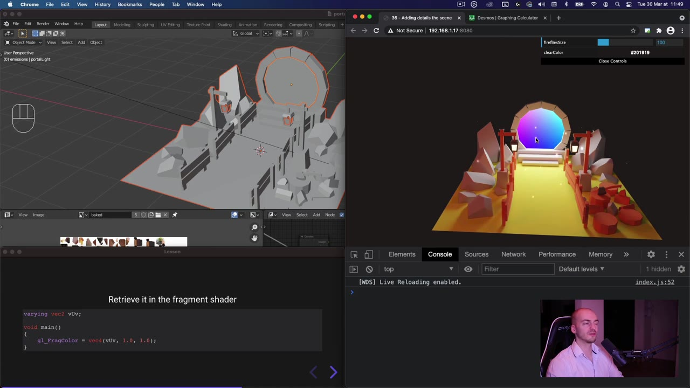

# 第 35 章 场景导入、优化与细节完善

本章承接 Blender 中的建模、UV 展开、光照烘焙与 glTF 导出流程，将静态资源转化为可独立运行的 Three.js 场景。工作重点不只是把模型显示出来，还包括让烘焙贴图保持正确方向与颜色、按名称管理独立发光部件、减少一帧中的渲染步骤，并在不破坏既有性能预算的前提下加入萤火虫和动态传送门。整条流程体现了烘焙渲染与实时 WebGL 的分工：静态光照由贴图承担，需要运动或程序化变化的部分则由粒子和 GLSL 完成。

## 从 Blender 资源到可渲染场景

起始资源包括 Blender 导出的 `portal.glb` 和烘焙图像 `baked.jpg`，二者都放在项目的 `static` 目录中。现有项目已经准备了 `GLTFLoader`、`DRACOLoader`、`TextureLoader`、`OrbitControls` 和调试 UI。若导出时使用 Draco 压缩，可沿用已经配置好的 Draco 解码器；未压缩的 GLB 也能直接加载，不必为了统一形式重新压缩。

加载 GLB 时，资源 URL 相对于构建工具公开的静态资源根目录，因此路径中不再写 `static`。同时，避免在资源名前直接加根斜杠。`/portal.glb` 指向站点域名根目录，当应用部署在子目录时会丢失应用本身的路径前缀；`portal.glb` 或 `./portal.glb` 则能保持相对关系。具体选择仍应与实际部署 URL 一致。

```js
gltfLoader.load(
  'portal.glb',
  (gltf) => {
    scene.add(gltf.scene)
  }
)
```

`gltf.scene` 是导入内容的根组，而不是必须取代现有 `scene` 的另一个渲染场景。将它添加到主场景后，导入模型会进入既有的相机、控制器和渲染循环。初次加载时可以先保留用于验证渲染管线的白色立方体，确认模型可见后再删除立方体及其创建代码。

如果模型显示为接近全黑的轮廓，不一定是加载失败。glTF 中的 PBR 材质通常会转换为 `MeshStandardMaterial`，这类材质需要场景灯光才能正确响应。当前工作流已经把光照和阴影写进烘焙贴图，因此不应再依赖实时灯光照亮整个模型。可以先创建红色的 `MeshBasicMaterial` 作为诊断材质，确认几何体、比例、朝向和相机均正常。

```js
const bakedMaterial = new THREE.MeshBasicMaterial({ color: 0xff0000 })

gltfLoader.load('portal.glb', (gltf) => {
  gltf.scene.traverse((child) => {
    if (child.isMesh) {
      child.material = bakedMaterial
    }
  })

  scene.add(gltf.scene)
})
```

`traverse` 会递归访问所有后代，适用于层级尚未完全掌握的导入模型。这里增加 `isMesh` 判断，是为了避免把材质属性写到组、相机或灯光等非网格对象上。红色剪影只用于排查结构问题，后续会被真正的烘焙材质替代。

## 烘焙贴图的方向与色彩空间

烘焙图像包含模型的基础颜色以及预先计算的光照、阴影信息，所以使用不受实时灯光影响的 `MeshBasicMaterial` 即可。通过 `TextureLoader` 加载图像，并将它赋给材质的 `map` 属性。

```js
const bakedTexture = textureLoader.load('baked.jpg')
bakedTexture.flipY = false
bakedTexture.encoding = THREE.sRGBEncoding

const bakedMaterial = new THREE.MeshBasicMaterial({
  map: bakedTexture
})
```

这里有两个容易同时被忽略的设置。第一个是 `flipY`。纹理加载器默认会在 Y 方向翻转图像，而本工作流中的 Blender 烘焙结果与 GLB 的 UV 配合时需要关闭这次翻转。若忘记设置，模型仍然可见，几何体也没有明显错误，但贴图会像镜像一样落在错误位置。此时应优先检查纹理坐标约定，而不是重新导出模型或随意修改 UV。

第二个是颜色编码。Blender 导出的这张 JPEG 使用 sRGB 色彩空间，但 Three.js 需要得到明确声明才能按预期解释它。未声明时，画面可能更暗、对比度更高，与 Blender 的烘焙结果不一致。`bakedTexture.encoding = THREE.sRGBEncoding` 保留了源项目所采用的 API 写法；关键是让贴图编码与渲染器的输出编码匹配，而不是通过调整灯光或材质颜色补偿错误的色彩转换。

纹理是异步加载的。图像文件较大时，独立发光体可能先出现，烘焙主体随后才显示完整颜色。这并不表示材质被覆盖，而是资源到达时间不同。该示例使用接近 1 MB 的高分辨率图像以保证细节，但实际项目应根据目标设备、镜头距离和画面占比重新权衡分辨率与下载成本，不能把更大的贴图等同于更好的最终效果。



*图 35-1 烘焙贴图将静态光照和阴影一并带入实时场景*

## 用对象名称分离烘焙主体与发光部件

灯杆上的两个发光部件和传送门圆面没有纳入统一的烘焙结果。它们需要独立材质：两个灯杆发光体在本例中颜色相同，可以共享 `poleLightMaterial`；传送门暂时使用白色的 `MeshBasicMaterial`，之后再替换为自定义着色器。若自制场景中的灯光颜色不同，应从 Blender 渲染结果取色，并分别管理材质。

在 Blender 中为这些对象设置清晰且唯一的名称，例如 `poleLightA`、`poleLightB` 和 `portalLight`，再按原有设置重新导出 GLB。Blender 会把对象名当作唯一标识，若重复使用同一个名字，会自动追加编号。数量较多时，可以使用统一前缀并在 JavaScript 中做前缀匹配；当前只有三个目标，直接使用完整名称更直观。

`gltf.scene.children` 是数组，因此可用 `Array.prototype.find` 按条件取出第一个匹配项。与 `traverse` 不同，`find` 只检查当前这一层子对象，不会递归进入更深层级。它适用于已经确认导出结构的项目；若对象被包在其他组中，应改为递归查找或调整导出层级。

```js
const poleLightAMesh = gltf.scene.children.find(
  (child) => child.name === 'poleLightA'
)
const poleLightBMesh = gltf.scene.children.find(
  (child) => child.name === 'poleLightB'
)
const portalLightMesh = gltf.scene.children.find(
  (child) => child.name === 'portalLight'
)

poleLightAMesh.material = poleLightMaterial
poleLightBMesh.material = poleLightMaterial
portalLightMesh.material = portalLightMaterial
```

查找后应确认结果确实是目标网格。名称拼写不一致、没有重新导出或导出了错误集合，都会使查找返回 `undefined`。名称在这里承担了轻量的语义接口作用：模型制作者和场景代码通过同一组约定协作，避免依赖不稳定的数组下标。

传送门圆面默认只渲染正面，从背面观察时可能不可见。若希望两面都显示，可将对应材质的 `side` 设为 `THREE.DoubleSide`；若保留单面效果，则能形成从另一侧观察不到圆面的空间关系。这个选择应由场景设计决定，而不是作为修复贴图或朝向问题的通用手段。

## 以单帧渲染步骤诊断合并收益

模型可见并不代表结构合理。初始导出包含数十个直接子对象，栅栏、树干、金属件、岩石和草等被分别绘制。要判断优化重点，可以使用 Spector.js 捕获一帧的 WebGL 渲染过程，查看从清屏到最终图像所经历的步骤，而不是仅凭对象数量或主观流畅度猜测瓶颈。

Spector.js 可通过浏览器扩展使用，也可作为项目依赖安装。扩展是否支持某个浏览器会随环境变化，依赖方式则便于直接集成到当前开发页面。

```bash
npm install spectorjs
```

```js
const SPECTOR = require('spectorjs')
const spector = new SPECTOR.Spector()

spector.displayUI()
```

启动捕获界面后，对同一视角、同一场景记录一帧，再逐项检查绘制顺序。源场景在合并前记录到 173 个渲染步骤。这个数字用于同一环境下优化前后的对照，不应把步骤数直接等同于跨项目可比较的 draw call 指标，也不能脱离纹理、着色器和设备成本单独判断性能。诊断完成后应移除调试工具及其界面代码，避免把分析开销带入正常体验。

## 在 Blender 中合并且保留可编辑源对象

共用同一烘焙材质的主体不需要保持为大量独立网格。将栅栏、木板、支架、岩石、草和地面等合并后，顶点总数基本不变，但可以作为一个较大的几何体统一提交，并共享一张烘焙贴图。对 GPU 而言，处理几千个顶点通常不是这里的主要矛盾，减少重复的对象与绘制管理更有价值。

合并时应保留可编辑的原始对象，而不是直接破坏 Blender 工程。可按以下顺序操作：

1. 禁止选择 `Emission` 集合和存放相机、灯光等辅助对象的 `Others` 集合，确保发光部件不会并入烘焙主体。
2. 新建 `merged` 集合，选中所有待合并的主体对象，并保证其中一个对象处于活动状态。
3. 复制这些对象，取消复制操作后的位移，使副本与原位置重合，再按 `M` 将副本移动到 `merged` 集合。原集合因此仍可继续编辑。
4. 在副本保持选中时按 `Ctrl+J`，将它们连接为一个对象，再把该对象命名为 `baked`。
5. 隐藏旧的分类集合，只保留合并主体和需要独立处理的发光部件，检查视图中的位置与外观是否一致。

Blender 允许一个对象带有多个材质槽，但 glTF 导出材质时，多材质几何通常会被拆成多个渲染对象或图元，可能抵消预期的合并效果。本例本来就计划在 Three.js 中统一替换材质，并且不导出这些 Blender 材质，因此无需通过保留材质槽来维护表面差异。删除合并副本上的材质槽可以用于查看纯几何结果，却不是本次导出的必要步骤。

最终导出内容收敛为四个主要对象：`baked`、`portalLight`、`poleLightA` 和 `poleLightB`。沿用此前导出设置，并确保旧集合没有被重新选中。源项目所用的 Blender 2.92 在 Draco 压缩导出上存在问题，因此该示例保持未压缩；这并不意味着其他版本也必须关闭压缩。模型本身较轻时，先保证可靠导出，再单独评估压缩收益更合理。

优化后，相同画面在同一 Spector.js 捕获流程中由 173 个步骤降至 16 个。合并并未减少几何细节，视觉结果也保持一致，收益来自更少的场景对象和绘制管理。两盏灯仍可进一步合并，但保留独立对象便于设置不同颜色，在当前规模下没有必要为极小收益牺牲灵活性。

合并后也不再需要为了修改一个烘焙网格而遍历整棵树。与发光部件一样，直接按名称查找即可：

```js
gltfLoader.load('portal.glb', (gltf) => {
  const bakedMesh = gltf.scene.children.find(
    (child) => child.name === 'baked'
  )
  const poleLightAMesh = gltf.scene.children.find(
    (child) => child.name === 'poleLightA'
  )
  const poleLightBMesh = gltf.scene.children.find(
    (child) => child.name === 'poleLightB'
  )
  const portalLightMesh = gltf.scene.children.find(
    (child) => child.name === 'portalLight'
  )

  bakedMesh.material = bakedMaterial
  poleLightAMesh.material = poleLightMaterial
  poleLightBMesh.material = poleLightMaterial
  portalLightMesh.material = portalLightMaterial

  scene.add(gltf.scene)
})
```

## 背景颜色与调试参数联动

静态场景完善后，可以先把纯黑背景换成更贴近环境气氛的深棕色。为了让调试 UI 中的颜色控件真正驱动渲染器，需要建立一个普通 JavaScript 对象保存颜色，再将对象的属性传给 `renderer.setClearColor`。

```js
const debugObject = {
  clearColor: '#ff0000'
}

renderer.setClearColor(debugObject.clearColor)

gui
  .addColor(debugObject, 'clearColor')
  .onChange(() => {
    renderer.setClearColor(debugObject.clearColor)
  })
```

先用红色验证联动，确认后再替换为所需的深色。只调用一次 `setClearColor` 并不会让渲染器持续观察 `debugObject.clearColor`。颜色字符串是按值传入的，调试控件后来修改对象属性时，渲染器不会自动收到通知，因此必须在 `onChange` 回调中再次设置。这个模式同样适用于后面的传送门颜色：调试状态负责保存可编辑值，回调负责把新值同步到 Three.js 对象。

## 萤火虫的几何数据与随机尺度

静态烘焙适合保存光照，却不适合表达持续漂浮的微小光点。萤火虫采用 `THREE.Points` 和自定义 `ShaderMaterial`，不必建立带翅膀的昆虫网格，也不必为每只萤火虫创建独立对象。一个顶点对应一个粒子，既能减少场景管理成本，也方便在 GPU 中统一更新运动。

先建立 `BufferGeometry`，用 `Float32Array` 保存位置和随机尺度。位置属性每个顶点包含 x、y、z 三个数，所以数组长度为粒子数的 3 倍；尺度属性每个顶点只有一个数，数组长度就等于粒子数。

```js
const firefliesGeometry = new THREE.BufferGeometry()
const firefliesCount = 30

const positionArray = new Float32Array(firefliesCount * 3)
const scaleArray = new Float32Array(firefliesCount)

for (let i = 0; i < firefliesCount; i++) {
  positionArray[i * 3 + 0] = (Math.random() - 0.5) * 4
  positionArray[i * 3 + 1] = Math.random() * 1.5
  positionArray[i * 3 + 2] = (Math.random() - 0.5) * 4

  scaleArray[i] = Math.random()
}

firefliesGeometry.setAttribute(
  'position',
  new THREE.BufferAttribute(positionArray, 3)
)
firefliesGeometry.setAttribute(
  'aScale',
  new THREE.BufferAttribute(scaleArray, 1)
)
```

x 和 z 使用 `(Math.random() - 0.5) * 4`，使分布以场景中心为基准，在水平面覆盖约 4 个单位；若只在 x、y、z 上使用 0 到 4 的随机值，粒子会全部落在场景一侧。y 使用 `Math.random() * 1.5`，让粒子位于地表以上并限制高度。`position` 是 Three.js 识别顶点位置所需的固定属性名，`aScale` 则是自定义属性，首字母 `a` 用来提示它是 attribute。

`BufferAttribute` 的第二个参数表示每个顶点占用几个分量，写错会导致顶点分组整体错位。填充数组时应同时检查首尾索引：第一组从 0、1、2 开始，后续每组步进 3；尺度数组则与粒子一一对应。随机尺度打破完全一致的大小，使粒子分布更接近自然现象，而不是规则复制的图形。

## 点精灵的大小、光斑与漂浮动画

着色器分别放在 `src/shaders/fireflies/vertex.glsl` 和 `fragment.glsl`，由现有 Webpack 配置导入。初期可以先用 `PointsMaterial` 验证位置，再换成 `ShaderMaterial`。自定义材质不会继承 `PointsMaterial` 的 `size` 和 `sizeAttenuation` 行为，因此点大小与透视衰减都要在顶点着色器中显式实现。

```js
const firefliesMaterial = new THREE.ShaderMaterial({
  uniforms: {
    uTime: { value: 0 },
    uPixelRatio: { value: Math.min(window.devicePixelRatio, 2) },
    uSize: { value: 100 }
  },
  vertexShader: firefliesVertexShader,
  fragmentShader: firefliesFragmentShader,
  transparent: true,
  blending: THREE.AdditiveBlending,
  depthWrite: false
})

const fireflies = new THREE.Points(firefliesGeometry, firefliesMaterial)
scene.add(fireflies)
```

`uSize` 控制整体基准大小，`uPixelRatio` 让不同像素密度的屏幕保持一致的视觉尺寸，`aScale` 提供个体差异。将像素比上限限制为 2，与渲染器的像素比策略一致，可避免高密度屏幕带来不成比例的填充成本。调试 UI 可以直接控制 `firefliesMaterial.uniforms.uSize.value`，例如把范围设为 0 至 500、步长设为 1，并为控件指定清晰名称，避免多个控件都只显示为 `value`。

顶点着色器先完成模型、视图和投影变换，再修改 y 坐标形成上下漂浮，最后计算点大小：

```glsl
uniform float uTime;
uniform float uPixelRatio;
uniform float uSize;

attribute float aScale;

void main()
{
  vec4 modelPosition = modelMatrix * vec4(position, 1.0);
  modelPosition.y += sin(uTime + modelPosition.x * 100.0) * aScale * 0.2;

  vec4 viewPosition = viewMatrix * modelPosition;
  vec4 projectedPosition = projectionMatrix * viewPosition;
  gl_Position = projectedPosition;

  gl_PointSize = uSize * aScale * uPixelRatio;
  gl_PointSize *= 1.0 / -viewPosition.z;
}
```

`gl_PointSize` 不能简单写成固定值。固定大小不会随距离衰减，而且在高像素比屏幕上会显得更小。`1.0 / -viewPosition.z` 恢复了近大远小的透视关系，乘以 `uPixelRatio` 则补偿设备像素密度。窗口移动到另一块屏幕并触发 resize 时，还要同步更新 uniform：

```js
firefliesMaterial.uniforms.uPixelRatio.value = Math.min(
  window.devicePixelRatio,
  2
)
```

漂浮动画使用 `sin`，但只写 `sin(uTime)` 会让所有粒子完全同步。这里复用粒子的 x 坐标生成不同相位，并乘以 100 拉大相位差，无需再传送一份随机相位属性。振幅又乘以 `aScale`，使小粒子轻微移动、大粒子移动更明显，最后以 0.2 控制整体幅度。复用已有数据既减少属性数量，也让大小和运动形成一致的自然差异。若粒子穿过地面，可进一步提高其初始 y 坐标，或额外调整振幅；速度、频率和幅度也可以继续提取为 uniform。

片元着色器使用 `gl_PointCoord` 取得每个点精灵内部的二维坐标。它不同于网格表面的 `uv`，不需要从顶点着色器传递。光斑以 `(0.5, 0.5)` 为中心，透明度随距离快速衰减：

```glsl
void main()
{
  float distanceToCenter = distance(gl_PointCoord, vec2(0.5));
  float strength = 0.05 / distanceToCenter - 0.05 * 2.0;

  gl_FragColor = vec4(1.0, 1.0, 1.0, strength);
}
```

`0.05 / distanceToCenter` 在中心附近产生很高强度，并向外迅速下降，但单纯使用倒数在边界处仍大于零，会露出点精灵的方形边缘。点精灵边的中点到中心距离为 0.5，此时 `0.05 / 0.5` 等于 0.1，因此再减去 `0.05 * 2.0`，让该位置的强度降为零。材质的 `transparent: true` 使 alpha 生效，`THREE.AdditiveBlending` 将光点颜色叠加到背景上，强化发光感。加法混合会增加填充与混合成本，但当前只有 30 个粒子，规模较小。

透明粒子仍可能因深度写入而遮住身后的其他粒子：先绘制的粒子把深度写入缓冲区，后续粒子即使经过透明区域，也可能被深度测试排除。`depthWrite: false` 让粒子参与绘制但不占用新的深度位置，从而改善粒子之间的遮挡和叠加。这里没有关闭深度测试，场景中的不透明几何仍能正常遮挡粒子。

最后，在动画循环中只更新一次经过时间，就能驱动整组粒子：

```js
const elapsedTime = clock.getElapsedTime()
firefliesMaterial.uniforms.uTime.value = elapsedTime
```

## 传送门的 UV、噪声与动态图案

传送门的几何形状保持不变，重点是把原来的单色 `MeshBasicMaterial` 替换为 `ShaderMaterial`。其着色器放在 `src/shaders/portal/vertex.glsl` 和 `fragment.glsl`。顶点着色器仍使用标准矩阵变换，但需要把网格自带的 `uv` 通过 varying 传给片元阶段。

```glsl
varying vec2 vUv;

void main()
{
  vec4 modelPosition = modelMatrix * vec4(position, 1.0);
  vec4 viewPosition = viewMatrix * modelPosition;
  vec4 projectedPosition = projectionMatrix * viewPosition;
  gl_Position = projectedPosition;

  vUv = uv;
}
```

片元着色器用完全相同的声明 `varying vec2 vUv;` 接收坐标。可先输出 `vec4(vUv.x, vUv.y, 1.0, 1.0)` 检查 UV 渐变。渐变方向不同通常不影响后续的径向算法；如果整个圆面只有一种颜色，则应检查模型是否具有有效 UV。在 Blender 中选中传送门的全部面，使用 `U` 菜单执行 Unwrap，再确认 UV 编辑器中出现正确展开。若创建圆面时关闭了 Generate UVs，也可能导致没有坐标。修复后需要重新导出包含 `baked` 与发光部件的 GLB，仅修改 JavaScript 无法补回缺失的网格属性。

动态图案使用 Stefan Gustavson 的经典三维 Perlin 噪声实现。将相关辅助函数和 `cnoise` 完整放在片元着色器的 `main` 之前，核心算法则以 UV 的前两个分量确定空间位置，以时间作为第三个分量。这样不必移动圆面顶点，就能让表面图案持续变化。

第一层噪声用于扰动 UV，第二层噪声在扰动后的坐标上生成明暗。`cnoise` 返回一个浮点数，将它加到 `vec2` 上会同时影响两个 UV 分量。两层都乘以 5 控制空间细节，但时间频率分别取 0.1 和 0.2，避免所有变化以完全相同的速度推进。随后加入径向外辉光，使靠近砖石的圆面边缘保持明亮，而中心保留较暗的流动纹理。下面列出片元着色器中与算法直接相关的声明和 `main` 核心计算，`cnoise` 的声明来自上述经典实现。

```glsl
uniform float uTime;
uniform vec3 uColorStart;
uniform vec3 uColorEnd;

varying vec2 vUv;

void main()
{
  vec2 displacedUv = vUv + cnoise(vec3(vUv * 5.0, uTime * 0.1));
  float strength = cnoise(vec3(displacedUv * 5.0, uTime * 0.2));

  float outerGlow = distance(vUv, vec2(0.5)) * 5.0 - 1.4;
  strength += outerGlow;

  strength += step(-0.2, strength) * 0.8;
  strength = clamp(strength, 0.0, 1.0);

  vec3 color = mix(uColorStart, uColorEnd, strength);
  gl_FragColor = vec4(color, 1.0);
}
```

`outerGlow` 使用未扰动的 `vUv` 计算，因此辉光边界不会被内部噪声破坏。乘以 5 和减去 1.4 是一组针对当前 UV 与构图的视觉参数：它们让边缘快速达到高亮，同时让中心保持较低强度，应根据自制模型重新调试。Perlin 噪声以及叠加后的 `strength` 不应被假定为严格位于 0 到 1 之间，所以边缘仍可能残留暗纹。

`step(edge, x)` 在 `x` 小于阈值时返回 0，否则返回 1。直接用 `step` 替换原强度会得到边界非常硬的双色图案，虽能呼应低多边形场景，却容易过于生硬。这里把 `step(-0.2, strength)` 的尖锐版本按 0.8 权重加回平滑噪声，兼顾有机变化与清晰轮廓。

最后通过 `mix(uColorStart, uColorEnd, strength)` 在内外两种颜色之间插值。若把未限制的强度传给 `mix`，小于 0 或大于 1 的值会造成颜色外推，例如预期停在橙色，却继续偏向另一种颜色。`clamp(strength, 0.0, 1.0)` 将混合因子限定在合法区间，保证结果只在指定颜色之间变化。alpha 固定为 1，因为传送门不需要像萤火虫那样透明。

JavaScript 端把时间和两种颜色作为 uniforms 传入，并让调试对象成为初始颜色的唯一来源：

```js
debugObject.portalColorStart = '#ff0000'
debugObject.portalColorEnd = '#0000ff'

const portalLightMaterial = new THREE.ShaderMaterial({
  vertexShader: portalVertexShader,
  fragmentShader: portalFragmentShader,
  uniforms: {
    uTime: { value: 0 },
    uColorStart: { value: new THREE.Color(debugObject.portalColorStart) },
    uColorEnd: { value: new THREE.Color(debugObject.portalColorEnd) }
  }
})

gui.addColor(debugObject, 'portalColorStart').onChange(() => {
  portalLightMaterial.uniforms.uColorStart.value.set(
    debugObject.portalColorStart
  )
})

gui.addColor(debugObject, 'portalColorEnd').onChange(() => {
  portalLightMaterial.uniforms.uColorEnd.value.set(
    debugObject.portalColorEnd
  )
})
```

使用十六进制字符串保存调试颜色，可以配合颜色控件稳定工作。`THREE.Color.set` 能接收颜色名称或十六进制字符串，因此变化时不必替换整个 `Color` 实例。红蓝组合只用于验证混合，最终可将中心设为黑色、边缘设为白色，或改成与其他发光部件一致的颜色。动画循环中同时更新 `portalLightMaterial.uniforms.uTime.value`，传送门便与萤火虫共享同一时间基准。



*图 35-2 静态烘焙、GPU 粒子与动态片元图案形成统一的实时效果*

## 本章小结

本章将 Blender 导出资源组织为可维护的 Three.js 场景：用 `MeshBasicMaterial` 呈现已经包含光照的烘焙贴图，用 `flipY` 与 sRGB 编码修正方向和颜色，再通过稳定对象名把烘焙主体与独立发光部件连接起来。Spector.js 的单帧对比揭示了合并主体的收益；保留原始集合、复制后合并，则同时兼顾渲染效率和后续编辑。

细节层没有重新引入昂贵的全场实时光照，而是按需求选择技术。`Points`、自定义属性和顶点动画生成漂浮萤火虫，`gl_PointCoord`、透明度与加法混合塑造光斑；传送门则利用 UV、两层三维 Perlin 噪声、径向辉光、`step`、`clamp` 和颜色插值形成动态表面。由此得到的场景仍以较轻量的烘焙结果为基础，同时具备 WebGL 特有的持续运动与程序化变化能力。
