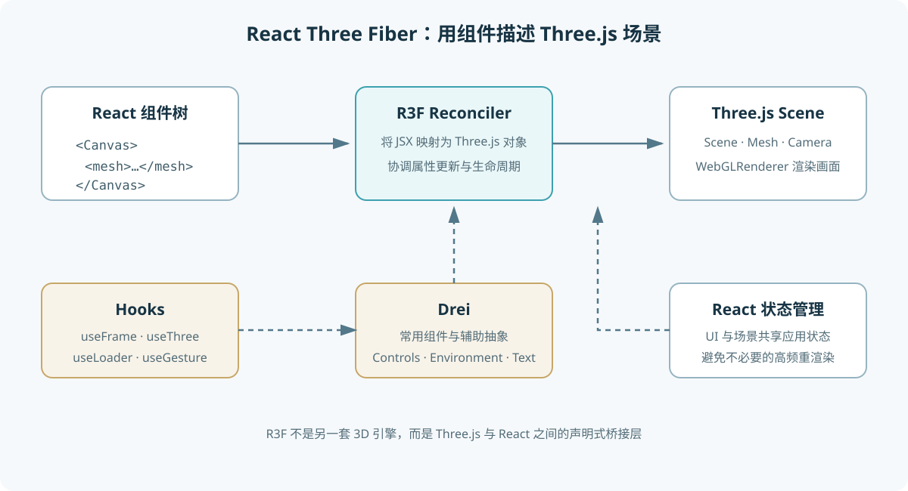
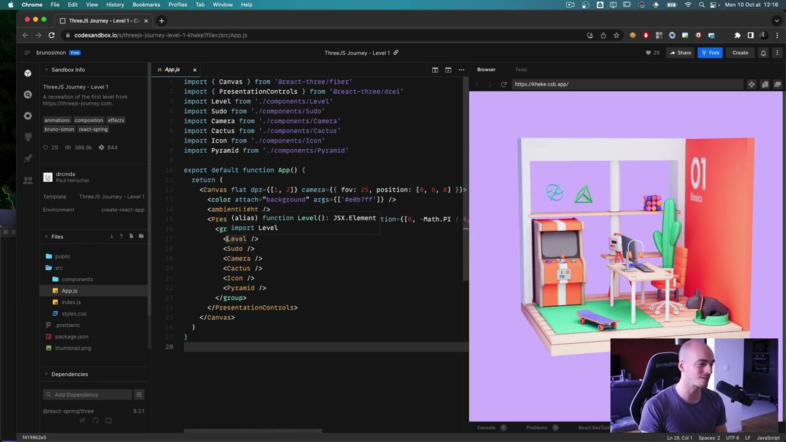
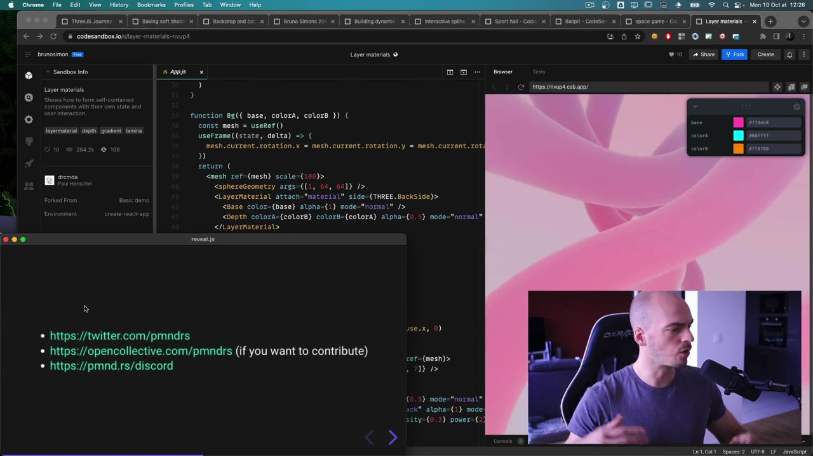

# 第 36 章 React 与 React Three Fiber 简介

此前的 Three.js 项目主要使用原生 JavaScript，以命令式方式创建场景、几何体、材质、相机和渲染循环。项目规模增大后，对象关系、界面状态和交互逻辑容易集中在冗长的脚本中。React Three Fiber 提供了另一种组织方式：保留 Three.js 的渲染能力，同时用 React 组件描述场景及其状态。本章先明确 React 与 React Three Fiber 的职责，再通过典型应用理解声明式场景的价值，为后续组件、Canvas、Drei、交互和物理系统建立统一概念。

## React：让界面响应数据

React 是用于构建用户界面的 JavaScript 库，而不是 Three.js 那样的三维渲染引擎。它常被称为“框架”，是因为围绕组件、状态、生命周期和生态系统可以形成完整的应用结构；就核心定位而言，它仍是一个界面库。

React 使用 JSX 描述界面。JSX 采用类似 HTML 的标签形式，使结构、嵌套和属性具有较高可读性，但 JSX 并不是直接把字符串写成 HTML。构建工具会先将它转换为 JavaScript，React 再依据组件树和相应渲染目标生成或更新界面。

```jsx
function StatusPanel({ score }) {
  return (
    <section>
      <h2>当前得分</h2>
      <p>{score}</p>
    </section>
  )
}
```

这个例子的关键不在于少写了几个标签，而在于界面被表达为数据的函数。数据可能来自 JSON 文件、API、用户操作或实时统计。当组件状态或输入数据按照 React 的更新机制发生变化时，React 会重新计算受影响的界面，开发者不必在每次变化后手动寻找节点、替换内容并重新绑定相关逻辑。早期也常把这种关系称为数据绑定，但现在更常从声明式 UI 和状态驱动更新的角度理解它。

这里的“自动”并不意味着任意修改一个 JavaScript 变量都会刷新页面。数据需要进入 React 能追踪的属性和状态更新流程。掌握这一点后，界面代码的重点就从“逐步命令 DOM 如何变化”转向“描述某种数据状态下应该呈现什么”。

## 组件化结构与使用成本

组件把结构、行为和状态组织成可复用单元。应用可以由多个小组件组合而成，每个组件只负责相对明确的职责；组件在创建、更新和销毁等阶段也有相应的生命周期语义。即使界面中的数据变化并不频繁，这种结构仍有价值，因为它能限制修改范围、明确数据流并促进复用。

React 最初主要服务于网站界面，但其组件模型并不限于浏览器 DOM。本书关注的是 WebGL 网站，因此只利用这一背景理解“同一组件模型可以面向不同渲染目标”，不必把 React 等同于 HTML 生成器。Vue.js、Svelte 等方案同样可以构建组件化应用，也各有优势；选择 React 的主要原因在于其生态以及 Three.js 相关集成，而不是否定其他技术路线。

采用 React 也需要承担实际成本：

- **学习范围较大。** JSX 只是入口，还需要理解组件、props、state、事件、hooks 和数据流，才能正确组织项目。
- **生态持续演进。** 稳定可用于生产并不等于 API 永远不变。依赖升级时，应核对所用版本的迁移说明，避免把不同年代的写法混在一起。
- **调试链路更抽象。** 页面空白或出现警告时，问题可能位于数据、组件关系、渲染器或底层对象。React 与 R3F 的调试工具能够提供帮助，但仍需分清错误发生在哪一层。

因此，React 的收益不是“代码越少越先进”，而是把重复更新和结构管理交给统一模型。若组件边界混乱、状态来源不清，声明式语法本身并不能解决架构问题。

## R3F：面向 Three.js 的 React 渲染器

React Three Fiber（简称 R3F，也称 Fiber）是面向 Three.js 的 React 渲染器。面向 DOM 的 React 渲染器把组件描述映射为页面元素，R3F 则把组件描述映射为 Three.js 场景对象。它并没有替代 Three.js，底层仍然是本章之前已经使用的场景、网格、材质、灯光、相机和 WebGL 渲染能力。

下面的片段只用于观察声明结构：

```jsx
<Canvas>
  <ambientLight />
  <mesh>
    <boxGeometry />
    <meshBasicMaterial color="orange" />
  </mesh>
</Canvas>
```

`Canvas` 提供 R3F 场景的运行环境，`ambientLight` 对应环境光，`mesh` 对应网格，嵌套的 `boxGeometry` 和 `meshBasicMaterial` 分别描述几何体与材质。小写标签看起来与 HTML 相似，实际表达的是 Three.js 对象及其属性关系。相较于逐行执行 `new THREE.Scene()`、`new THREE.Mesh()`、`scene.add()`，场景结构可以直接从组件嵌套中读出；当 props 或 state 改变时，也可以沿用 React 的更新思路。

原生 JavaScript 与 R3F 的差别主要是组织方式，而不是能力高低：

| 关注点 | 原生 JavaScript 写法 | R3F 写法 |
|---|---|---|
| 场景结构 | 通过创建对象和 `add` 等命令逐步搭建 | 通过 JSX 嵌套声明对象关系 |
| 状态变化 | 手动保存引用并修改属性 | 将可追踪的数据变化映射到组件属性 |
| 功能复用 | 提炼类、函数或模块 | 提炼组件、hooks，并复用生态组件 |
| 渲染底层 | Three.js 与 WebGL | 仍是 Three.js 与 WebGL |

R3F 还为常用基础设置提供合理默认值。原生项目中，相机创建与初始位置、画布尺寸更新、输出色彩设置、抗锯齿以及像素比上限等都需要逐项处理。R3F 将许多重复配置收敛到运行环境中，让开发者更快把精力放到场景构图和体验上。默认值并非不可修改，也不意味着纹理色彩空间、模型资源和特殊渲染需求都可以不检查；项目有特殊要求时，仍应理解并覆盖相应配置。



*图 36-1 React 组件、R3F 协调器、Drei 与 Three.js 场景之间的关系*



*图 36-2 声明式组件树把场景对象及其组合关系直接呈现在代码结构中*

R3F 于 2019 年创建。源内容以 2022 年 5 月发布的 v8 作为其写法已经趋于稳定的时间节点，这一历史信息用于说明教程所依赖的背景。实际项目仍应让示例、React、Three.js 与 R3F 的版本相互匹配，而不是把“稳定”理解为永远不需要查阅版本文档。

## Drei 与 pmndrs 生态

R3F 由 Paul Henschel 创建，他也是 pmndrs 开源集体的发起者之一。pmndrs 聚集了一批围绕 React、Three.js 和 WebGL 的库、工具与示例，其目标包括促进开发者互助，并支持、展示和推广相关项目。理解这一生态很重要，因为后续开发不会只依赖一个 R3F 包，而会组合多种彼此适配的工具。

其中最常见的是 Drei。Drei 收集了大量可直接使用的组件和 hooks，把常见但繁琐的 Three.js 工作封装为声明式助手。例如，轨道控制、用三维线连接对象、漂浮火花、环境布置等功能，都可以通过经过封装的接口接入场景。助手减少的是重复搭建工作，并不取消参数调节；选择何种效果、强度多大、是否适合性能预算，仍由具体场景决定。

生态示例展示了这种组合方式的覆盖范围：

- 累积阴影（Accumulative Shadows）可以生成柔和的接地阴影，重点是用更少配置完成复杂的阴影积累过程。
- 模型、相机动画和变换控制可以组合成交互式展示，模型加载与交互控制不再必须集中于同一个脚本。
- 景深、地面反射等后期与材质效果能够按组件组织，效果代码更接近参数配置。
- 手机模型中的交互式 WebView 表明三维对象还可以承载可点击的网页内容，HTML 与 WebGL 并非只能彼此隔离。
- 物理、后期处理与模型可以组合成完整视觉体验，也可以进一步构建具有输入、规则和状态的游戏，而不只是展示一个缓慢旋转的物体。

这些结果都能用原生 Three.js 实现。R3F 与 Drei 的优势是减少连接代码、提高组件可读性并复用成熟封装，而不是产生原生 API 无法实现的独立渲染能力。较少的应用代码也不自动等于较低的 GPU 开销，阴影、反射、后期处理和物理计算仍需按实际成本评估。



*图 36-3 R3F 生态将常用三维能力组织为可组合的组件与 helpers*

## 从 React 基础到完整 R3F 项目

后续学习应按依赖关系逐步推进，而不是一开始就堆砌助手组件。

1. **先掌握 React 应用基础。** 暂时把 Three.js 放到一边，理解应用设置、组件、JSX、props、state、事件和数据流。它们既服务于 R3F，也足以支撑普通 React 界面开发。
2. **建立第一个 R3F 应用。** 学习安装与基本运行方式，理解 `Canvas`、场景组件和 hooks，再引入 Drei，把常见 Three.js 功能改写为声明式组合。
3. **完成调试与视觉布置。** 使用面向 React 和 R3F 的调试工具，处理灯光、阴影、环境贴图与 staging。熟悉的 Three.js 原理仍然有效，只是接入方式发生变化。
4. **处理模型与既有练习。** 加载 GLTF 模型，创建三维文本，并用 R3F 重做传送门场景。重复相同主题可以清楚比较原生 JavaScript 与组件化写法的差异。
5. **加入指针交互和后期处理。** R3F 会把部分射线检测与事件连接工作封装起来，监听对象点击时不必在每帧手动管理 `Raycaster`。这里的“鼠标事件”更准确地说是指针事件，也能覆盖触摸输入。后期处理则采用适合 R3F 的组合方式，并可实现画面摇晃等状态化效果。
6. **进入综合应用。** 通过简洁作品集整合布局、模型和交互，再使用与 R3F 集成的 Rapier 物理方案处理刚体和碰撞。最后完成键盘控制球体穿越关卡的小型游戏，加入陷阱、跳跃、计时、重新开始和关卡变化，把渲染、物理、输入、相机与 UI 状态连成完整系统。

这条路线中的每一步都复用前面的知识。React 组件模型负责组织和更新，R3F 负责把组件映射到 Three.js，Drei 与其他生态库提供可复用助手，而光照、材质、几何、着色器和性能原理仍来自 Three.js 本身。

## 本章小结

React 的核心价值是以组件和状态描述界面，使 UI 能随可追踪的数据变化而更新。它带来结构与复用能力，也引入学习、版本和调试成本。R3F 将同一思想延伸到 Three.js：JSX 描述场景对象，Canvas 提供运行环境，合理的默认设置减少重复配置，Drei 与 pmndrs 生态进一步封装常用功能。

从原生 JavaScript 转向 R3F，不是放弃 Three.js 原理，而是改变组织这些原理的方式。后续无论实现模型展示、传送门、指针事件、后期处理、物理还是游戏，都应同时看清两层：上层是组件和数据流，底层仍是真实的 Three.js 对象与渲染成本。
