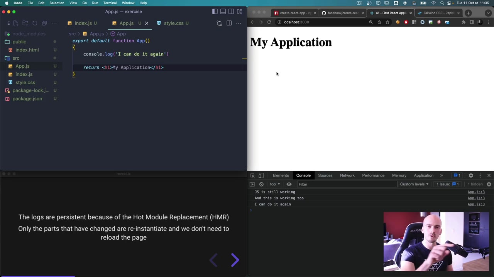
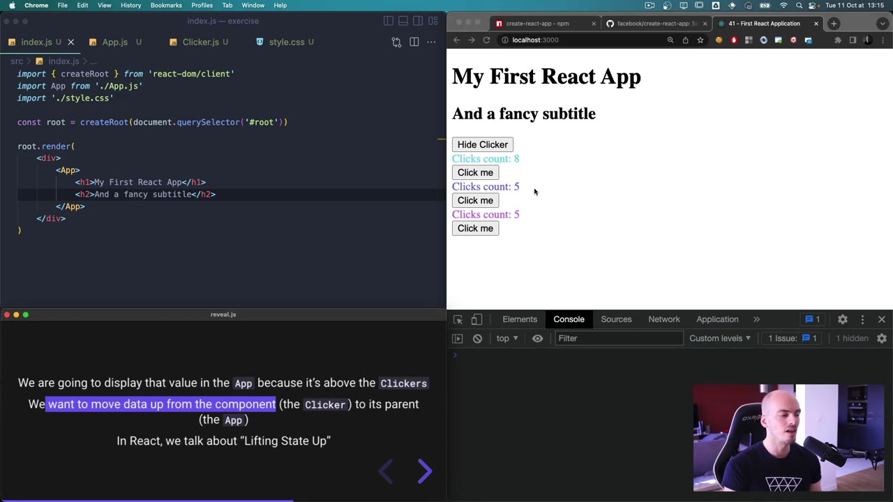

# 第 37 章 React 应用基础

本章将系统学习 React 框架的基础知识与应用方法。作为现代前端开发的核心工具，React 提供了基于组件的声明式编程范式，能够高效构建交互式用户界面。虽然本章暂时将 Three.js 放在一边，但所学 React 知识将为后续理解和应用 React Three Fiber（R3F）奠定坚实基础。读者将学习如何配置开发环境、创建组件、使用 JSX、管理状态与属性、处理事件、实现条件渲染、处理表单以及理解 React 的核心数据流机制。

## React 开发环境配置

React 项目可以通过多种方式搭建，每种方法都适用于不同的开发场景。

### 通过 Create React App 快速启动

一种快速启动方式是使用 `npx` 命令配合 `create-react-app` 脚手架工具。它提供较完整的默认配置，适合需要快速验证 React 概念的项目；在其他场景中，也可以选择更轻量的现代工具链。在项目目录中执行以下命令：

```bash
npx create-react-app .
```

该命令会创建一个包含默认配置的完整 React 项目，内置开发服务器、构建工具和常见依赖。虽然功能完备，但这种方式会引入许多我们可能不需要的文件和功能，更适合快速原型开发。

### 从零开始的项目搭建

为了更好地理解 React 项目的构成，我们可以手动创建项目。首先初始化项目目录：

```bash
npm init -y
```

然后安装 React 核心依赖：

```bash
npm install react@18 react-dom@18.2 react-scripts@5.0
```

在 `package.json` 中添加开发脚本：

```json
{
  "scripts": {
    "dev": "react-scripts start",
    "build": "react-scripts build"
  }
}
```

创建 `public/index.html` 作为入口文件：

```html
<!DOCTYPE html>
<html lang="en">
<head>
    <meta charset="UTF-8">
    <meta name="viewport" content="width=device-width, initial-scale=1.0">
    <title>React 应用基础</title>
</head>
<body>
    <div id="root"></div>
</body>
</html>
```

编写 `src/index.js` 入口文件：

```javascript
import { createRoot } from 'react-dom/client'
import App from './App'

const root = createRoot(document.querySelector('#root'))
root.render(<App />)
```

这种方式让我们深入理解 React 项目的各个组成部分，但配置过程相对繁琐。

### 使用 Vite 构建工具

Vite 是现代前端开发中广泛使用的构建工具，它提供了快速的开发服务器和高效的构建流程。通过以下命令创建 React + Vite 项目：

```bash
npm create vite@latest
```

在交互式命令行中选择 React 框架和 JavaScript 变体，Vite 会自动生成包含现代工具链的优化项目结构。这种方式结合了开发效率与构建性能，是本课程推荐的方式。

无论选择哪种方式，项目的基本结构都遵循相似的模式：`public/` 目录存放静态资源，`src/` 目录包含源代码，`package.json` 管理依赖和脚本。

## JSX：JavaScript 语法扩展

JSX 是 React 的核心语法特性，它允许在 JavaScript 代码中直接编写类似 HTML 的标记语言。

### JSX 基础语法规则

JSX 元素必须始终有且仅有一个根元素。可以使用普通的 HTML 标签或 React 片段（Fragment）：

```javascript
// 使用根元素包裹
root.render(
    <div>
        <h1>Hello React</h1>
        <p>应用基础教程</p>
    </div>
)

// 使用片段避免额外 DOM 元素
root.render(
    <>
        <h1>Hello React</h1>
        <p>应用基础教程</p>
    </>
)
```

元素标签必须正确闭合，对自闭合标签需要在尾部添加斜杠：

```javascript
// 正确：自闭合标签
<input type="text" />

// 正确：完全闭合
<div>内容</div>

// 错误：未闭合
<input type="text">
```

JavaScript 表达式可以通过花括号 `{}` 嵌入 JSX 中：

```javascript
const userName = 'Alice'
const currentTime = new Date().toLocaleTimeString()

root.render(
    <div>
        <h1>欢迎，{userName}！</h1>
        <p>当前时间：{currentTime}</p>
        <p>计算结果：{2 + 2}</p>
    </div>
)
```

### 属性命名与保留字处理

由于 `class` 和 `for` 是 JavaScript 的保留关键字，JSX 中使用替代属性名：

```javascript
// className 代替 class
<div className="container">
    <h1 className="title">React 教程</h1>
</div>

// htmlFor 代替 for
<label htmlFor="username">用户名：</label>
<input id="username" type="text" />
```

样式属性接受 JavaScript 对象，CSS 属性名需要使用驼峰命名法：

```javascript
<div style={{
    color: 'coral',
    backgroundColor: 'floralwhite',
    padding: '20px',
    borderRadius: '8px'
}}>
    内联样式示例
</div>
```

JSX 内部可以使用注释，但需要注意语法：

```javascript
<div>
    {/* 这是 JSX 中的注释 */}
    <h1>标题</h1>
    {/*
        多行注释
        也需要包裹在花括号中
    */}
</div>
```

## React 组件系统

组件是 React 应用的基本构建块，负责封装可复用的 UI 片段及相关逻辑。

### 函数组件创建与使用

最简单的组件形式是函数组件，它接受 `props` 参数并返回 JSX：

```javascript
// Button.jsx - 按钮组件
export default function Button({ text, onClick }) {
    return (
        <button className="custom-button" onClick={onClick}>
            {text}
        </button>
    )
}

// App.jsx - 主应用组件
import Button from './Button'

export default function App() {
    const handleClick = () => {
        console.log('按钮被点击')
    }

    return (
        <div>
            <Button text="点击我" onClick={handleClick} />
            <Button text="另一个按钮" onClick={() => alert('你好！')} />
        </div>
    )
}
```

### 组件间通信：Props 机制

Props（属性）是组件间数据传递的主要方式，遵循单向数据流原则：

```javascript
// UserCard.jsx - 用户卡片组件
export default function UserCard({ name, email, role }) {
    return (
        <div className="user-card">
            <h2>{name}</h2>
            <p>邮箱：{email}</p>
            <p>角色：<span className="role-badge">{role}</span></p>
        </div>
    )
}

// App.jsx - 父组件传递数据
export default function App() {
    const userData = {
        name: '张三',
        email: 'zhangsan@example.com',
        role: '管理员'
    }

    return (
        <div>
            <UserCard
                name={userData.name}
                email={userData.email}
                role={userData.role}
            />
        </div>
    )
}
```

Props 可以是任意 JavaScript 值，包括函数、对象、数组等。组件应该保持纯粹性，避免直接修改接收到的 props。

### 组件状态管理：useState Hook

React 16.8 引入的 Hooks API 允许函数组件使用状态和其他 React 特性。`useState` 是管理组件局部状态的核心 Hook：

```javascript
import { useState } from 'react'

function Counter() {
    // 声明状态变量和更新函数
    const [count, setCount] = useState(0)
    const [inputValue, setInputValue] = useState('')

    const increment = () => {
        setCount(count + 1)
    }

    const handleInputChange = (event) => {
        setInputValue(event.target.value)
    }

    return (
        <div>
            <p>当前计数：{count}</p>
            <button onClick={increment}>增加</button>

            <input
                type="text"
                value={inputValue}
                onChange={handleInputChange}
                placeholder="输入内容"
            />
            <p>输入的内容：{inputValue}</p>
        </div>
    )
}
```

状态更新会触发组件重新渲染，React 会协调需要更新的 DOM。应该避免直接修改状态变量，始终使用更新函数。若新状态依赖旧状态，尤其是在同一事件或异步回调中可能连续更新时，优先使用 `setCount(prev => prev + 1)` 这样的函数式更新。

### 组件生命周期与副作用：useEffect Hook

`useEffect` Hook 用于处理组件副作用，如数据获取、订阅管理、手动 DOM 操作等：

```javascript
import { useState, useEffect } from 'react'

function Timer() {
    const [seconds, setSeconds] = useState(0)

    useEffect(() => {
        // 组件挂载时启动定时器
        const intervalId = setInterval(() => {
            setSeconds(prev => prev + 1)
        }, 1000)

        // 清理函数：组件卸载时清除定时器
        return () => {
            clearInterval(intervalId)
        }
    }, []) // 空依赖数组表示只运行一次

    // 依赖数组控制 effect 执行时机
    useEffect(() => {
        document.title = `计时：${seconds} 秒`
    }, [seconds]) // 仅在 seconds 变化时更新

    return <div>已过去：{seconds} 秒</div>
}
```

Effect 的依赖数组决定了何时重新执行 effect：空数组表示仅在组件挂载时执行，包含特定变量的数组表示在该变量变化时执行。



*图 37-1 React 函数组件的生命周期与 Hook 执行时机*

## 事件处理与表单交互

React 提供了合成事件系统，统一处理浏览器原生事件，确保跨浏览器兼容性。

### 事件绑定与处理

事件处理函数通过 JSX 属性直接绑定到元素：

```javascript
function EventExample() {
    const [message, setMessage] = useState('未点击')
    const [position, setPosition] = useState({ x: 0, y: 0 })

    const handleClick = (event) => {
        setMessage(`按钮被点击于 ${new Date().toLocaleTimeString()}`)
    }

    const handleMouseMove = (event) => {
        setPosition({
            x: event.clientX,
            y: event.clientY
        })
    }

    const handleSubmit = (event) => {
        event.preventDefault()
        console.log('表单提交阻止默认行为')
    }

    return (
        <div onMouseMove={handleMouseMove}>
            <button onClick={handleClick}>点击我</button>
            <p>{message}</p>
            <p>鼠标位置：{position.x}, {position.y}</p>

            <form onSubmit={handleSubmit}>
                <button type="submit">提交表单</button>
            </form>
        </div>
    )
}
```

需要注意事件处理函数中的 `this` 绑定问题，使用箭头函数或在构造函数中绑定可以避免引用错误。

### 受控表单组件

在 React 中，表单元素的状态由组件状态管理，形成受控组件：

```javascript
function ControlledForm() {
    const [formData, setFormData] = useState({
        username: '',
        email: '',
        newsletter: true,
        country: 'china'
    })

    const handleChange = (event) => {
        const { name, value, type, checked } = event.target

        setFormData(prev => ({
            ...prev,
            [name]: type === 'checkbox' ? checked : value
        }))
    }

    const handleSubmit = (event) => {
        event.preventDefault()
        console.log('提交的数据：', formData)
    }

    return (
        <form onSubmit={handleSubmit}>
            <div>
                <label>用户名：</label>
                <input
                    type="text"
                    name="username"
                    value={formData.username}
                    onChange={handleChange}
                />
            </div>

            <div>
                <label>邮箱：</label>
                <input
                    type="email"
                    name="email"
                    value={formData.email}
                    onChange={handleChange}
                />
            </div>

            <div>
                <label>
                    <input
                        type="checkbox"
                        name="newsletter"
                        checked={formData.newsletter}
                        onChange={handleChange}
                    />
                    订阅新闻通讯
                </label>
            </div>

            <div>
                <label>国家：</label>
                <select
                    name="country"
                    value={formData.country}
                    onChange={handleChange}
                >
                    <option value="china">中国</option>
                    <option value="usa">美国</option>
                    <option value="germany">德国</option>
                </select>
            </div>

            <button type="submit">提交</button>
        </form>
    )
}
```

受控组件使得表单状态完全由 React 管理，便于验证、提交和状态同步。

## 条件渲染与列表处理

根据应用状态动态渲染不同内容是 React 的核心优势之一。

### 条件渲染的多种方式

可以根据条件选择性地渲染组件或元素：

```javascript
function ConditionalRendering({ user }) {
    const [isLoggedIn, setIsLoggedIn] = useState(false)
    const [error, setError] = useState(null)

    // 1. if 语句
    let welcomeMessage
    if (user) {
        welcomeMessage = <p>欢迎回来，{user.name}！</p>
    } else {
        welcomeMessage = <p>请先登录</p>
    }

    // 2. 三元运算符
    const loginButton = isLoggedIn ? (
        <button onClick={() => setIsLoggedIn(false)}>退出登录</button>
    ) : (
        <button onClick={() => setIsLoggedIn(true)}>登录</button>
    )

    // 3. 逻辑与运算符
    const warningMessage = error && (
        <div className="error-message">
            <p>错误：{error}</p>
        </div>
    )

    return (
        <div>
            {welcomeMessage}
            {loginButton}
            {warningMessage}
        </div>
    )
}
```

### 列表渲染与 Key 属性

使用 `map()` 方法渲染列表时，必须为每个元素提供在同级元素中稳定且唯一的 `key` 属性：

```javascript
function TaskList() {
    const [tasks, setTasks] = useState([
        { id: 1, text: '学习 React', completed: true },
        { id: 2, text: '完成项目', completed: false },
        { id: 3, text: '写文档', completed: false }
    ])

    const toggleTask = (taskId) => {
        setTasks(tasks.map(task =>
            task.id === taskId
                ? { ...task, completed: !task.completed }
                : task
        ))
    }

    return (
        <ul className="task-list">
            {tasks.map(task => (
                <li
                    key={task.id}
                    className={task.completed ? 'completed' : ''}
                >
                    <input
                        type="checkbox"
                        checked={task.completed}
                        onChange={() => toggleTask(task.id)}
                    />
                    <span>{task.text}</span>
                </li>
            ))}
        </ul>
    )
}
```

Key 属性帮助 React 识别哪些元素发生了变化，优化重新渲染性能。应该使用稳定、可预测的标识符作为 key，避免使用数组索引。

### 列表过滤与排序

结合数组方法可以实现复杂的数据处理：

```javascript
function ProductList({ products }) {
    const [filter, setFilter] = useState('')
    const [sortBy, setSortBy] = useState('name')

    // 过滤产品
    const filteredProducts = products.filter(product =>
        product.name.toLowerCase().includes(filter.toLowerCase()) ||
        product.category.toLowerCase().includes(filter.toLowerCase())
    )

    // 排序产品
    const sortedProducts = [...filteredProducts].sort((a, b) => {
        if (sortBy === 'name') {
            return a.name.localeCompare(b.name)
        } else if (sortBy === 'price') {
            return a.price - b.price
        }
        return 0
    })

    return (
        <div>
            <input
                type="text"
                placeholder="搜索产品..."
                value={filter}
                onChange={(e) => setFilter(e.target.value)}
            />

            <select value={sortBy} onChange={(e) => setSortBy(e.target.value)}>
                <option value="name">按名称排序</option>
                <option value="price">按价格排序</option>
            </select>

            <div className="product-grid">
                {sortedProducts.map(product => (
                    <div key={product.id} className="product-card">
                        <h3>{product.name}</h3>
                        <p>{product.category}</p>
                        <p>价格：¥{product.price}</p>
                    </div>
                ))}
            </div>
        </div>
    )
}
```

## 样式管理与 CSS 集成

React 支持多种样式管理方式，可以根据项目需求灵活选择。

### CSS 模块化

通过 CSS Modules 实现作用域隔离的样式：

```javascript
// Button.module.css
.button {
    padding: 12px 24px;
    background-color: #007bff;
    color: white;
    border: none;
    border-radius: 4px;
    cursor: pointer;
}

.button:hover {
    background-color: #0056b3;
}

// Button.jsx
import styles from './Button.module.css'

function Button({ children, onClick }) {
    return (
        <button
            className={styles.button}
            onClick={onClick}
        >
            {children}
        </button>
    )
}
```

### 内联样式与动态样式

内联样式适合动态变化的样式，使用 JavaScript 对象定义：

```javascript
function ProgressBar({ percentage }) {
    const barStyle = {
        width: `${percentage}%`,
        height: '20px',
        backgroundColor: percentage >= 100 ? '#28a745' : '#007bff',
        transition: 'width 0.3s ease',
        borderRadius: '4px'
    }

    const containerStyle = {
        width: '100%',
        backgroundColor: '#e9ecef',
        borderRadius: '4px',
        overflow: 'hidden'
    }

    return (
        <div style={containerStyle}>
            <div style={barStyle}></div>
            <span>{percentage}%</span>
        </div>
    )
}
```

### CSS-in-JS 方案

使用 styled-components 等库实现组件级样式封装：

```javascript
import styled from 'styled-components'

const StyledCard = styled.div`
    padding: 20px;
    border-radius: 8px;
    box-shadow: 0 2px 8px rgba(0,0,0,0.1);
    background-color: white;

    &:hover {
        box-shadow: 0 4px 12px rgba(0,0,0,0.15);
    }

    h2 {
        color: #333;
        margin-bottom: 10px;
    }
`

const Card = ({ title, children }) => {
    return (
        <StyledCard>
            <h2>{title}</h2>
            {children}
        </StyledCard>
    )
}
```

## 数据获取与异步操作

现代 Web 应用通常需要与后端 API 交互，React 提供了处理异步操作的完整方案。

### 使用 fetch API 获取数据

结合 `useState` 和 `useEffect` 实现数据获取：

```javascript
function UserList() {
    const [users, setUsers] = useState([])
    const [loading, setLoading] = useState(false)
    const [error, setError] = useState(null)

    useEffect(() => {
        const fetchUsers = async () => {
            setLoading(true)
            setError(null)

            try {
                const response = await fetch('https://jsonplaceholder.typicode.com/users')
                if (!response.ok) {
                    throw new Error(`HTTP 错误 ${response.status}`)
                }

                const data = await response.json()
                setUsers(data)
            } catch (err) {
                setError(err.message)
            } finally {
                setLoading(false)
            }
        }

        fetchUsers()
    }, []) // 空依赖数组表示只执行一次

    if (loading) return <div>加载中...</div>
    if (error) return <div>错误：{error}</div>

    return (
        <div>
            <h2>用户列表</h2>
            <ul>
                {users.map(user => (
                    <li key={user.id}>
                        {user.name} - {user.email}
                    </li>
                ))}
            </ul>
        </div>
    )
}
```

### 自定义 Hook 封装数据逻辑

提取数据获取逻辑到可复用的自定义 Hook：

```javascript
// useFetch.js - 自定义 Hook
import { useState, useEffect } from 'react'

function useFetch(url) {
    const [data, setData] = useState(null)
    const [loading, setLoading] = useState(true)
    const [error, setError] = useState(null)

    useEffect(() => {
        const fetchData = async () => {
            try {
                setLoading(true)
                const response = await fetch(url)
                const result = await response.json()
                setData(result)
            } catch (err) {
                setError(err.message)
            } finally {
                setLoading(false)
            }
        }

        fetchData()
    }, [url])

    return { data, loading, error }
}

// UserProfile.jsx - 使用自定义 Hook
function UserProfile({ userId }) {
    const { data: user, loading, error } = useFetch(
        `https://jsonplaceholder.typicode.com/users/${userId}`
    )

    if (loading) return <div>加载用户信息...</div>
    if (error) return <div>加载失败：{error}</div>

    return (
        <div className="user-profile">
            <h2>{user.name}</h2>
            <p>邮箱：{user.email}</p>
            <p>公司：{user.company.name}</p>
            <p>电话：{user.phone}</p>
        </div>
    )
}
```

实际项目还应在 effect 的清理阶段使用 `AbortController` 取消不再需要的请求，或忽略过期响应，避免组件卸载后继续更新状态，以及快速切换 URL 时旧请求覆盖新数据。

### 处理表单提交与异步验证

结合异步操作处理表单提交：

```javascript
function RegistrationForm() {
    const [formData, setFormData] = useState({
        username: '',
        email: '',
        password: ''
    })
    const [submitting, setSubmitting] = useState(false)
    const [submitError, setSubmitError] = useState('')

    const handleChange = (e) => {
        const { name, value } = e.target
        setFormData(prev => ({ ...prev, [name]: value }))
        setSubmitError('') // 清除错误信息
    }

    const handleSubmit = async (e) => {
        e.preventDefault()
        setSubmitting(true)

        try {
            // 模拟 API 调用
            const response = await fetch('/api/register', {
                method: 'POST',
                headers: {
                    'Content-Type': 'application/json'
                },
                body: JSON.stringify(formData)
            })

            const result = await response.json()

            if (!response.ok) {
                throw new Error(result.message || '注册失败')
            }

            console.log('注册成功：', result)
            // 重置表单
            setFormData({ username: '', email: '', password: '' })
            alert('注册成功！')
        } catch (err) {
            setSubmitError(err.message)
        } finally {
            setSubmitting(false)
        }
    }

    return (
        <form onSubmit={handleSubmit}>
            {submitError && (
                <div className="error-message">{submitError}</div>
            )}

            <div>
                <label>用户名：</label>
                <input
                    type="text"
                    name="username"
                    value={formData.username}
                    onChange={handleChange}
                    required
                />
            </div>

            <div>
                <label>邮箱：</label>
                <input
                    type="email"
                    name="email"
                    value={formData.email}
                    onChange={handleChange}
                    required
                />
            </div>

            <div>
                <label>密码：</label>
                <input
                    type="password"
                    name="password"
                    value={formData.password}
                    onChange={handleChange}
                    required
                />
            </div>

            <button type="submit" disabled={submitting}>
                {submitting ? '注册中...' : '注册'}
            </button>
        </form>
    )
}
```



*图 37-2 React 单向数据流与组件状态管理示意图*

## React 性能优化基础

理解 React 渲染机制有助于编写高性能应用。

### 组件重新渲染机制

React 在以下情况会重新渲染组件：
1. 组件自身的状态变化
2. 组件接收的 props 变化
3. 父组件重新渲染导致子组件重新渲染

可以使用 `React.memo` 进行组件记忆化：

```javascript
import React, { useMemo, useState } from 'react'

const ExpensiveComponent = React.memo(function ({ data }) {
    console.log('ExpensiveComponent 渲染')

    // 复杂计算
    const processedData = processData(data)

    return <div>{processedData}</div>
})

// 避免 props 引用变化导致重新渲染
const ParentComponent = () => {
    const [count, setCount] = useState(0)
    const data = useMemo(() => ({ value: count }), [count])

    return (
        <div>
            <button onClick={() => setCount(c => c + 1)}>
                计数：{count}
            </button>
            <ExpensiveComponent data={data} />
        </div>
    )
}
```

### useMemo 与 useCallback

缓存计算结果和函数引用，避免不必要的重新计算：

```javascript
import { useState, useMemo, useCallback } from 'react'

function ProductFilter({ products }) {
    const [filterText, setFilterText] = useState('')
    const [sortOrder, setSortOrder] = useState('asc')

    // 缓存过滤后的产品列表
    const filteredProducts = useMemo(() => {
        console.log('重新过滤产品')
        return products.filter(product =>
            product.name.toLowerCase().includes(filterText.toLowerCase())
        )
    }, [products, filterText])

    // 缓存排序函数
    const sortProducts = useCallback((productsToSort) => {
        return [...productsToSort].sort((a, b) => {
            if (sortOrder === 'asc') {
                return a.price - b.price
            }
            return b.price - a.price
        })
    }, [sortOrder])

    // 缓存最终结果
    const sortedProducts = useMemo(() => {
        console.log('重新排序产品')
        return sortProducts(filteredProducts)
    }, [filteredProducts, sortProducts])

    return (
        <div>
            <input
                value={filterText}
                onChange={(e) => setFilterText(e.target.value)}
                placeholder="过滤产品"
            />

            <button onClick={() => setSortOrder(s => s === 'asc' ? 'desc' : 'asc')}>
                切换排序：{sortOrder === 'asc' ? '升序' : '降序'}
            </button>

            <ul>
                {sortedProducts.map(product => (
                    <li key={product.id}>
                        {product.name} - ¥{product.price}
                    </li>
                ))}
            </ul>
        </div>
    )
}
```

`useMemo` 和 `useCallback` 也会保存引用并增加维护成本，不能把它们当成所有值和函数的默认包装。只有当重复计算确实昂贵，或引用稳定性能减少有意义的子组件渲染时，才应结合测量使用。

### 虚拟 DOM 与协调算法

React 使用虚拟 DOM 和协调算法优化渲染性能：
- 创建当前 UI 的虚拟表示
- 状态变化时生成新的虚拟 DOM
- 比较新旧虚拟 DOM（diffing 算法）
- 仅更新实际 DOM 中发生变化的部分

这种机制减少了不必要的 DOM 操作，但虚拟 DOM 的计算、组件渲染和 effect 仍有成本，不能据此忽略性能测量。

## 本章小结

本章系统介绍了 React 应用开发的基础知识与核心技术。我们从开发环境配置开始，涵盖了现代 React 开发的完整流程：

**核心概念掌握**：理解了 JSX 语法扩展的本质，它允许在 JavaScript 中编写声明式 UI 代码；掌握了组件化开发思想，将界面拆分为独立、可复用的功能单元；熟悉了 Props 单向数据流机制，确保组件间通信的清晰性。

**状态管理能力**：通过 `useState` Hook 实现了组件内部状态管理；掌握了 `useEffect` Hook 处理副作用的模式；了解了事件处理、表单交互的标准方法。

**数据渲染技术**：实现了条件渲染、列表渲染等动态内容展示；学会了处理异步操作和数据获取；掌握了样式管理的多种方案。

**性能优化基础**：了解了虚拟 DOM 与协调算法的工作原理；学习了 `React.memo`、`useMemo`、`useCallback` 等优化工具的使用场景。

React 的优势在于其声明式编程范式和高效的渲染机制，这些特性使其成为构建复杂用户界面的理想选择。虽然本章内容聚焦于 React 基础，但所学的组件模型、状态管理和数据流理念将直接应用于后续的 React Three Fiber（R3F）开发中，为创建交互式 3D Web 体验奠定基础。

在学习过程中，建议读者：
- 理解每个概念背后的设计思想，而非仅仅记忆语法
- 通过实际项目练习巩固所学知识
- 遵循 React 官方文档的最佳实践
- 关注性能优化但不过度优化

通过本章学习，读者已经具备了构建现代 React 应用的基本能力，为后续深入学习 Three.js 与 React 整合开发做好了充分准备。