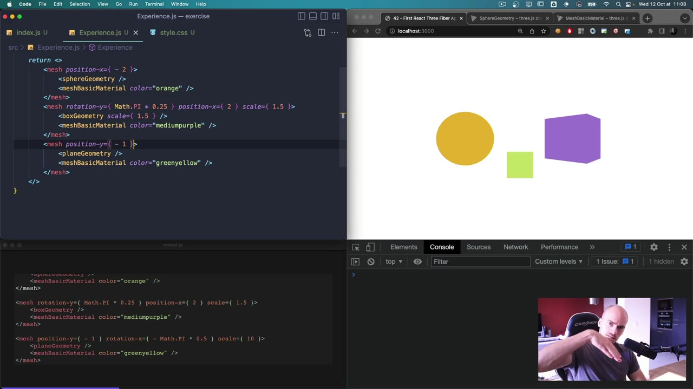
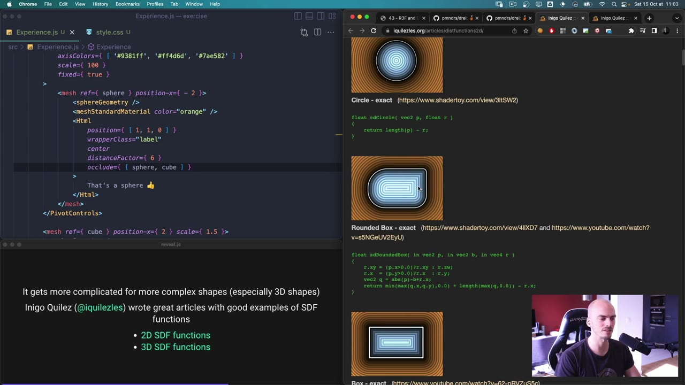

# 第 38 章 第一个 R3F 应用与 Drei

在掌握了 React 的基础知识后，我们终于可以将 Three.js 集成到 React 项目中。本章将介绍 React Three Fiber（R3F）——一个 Three.js 的 React 渲染器，并通过 Drei 辅助库进一步简化开发流程。你将学会如何使用 JSX 语法创建 Three.js 场景、控制相机、添加交互功能，以及利用丰富的组件库快速构建 3D 应用。

## React Three Fiber 简介

React Three Fiber（简称 R3F）是一个 React 渲染器，它将 JSX 语法转换为 Three.js 对象。这意味着我们可以像编写 React 组件一样编写 Three.js 场景，享受 React 生态的声明式编程、状态管理和组件化优势。

### R3F 与原生 Three.js 对比

在原生 Three.js 中创建网格需要多行代码：

```javascript
const mesh = new THREE.Mesh()
mesh.geometry = new THREE.BoxGeometry(1, 1, 1)
mesh.material = new THREE.MeshBasicMaterial({ color: 'red' })
mesh.position.set(1, 2, 3)
mesh.rotation.x = 0.5
scene.add(mesh)
```

而在 R3F 中，同样的网格只需简洁的 JSX：

```javascript
<mesh position={[1, 2, 3]} rotation-x={0.5}>
    <boxGeometry />
    <meshBasicMaterial color="red" />
</mesh>
```

### 嵌套对象与组件组合

R3F 支持 Three.js 的所有类，并能以自然的嵌套结构组织场景。对比原生 Three.js 中的组对象创建：

```javascript
const group = new THREE.Group()
scene.add(group)

const mesh1 = new THREE.Mesh()
mesh1.geometry = new THREE.BoxGeometry(1, 1, 1)
mesh1.material = new THREE.MeshBasicMaterial({ color: 'red' })

const mesh2 = new THREE.Mesh()
mesh2.geometry = new THREE.SphereGeometry(0.5)
mesh2.material = new THREE.MeshBasicMaterial({ color: 'orange' })

group.add(mesh1, mesh2)
```

R3F 提供了更清晰的层次结构：

```javascript
<group>
    <mesh>
        <boxGeometry />
        <meshBasicMaterial color="red" />
    </mesh>
    <mesh>
        <sphereGeometry />
        <meshBasicMaterial color="orange" />
    </mesh>
</group>
```

### 属性绑定机制

R3F 自动将组件映射到对应的 Three.js 属性。例如，`<boxGeometry>` 会自动绑定到 `geometry` 属性，而 `<meshBasicMaterial>` 则绑定到 `material` 属性。这通过 `attach` 属性实现，但在大多数情况下，R3F 可以通过组件名称自动推断正确的绑定关系。

## 创建第一个 R3F 应用

### 安装与配置

首先需要安装 R3F 和 Three.js 依赖：

```bash
npm install three@0.158 @react-three/fiber@8.15
```

R3F 采用 `@react-three/fiber` 作为包名，其中 `@` 表示它属于 `react-three` 作用域，`/fiber` 指定了我们需要的具体部分。

### Canvas 组件

创建场景的第一步是引入 Canvas 组件：

```javascript
import { Canvas } from '@react-three/fiber'

export default function App() {
    return <Canvas>{/* 3D 内容放在这里 */}</Canvas>
}
```

Canvas 组件会自动创建 Three.js 所需的 `<canvas>` 元素、场景、相机和渲染器。默认情况下，Canvas 会占用父元素的整个空间，因此通常需要设置样式确保其填满视口。

### Experience 组件模式

为了遵循最佳实践，我们通常将 3D 场景内容封装在一个独立的 Experience 组件中：

```javascript
// Experience.jsx
export default function Experience() {
    return <mesh>
        <boxGeometry />
        <meshBasicMaterial color="mediumpurple" wireframe />
    </mesh>
}
```

然后在主组件中导入：

```javascript
import Experience from './Experience.jsx'

export default function App() {
    return <Canvas>
        <Experience />
    </Canvas>
}
```

这种分离让 3D 相关逻辑独立于应用框架，便于维护和测试。

### 控制几何体与材质参数

R3F 为组件提供默认参数，但可以通过 `args` 属性自定义构造参数。参数顺序与对应的 Three.js 类保持一致：

```javascript
<mesh>
    <sphereGeometry args={[1.5, 32, 32]} />
    <meshBasicMaterial color="mediumpurple" wireframe />
</mesh>
```

也可以直接设置属性值，这与调用 Three.js 对象的 `.set()` 方法等价：

```javascript
<meshBasicMaterial color="mediumpurple" wireframe />
// 相当于 material.color.set('mediumpurple'), material.wireframe = true
```

## 场景动画与状态管理

### useFrame 动画钩子

R3F 提供了 `useFrame` 钩子来处理每一帧的动画更新：

```javascript
import { useRef } from 'react'
import { useFrame } from '@react-three/fiber'

export default function Experience() {
    const meshRef = useRef()

    useFrame((state, delta) => {
        meshRef.current.rotation.y += delta
    })

    return <mesh ref={meshRef}>
        <boxGeometry />
        <meshStandardMaterial />
    </mesh>
}
```

`useFrame` 接受两个参数：`state`（包含 scene、camera、gl 等信息）和 `delta`（距离上一帧的时间差）。使用 `delta` 而非固定增量可以确保动画在不同刷新率显示器上保持一致速度。`useFrame` 与 `useThree` 都必须在 `<Canvas>` 的组件树内调用，不能在 Canvas 外的应用组件或普通工具函数中使用。

### useThree 场景信息钩子

`useThree` 钩子提供了对 Three.js 核心对象的访问：

```javascript
import { useThree } from '@react-three/fiber'

export default function Experience() {
    const { scene, camera, gl } = useThree()

    return <mesh>
        <boxGeometry />
        <meshStandardMaterial />
    </mesh>
}
```

这对于需要直接操作 Three.js 对象的高级场景非常有用。



*图 38-1 使用 R3F 创建的基础 Three.js 场景*

## Drei 辅助库

虽然 R3F 已经显著简化了 Three.js 开发，但 React 社区还创建了 [Drei](https://github.com/pmndrs/drei)（德语中的 "三"）库，提供了大量实用组件和钩子，进一步加速开发流程。

### 安装 Drei

```bash
npm install @react-three/drei@9.88
```

Drei 同样属于 `@react-three` 作用域，与 R3F 保持兼容。

### OrbitControls 相机控制器

在原生 Three.js 中，设置 OrbitControls 需要多步操作。Drei 的 OrbitControls 组件大幅简化了这一流程：

```javascript
import { OrbitControls } from '@react-three/drei'

export default function Experience() {
    return <>
        <mesh>
            <boxGeometry />
            <meshStandardMaterial />
        </mesh>
        <OrbitControls makeDefault />
    </>
}
```

`makeDefault` 属性会自动将控件设为当前相机的默认控制器。

### TransformControls 变换控制

TransformControls 提供了可视化的变换控制器（移动、旋转、缩放）：

```javascript
import { TransformControls, OrbitControls } from '@react-three/drei'

export default function Experience() {
    const [mode, setMode] = useState('translate')

    return <>
        <TransformControls mode={mode}>
            <mesh position-x={2}>
                <boxGeometry />
                <meshStandardMaterial />
            </mesh>
        </TransformControls>
        <OrbitControls makeDefault />
    </>
}
```

通过 `mode` 属性可以在 `translate`（移动）、`rotate`（旋转）、`scale`（缩放）之间切换。当用户与 TransformControls 交互时，OrbitControls 会自动禁用，防止冲突。

### 引用对象模式

有时我们不需要将组件嵌套在 TransformControls 内部，而是通过引用关联：

```javascript
const cubeRef = useRef()

<TransformControls object={cubeRef.current} />
<mesh ref={cubeRef}>
    <boxGeometry />
    <meshStandardMaterial />
</mesh>
```

### PivotControls 枢轴控制

PivotControls 是 TransformControls 的现代替代方案，提供更优雅的视觉交互：

```javascript
import { PivotControls, TransformControls, OrbitControls } from '@react-three/drei'

export default function Experience() {
    return <>
        <mesh position-x={-2}>
            <sphereGeometry />
            <meshStandardMaterial />
        </mesh>
        <PivotControls anchor={[0, 0, 0]} scale={0.75}>
            <mesh position-x={2}>
                <boxGeometry />
                <meshStandardMaterial />
            </mesh>
        </PivotControls>
        <OrbitControls makeDefault />
    </>
}
```

PivotControls 的 `anchor` 属性指定了枢轴点的位置，`scale` 控制了视觉大小。默认情况下，枢轴点会在透视中自然缩放，也可以通过 `fixed` 属性保持固定像素尺寸。

### Html 组件：在 3D 场景中嵌入 DOM

Drei 的 `<Html>` 组件能够在 3D 空间中嵌入 DOM 元素：

```javascript
import { Html } from '@react-three/drei'

export default function Experience() {
    return <Html position={[0, 1, 0]} className="label">
        <div style={{ background: 'white', padding: '8px', borderRadius: '4px' }}>
            这是 3D 空间中的 HTML 标签
        </div>
    </Html>
}
```

HTML 元素会跟随 3D 对象移动，即使相机旋转，标签也会始终面向屏幕。通过 `distanceFactor` 属性可以控制 HTML 元素的大小，使其在透视中保持一致比例。

### Text 组件：3D 文本

创建 3D 文本在原生 Three.js 中较为复杂，但 Drei 的 `<Text>` 组件简化了这一过程：

```javascript
import { Text } from '@react-three/drei'

export default function Experience() {
    return <Text position={[0, 0, 1]} fontSize={0.5} color="white">
        Hello R3F!
    </Text>
}
```

Text 组件支持自定义字体、大小、颜色、对齐等属性。底层使用了 Troika 文本库，提供了高质量的字体渲染效果。

### Float 漂浮动画

Float 组件可以轻松实现物体的漂浮动画效果：

```javascript
import { Float, Text } from '@react-three/drei'

export default function Experience() {
    return <Float speed={2} rotationIntensity={1} floatIntensity={2}>
        <mesh>
            <boxGeometry />
            <meshStandardMaterial />
        </mesh>
    </Float>
}
```

参数包括 `speed`（动画速度）、`rotationIntensity`（旋转强度）和 `floatIntensity`（浮动强度）。这在创建幻想场景或强调特定物体时非常有用。

### MeshReflectorMaterial 反射材质

实现逼真的反射效果在 WebGL 中通常很复杂，但 MeshReflectorMaterial 显著简化了这一过程：

```javascript
import { MeshReflectorMaterial } from '@react-three/drei'

export default function Experience() {
    return <mesh position-y={-1} rotation-x={-Math.PI * 0.5}>
        <planeGeometry args={[10, 10]} />
        <MeshReflectorMaterial
            blur={[400, 100]}
            resolution={512}
            mixBlur={1}
            mixStrength={50}
            depthScale={1}
            minDepthThreshold={0.85}
            metalness={0.9}
            roughness={1}
        />
    </mesh>
}
```

该材质提供了类似镜面的反射效果，特别适合地板、水面或其他光滑表面。

## 光照与环境

### 预设光照环境

Drei 还提供了环境预设，可以快速配置专业级的光照环境：

```javascript
import { Environment } from '@react-three/drei'

export default function Experience() {
    return <>
        <mesh>
            <boxGeometry />
            <meshStandardMaterial />
        </mesh>
        <Environment preset="sunset" background />
    </>
}
```

preset 选项包括 `sunset`、`dawn`、`night`、`warehouse`、`forest`、`apartment`、`studio`、`city`、`park`、`lobby` 等，每个都提供了精心调校的环境光照和背景。

### Sky 天空组件

Sky 组件可以快速添加动态的天空效果：

```javascript
import { Sky } from '@react-three/drei'

export default function Experience() {
    return <Sky sunPosition={[100, 20, 100]} />
}
```

通过 `sunPosition` 属性可以控制太阳的位置，模拟从日出到日落的各种光照条件。

### Lightformer 灯光造型器

对于需要精细控制灯光效果的场景，Lightformer 提供了灵活的灯光形状和分布：

```javascript
import { Lightformer } from '@react-three/drei'

export default function Experience() {
    return <Lightformer
        form="rect"
        intensity={2}
        position={[0, 5, 0]}
        rotation={[Math.PI / 2, 0, 0]}
    />
}
```



*图 38-2 Drei 提供的多种辅助组件增强了 R3F 的开发体验*

## 性能优化与调试

### 性能监控

Drei 提供了 `PerformanceMonitor` 组件来监控应用性能：

```javascript
import { PerformanceMonitor } from '@react-three/drei'

export default function App() {
    return <PerformanceMonitor>
        <Experience />
    </PerformanceMonitor>
}
```

### Stats 性能统计面板

添加性能统计面板以监控帧率、内存使用等指标：

```javascript
import { Stats } from '@react-three/drei'

export default function App() {
    return <Canvas>
        <Experience />
        <Stats />
    </Canvas>
}
```

Stats 面板会显示在屏幕左上角，通过点击可以切换不同的统计信息。

## 资源加载与管理

### glTF 模型加载

Drei 提供了简化的 GLTF 模型加载器：

```javascript
import { useGLTF } from '@react-three/drei'

function Model({ url }) {
    const { scene } = useGLTF(url)
    return <primitive object={scene} />
}

export default function Experience() {
    return <Model url="/model.gltf" />
}
```

`useGLTF` 处理了模型加载、解析、缓存和共享访问。缓存并不等同于无条件自动释放所有资源；模型、纹理和材质的释放仍需结合 Drei 的缓存策略、对象引用与项目生命周期判断。

### 纹理加载

纹理加载同样得到了简化：

```javascript
import { useTexture } from '@react-three/drei'

function TexturedBox({ textureUrl }) {
    const texture = useTexture(textureUrl)

    return <mesh>
        <boxGeometry />
        <meshStandardMaterial map={texture} />
    </mesh>
}
```

## 本章小结

本章介绍了 React Three Fiber 这一强大的 React 渲染器，它将 Three.js 集成到 React 生态系统中，带来了声明式编程、状态管理和组件化的优势：

1. **R3F 基础**：通过 JSX 语法创建 Three.js 对象，大幅简化了场景构建流程。自动化的属性绑定、默认参数配置和直观的嵌套结构使代码更简洁易读。

2. **动画与状态管理**：使用 `useFrame` 钩子处理逐帧动画，`useThree` 钩子访问场景核心对象，实现了 React 状态与 Three.js 渲染的无缝衔接。

3. **Drei 辅助库**：这一丰富的组件库提供了相机控制、变换工具、3D 文本、环境预设、性能监控等众多实用功能，避免了重复开发。

4. **开发效率提升**：对比原生 Three.js，R3F 和 Drei 的组合显著减少了样板代码，提高了开发效率，同时保持了对底层 Three.js API 的完全访问能力。

5. **资源管理优化**：内置的加载器和缓存机制简化了纹理、模型等外部资源的处理，遵循了 React 的声明式模式。

通过本章的学习，你已经掌握了在现代 React 应用中构建 3D 场景的核心技术。R3F 和 Drei 的强大组合为创建交互式、高性能的 3D Web 应用奠定了坚实基础。在实际项目中，你可以根据需求自由选择使用声明式组件还是直接访问 Three.js API，在开发效率和灵活性之间找到最佳平衡。