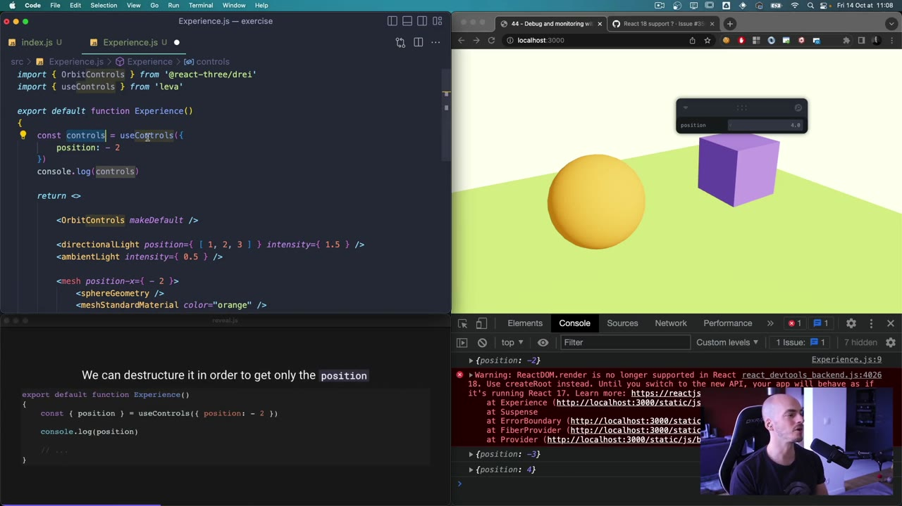
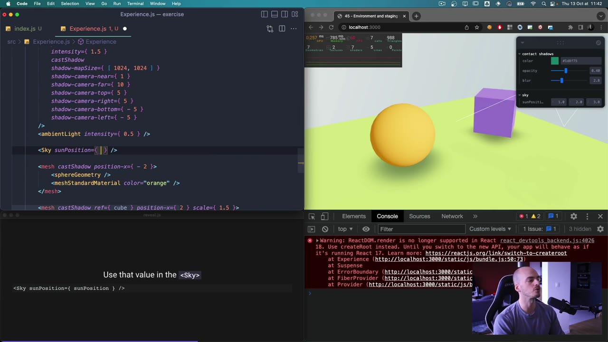

# 第 39 章 R3F 调试与环境布置

前几章已经介绍了 React 与 React Three Fiber（R3F）的基础使用及 Drei 工具库的核心功能。但在开发复杂 3D 应用时，我们还需要了解如何高效地监控和调试 R3F 应用，并掌握场景的环境布置方法。本章将系统介绍调试工具、性能监测、环境贴图、灯光配置、阴影处理等关键技术，帮助你从一开始就建立易于开发和优化的项目结构。

## React 调试与严格模式

在使用 React 和 R3F 时，合理的调试措施能让开发过程更加顺畅。首先应当了解 React 的 `StrictMode`。它能够检测应用中潜在的问题并发出警告，例如：

- 不安全或已弃用的生命周期和 API 用法
- 可能产生副作用的渲染与 effect 写法
- 遗留字符串 ref、旧版 context 等需要迁移的模式

在开发构建中，StrictMode 还可能通过额外的渲染和 effect 调用帮助暴露不纯逻辑与清理问题。它不等同于静态代码检查器，也不会检查未使用的导入。

在 `/src/index.jsx` 中，从 `react` 导入 `StrictMode`，然后将 `<Canvas>` 包装在 `<StrictMode>` 中：

```javascript
import { StrictMode } from 'react'

root.render(
    <StrictMode>
        <Canvas
            camera={ {
                fov: 45,
                near: 0.1,
                far: 50,
                position: [ -4, 3, 6 ]
            } }
        >
            <Experience />
        </Canvas>
    </StrictMode>
)
```

`StrictMode` 会于开发阶段在终端和控制台中显示警告，而构建后的生产版本会自动忽略它，因此不会影响最终应用的性能。

## 浏览器开发工具

为方便检查与修改组件状态，建议安装 **React Developer Tools** 浏览器扩展。该工具可在 Chrome 与 Firefox 中获取：

- [Chrome 扩展](https://chrome.google.com/webstore/detail/react-developer-tools/fmkadmapgofadopljbjfkapdkoienihi)
- [Firefox 插件](https://addons.mozilla.org/firefox/addon/react-devtools/)

安装完成后，重新打开 React 应用页面，开发者工具中就会增加“⚛️ Components”选项卡。在这里可以查看组件树并实时调整 props 和 state。需要注意的是，R3F 的底层元素（如 `<mesh>`、`<meshBasicMaterial>`）不会出现在组件树中，但自定义组件中的 R3F 相关属性仍可正常调试。

## 调试界面 Leva

虽然之前我们尚未使用过调试界面，但像 `<Text>` 或 `<MeshReflectorMaterial>` 这类组件若有可视化调节面板则更加方便。除了传统的 [lil-gui](https://github.com/georgealways/lil-gui) 和 [TweakPane](https://github.com/cocopon/tweakpane) 等工具，React 生态中还有专门为 React 设计的调试面板 [Leva](https://github.com/pmndrs/leva)，它由 PMNDRS 团队开发，可通过简单的 hook 调用进行集成。

### 安装 Leva

在终端中安装 Leva 并固定版本，以避免因后续更新导致的不兼容问题：

```bash
npm install leva@0.9
```

然后在 `Experience.jsx` 中导入 `useControls` 并调用：

```javascript
import { useControls } from 'leva'

export default function Experience() {
    const { position } = useControls({
        position: {
            value: { x: -2, y: 0 },
            step: 0.01,
            joystick: 'invertY'
        }
    })

    return (
        <mesh position={[position.x, position.y, 0]}>
            <sphereGeometry />
            <meshStandardMaterial color="orange" />
        </mesh>
    )
}
```

Leva 会自动在右上角显示调试面板，且面板支持拖动、缩放和搜索，比传统 GUI 更加灵活。

### 参数类型与配置

Leva 支持多种参数类型，并可通过合理的配置组织复杂的调试项：

**数值范围**
```javascript
const { size } = useControls({
    size: { value: 1.5, min: 0, max: 5, step: 0.01 }
})
```

**颜色选择**
```javascript
const { color } = useControls({
    color: '#ff0000'  // 支持 'rgb()', 'hsl()', 'hsla()', 颜色名等多种格式
})
```

**布尔开关**
```javascript
const { visible } = useControls({
    visible: true
})
```

**选择列表**
```javascript
const { material } = useControls({
    material: { options: ['standard', 'basic', 'phong'] }
})
```

**按钮执行**
```javascript
import { button, useControls } from 'leva'

const { clickMe } = useControls({
    clickMe: button(() => { console.log('执行操作') })
})
```

**文件夹组织**
```javascript
const { position, color } = useControls('sphere', {
    position: { value: { x: -2, y: 0 }, step: 0.01, joystick: 'invertY' },
    color: 'orange',
    visible: true
})

const { scale } = useControls('cube', {
    scale: { value: 1.5, step: 0.01, min: 0, max: 5 }
})
```

### Leva 配置

如需自定义 Leva 面板的位置或样式，可将 `<Leva>` 组件添加到应用根组件中（注意要放在 `<Canvas>` 外部）：

```javascript
import { Leva } from 'leva'

root.render(
    <StrictMode>
        <Leva collapsed />  {/* 初始为折叠状态 */}
        <Canvas>{/* ... */}</Canvas>
    </StrictMode>
)
```

更多配置选项如位置、主题等可在 [Leva 配置文档](https://github.com/pmndrs/leva/blob/main/docs/configuration.md) 中查阅。

## 性能监测 R3F-Perf

调试场景时性能监控必不可少。虽然可以使用传统的 [Stats.js](https://github.com/mrdoob/stats.js)，但 R3F 社区有更贴合需求的专用工具 [R3F-Perf](https://github.com/utsuboco/r3f-perf)，由 Renaud Rohlinger（[@onirenaud](https://twitter.com/onirenaud)）开发，能提供更详尽且有针对性的性能数据。

### 安装与使用

```bash
npm install r3f-perf@7.1
```

在 `Experience.jsx` 中导入 `Perf` 并将其加入 JSX：

```javascript
import { Perf } from 'r3f-perf'

export default function Experience() {
    return (
        <>
            <Perf position="top-left" />
            {/* 其他组件 */}
        </>
    )
}
```

R3F-Perf 可显示帧率（FPS）、CPU/GPU 负载、绘制调用、三角形、几何体、纹理和着色器程序等信息，对性能优化很有帮助。为避免与其他调试面板重叠，通常建议通过 `position` 属性调整其位置。

### 集成调试面板

可以将 R3F-Perf 的显示控制集成到 Leva 中，实现统一管理：

```javascript
const { perfVisible } = useControls({
    perfVisible: true
})

return (
    <>
        {perfVisible && <Perf position="top-left" />}
        {/* 其他组件 */}
    </>
)
```

这样就能通过调试面板切换性能监控的显示与隐藏。



*图 39-1 Leva 调试面板与 R3F-Perf 性能监控的协同使用*

## 环境背景设置方法

构建三维场景时，背景设置是基本步骤之一。R3F 与纯 Three.js 场景不同，有几种便捷的背景配置方式，各有适用场景。

### CSS 背景颜色

最简单的方法是通过 CSS 设置画布的背景色。默认情况下，`<canvas>` 是透明的，我们看到的白色实际上是页面背景。

在 `/src/style.css` 中设置：

```css
html, body, #root {
    position: fixed;
    top: 0;
    left: 0;
    width: 100%;
    height: 100%;
    background: ivory;  // 选择需要的背景色
}
```

### WebGLRenderer.setClearColor

如果需要通过渲染器设置背景色，可以通过 `<Canvas>` 的 `onCreated` 回调访问 `WebGLRenderer`：

```javascript
const created = ({ gl }) => {
    gl.setClearColor('#ff0000', 1)  // 颜色与不透明度
}

root.render(
    <Canvas
        camera={/* ... */}
        onCreated={created}
    >
        <Experience />
    </Canvas>
)
```

### 场景背景颜色

也可以在 `created` 回调中给场景直接设置背景：

```javascript
import * as THREE from 'three'

const created = ({ scene }) => {
    scene.background = new THREE.Color('#ff0000')
}
```

### R3F 原生颜色组件

最推荐的方式是使用 R3F 的 `<color>` 组件直接在 JSX 中设置：

```javascript
<Canvas>
    <color args={['ivory']} attach="background" />
    <Experience />
</Canvas>

// 或在 Experience 组件中：
export default function Experience() {
    return (
        <>
            <color args={['ivory']} attach="background" />
            {/* 其他组件 */}
        </>
    )
}
```

`attach` 属性告诉 R3F 将此 `<color>` 实例附加到场景的 `background` 属性上。

## 光源与光照效果

所有的 Three.js 光源在 R3F 中都有对应的 JSX 组件：`<ambientLight>`、`<hemisphereLight>`、`<directionalLight>`、`<pointLight>`、`<rectAreaLight>`、`<spotLight>`。它们的用法与原生 Three.js 高度对应。

### 光源辅助器

调试时，为 `directionalLight` 等光源添加辅助器有助于理解光源的位置与方向。可以通过 `@react-three/drei` 中的 `useHelper` 实现：

```javascript
import * as THREE from 'three'
import { useHelper, OrbitControls } from '@react-three/drei'
import { useRef } from 'react'

export default function Experience() {
    const directionalLight = useRef()
    useHelper(directionalLight, THREE.DirectionalLightHelper, 1)

    return (
        <directionalLight
            ref={directionalLight}
            position={[1, 2, 3]}
            intensity={4.5}
        />
    )
}
```

`useHelper` 不仅可用于光线辅助器，还可以用于相机辅助器（`THREE.CameraHelper`）等，展现了在设计上的通用性。

## 阴影系统综述

写实渲染中阴影至关重要。R3F 不仅支持 Three.js 默认的阴影系统，也提供更加高级和便捷的阴影方案。

### 默认阴影激活

要激活默认阴影，首先在 `<Canvas>` 上添加 `shadows` 属性：

```javascript
<Canvas shadows>
    <Experience />
</Canvas>
```

然后在 `Experience.jsx` 中分别为光源、物体和接收面设置阴影属性：

```javascript
// 光源投射阴影
<directionalLight castShadow position={[1, 2, 3]} intensity={4.5} />

// 物体投射阴影
<mesh castShadow position-x={-2}>
    <sphereGeometry />
    <meshStandardMaterial color="orange" />
</mesh>

// 地面接收阴影
<mesh receiveShadow position-y={-1} rotation-x={-Math.PI * 0.5} scale={10}>
    <planeGeometry />
    <meshStandardMaterial color="greenyellow" />
</mesh>
```

### 阴影配置优化

默认阴影贴图分辨率较低，若想提升阴影质量，可以通过属性链式访问来设置深层属性：

```javascript
<directionalLight
    castShadow
    position={[1, 2, 3]}
    intensity={4.5}
    shadow-mapSize={[1024, 1024]}
    shadow-camera-near={1}
    shadow-camera-far={10}
    shadow-camera-top={5}
    shadow-camera-right={5}
    shadow-camera-bottom={-5}
    shadow-camera-left={-5}
/>
```

在 R3F 中，属性链使用连字符 `-` 分隔层级，例如 `shadow.mapSize` 写作 `shadow-mapSize`，`shadow.camera.near` 写作 `shadow-camera-near`。

### 烘焙阴影

对于静态场景，可以使用 `<BakeShadows>` 组件烘焙阴影，以减少每帧的阴影计算开销：

```javascript
import { BakeShadows } from '@react-three/drei'

export default function Experience() {
    return (
        <>
            <BakeShadows />
            {/* 其他组件 */}
        </>
    )
}
```

烘焙阴影仅渲染一次，不在每帧更新，可显著提升性能，但需要确保场景中的物体均为静态或阴影变化极少。

### 柔和阴影

为了解决默认阴影过于锐利的问题，Three.js 社区提出了 **Percent Closer Soft Shadows（PCSS）** 算法。Drei 库中的 `<SoftShadows>` 组件封装了这一功能：

```javascript
import { SoftShadows } from '@react-three/drei'

export default function Experience() {
    return (
        <>
            <SoftShadows size={25} samples={10} focus={0} />
            {/* 其他组件 */}
        </>
    )
}
```

但请注意 `<SoftShadows>` 会修改 Three.js 的默认着色器模板，每次属性变更都会导致所有相关着色器重新编译，可能带来性能问题和帧率波动。因此一般仅在确定好参数后将其固定使用，而非运行时动态调整。

### 累积阴影

`<AccumulativeShadows>` 是一种基于多次渲染合成的阴影，它通过随机变化的灯光位置进行多帧叠加，生成极为柔和、真实的软阴影效果。

```javascript
import { AccumulativeShadows, RandomizedLight } from '@react-three/drei'

export default function Experience() {
    return (
        <AccumulativeShadows
            position={[0, -0.99, 0]}
            scale={10}
            color="#316d39"
            opacity={0.8}
            frames={Infinity}
            temporal
            blend={100}
        >
            <RandomizedLight
                amount={8}
                radius={1}
                ambient={0.5}
                intensity={3}
                position={[1, 2, 3]}
                bias={0.001}
            />
        </AccumulativeShadows>
    )
}
```

`<RandomizedLight>` 是专为 `<AccumulativeShadows>` 设计的组件，它会在指定半径内随机分布多个光源，模拟真实世界中环境光的散射特征。参数 `frames` 控制合成帧数（值越大阴影越平滑，所需时间也越长）；`temporal` 将渲染分散到多个帧，防止卡顿；`blend` 则控制融合的帧数，影响阴影对移动物体的响应速度。

### 接触阴影

`<ContactShadows>` 是一种不依赖光源的阴影技术，它从场景上方俯视视图生成阴影贴图，适用于地板或平板表面的接触阴影模拟：

```javascript
import { ContactShadows } from '@react-three/drei'

export default function Experience() {
    const { color, opacity, blur } = useControls('contact shadows', {
        color: '#1d8f75',
        opacity: { value: 0.4, min: 0, max: 1 },
        blur: { value: 2.8, min: 0, max: 10 }
    })

    return (
        <ContactShadows
            position={[0, -0.99, 0]}
            scale={10}
            resolution={512}
            far={5}
            color={color}
            opacity={opacity}
            blur={blur}
            frames={1}  // 烘焙模式，只计算一次
        />
    )
}
```

`<ContactShadows>` 的优势在于实现简单，无需复杂的光源配置，但局限性也较为明显：阴影始终来自同一方向，不具备物理准确性，且对复杂场景的性能压力较大。



*图 39-2 不同阴影方案的对比，包含 ContactShadows 和 AccumulativeShadows*

## 天空与大气效果

为场景增添天空背景与自然光照效果，可使用 `<Sky>` 组件。Drei 的 `Sky` 组件基于 Three.js 的物理大气模型，能够模拟一天中不同时段的光照效果。

### 天空环境配置

```javascript
import { Sky } from '@react-three/drei'

export default function Experience() {
    const { sunPosition } = useControls('sky', {
        sunPosition: { value: [1, 2, 3] }
    })

    return (
        <>
            <Sky sunPosition={sunPosition} />
            {/* 其他组件 */}
        </>
    )
}
```

`<Sky>` 组件通过 `sunPosition` 调整太阳的位置，进而影响天空的色彩、云层与光照。更精准地定位太阳可使用球坐标（`THREE.Spherical` 与 `Vector3.setFromSpherical`），但多数情况下直接调整矢量坐标已足够。

为了保持场景逻辑一致性，通常应该将 `<directionalLight>` 的位置与 `<Sky>` 的 `sunPosition` 同步，这样三维对象的光照与背景光影才能匹配。

## 环境贴图系统

环境贴图不仅用于背景展示，更是场景中物体反射与折射的重要数据来源。Drei 库的 `<Environment>` 组件极大地简化了环境贴图的使用流程。

### 立方体贴图环境

传统上环境贴图由 6 张图片组成的立方体贴图（Cube Map）。在 R3F 中，可以通过 `<Environment>` 组件加载：

```javascript
import { Environment } from '@react-three/drei'

export default function Experience() {
    return (
        <Environment
            files={[
                './environmentMaps/2/px.jpg',
                './environmentMaps/2/nx.jpg',
                './environmentMaps/2/py.jpg',
                './environmentMaps/2/ny.jpg',
                './environmentMaps/2/pz.jpg',
                './environmentMaps/2/nz.jpg'
            ]}
        />
    )
}
```

### HDR 环境贴图

HDRI（High Dynamic Range Image）格式的环境贴图是一张能够包含丰富光照信息的 360 度全景照片。与传统 RGB 图像相比，HDR 能以超出普通色彩范围的值存储亮度信息，更适用于写实渲染。

```javascript
<Environment files="./environmentMaps/the_sky_is_on_fire_2k.hdr" />
```

### 预设环境贴图

Drei 内置了从 [Poly Haven（原 HDRI Haven）](https://polyhaven.com/hdris) 精选的环境贴图预设，无需下载文件即可直接使用：

```javascript
<Environment preset="sunset" />
```

其他常用预设包括 `'sunset'`、`'night'`、`'warehouse'`、`'forest'`、`'city'` 等，完整列表可查看 [Drei 环境资源文档](https://github.com/pmndrs/drei/blob/master/src/helpers/environment-assets.ts)。

### 环境亮度控制

环境贴图的亮度可通过 `envMapIntensity` 参数统一调节：

```javascript
const { envMapIntensity } = useControls('environment map', {
    envMapIntensity: { value: 3.5, min: 0, max: 12 }
})

// 在每个材质上统一应用
<meshStandardMaterial color="orange" envMapIntensity={envMapIntensity} />
```

### 自定义环境效果

如果需要进一步调整环境贴图的视觉效果（例如增加特定的色彩亮斑），可在 `<Environment>` 内部放置其他模型。这些模型会被渲染到环境贴图中，从而影响整个场景的光照。

例如，在环境贴图中加入一个大幅度的红色平面：

```javascript
<Environment background preset="sunset">
    <mesh position-z={-5} scale={10}>
        <planeGeometry />
        <meshBasicMaterial color={[10, 0, 0]} />
    </mesh>
</Environment>
```

上面的代码会在场景后方放置一个红色光源平面，其颜色值 `[10, 0, 0]` 中的 10 表示红色通道强度远超常规范围，这样做可以产生高强度的红色光照效果。

### 专用光源构造器

Drei 还提供了 `<Lightformer>` 组件，专门用于在环境贴图内构建光源形状。相较于自定义 `<mesh>`，`<Lightformer>` 拥有更便捷的参数接口：

```javascript
import { Lightformer } from '@react-three/drei'

<Environment preset="sunset">
    <Lightformer
        position-z={-5}
        scale={5}
        color="red"
        intensity={10}
        form="ring"  // 可选 'ring', 'circle', 'rect' 等形状
    />
</Environment>
```

### 地面投影效果

默认的环境贴图会让场景中物体看起来像是悬浮在无限远处，为增强真实感，可使用 `ground` 属性将环境贴图投影到虚拟地面上：

```javascript
<Environment
    preset="sunset"
    ground={ {
        height: 7,     // 地面高度
        radius: 28,    // 地面范围半径
        scale: 100     // 整体缩放比例
    } }
/>
```

## 集成舞台组件

以上配置虽然能组合出理想的环境效果，但手动调整参数较为繁琐。Drei 提供了 `<Stage>` 组件，它能一次性完成环境贴图、光源、阴影等多种预设，并自动居中场景。

### 基础舞台配置

```javascript
import { Stage } from '@react-three/drei'

export default function Experience() {
    return (
        <Stage shadows={{ type: 'contact', opacity: 0.2, blur: 3 }}
               environment="sunset"
               preset="portrait"
               intensity={6}>
            {/* 场景对象 */}
            <mesh position-y={1} position-x={-2}>
                <sphereGeometry />
                <meshStandardMaterial color="orange" />
            </mesh>
            <mesh position-y={1} position-x={2} scale={1.5}>
                <boxGeometry />
                <meshStandardMaterial color="mediumpurple" />
            </mesh>
        </Stage>
    )
}
```

`<Stage>` 会自动配置好环境地图、两盏方向性灯光以及阴影系统。重要参数包括：

- `shadows`: 阴影类型配置，可选 `'contact'` 或 `'accumulative'`
- `environment`: 环境贴图预设
- `preset`: 光照模式，可选 `'rembrandt'`、`'portrait'`、`'upfront'`、`'soft'` 等
- `intensity`: 整体光照强度

舞台组件极大简化了初始环境配置，特别适合快速搭建展示场景或原型验证。

## 相机辅助与自动居中

调试过程中，相机定位与场景视线对中也比想象中更为重要。除了手动控制相机参数，还可以利用 Drei 的 `<CameraHelper>` 与 `<Center>` 组件。

### 相机辅助线

```javascript
import { CameraHelper } from '@react-three/drei'

// 在组件中插入相机辅助线
<cameraHelper args={[camera]} />
```

### 自动居中

`<Center>` 会计算子对象的包围范围并移动内容分组，使子内容在局部空间中居中。它并不自动决定相机的位置、朝向或最佳取景距离，这些仍需根据模型尺寸和构图配置。

```javascript
import { Center } from '@react-three/drei'

export default function Experience() {
    return (
        <Center>
            <mesh>{/* ... */}</mesh>
            <mesh>{/* ... */}</mesh>
        </Center>
    )
}
```

居中功能在调试复杂场景、模型展示时尤为有用，减少手动调整相机位置的时间。

## 本章小结

本章全面介绍了 R3F 应用开发中的调试与环境布置技术。要点概括如下：

1. **调试与监控**
   - `StrictMode` 检测潜在 React 问题
   - React Developer Tools 浏览器插件
   - Leva 调试面板支持多种参数控制与界面组织
   - R3F-Perf 实时监测 FPS、GPU 内存、渲染时长

2. **环境配置**
   - 背景颜色设置：CSS、`setClearColor`、场景背景、`<color>` 组件
   - 天空环境：`<Sky>` 组件与物理大气模拟
   - 环境地图：立方体贴图、HDRI 与预设环境
   - 地面投影：`ground` 增强真实感

3. **光照与阴影**
   - 所有 Three.js 光源的 JSX 对等组件
   - 光源辅助器：`useHelper` 与 `DirectionalLightHelper`
   - 多重阴影方案：默认阴影、软阴影、累积阴影、接触阴影
   - 阴影优化：分辨率、烘焙、性能平衡

4. **便捷集成**
   - `<Stage>`：一键配置完整场景环境
   - `<Center>`：自动对中相机视野
   - `<CameraHelper>`：可视化相机边界

上述工具与技巧共同构成了 R3F 应用开发的核心调试与环境配置知识体系。实际项目中它们往往是组合使用：调试工具帮助快速调整参数；环境布置建立最终视觉风格；性能监控确保流畅体验。掌握这些能力后，你将能够更加自信地开发与优化 React Three Fiber 项目。