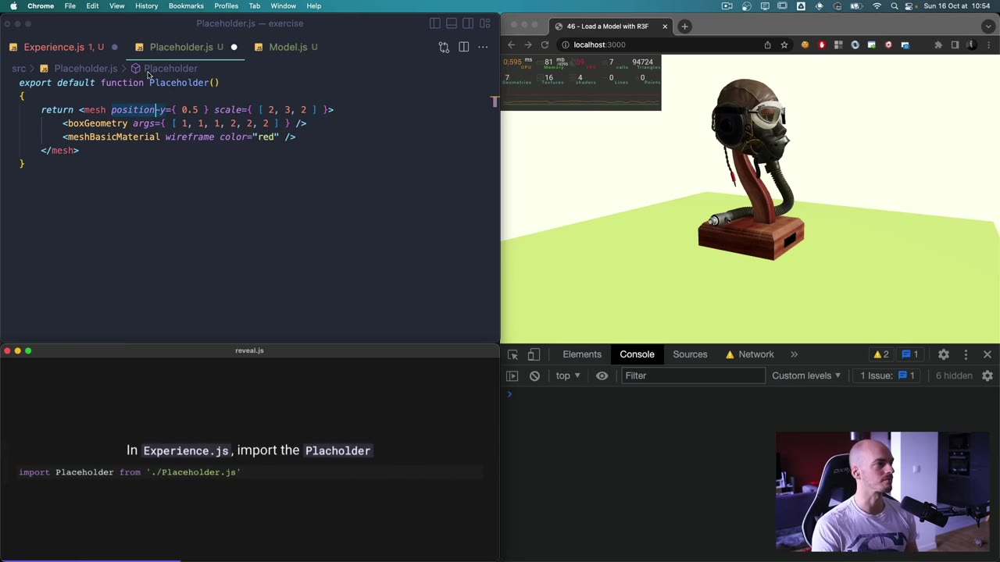
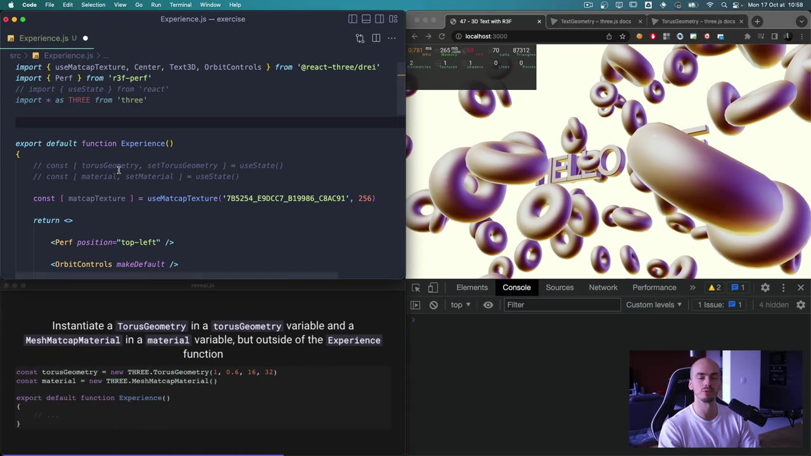

# 第 40 章 R3F 模型与 3D 文本

React Three Fiber（R3F）将 Three.js 的底层 API 封装为声明式的 React 组件，使模型加载、动画控制、文字渲染等复杂操作变得简洁直观。仅用原生 Three.js 实现多个汉堡模型或三维字体需要大量样板代码，而 R3F 配合其生态库 `drei` 能以数行代码完成相同效果。本章基于课程第 59、60 讲，演示 R3F 环境下的模型加载、DRACO 压缩处理、惰性加载、字体渲染、性能优化及多实例渲染，重点对比两种技术栈的异同，突出 R3F 在生产效率与代码可维护性方面的优势。

## R3F 项目初始设置

本章实践项目包含标准的三维场景框架：画布、环境光、定向光源、阴影支持、性能监控面板（`Perf`）与相机控制器（`OrbitControls`）。初始场景含一个立方体与绿色地板，主要用于验证投影和基础交互功能。随着模型和文字组件的引入，这些占位元素将被逐步移除。

启用阴影是创建真实感场景的基础，需在 `Canvas` 组件设置 `shadows` 属性，并在 `directionalLight` 和网格上分别配置 `castShadow` 与 `receiveShadow`。

## 模型加载与 primitive 容器

R3F 提供 `useLoader` 钩子抽象外部资源的加载过程。针对 GLTF/GLB 格式，需导入 Three.js 的 `GLTFLoader`:

```javascript
import { useLoader } from '@react-three/fiber'
import { GLTFLoader } from 'three/examples/jsm/loaders/GLTFLoader.js'

export default function Experience() {
  const model = useLoader(GLTFLoader, './hamburger.glb')
  console.log(model)

  return <primitive object={model.scene} scale={0.35} />
}
```

`useLoader` 接收三个参数：加载器类、资源路径以及可选的加载器配置函数。几乎所有 Three.js 内置加载器均可通过此方式接入。

加载后的 GLTF 对象包含完整的场景结构（`scene` 属性）、动画数据、相机设置等信息。R3F 不支持直接渲染 `model.scene` 对象，必须通过 `<primitive>` 标签包装。`<primitive>` 是 R3F 提供的一种通用容器，其 `object` 属性可接收任意 Three.js 对象（`Object3D` 子类）并在场景中正确实例化。通过 `position`、`scale`、`rotation` 等标准属性可调整模型位置与大小。

### DRACO 压缩格式处理

DRACO 压缩能显著减小模型文件体积，但需要专门解码器。传统的 Three.js 方案需手动实例化 `DRACOLoader` 并与 `GLTFLoader` 关联，R3F 的 `useLoader` 简化了这一流程：

```javascript
import { DRACOLoader } from 'three/examples/jsm/loaders/DRACOLoader.js'

const model = useLoader(
  GLTFLoader,
  './hamburger-draco.glb',
  (loader) => {
    const dracoLoader = new DRACOLoader()
    dracoLoader.setDecoderPath('./draco/')
    loader.setDRACOLoader(dracoLoader)
  }
)
```

`useLoader` 的第三个参数是配置回调函数，在加载器实例创建后执行。此机制保持了加载器的灵活性，同时将初始化逻辑集中于一处。

## 基于 Suspense 的惰性加载

默认情况下，`useLoader` 会让依赖资源的组件进入 Suspense 挂起状态，直至资源可用。对于较大模型，如果整个场景都包含在同一个挂起边界内，就可能暂时无法显示。React 的 `<Suspense>` 组件允许把挂起范围限制在模型组件，并为加载过程指定 `fallback`，其他页面与场景组件仍可正常渲染；这并不表示 JavaScript 主线程被阻塞。

实现惰性加载需三个步骤：

1. **分离模型组件**：将模型加载逻辑移至独立组件，使 `<Suspense>` 能精确控制其渲染时机
2. **配置占位状态**：通过 `fallback` 提供加载期间的视觉反馈（如线框方块、旋转加载器）
3. **统一资源路径**：确保预加载与实际加载使用相同的资源路径，避免重复请求

```javascript
// Model.jsx - 独立的模型组件
export default function Model() {
  const model = useLoader(GLTFLoader, './FlightHelmet/glTF/FlightHelmet.gltf')
  return <primitive object={model.scene} scale={5} position-y={-1} />
}

// Experience.jsx - 主场景组件
import { Suspense } from 'react'
import Model from './Model.jsx'
import Placeholder from './Placeholder.jsx'

export default function Experience() {
  return (
    <>
      {/* 光源、地板等 */}
      <Suspense fallback={<Placeholder position-y={0.5} scale={[2, 3, 2]} />}>
        <Model />
      </Suspense>
    </>
  )
}
```

网络限流测试（通过开发者工具的 Network 面板模拟低速连接）能直观展示惰性加载的效果：地板、光源等基础场景首先出现，占位符显示，最后模型加载完毕替换占位内容。这种渐进式体验显著提升用户感知性能。

### 具象化的占位组件

`Placeholder` 组件设计为可复用、可配置的占位符。通过 props 传播机制，外部可控制其位置、缩放、旋转等属性：

```javascript
// Placeholder.jsx
export default function Placeholder(props) {
  return (
    <mesh {...props}>
      <boxGeometry args={[1, 1, 1, 2, 2, 2]} />
      <meshBasicMaterial wireframe color="red" />
    </mesh>
  )
}
```

这种设计便于在不同模型加载场景中复用，开发者只需调整属性即可适配不同尺寸的模型。

## `drei` 工具库与 useGLTF 钩子

`drei` 是 R3F 的官方生态库，提供大量实用的高阶组件与钩子。其中 `useGLTF` 将 GLTF 加载流程压缩为一行代码：

```javascript
import { useGLTF } from '@react-three/drei'

export default function Model() {
  const model = useGLTF('./hamburger-draco.glb')
  return <primitive object={model.scene} scale={0.35} />
}
```

`useGLTF` 自动处理 DRACO 压缩格式，无需手动配置 `DRACOLoader`，同时内置了解码器路径等默认设置。它的 `preload` 静态方法支持预加载资源：

```javascript
useGLTF.preload('./hamburger-draco.glb')
```

预加载机制特别适用于有条件的场景元素，例如室内装饰只在玩家进入城堡后才显示，但提前加载可确保无缝切换。预加载需与实际加载路径严格一致，否则将产生冗余的网络请求。

## Clone 组件与多实例渲染

创建多个相同模型实例是三维场景中的常见需求。传统 Three.js 需手动克隆几何体与材质，处理引用关系。`drei` 的 `Clone` 组件将此过程简化为声明式操作：

```javascript
import { Clone, useGLTF } from '@react-three/drei'

export default function Model() {
  const model = useGLTF('./hamburger.glb')

  return (
    <>
      <Clone object={model.scene} scale={0.35} position-x={-4} />
      <Clone object={model.scene} scale={0.35} position-x={0} />
      <Clone object={model.scene} scale={0.35} position-x={4} />
    </>
  )
}
```

`Clone` 克隆场景节点并复用几何体和材质，能够减少重复资源，但它不是 `InstancedMesh`，不保证把所有副本合并为一次绘制调用。少量重复模型可以使用 `Clone`；大量相同对象若需要降低绘制调用，应进一步采用 `instancedMesh` 或相应的实例化组件。



*图 40-1 汉堡模型的三个实例化副本，光源阴影来源正确*

## GLTF 到 JSX 的自动转换工具

GLTF 文件内部的层次结构对开发者并不透明，如需调整模型中特定部件（如汉堡的上层面包）的位置或材质，必须通过代码遍历查找对应节点，或返回三维软件修改后重新导出。`gltfjsx` 工具解决了这一痛点。

### 在线转换平台与本地工具

`gltfjsx` 提供在线版本（[gltf.pmnd.rs](https://gltf.pmnd.rs)）与命令行工具两种使用方式。将 GLTF/GLB 文件拖拽至网页，工具自动解析文件结构并生成对应的 React 组件代码：

```javascript
/*
Auto-generated by: https://github.com/pmndrs/gltfjsx
*/
import React from 'react'
import { useGLTF } from '@react-three/drei'

export default function Hamburger(props) {
  const { nodes, materials } = useGLTF('./hamburger.glb')
  return (
    <group {...props} dispose={null}>
      <mesh
        castShadow
        receiveShadow
        geometry={nodes.bottomBun.geometry}
        material={materials.BunMaterial}
      />
      <mesh
        castShadow
        receiveShadow
        geometry={nodes.meat.geometry}
        material={materials.SteakMaterial}
        position={[0, 2.82, 0]}
      />
      <mesh
        castShadow
        receiveShadow
        geometry={nodes.cheese.geometry}
        material={materials.CheeseMaterial}
        position={[0, 3.04, 0]}
      />
      <mesh
        castShadow
        receiveShadow
        geometry={nodes.topBun.geometry}
        material={materials.BunMaterial}
        position={[0, 1.77, 0]}
      />
    </group>
  )
}

useGLTF.preload('./hamburger.glb')
```

生成的结构包含所有节点（`nodes`）与材质（`materials`）的明确引用，每条 `<mesh>` 都具有独立属性控制。现在可以直接修改上层面包的垂直位置，而无需担心影响其他部分：

```javascript
<mesh
  castShadow
  receiveShadow
  geometry={nodes.topBun.geometry}
  material={materials.BunMaterial}
  position={[0, 3.77, 0]} // 从 1.77 调整为 3.77，面包层升高
/>
```

自动生成的组件默认支持阴影投射与接收，但需注意阴影痤疮问题（模型自投影导致的条纹伪影）。在定向光源上设置 `shadow-normalBias` 可有效缓解：

```javascript
<directionalLight castShadow position={[1, 2, 3]} intensity={4.5} shadow-normalBias={0.04} />
```

转换后的组件在保持完整模型结构的同时，赋予开发者对每个部件的细粒度控制权，极大简化了模型定制与动态修改流程。

## 动画模型控制与 useAnimations 钩子

加载带动画的模型（如经典的 Fox 动画示例）是 R3F 的另一常见需求。`drei` 提供 `useAnimations` 钩子将 Three.js 的动画系统集成到 React 组件中。

### 动画加载流程

动画模型通常包含多个命名动画片段（如狐狸的 "Walk"、"Run"、"Survey"）。`useGLTF` 加载的模型对象含有 `animations` 数组：

```javascript
import { useAnimations, useGLTF } from '@react-three/drei'

export default function Fox() {
  const fox = useGLTF('./Fox/glTF/Fox.gltf')
  const animations = useAnimations(fox.animations, fox.scene)

  return <primitive object={fox.scene} scale={0.02} position={[-2.5, 0, 2.5]} rotation-y={0.3} />
}
```

`useAnimations` 接收动画数据数组与目标场景对象，返回包含 `actions`（动画动作映射）和 `names`（动画名称数组）的对象。`actions` 中的每个动画动作都是 Three.js `AnimationAction` 实例，具有 `play()`、`stop()`、`fadeIn()`、`fadeOut()` 等方法。

### 动画播放与淡入淡出控制

React 组件的副作用控制通过 `useEffect` 实现。首次渲染后播放默认动画：

```javascript
import { useEffect } from 'react'

useEffect(() => {
  const action = animations.actions.Run
  action.play()
}, [])
```

当需要切换不同动画时（例如通过调试面板选择），仅调用新动画的 `play()` 会导致多个动画重叠播放。正确的做法是在副作用清理阶段淡出旧动画，在新动画播放前淡入：

```javascript
import { useControls } from 'leva'

export default function Fox() {
  // ...加载动画...

  const { animationName } = useControls({
    animationName: { options: animations.names }
  })

  useEffect(() => {
    const action = animations.actions[animationName]
    action.reset().fadeIn(0.5).play()

    return () => {
      action.fadeOut(0.5)
    }
  }, [animationName])

  // ...渲染...
}
```

这种模式体现了 React 生命周期的优势：通过依赖数组控制副作用触发时机，通过清理函数确保资源正确释放。动画在组件卸载或切换时会平滑过渡，避免视觉跳跃。

`fadeIn()` 与 `fadeOut()` 的参数为淡入淡出持续时间（秒数），`reset()` 将动画重置至初始状态。调整这些参数可模仿不同的动画过渡效果。

## Text3D 组件与三维文字渲染

三维文字是 Three.js 的经典应用场景，R3F 配合 `drei` 提供更直观的实现方案。传统 `TextGeometry` 需要预先处理字体文件、配置几何参数、优化性能，而 `Text3D` 组件将这些步骤统一封装。

### 字体准备与基础渲染

R3F 使用 `Text3D` 组件渲染三维文字，需要提供字体文件路径。TrueType 字体（`.ttf`）需通过 [facetype.js](http://gero3.github.io/facetype.js/) 等工具转换为 Three.js 支持的 `.typeface.json` 格式，注意字体的使用许可：

```javascript
import { Text3D, OrbitControls } from '@react-three/drei'

export default function Experience() {
  return (
    <>
      <OrbitControls makeDefault />
      <Text3D font="./fonts/helvetiker_regular.typeface.json">
        HELLO R3F
        <meshNormalMaterial />
      </Text3D>
    </>
  )
}
```

`Text3D` 内部使用 Three.js 的 `TextGeometry`，支持所有标准几何参数，如字体大小（`size`）、挤出深度（`height`）、曲线分段数（`curveSegments`）、倒角配置等：

```javascript
<Text3D
  font="./fonts/helvetiker_regular.typeface.json"
  size={0.75}
  height={0.2}
  curveSegments={12}
  bevelEnabled
  bevelThickness={0.02}
  bevelSize={0.02}
  bevelOffset={0}
  bevelSegments={5}
>
  HELLO R3F
</Text3D>
```

### 自动居中与 Center 组件

三维文字默认以其局部坐标系原点为基准点渲染，视觉上可能偏离场景中心。传统做法需计算文字包围盒并调整位置，`drei` 的 `Center` 组件自动完成此过程：

```javascript
import { Center, Text3D } from '@react-three/drei'

<Center>
  <Text3D font="./fonts/helvetiker_regular.typeface.json">
    HELLO R3F
    <meshNormalMaterial />
  </Text3D>
</Center>
```

`Center` 分析子组件的几何边界，自动应用位置偏移使整体居中，无需开发者手动计算。对包含多个文字的复杂排版尤为实用。

### Matcap 材质与 useMatcapTexture

材质捕获（Matcap）材质提供高光、渐变一体化的着色效果，无需复杂光照计算即可呈现立体感。传统实现需单独加载纹理并配置材质参数，R3F 通过 `useMatcapTexture` 钩子简化流程：

```javascript
import { useMatcapTexture, Text3D } from '@react-three/drei'

export default function Experience() {
  const [matcapTexture] = useMatcapTexture('7B5254_E9DCC7_B19986_C8AC91', 256)

  return (
    <Text3D font="./fonts/helvetiker_regular.typeface.json">
      HELLO R3F
      <meshMatcapMaterial matcap={matcapTexture} />
    </Text3D>
  )
}
```

`useMatcapTexture` 从预设在线库加载 Matcap 纹理，参数依次为纹理名称与尺寸（64、128、256、512、1024）。返回值为包含纹理对象的数组，通过解构获取第一个元素。这种方式的局限性是对外部服务的依赖，生产环境建议将纹理资源本地化。

## 基于几何体与材质共享的性能优化

大量重复对象的渲染（如一百个甜甜圈）既是视觉效果的展现，也是性能挑战。直接创建一百个独立的几何体与材质实例会增加内存、初始化和资源管理开销。R3F 可以复用这些底层对象，但是否还需要降低绘制调用，应另行通过性能数据判断。

### React 状态共享方案

通过 React 状态钩子共享单个几何体与材质实例是首选的优化思路：

```javascript
import { useState } from 'react'

const [torusGeometry, setTorusGeometry] = useState()
const [material, setMaterial] = useState()

return (
  <>
    <torusGeometry ref={setTorusGeometry} />
    <meshMatcapMaterial ref={setMaterial} matcap={matcapTexture} />

    {[...Array(100)].map((_, index) => (
      <mesh
        key={index}
        geometry={torusGeometry}
        material={material}
        position={[
          (Math.random() - 0.5) * 10,
          (Math.random() - 0.5) * 10,
          (Math.random() - 0.5) * 10
        ]}
        scale={0.2 + Math.random() * 0.2}
        rotation={[Math.random() * Math.PI, Math.random() * Math.PI, 0]}
      />
    ))}
  </>
)
```

`useState` 与 `ref` 属性结合实现共享机制：几何体与材质组件的引用传递给状态变量后，可被多个网格复用。共享资源能够减少几何体和材质实例数量，但每个网格仍可能产生独立绘制调用，不能直接等同于 GPU 实例化。实际项目中还应用 `useMemo` 保存随机布局，避免组件重渲染时再次生成随机位置、旋转和缩放。

`[...Array(100)]` 语法创建长度为 100 的数组用于循环渲染，React 要求循环中每个子元素具备唯一的 `key` 值以避免重渲染时的混乱。虽然索引作为 key 在某些动态场景中并非最佳选择，但在静态多实例中可接受。

### Three.js 原生对象方案

对于熟悉 Three.js 原生 API 的开发者，直接在组件外部创建几何体与材质对象是更直接的方案：

```javascript
import * as THREE from 'three'

const torusGeometry = new THREE.TorusGeometry(1, 0.6, 16, 32)
const material = new THREE.MeshMatcapMaterial()

export default function Experience() {
  const [matcapTexture] = useMatcapTexture('7B5254_E9DCC7_B19986_C8AC91', 256)

  useEffect(() => {
    matcapTexture.colorSpace = THREE.SRGBColorSpace
    matcapTexture.needsUpdate = true

    material.matcap = matcapTexture
    material.needsUpdate = true
  }, [])

  return (
    <>
      {/* 使用 torusGeometry 和 material */}
    </>
  )
}
```

这种方式避免 React 状态管理的开销，但在材质配置上需要额外的 `useEffect` 设置（因为纹理加载在组件渲染后完成）。材质属性赋值后需设置 `needsUpdate = true` 通知 Three.js 更新着色器。两种方案各有适用场景，开发者可根据具体需求选择。



*图 40-2 共享几何体与材质的一百个随机分布甜甜圈，Matcap 材质统一着色*

### 集合动画与 useRef 引用机制

使大量对象动态变化（如旋转所有甜甜圈）需要能高效访问这些实例。React 的 `useRef` 钩子提供持久的引用容器，特别适用于此类批量操作。

#### 组引用与遍历模式

最简单的方式是将所有甜甜圈包裹在 `<group>` 中，通过组的 `children` 属性访问子元素：

```javascript
import { useRef } from 'react'
import { useFrame } from '@react-three/fiber'

export default function Experience() {
  const donutsGroup = useRef()

  useFrame((state, delta) => {
    for(const donut of donutsGroup.current.children) {
      donut.rotation.y += delta * 0.2
    }
  })

  return (
    <group ref={donutsGroup}>
      {[...Array(100)].map((_, index) => (
        // 甜甜圈网格
      ))}
    </group>
  )
}
```

`useFrame` 钩子在每帧渲染前调用，其 `delta` 参数表示距上一帧的时间差，乘以系数可使动画速度与帧率解耦，保持跨设备一致性。

#### 数组引用与索引映射

当仅需要引用集合而非实际的组节点时，可创建数组引用替代组包装：

```javascript
const donuts = useRef([])

return (
  <>
    {[...Array(100)].map((_, index) => (
      <mesh
        key={index}
        ref={(element) => donuts.current[index] = element}
        // 其他属性...
      />
    ))}
  </>
)

// 在 useFrame 中使用
useFrame((state, delta) => {
  for(const donut of donuts.current) {
    donut.rotation.y += delta * 0.2
  }
})
```

数组引用避免了额外组节点的开销，但需确保数组填充逻辑的健壮性：通过索引直接赋值防止重复添加，确保数组长度与实例数量匹配。

### 性能取舍与模式选择

批量对象渲染的优化需在多个维度平衡：

1. **几何体与材质共享**：是性能保障的基础，应作为首要实现目标
2. **动画更新效率**：`useFrame` 中的循环开销需注意，超大规模集合（数千对象）可能需要分帧更新或 GPU 实例化
3. **组件结构简洁性**：引用数组模式避免了虚幻的组结构，但赋值逻辑较分散
4. **内存占用**：引用保持可能导致垃圾回收延迟，大型应用需适时清理

实际项目应基于性能分析器（如 `Perf` 组件）的数据进行决策，而非仅凭感觉优化。

## 本章小结

本章完整展示了 R3F 在模型加载、文字渲染、性能优化三个关键场景中的强大能力，对比原生 Three.js 实现，突显了声明式编程与组件化架构的优势。

### R3F 生态工作流程总结

1. **资源加载抽象**：`useLoader` 统一不同格式的加载接口，`useGLTF` 等专用钩子进一步简化配置
2. **渐进式体验**：`Suspense` 结合占位组件实现资源惰性加载，保持界面响应
3. **模型转换**：`gltfjsx` 自动生成组件化模型，提供细粒度部件控制
4. **动画集成**：`useAnimations` 将 Three.js 动画系统融入 React 副作用模型，支持流畅过渡
5. **文字渲染**：`Text3D` 和 `Center` 简化三维字体创建与定位
6. **性能模式**：几何体/材质共享、引用数组、批量动画等模式有效控制渲染开销

### 核心概念深化

- **`<primitive>` 容器**：作为通用适配器，允许任意 Three.js 对象进入 R3F 组件树
- **`Clone` 组件**：实例化优化原理与实现，共享底层 GPU 资源的关键
- **资源预加载**：`preload` 方法的适用场景与实现机制
- **副作用管理体系**：`useEffect` 与 `useFrame` 如何协作处理动画、资源更新等时序逻辑
- **引用与状态策略**：`useRef`、`useState` 与 Three.js 原生对象的不同应用场景

### 向项目实践迈进

掌握本章内容后，开发者可将这些技术组合应用于实际项目：

- **作品集展示**：结合模型加载、文字说明与动画交互
- **产品可视化**：使用 `gltfjsx` 转换产品或建筑模型，实现部件高亮与说明
- **教育体验**：三维文字与交互式模型的结合，创造沉浸式学习场景
- **游戏原型**：动画模型控制与场景对象批量管理，奠定游戏开发基础

R3F 的价值在于降低 Three.js 的学习与应用门槛，而非替代其底层能力。理解本章介绍的每个组件背后的 Three.js 原理，才能在遇到复杂需求时灵活调整方案，而非受限于封装。如同本章开篇所示的三维文字与环绕甜甜圈，R3F 让创意更易实现，让实现更易维护。