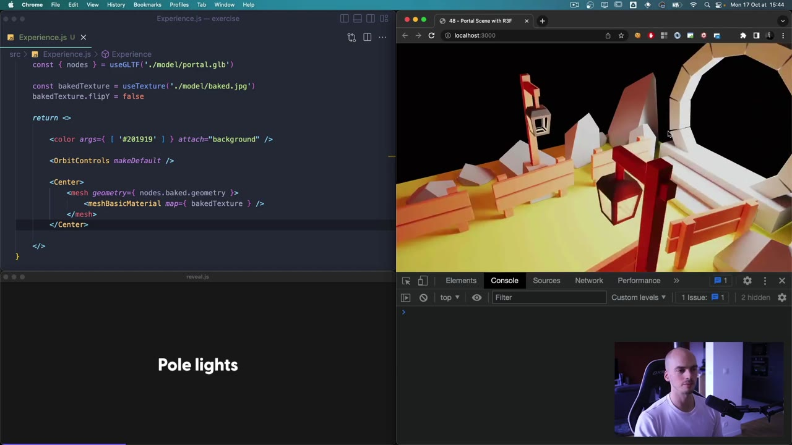
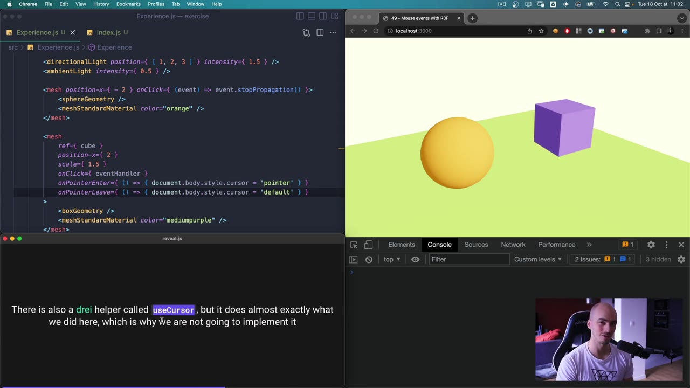

# 第 41 章 传送门场景与鼠标事件

本章用一个已完成的 Blender 传送门场景练习 React Three Fiber（R3F）的场景重组能力，并进一步建立完整的指针交互模型。重点不在重复建模、烘焙和导出，而在如何把 glTF 中的节点拆成可独立配置材质的 JSX 网格，如何复用烘焙纹理与 GLSL 着色器，以及如何用声明式事件替代手工维护的 Raycaster 流程。传送门项目说明“对象如何进入场景”，鼠标事件则说明“用户如何作用于这些对象”；二者共同构成可阅读、可交互的 R3F 应用基础。

## 准备场景并设置背景

课程直接复用此前制作的 `portal.glb`、`baked.jpg` 以及传送门顶点、片元着色器。模型和纹理位于 `public/model`，因此运行时路径不再包含 `public`：Vite 会把该目录中的资源作为站点根路径下的静态文件提供。若换用自己的模型，必须检查节点名称、变换和烘焙方式，不能机械照搬后文的属性名。

初始应用只需保留 `Canvas`、`Experience` 与 Drei 的 `OrbitControls`。默认画布看似白色，实际上可能是透明背景露出了页面颜色。要明确设置 Three.js 场景背景，可以创建一个 `Color` 实例，并用 `attach="background"` 把它附加到父级场景的 `background` 属性：

```jsx
<Canvas
    camera={ {
        fov: 45,
        near: 0.1,
        far: 50,
        position: [ 1, 2, 6 ]
    } }
>
    <color args={ [ '#030202' ] } attach="background" />
    <Experience />
</Canvas>
```

`args` 对应类构造函数参数，所以即使只传一个颜色值也必须使用数组。仅写 `<color args={ [ '#030202' ] } />` 只会创建颜色对象；`attach` 才建立了它与场景属性之间的关系。这种“声明实例并附加到父对象”的方式，也适用于材质、几何体及其他 Three.js 对象。

## 拆分 glTF 节点并恢复烘焙外观

Drei 的 `useGLTF` 负责加载模型并返回其场景、节点等资源。本例不直接用 `<primitive object={ model.scene } />` 放入整棵场景树，而是解构 `nodes`，分别重建 `baked`、`poleLightA`、`poleLightB` 和 `portalLight`。这样做是因为各部分需要不同材质：主体使用烘焙贴图，两处灯头使用固定发光色，门面则使用自定义着色器。若直接保留原模型材质，后续定制会变得迂回。

```jsx
import { useGLTF, useTexture, Center, OrbitControls } from '@react-three/drei'

export default function Experience()
{
    const { nodes } = useGLTF('./model/portal.glb')
    const bakedTexture = useTexture('./model/baked.jpg')
    bakedTexture.flipY = false

    return <>
        <OrbitControls makeDefault />
        <Center>
            <mesh geometry={ nodes.baked.geometry }>
                <meshBasicMaterial map={ bakedTexture } />
            </mesh>
        </Center>
    </>
}
```

这里复用的是节点中的 `geometry`，而不是再创建一份几何体。`useTexture` 加载烘焙图后，将其交给 `meshBasicMaterial` 的 `map`。烘焙纹理已经包含光照、阴影和色彩信息，因此主体无需再依赖实时光照，使用不受灯光影响的基础材质即可。这也避免了把光照重复计算到已经烘焙的结果上。

本课程所用外部纹理需要设置 `bakedTexture.flipY = false`，否则图像会在 Y 方向翻转。也可以在 JSX 中沿属性路径写 `map-flipY={ false }`，但既然已经持有 `bakedTexture` 引用，直接修改纹理本身更直观。该设置取决于纹理来源与导出流程，不应被当成所有图片都必须执行的固定步骤。

开发时若通过热更新把 `map` 注入一个已经创建的材质，旧材质的色彩编码状态可能暂时没有同步，画面因此显得过亮。先完整刷新，让纹理与材质重新创建，再判断颜色配置是否正确，可以避免把热更新的中间状态误当成最终渲染问题。

`Center` 根据子内容的整体包围范围调整位置，使传送门成为轨道控制的视觉中心。它不同于单独提高相机或控制器目标点：这里移动的是内容分组，因此后续加入的灯头、门面和粒子也应放在同一个 `Center` 内，才能作为整体居中。如果模型节点缺失或名称不符，应先查看 `useGLTF` 返回的 `nodes`，确认实际拼写，而不是通过随意移动网格来掩盖资源结构问题。



*图 41-1 将 glTF 节点拆为独立网格后，分别恢复烘焙主体、灯头与门面*

## 恢复灯头变换并校准色彩管理

两处灯头同样复用 glTF 几何体，但还必须复制原节点的位置。只取 `geometry` 不会自动继承原网格的 `position`、`rotation` 和 `scale`，新网格会使用默认变换，灯头因此可能落在地面或场景原点。门面的平面还可能与主体重叠，产生深度冲突；补回原节点变换后，几何关系才与 Blender 中一致。

```jsx
<mesh
    geometry={ nodes.poleLightA.geometry }
    position={ nodes.poleLightA.position }
>
    <meshBasicMaterial color="#ffffe5" />
</mesh>

<mesh
    geometry={ nodes.poleLightB.geometry }
    position={ nodes.poleLightB.position }
>
    <meshBasicMaterial color="#ffffe5" />
</mesh>

<mesh
    geometry={ nodes.portalLight.geometry }
    position={ nodes.portalLight.position }
    rotation={ nodes.portalLight.rotation }
>
    <portalMaterial />
</mesh>
```

`portalLight` 的命名反映了它在烘焙方案中作为发光区域的角色，并不意味着这里创建了实时灯光。若自有模型还保留非单位缩放，应继续传入 `scale={ nodes.portalLight.scale }`。两处灯头各自声明一个基础材质会形成两个材质实例，但对如此小的场景而言，为了强行共享材质而增加抽象并不划算；在大量重复对象的项目中，再考虑复用更合理。

恢复模型后，画面可能比 Blender 烘焙结果更亮、更鲜艳。原因是 R3F 的默认渲染配置会应用 ACES 色调映射，而这张烘焙纹理在制作时已经经过 Blender 的色彩管理与色调映射。再次映射会改变原本已经定稿的颜色。课程的解决方式是在 `Canvas` 上加入 `flat`，关闭默认色调映射：

```jsx
<Canvas flat camera={ { position: [ 1, 2, 6 ], fov: 45, near: 0.1, far: 50 } }>
    <color args={ [ '#030202' ] } attach="background" />
    <Experience />
</Canvas>
```

`flat` 的目的不是让所有场景都“更扁平”，而是避免对已烘焙色彩进行二次处理。若项目使用未烘焙材质、HDR 光照或另一条后期处理链，则应重新评估色调映射配置，而不是无条件复制此属性。

## 用 Sparkles 与自定义材质完成动态传送门

早期版本用自定义粒子着色器绘制萤火虫，本章改用 Drei 的 `Sparkles`，把粒子生成、漂浮动画和渲染交给助手。将其放在 `Center` 内，并明确粒子尺寸、活动范围与速度：

```jsx
import { Sparkles } from '@react-three/drei'

<Sparkles
    size={ 6 }
    scale={ [ 4, 2, 4 ] }
    position-y={ 1 }
    speed={ 0.2 }
    count={ 40 }
/>
```

`size` 控制单个闪光点的视觉大小，`scale` 则定义粒子分布区域的宽、高、深，并不是把每个粒子放大到对应倍数。`position-y={ 1 }` 将活动区域整体上移，使大部分粒子位于地板上方；`speed` 降低漂浮速度，`count` 控制数量。区域边界并不等同于严格碰撞约束，若仍有少量粒子进入地板，可继续调整位置和区域高度。

门面着色器沿用此前的 GLSL 文件。顶点着色器完成标准变换并传递 `vUv`；片元着色器用时间驱动的 Perlin 噪声扰动 UV，叠加边缘辉光与阶梯化处理，最后在起始色和结束色之间混合。项目通过 `vite-plugin-glsl` 导入 `.glsl` 文件：在现有 Vite 配置中导入 `glsl`，并把 `glsl()` 加入 `plugins`，随后即可把文件作为字符串导入。

```jsx
import portalVertexShader from './shaders/portal/vertex.glsl'
import portalFragmentShader from './shaders/portal/fragment.glsl'
```

原生 `<shaderMaterial>` 可以接收 `vertexShader`、`fragmentShader` 和带 `{ value: ... }` 包装的 `uniforms`。Drei 的小写 `shaderMaterial` 助手则把默认值、着色器和材质类创建合并起来，再通过 R3F 的 `extend` 注册为 JSX 标签。材质类应在组件外创建，避免把类定义与每次组件渲染混在一起：

```jsx
import * as THREE from 'three'
import { shaderMaterial } from '@react-three/drei'
import { extend, useFrame } from '@react-three/fiber'
import { useRef } from 'react'

const PortalMaterial = shaderMaterial(
    {
        uTime: 0,
        uColorStart: new THREE.Color('#ffffff'),
        uColorEnd: new THREE.Color('#000000')
    },
    portalVertexShader,
    portalFragmentShader
)

extend({ PortalMaterial })
```

与原生 `uniforms` 对象不同，这里直接提供 `uTime: 0` 等默认值，助手会建立相应的 uniform。注册后使用小写开头的 `<portalMaterial>`，它与前述门面网格结合：

```jsx
const portalMaterial = useRef()

useFrame((state, delta) =>
{
    portalMaterial.current.uTime += delta
})

// 位于 portalLight 网格内部
<portalMaterial ref={ portalMaterial } />
```

`useRef` 保存实际材质实例，`useFrame` 每帧累加 `delta`，使不同帧率设备上的动画速度一致。借助该助手，可直接写 `current.uTime`，无需再沿 `uniforms.uTime.value` 访问。若只导入着色器而没有提供三个 uniform，片元计算缺少必要输入，门面可能无法显示预期图案；若需要调节动画速率，可以在 `delta` 上乘以系数。

## 从 onClick 进入声明式指针交互

R3F 的事件以指针（pointer）为核心，而不是只服务于桌面鼠标，因此点击、触摸和触控笔可共享大部分处理逻辑。传统 Three.js 交互通常要自行创建 Raycaster、换算指针坐标、在适当时机投射射线并筛选交点；R3F 把这些步骤接入渲染循环和场景图，开发者只需在目标对象上声明回调。

下面的立方体已经通过 `cube` 引用执行旋转，点击时复用该引用修改材质颜色：

```jsx
const cube = useRef()

useFrame((state, delta) =>
{
    cube.current.rotation.y += delta * 0.2
})

const cubeClickHandler = (event) =>
{
    cube.current.material.color.set(
        `hsl(${ Math.random() * 360 }, 100%, 75%)`
    )
}

<mesh ref={ cube } position-x={ 2 } scale={ 1.5 } onClick={ cubeClickHandler }>
    <boxGeometry />
    <meshStandardMaterial color="mediumpurple" />
</mesh>
```

`material.color` 是 `THREE.Color`，因此调用其 `set` 方法即可更新现有颜色实例。HSL 字符串中的色相直接写数值，不添加 `deg`；饱和度与明度分别使用 `100%` 和 `75%`。处理器既可以内联在 `onClick` 中，也可以像这里一样独立命名。逻辑稍复杂时，使用 `cubeClickHandler` 这类具有对象和动作含义的名称，比通用的 `eventHandler` 更容易维护。

点击并不等同于一次按下。R3F 会综合按下、移动和释放过程，判断这是否仍是对同一对象的有效点击；按下后移出对象再释放，通常不应触发普通点击。这些细节由事件系统处理，使业务回调可以保持简洁，但设计拖拽等手势时仍应分别使用按下、移动与释放事件。

## 选择事件类型并读取交点信息

不同事件对应不同的交互意图。`onClick` 适合确认选择，`onContextMenu` 对应上下文菜单而非单纯的物理右键，触摸设备上的长按也可能触发它；`onDoubleClick` 处理双击，其时间间隔受操作系统设置影响。`onPointerDown` 在按下时触发，`onPointerUp` 在释放时触发，二者可用于拖拽起点和终点。

悬停相关属性包括 `onPointerOver`、`onPointerEnter`、`onPointerOut` 与 `onPointerLeave`。在原生 DOM 中，`over/out` 与 `enter/leave` 对子元素冒泡的处理存在差别；在 R3F 的这套对象事件里，课程将对应的 over/enter 与 out/leave 视为相同用法，不必照搬 DOM 的区分。`onPointerMove` 用于指针在对象上移动，它可能随每次渲染帧执行，但指针完全静止时不会仅因对象自身运动就持续触发。

`onPointerMissed` 表示点击没有命中所关注的对象。它既能放在具体网格上，也能放在 `Canvas` 上：前者适合“点到了这个对象之外”，后者适合关闭整个 3D 交互中的选择或面板。若场景中只有部分对象注册了事件，Canvas 级未命中的判断也与这套可交互对象集合相关，不能简单理解为对页面所有像素的原生空白点击监听。

事件回调接收的对象混合了原生指针信息与 R3F 射线交点信息，常用字段如下。

| 字段 | 含义与典型用途 |
|---|---|
| `distance` | 相机到当前交点的距离，可判断命中远近。 |
| `point` | 交点在三维世界中的坐标，可在点击位置生成粒子或标记。 |
| `uv` | 交点在几何体上的 UV 坐标，可用于纹理绘制或局部采样；前提是几何体具有有效 UV。 |
| `object` | 实际被射线命中的对象，复合模型中通常是某个具体子网格。 |
| `eventObject` | 注册当前事件监听器的对象，可能是包含被命中网格的组或 `primitive`。 |
| `x`、`y` | 指针的屏幕坐标，可与二维界面或自定义手势计算配合。 |
| `shiftKey`、`ctrlKey`、`metaKey` | 修饰键状态，可用于追加选择、快捷操作等；不同系统的按键习惯需要实际测试。 |

家具配置器可以用 `onClick` 选中家具并打开材质面板，再用 Canvas 的 `onPointerMissed` 关闭面板。即时战略游戏则可用点击选择单位、用 Shift 追加选择、用按下和释放围出框选区域，并在点击空地时取消选择。事件类型的选择应由用户任务决定，而不是把所有监听器都堆到每个对象上。

## 控制射线传播、遮挡与复合模型事件

R3F 会沿相机到指针的射线收集交点，并按距离从近到远处理。若射线依次穿过球体、立方体和圆柱体，而且三者都监听点击，默认可能依次触发它们的回调，而不是只处理视觉上最前面的一个。因此，后方对象“能够被点中”不一定意味着射线检测失效，而可能只是前方对象没有阻止事件继续传播。

在任一交点回调中调用 `event.stopPropagation()`，即可阻止事件继续传播到更远的交点。若希望球体在位于立方体前方时遮挡立方体，可给球体也声明点击事件并停止传播：

```jsx
<mesh
    position-x={ -2 }
    onClick={ (event) => event.stopPropagation() }
    onPointerEnter={ (event) => event.stopPropagation() }
>
    <sphereGeometry />
    <meshStandardMaterial color="orange" />
</mesh>
```

这里球体的处理器不需要执行其他业务，其存在本身就参与了交互遮挡。对悬停也停止传播，可以避免指针已经落在前方球体上时，后方对象仍展示可点击状态。遮挡策略应按产品需要设计：有时只允许操作最前对象，有时则确实需要同时处理一条射线上的多个对象。

复合 glTF 模型还会暴露另一个问题。通过 `<primitive object={ hamburger.scene } />` 加入汉堡后，事件可以声明在整个 primitive 上，但射线仍会与内部多个网格相交。一次点击面包、肉饼和奶酪重叠的位置，可能让同一组上的回调执行多次。下面的写法在最前面的有效交点处停止传播，保证一次点击只处理一次，同时打印实际命中的子网格：

```jsx
const hamburger = useGLTF('./hamburger.glb')

<primitive
    object={ hamburger.scene }
    scale={ 0.25 }
    position-y={ 0.5 }
    onClick={ (event) =>
    {
        console.log(event.object.name)
        event.stopPropagation()
    } }
/>
```

此时 `event.object` 可能是名为 `topBun`、`bottomBun` 等具体网格，而 `event.eventObject` 是注册 `onClick` 的 primitive 所代表的整组对象。前者适合判断“击中了哪一部分”，后者适合判断“哪个交互组收到了事件”。从模型另一侧点击时，最近的子网格会改变，因此日志中的名称也可能不同。



*图 41-2 通过停止传播处理前后遮挡，并避免复合模型的一次点击触发多次业务逻辑*

## 提供悬停反馈并控制交互成本

可点击对象需要可发现的反馈。桌面端常见做法是在指针进入时把光标改为手型，离开时恢复默认。若页面几乎完全由 WebGL 画布组成，可以直接修改 `body`：

```jsx
<mesh
    ref={ cube }
    position-x={ 2 }
    onClick={ cubeClickHandler }
    onPointerEnter={ () => { document.body.style.cursor = 'pointer' } }
    onPointerLeave={ () => { document.body.style.cursor = 'default' } }
>
    <boxGeometry />
    <meshStandardMaterial color="mediumpurple" />
</mesh>
```

如果页面还有画布外的链接、按钮或滚动内容，不宜让 3D 对象永久改变整个页面的光标。可以通过 `useThree` 取得 `gl`，再修改 `gl.domElement.style.cursor`，把影响限制在渲染器画布上。Drei 也提供 `useCursor` 助手，但本例的原生写法已经足够直接。触摸设备没有持续悬停光标，仍需依靠按钮造型、动画提示或清晰的视觉层级传达可点击性。

声明事件很简短，不代表检测没有成本。射线求交主要由 CPU 完成，悬停、进入、离开和移动等监听还需要持续检测。应只为真正需要交互的对象注册事件，避免无必要的逐帧检测，并谨慎处理高三角面数几何体。若点击复杂模型时动画出现明显停顿，应先检查射线求交是否成为瓶颈，而不是立即归因于渲染分辨率。

Drei 的 `meshBounds` 是一种低成本近似方案。它用理论包围球代替原始网格进行指针检测，适合允许一定命中文差的对象：

```jsx
import { meshBounds } from '@react-three/drei'

<mesh raycast={ meshBounds } onClick={ cubeClickHandler }>
    <boxGeometry />
    <meshStandardMaterial color="mediumpurple" />
</mesh>
```

它用于单个网格，不适合直接套在由许多子网格组成的汉堡 primitive 上。包围球比真实轮廓大，因此指针略在立方体边缘之外也可能命中。若复杂模型必须保留精确轮廓，可采用边界体积层次结构（Bounding Volume Hierarchy，BVH）加速射线检测；Drei 的 `Bvh` 助手可把这套优化接入场景。BVH 的实现和预处理更复杂，应在近似检测与减少监听仍无法满足需求时使用，而不是作为所有对象的默认配置。

## 本章小结

传送门场景的重构展示了 R3F 如何把现有 Three.js 资源转化为声明式场景图：通过 `useGLTF` 与 `useTexture` 取得资源，按需复用节点几何体和变换，分别附加材质，再用 `Center`、`Sparkles` 与自定义 `PortalMaterial` 完善构图和动画。对已经烘焙的颜色，应通过 `flat` 避免默认色调映射造成二次处理；对自定义着色器，则要同时处理 GLSL 导入、uniform 初始化、JSX 注册和基于 `delta` 的更新。

指针事件让同一棵场景图具备交互能力。`onClick` 等属性隐藏了手工 Raycaster 流程，但事件对象仍暴露交点、命中对象和原生指针状态。正确处理 `stopPropagation`、`object` 与 `eventObject`，才能解决遮挡和复合模型重复触发。最后，交互设计还必须兼顾可发现反馈与 CPU 成本，在普通射线检测、`meshBounds` 近似和 BVH 精确加速之间按实际需求取舍。
