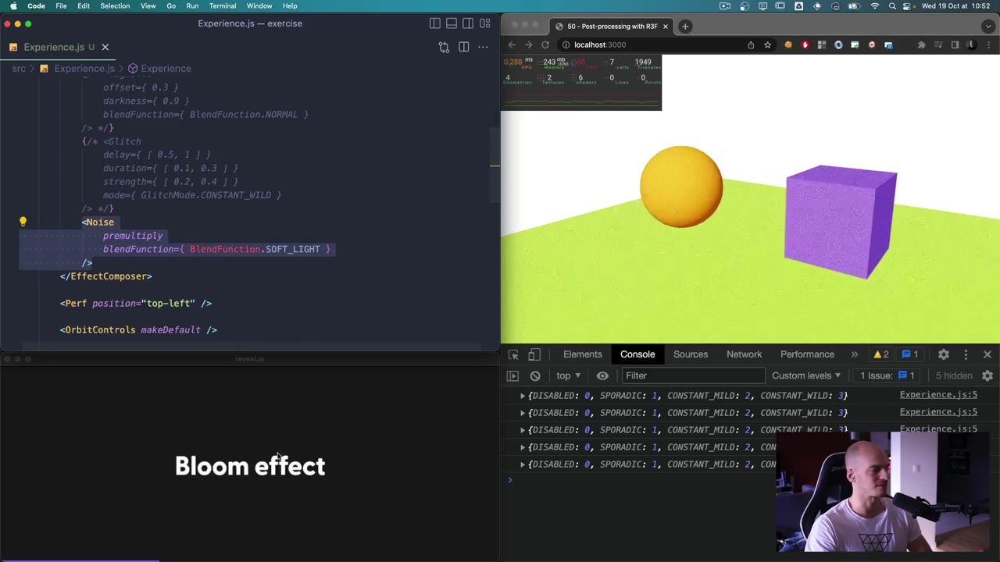
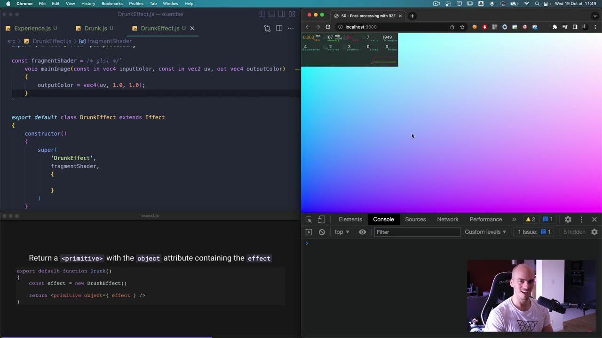

# 第 42 章 R3F 中的后期处理

本章在 R3F 中建立一条可组合、可调试的后期处理链，并进一步编写自定义效果。内容分为三个层次：首先理解 `postprocessing` 库为何把多个效果合并到尽可能少的渲染通道中；随后用暗角、故障、噪点、辉光和景深掌握效果组件、混合函数与关键参数；最后让自定义 `DrunkEffect` 同时满足底层库的着色器约定和 React 组件的 props、ref 使用方式。后期处理不仅改变画面，也直接增加 GPU、带宽与同步成本，因此每项视觉决策都应与分辨率、设备像素比和实测性能一起评估。

## 从独立 Pass 到可合并的 Effect

传统 Three.js 后期处理通常以 `EffectComposer` 管理一串 pass：先用 `RenderPass` 渲染场景，再依次加入其他通道。每个 pass 都可能读取上一张全屏纹理、执行自己的着色器并写入下一张纹理；某些效果还会额外渲染深度、法线或多次模糊。流程直观，却容易产生重复工作。通道越多，全屏绘制和纹理往返越多，在大画布、高设备像素比（DPR）或性能较弱的移动设备上尤其明显。DPR 为 2 时，两个方向上的像素数都翻倍，总像素量约为基础分辨率的四倍。

本章采用的底层依赖名为 `postprocessing`，React 侧适配层名为 `@react-three/postprocessing`。这里的“Effect”不只是给 pass 换一个名称：库会分析效果，把可以合并的着色代码组织到尽可能少的通道中，同时保留开发者声明的效果顺序。某些效果因算法需要仍会执行额外渲染，不能承诺所有组合最终只剩一次绘制；优化目标是消除可以避免的独立全屏通道，而不是改变每种效果的必要计算。

React 适配层也导出一个名为 `EffectComposer` 的组件，但它不是此前直接实例化的 Three.js `EffectComposer` 类。新组件负责把 JSX 子效果转换为上述库的合成流程，并自动处理基础场景渲染，因此无需再手动添加 `RenderPass`。声明顺序仍然重要：先调色、再暗角、再辉光，与交换这些步骤后的输入图像并不相同。

这种结构还带来两项声明式优势。其一，效果参数可以直接写成 props，并由 Leva 等 React 调试工具驱动；其二，每种效果可指定混合函数，决定其输出如何与前面已经得到的颜色组合。视觉效果因此既可独立测试，也可作为一条有序管线统一调整。

## 安装依赖并建立 EffectComposer

先加入 React 适配层，再在需要直接引用枚举或基类时显式安装底层库：

```bash
npm install @react-three/postprocessing
npm install postprocessing
```

实际复现课程时，应以课程包 `package.json` 中相互匹配的版本为准，不要只升级其中一个包后再预期所有 API 和画面完全一致。录制环境中若出现 npm 无法解析 peer dependency 的错误，原流程使用 `--force` 继续安装；该参数只是绕过依赖解析限制，并不能证明版本兼容，也不会消除安全审计问题。使用前应先确认报错确实来自课程依赖组合，而不是把它当作所有安装错误的通用修复。

虽然 `@react-three/postprocessing` 自身会带入 `postprocessing`，代码若直接写 `import { BlendFunction } from 'postprocessing'`，就应在项目清单中显式声明后者。否则项目实际上依赖的是“另一个依赖碰巧安装的传递依赖”，适配层调整版本或包管理器改变布局后，导入可能失效，其他开发者也难以从清单判断真实依赖关系。

最小组件结构如下：

```jsx
import { EffectComposer, Vignette } from '@react-three/postprocessing'

export function Effects()
{
    return <EffectComposer>
        <Vignette />
    </EffectComposer>
}
```

把 `<Effects />` 放入 `Canvas` 内的场景组件即可。示例较少时也能直接把合成器写在 `Experience` 中；效果增多后，独立组件能避免场景对象、灯光与后期配置挤在同一文件。修改合成器和底层着色代码后，热更新偶尔可能保留不一致的渲染状态，排查时应结合完整刷新，而不是连续叠加旧状态。

课程所用版本的 `multisampling` 默认值为 8，用于多重采样抗锯齿，减轻几何边缘的阶梯状锯齿。设为 0 可关闭它，设为 4 是一种中间取舍：

```jsx
<EffectComposer multisampling={ 4 }>
    <Vignette />
</EffectComposer>
```

多重采样与原生 WebGL 渲染器的抗锯齿都关心边缘质量，但此处配置作用于后期处理所用的离屏渲染流程。不能只在普通画布上看到抗锯齿有效，就忽略后期链中的采样设置。数值越高也不代表可以不计成本，应结合目标设备与分辨率测试。

两套文档需要配合阅读：`@react-three/postprocessing` 文档说明 React 组件、props 和封装方式，`postprocessing` 文档说明底层效果、枚举、混合算法与自定义效果接口。仅在组件文档中找不到某个参数时，底层效果文档往往是必要的补充。

## 用暗角理解混合函数与透明背景

暗角（Vignette）使画面边缘和角落变暗，把视线引向中心，常用于电影感、压抑氛围或轻微的镜头模拟。组件无需额外场景对象即可工作，`offset` 调整暗角向中心延伸的位置，`darkness` 控制暗化强度：

```jsx
import { BlendFunction } from 'postprocessing'
import { EffectComposer, Vignette } from '@react-three/postprocessing'

<color args={ [ '#ffffff' ] } attach="background" />

<EffectComposer>
    <Vignette
        offset={ 0.3 }
        darkness={ 0.9 }
        blendFunction={ BlendFunction.NORMAL }
    />
</EffectComposer>
```

`blendFunction` 是效果普遍具有的配置。可以把它类比为图像编辑软件的图层混合：当前效果是一层，之前的场景渲染和其他效果是下一层，混合函数决定两层像素如何组合。`NORMAL` 按正常方式和透明度覆盖，效果自己的 alpha 决定原画面保留多少；`COLOR_BURN` 等模式会产生更强烈的颜色关系。模式名称只能提示算法类别，最终效果仍受场景明暗、色调映射和前序效果影响，适合用 Leva 枚举后实际比较，而不是脱离画面推断。

透明背景会暴露一个常见现象：几何体附近有暗角，画布空白区域却没有。这里并非效果只识别物体，而是透明像素参与了合成，底层透明性使暗角无法按预期呈现在那些区域。如果设计目标就是透视到画布背后的网页内容，这种行为可能正合适；若希望得到完整的不透明画面，则像上例一样把颜色附加到场景 `background`，再评估暗角。背景、透明度和效果输入属于同一条颜色管线，不能只调暗角参数来掩盖输入问题。



*图 42-1 暗角效果及其与场景背景、前序像素之间的混合关系*

## 调整故障与噪点效果

故障（Glitch）会间歇或持续地错位、撕裂画面。它适合信号干扰、系统异常等风格，但闪烁和快速移动可能引起不适，测试时应控制亮度、效果强度与持续时间，并为敏感用户提供降低动态效果的可能。下面的配置把等待时间、单次持续时间和强度分别设为范围：

```jsx
import { Glitch } from '@react-three/postprocessing'
import { GlitchMode } from 'postprocessing'

<Glitch
    delay={ [ 0.5, 1 ] }
    duration={ [ 0.1, 0.3 ] }
    strength={ [ 0.2, 0.4 ] }
    mode={ GlitchMode.CONSTANT_MILD }
/>
```

`delay` 控制故障出现的时间间隔范围，`duration` 控制每次故障的持续时间范围，`strength` 控制扰动强弱范围；降低这些强度值可得到更克制的结果。`GlitchMode.SPORADIC` 用于零星出现，`CONSTANT_MILD` 与 `CONSTANT_WILD` 用于持续但强度不同的表现。课程录制中对个别模式的行为存在版本相关疑问，因此使用枚举时应以当前锁定版本和实测结果为准，不宜把某次热更新中的异常直接归结为模式定义。

噪点（Noise）在全屏加入随机颗粒，可模拟胶片颗粒、传感器干扰或轻微纹理。默认覆盖往往过重，混合函数与预乘配置比单纯增加噪点更重要：

```jsx
import { Noise } from '@react-three/postprocessing'
import { BlendFunction } from 'postprocessing'

<Noise
    premultiply
    blendFunction={ BlendFunction.SOFT_LIGHT }
/>
```

`SOFT_LIGHT` 通常比直接覆盖更容易保留原场景，`OVERLAY`、`SCREEN` 和 `AVERAGE` 会得到不同的明暗与灰度倾向，没有脱离场景的固定最佳项。`premultiply` 在混合前让噪点与输入颜色发生预乘，因此亮部和暗部感知到的颗粒会发生变化。有效调试顺序是先单独显示噪点，再启用 `premultiply`，最后逐一比较混合函数；若一开始就与其他强效果叠加，很难判断差异来自哪里。

暗角、故障和噪点可以按声明顺序组合，但学习参数时应一次突出一种效果。组合测试不仅用于观察风格，也用于确认合成器是否按预期保留顺序并合并可合并的工作。

## 用 HDR 颜色驱动 Bloom 辉光

辉光（Bloom）把高亮区域的能量扩散到周围像素。普通颜色通道通常处在 0 到 1 的范围内，而默认亮度阈值附近的像素并不多，因此在明亮背景下简单加入 `<Bloom />` 可能几乎看不到变化。测试时先使用较暗背景，再给目标材质超出普通范围的颜色通道：

```jsx
<mesh>
    <boxGeometry />
    <meshBasicMaterial color={ [ 1.5, 1, 4 ] } />
</mesh>

<Bloom mipmapBlur />
```

数组依次对应 R、G、B，这里蓝色通道为 4，超过了普通 LDR 颜色上限。它并不是把 CSS 色值写大，而是让材质输出进入高动态范围，使亮度阈值能够区分目标与背景。`MeshBasicMaterial` 不受场景灯光影响，各面使用一致的颜色输出，因此很适合验证“物体本身发光”的效果。

`mipmapBlur` 是值得优先尝试的模糊方式。其思路类似纹理 mipmap：从当前渲染开始逐级形成更低分辨率的图像，再组合不同尺度的模糊结果。低分辨率层级能把高亮扩散到更远的位置，从而产生柔和、宽阔的光晕，同时避免只在大半径单尺度模糊上投入相同成本。底层仍需要渲染目标和多级处理，不能把“效果较好”理解为完全没有 GPU 开销。

若使用 `MeshStandardMaterial`，最终亮度是材质颜色、灯光、曝光和自发光共同作用的结果。同一立方体朝光面可能产生强辉光，背光面却很弱，这是光照模型的正常结果，却未必符合“整体发光体”的设计。可以设置 `emissive` 并用 `emissiveIntensity` 放大发光贡献；若希望高亮中心趋白，也可调整自发光颜色。基础材质没有 `emissive` 与 `emissiveIntensity` 属性，把二者直接留在 `<meshBasicMaterial>` 上会导致错误，应改用 HDR `color` 数组。

辉光组件自身的两个关键参数是 `intensity` 与 `luminanceThreshold`：

```jsx
<Bloom
    mipmapBlur
    intensity={ 0.5 }
    luminanceThreshold={ 0 }
/>
```

`luminanceThreshold` 是开始参与辉光的亮度界限，设为 0 会让几乎所有可见内容都进入模糊链；`intensity` 控制这些结果的总体强度。一种实用做法是把阈值和强度都保持克制，让全画面只有轻微的柔化，再单独把需要突出的物体颜色通道提高到远大于 1。若阈值很高而材质没有足够亮度，可能没有辉光；若阈值低、强度又高，则整个画面会泛白并丢失层次。两个参数必须与材质输出联合调整。

## 景深、效果顺序与性能验证

景深（DepthOfField）让对焦距离之外的区域模糊，可以突出主体或制作近摄、移轴般的观感。课程示例使用三个主要参数：

```jsx
import { DepthOfField } from '@react-three/postprocessing'

<DepthOfField
    focusDistance={ 0.025 }
    focalLength={ 0.025 }
    bokehScale={ 6 }
/>
```

`focusDistance` 指定对焦位置，`focalLength` 描述从清晰焦点向失焦区域过渡的尺度，`bokehScale` 控制散景模糊强度。这里的距离相关值使用相机近、远裁剪面之间的归一化空间，而不是直接把“相机到物体约有 8 个场景单位”写成 8。0 和 1 对应归一化深度范围的两端，具体对焦位置需要根据相机 `near`、`far` 和物体深度换算或通过调试确定。移动相机后，固定参数对应的清晰区域也会改变。

景深并不一定让画面更好。模糊会掩盖几何和纹理细节，不合适的焦点会让主体也难以辨认，而且额外深度与模糊处理有成本。应以实际镜头语言决定是否需要它，不要把景深当作所有写实场景的必备选项。

完成单项测试后，可以按明确顺序同时启用多个效果，观察合成与性能。`r3f-perf` 的 `<Perf />` 可辅助查看帧率与渲染耗时，但某台设备上“多个效果仍很流畅”不能推广为普遍结论。测试至少应覆盖以下变量：

- 使用实际发布画布的尺寸和 DPR，而不是只看编辑器旁的小预览。
- 分别记录无后期、单效果与完整效果链的结果，确认成本来自哪一项。
- 覆盖集成显卡、移动设备和高刷新率设备，避免以高端开发机为唯一依据。
- 检查效果顺序、色调映射与透明背景，排除把颜色错误误判为性能或算法错误的情况。
- 在视觉收益低于成本时，降低采样、模糊尺度或效果数量，而不是只追求效果堆叠。

合成器减少的是可合并通道的重复工作，并不会消除高分辨率像素、复杂模糊和多次场景渲染的成本。性能预算仍属于整体设计的一部分。

## 创建符合 postprocessing 约定的自定义效果

自定义效果需要同时穿过两层接口：底层类必须能被 `postprocessing` 合并与执行，React 包装组件必须能被 JSX 使用。先实现一个 `DrunkEffect`，让采样坐标按正弦波摆动，并把输出设置成可参与混合的绿色。文件 `DrunkEffect.jsx` 从底层包导入 `Effect` 和 `BlendFunction`，从 Three.js 导入 `Uniform`。

```jsx
import { BlendFunction, Effect } from 'postprocessing'
import { Uniform } from 'three'

const fragmentShader = /* glsl */`
    uniform float frequency;
    uniform float amplitude;
    uniform float time;

    void mainUv(inout vec2 uv)
    {
        uv.y += sin(uv.x * frequency + time) * amplitude;
    }

    void mainImage(
        const in vec4 inputColor,
        const in vec2 uv,
        out vec4 outputColor
    )
    {
        outputColor = vec4(0.8, 1.0, 0.5, inputColor.a);
    }
`

export default class DrunkEffect extends Effect
{
    constructor({ frequency, amplitude, blendFunction = BlendFunction.DARKEN })
    {
        super(
            'DrunkEffect',
            fragmentShader,
            {
                blendFunction,
                uniforms: new Map([
                    [ 'frequency', new Uniform(frequency) ],
                    [ 'amplitude', new Uniform(amplitude) ],
                    [ 'time', new Uniform(0) ]
                ])
            }
        )
    }

    update(renderer, inputBuffer, deltaTime)
    {
        this.uniforms.get('time').value += deltaTime
    }
}
```

继承 `Effect` 可以获得合成器所需的属性与方法。派生类构造函数中的 `super(...)` 必须先于 `this` 的使用，它接收效果名称、片元着色器和选项。选项中的 `uniforms` 是 JavaScript `Map`，每个键是着色器 uniform 名称，每个值是 `new Uniform(initialValue)`；更新时通过 `this.uniforms.get('time').value` 取回具体值，而不能像普通对象那样写 `uniforms.time`。

片元入口不能照搬普通 Three.js 片元着色器的 `void main()` 和 `gl_FragColor`。合成器会把多个效果的着色代码组织在一起，并要求效果实现约定的函数：

- `mainImage(const in vec4 inputColor, const in vec2 uv, out vec4 outputColor)` 处理当前像素。`inputColor` 是前序阶段的颜色，`uv` 是渲染坐标，`outputColor` 是必须写出的结果。
- `mainUv(inout vec2 uv)` 修改后续采样使用的 UV。`inout` 表示既可读取也可写回，因此函数内的变化会影响调用方持有的坐标。
- `const in` 表明输入按只读方式使用，`out` 表明函数需要写出该参数。这些限定词采用课程后期处理环境所使用的 WebGL2 GLSL 语法；上述签名中的类型和限定词不能随意省略，尤其 `outputColor` 是 `vec4`，不是 `vec2`。

在编写扭曲前，可以先让 `mainImage` 执行 `outputColor = inputColor`，验证自定义效果能够无损透传；也可用 `vec4(uv, 1.0, 1.0)` 检查 UV 渐变。这样的中间结果有助于区分“React 包装未挂载”“类构造失败”和“着色算法错误”，比一次写完所有逻辑更容易定位问题。

最终代码没有直接把绿色乘到 `inputColor.rgb` 上，而是输出纯绿色并保留输入 alpha，因为绿色与原图的组合交由 `blendFunction` 完成。若只需要固定绿色 tint，也可以在函数内先写 `vec4 color = inputColor`，再执行 `color.rgb *= vec3(0.8, 1.0, 0.5)` 并输出 `color`；但那样就把混合方式固化在着色器中，不如把这一决策开放给效果参数灵活。

## 用 forwardRef 暴露效果并连接 props

底层效果类不是 Three.js 网格，也不是 React 组件，因此还需一个包装文件 `Drunk.jsx`。组件接收 props，实例化效果，并通过 `<primitive>` 把现有对象加入 R3F 的 JSX 体系：

```jsx
import { forwardRef } from 'react'
import DrunkEffect from './DrunkEffect.jsx'

export default forwardRef(function Drunk(props, ref)
{
    const effect = new DrunkEffect(props)
    return <primitive ref={ ref } object={ effect } />
})
```

`props` 中的 `frequency`、`amplitude` 和 `blendFunction` 被完整转交给类构造函数。若外部还需要在动画或业务逻辑中访问效果实例，就会使用 ref。普通函数组件不能直接接收 ref，`forwardRef` 把外部传入的第二个参数转发到 `<primitive>`，最终使 `drunkRef.current` 指向实际的 `DrunkEffect` 实例。这里的外部 ref 是可选能力，但共享组件时保留它，调用方就不必修改包装组件才能访问底层对象。

在 `Experience` 中，Leva 可以像驱动其他 React props 一样驱动频率和振幅：

```jsx
import { useRef } from 'react'
import { useControls } from 'leva'
import { EffectComposer } from '@react-three/postprocessing'
import { BlendFunction } from 'postprocessing'
import Drunk from './Drunk.jsx'

export default function Experience()
{
    const drunkRef = useRef()
    const drunkProps = useControls('Drunk Effect', {
        frequency: { value: 2, min: 1, max: 20 },
        amplitude: { value: 0.1, min: 0, max: 1 }
    })

    return <EffectComposer>
        <Drunk
            ref={ drunkRef }
            { ...drunkProps }
            blendFunction={ BlendFunction.DARKEN }
        />
    </EffectComposer>
}
```

`frequency` 决定单位 UV 距离内正弦变化的密集程度，`amplitude` 决定 Y 方向采样偏移的幅度。频率过低时扭曲接近整幅缓慢弯曲，过高时会形成密集条纹；振幅若接近整个 UV 范围，画面会严重越界和断裂。滑块范围用于方便探索，不代表所有场景都应使用极端值。

构造函数为 `blendFunction` 提供 `BlendFunction.DARKEN` 默认值十分重要。调用方若只提供频率和振幅而省略混合函数，默认的正常覆盖可能让整幅画面呈现效果输出的绿色。设置默认模式后，组件在常规用法下即有合理结果，调用方仍能显式改为 `MULTIPLY`、`SCREEN` 等模式。组件的默认值、外部 props 和着色器输出三者需要一起设计，不能只在使用示例里临时修补。



*图 42-2 将自定义 Effect 包装为可接收 props 与 ref 的 React 组件，并调试频率、振幅和混合方式*

## 用 mainUv 与 deltaTime 驱动动态扭曲

`mainUv` 中的核心公式是：

```glsl
uv.y += sin(uv.x * frequency + time) * amplitude;
```

`uv.x` 为不同水平位置提供不同相位，`sin` 让 Y 方向偏移在正负之间往复，`time` 则整体移动相位。修改的是从上游图像取样的坐标，而不是场景中网格的顶点或相机的位置，所以三维场景仍保持原有结构，`OrbitControls` 也照常工作。画面波动来自后期采样，而不是物体真的在空间中晃动。

底层 `Effect` 的 `update(renderer, inputBuffer, deltaTime)` 会由后期处理系统按帧调用，无需再为该效果写一个 R3F `useFrame`。前两个参数分别提供渲染器和输入缓冲区，本例只使用第三个参数。把 `deltaTime` 累加到相位 uniform，可以把动画速度表示为“每秒推进多少”，而不是“每帧固定加 0.02”。若按帧固定累加，高刷新率设备上的扭曲会更快；使用秒为单位的 `deltaTime` 后，不同帧率下才能获得一致的时间进程。

自定义效果到此形成完整闭环：React props 决定初始频率、振幅和混合方式，`Map` 将这些值送入 GLSL，`mainUv` 与 `mainImage` 分别处理坐标和颜色，`update` 推进时间，`forwardRef` 则把底层实例保留给需要它的调用方。进一步扩展时，可以把颜色做成 `THREE.Color` uniform、把动画速度做成新 props，并继续通过 Leva 调试；这些扩展应沿用同一条数据路径，避免一部分参数绕到组件外的全局变量中。

## 本章小结

R3F 的后期处理由 `@react-three/postprocessing` 提供声明式入口，由 `postprocessing` 负责底层效果合成。与传统逐 pass 流程相比，它能合并可合并的工作，但仍受分辨率、DPR、模糊算法和额外地形数据渲染影响。`EffectComposer` 中的声明顺序、背景透明度和色调映射共同决定效果输入，不能只凭组件名称预测最终画面。

内置效果的使用重点是参数之间的关系：暗角依赖正确背景与混合函数，故障和噪点需要控制动态强度，Bloom 依赖 HDR 材质输出、亮度阈值与模糊尺度，景深则依赖归一化深度。自定义效果进一步要求遵守 `mainUv`、`mainImage` 和 `Map` uniforms 的接口，再用 `primitive`、`forwardRef` 和 props 接入 React。通过 `deltaTime` 更新、默认值设计与实际设备测量，效果链才能同时保持视觉可控、组件可用和性能可评估。
