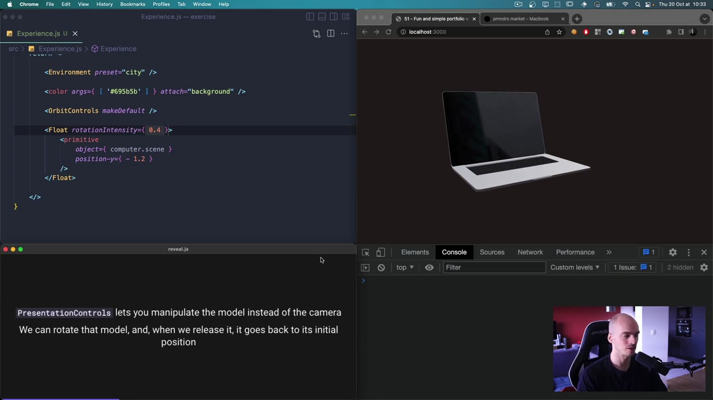
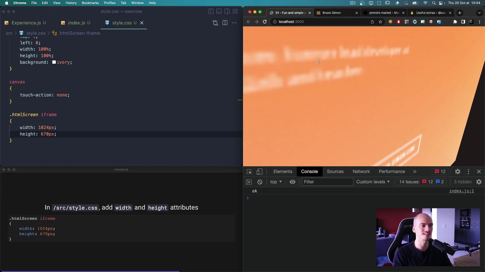

# 第 43 章 使用 R3F 构建简洁作品集

在网页开发与数字创意领域，作品集不仅是项目展示的平台，更是专业能力的直观体现。本章将指导你利用 React Three Fiber（R3F）及其辅助库 Drei，将一个基础的 HTML/CSS 作品集升级为沉浸式 3D 体验。通过在虚拟笔记本电脑屏幕上嵌入真实网页内容，实现传统网页与 WebGL 渲染的有机融合，为访客提供更具创意和互动性的浏览体验。

## 作品集的独特价值

在数字行业中，实践经验往往是衡量专业能力的最重要标准。作品集作为展示个人项目成果的核心载体，其质量直接影响职业发展机会。

### 传统作品集的局限

虽然一个结构清晰、内容完整的 HTML/CSS 作品集已经能够胜任基本信息展示，但在视觉冲击力和互动体验方面存在天然局限。这种传统形式难以在众多类似作品中脱颖而出，也难以直观展示 WebGL 与 Three.js 相关的专业技能。

### 3D 增强的机遇

通过将 HTML/CSS 作品集嵌入到精心设计的 3D 场景中，可以创造独特的视觉叙事。这种形式不仅展示了技术实现能力，还体现了对用户体验的关注。更重要的是，它本身就成为了一个值得展示的 WebGL 项目，完美契合 Three.js 开发者的专业定位。



*图 43-1 将 HTML 作品集嵌入 3D 场景的概念示意*

## 项目环境配置

### 初始项目结构

本章基于一个已配置好的 React Three Fiber 起步项目，其中包含以下核心依赖：

- `@react-three/fiber`: React Three Fiber 核心库
- `@react-three/drei`: Three.js 辅助组件库
- `three`: Three.js 3D 引擎
- `vite`: 构建工具与开发服务器

项目初始状态包含一个位于场景中心的简单立方体，用于验证渲染管道的正常运行。我们将在后续步骤中逐步替换这一占位内容。

### 调试工具准备

虽然本章示例将直接使用优化后的参数值，但在实际项目中强烈建议配置调试工具以加速开发过程：

```javascript
// 可选：Leva 调试界面
import { Leva } from 'leva'

function App() {
  return (
    <>
      <Leva />
      <Canvas>
        {/* 场景内容 */}
      </Canvas>
    </>
  )
}

// 可选：性能监控
import { Perf } from 'r3f-perf'

function Experience() {
  return (
    <>
      <Perf position="top-left" />
      {/* 其他组件 */}
    </>
  )
}
```

调试工具的价值不仅在于参数调整，还能帮助识别性能瓶颈，确保最终作品在各种设备上都能流畅运行。

## 背景与氛围设计

作为 3D 场景的基础，背景色彩直接影响整体氛围与内容可读性。我们的目标是创建一个温暖、专注的环境，让用户的注意力自然集中在核心内容上。

### 背景色彩设置

在 React Three Fiber 中，可以通过 `<color>` 组件配合 `attach="background"` 属性来设置场景背景色：

```javascript
// Experience.jsx
export default function Experience() {
  return (
    <>
      <color args={['#241a1a']} attach="background" />
      {/* 其他场景元素 */}
    </>
  )
}
```

这里的深红褐色（`#241a1a`）具有以下优势：
- **视觉焦点**：暗色调自然引导视线向明亮的场景中心集中
- **色彩对比**：与后续将添加的笔记本电脑模型形成良好对比
- **氛围营造**：创造专业、专注且略带温暖的工作环境感

### 色彩心理学考量

作品集场景的色彩选择需要考虑心理学因素：
- **专业感**：深色系传递专业、可靠和稳重的印象
- **注意力引导**：暗背景配合明亮主体形成自然的视觉层次
- **情绪调节**：暖色调比冷色调更具亲和力，适合创意领域展示

## 笔记本电脑模型集成

作为作品集的载体，笔记本电脑模型需要满足真实性、兼容性和美学表现等多重要求。

### 模型来源选择

课程从 PMNDRS Market（https://market.pmnd.rs）获取 MacBook 模型。该平台提供面向 Three.js 和 R3F 生态的资源与示例，但每个模型仍应单独检查授权、拓扑、纹理和文件体积，不能把平台来源直接视为性能或许可保证。

### 模型加载实现

我们将使用 CDN 链接直接加载 MacBook 模型，避免本地文件管理的复杂性：

```javascript
// Experience.jsx
import { useGLTF } from '@react-three/drei'

export default function Experience() {
  // 加载 MacBook 模型
  const computer = useGLTF(
    'https://vazxmixjsiawhamofees.supabase.co/storage/v1/object/public/models/macbook/model.gltf'
  )

  // 备选链接，防止主链接失效
  // 'https://threejs-journey.com/resources/models/macbook_model.gltf'

  return (
    <>
      {/* 背景与灯光 */}
      <primitive object={computer.scene} />
    </>
  )
}
```

### 模型渲染优化

初始加载的模型可能呈现全黑色，这是正常现象，因为 Three.js 场景需要光源才能正确显示材质细节。我们将在后续步骤中添加环境光和人工光源解决这一问题。

## 照明与环境配置

照明配置是决定场景真实感和情绪表达的关键因素。我们将结合环境光和人工光源创造自然且富有层次的光照效果。

### 环境光预设

Drei 的 `<Environment>` 组件提供了一组精心调校的环境光预设，简化了光照设置过程：

```javascript
// Experience.jsx
import { Environment } from '@react-three/drei'

export default function Experience() {
  return (
    <>
      <Environment preset="city" />
      {/* 其他场景元素 */}
    </>
  )
}
```

`city` 预设提供了以下特性：
- **全局均匀**：创建柔和的基础照明，减少硬阴影
- **反射映射**：为金属和玻璃材质提供真实的环境反射
- **色彩平衡**：中性色调确保模型材质色彩准确显示

### 预设选择策略

除了 `city` 预设，Drei 还提供多种环境选择：
- **apartment**：室内场景，温暖的居家氛围
- **studio**：摄影棚效果，突出主体细节
- **park**：自然光效，适合户外展示
- **sunset**：戏剧性暖光，增强情绪表达

选择环境预设时需考虑作品集内容的整体色调和期望传达的情绪。

## 浮动动画效果

静态的模型展示虽然清晰，但缺乏动态吸引力。我们将为笔记本电脑添加微妙的浮动效果，增强场景的生动性。

### 模型位置调整

在添加动画前，需要将模型调整到合适的垂直位置：

```javascript
<primitive
  object={computer.scene}
  position-y={-1.2}
/>
```

垂直位置 `-1.2` 的设定基于以下考虑：
If接受到目标系统的搭建，可以实现更好的可视化
预留了后续添加阴影的空间
屏幕角度适合访客自然观看
### 浮动动画实现

Drei 的 `<Float>` 组件为物体添加自然的漂浮效果，模拟失重或水中漂浮的视觉效果：

```javascript
import { Float } from '@react-three/drei'

// 使用方式
<Float rotationIntensity={0.4}>
  <primitive
    object={computer.scene}
    position-y={-1.2}
  />
</Float>
```

### 强度参数调整

考虑到屏幕上将显示可交互的网页内容，过度的旋转会影响可用性。我们将旋转强度降低到 `0.4`：

```javascript
<Float rotationIntensity={0.4}>
  {/* 模型 */}
</Float>
```

这一设置实现了微妙的动态感，同时确保：
- **内容可读性**：屏幕始终保持相对稳定，不影响网页交互
- **视觉吸引力**：轻微的浮动创造生动的视觉体验
- **性能平衡**：适度的动画不会对性能造成显著影响

## 交互式相机控制

相机控制决定了用户如何探索 3D 场景。我们将从标准的 `OrbitControls` 升级到更友好的 `PresentationControls`。

### 标准控制的问题

传统的 `OrbitControls` 虽然功能全面，但存在以下不适合作品集场景的问题：
- **过度自由**：用户可能旋转到不理想的视角
- **缺乏引导**：没有明确的最佳观看位置
- **移动冲突**：可能与其他页面滚动冲突

### 演示控制组件

`PresentationControls` 提供了更符合演示场景的交互模式：

```javascript
import { PresentationControls } from '@react-three/drei'

export default function Experience() {
  return (
    <>
      <PresentationControls
        global
        rotation={[0.13, 0.1, 0]}
        polar={[-0.4, 0.2]}
        azimuth={[-1, 0.75]}
        config={{ mass: 2, tension: 400 }}
        snap={{ mass: 4, tension: 400 }}
      >
        <Float rotationIntensity={0.4}>
          <primitive
            object={computer.scene}
            position-y={-1.2}
          />
        </Float>
      </PresentationControls>
    </>
  )
}
```

### 参数详细说明

每个参数都精心调整以优化用户体验：

**`global: true`**
允许从屏幕任意位置拖动，而不仅是模型表面。大幅提升交互便利性。

**`rotation: [0.13, 0.1, 0]`**
默认旋转角度，展示笔记本电脑的最佳视角：
- `x: 0.13`: 轻微俯视角，便于观察屏幕内容
- `y: 0.1`: 轻微的侧转，增加立体感
- `z: 0`: 保持水平对齐

**`polar: [-0.4, 0.2]`**
垂直旋转限制（弧度制）：
- `min: -0.4`: 防止过度俯视
- `max: 0.2`: 防止过度仰视

**`azimuth: [-1, 0.75]`**
水平旋转限制（弧度制）：
- `min: -1`: 左侧视角限制
- `max: 0.75`: 右侧视角限制

**Spring 物理参数**
`PresentationControls` 基于 react-spring 库实现平滑动画：
- `config`: 拖动时的物理参数（轻柔响应）
- `snap`: 释放时的回弹参数（快速复位）



*图 43-2 PresentationControls 的交互范围与复位效果*

### 移动端触摸优化

为了在移动设备上获得流畅的触摸体验，需要添加 CSS 样式防止手势冲突：

```javascript
// App.jsx 中的 Canvas 组件
<Canvas
  className="r3f"
  camera={{
    fov: 45,
    near: 0.1,
    far: 2000,
    position: [-3, 1.5, 4]
  }}
>
  <Experience />
</Canvas>
```

```css
/* style.css */
.r3f {
  touch-action: none;
}
```

`touch-action: none` 阻止浏览器默认的触摸行为（如刷新、滚动），确保自定义手势控制的独占性。

## 真实感阴影增强

阴影是增加场景深度感和真实感的关键因素。我们将使用 `ContactShadows` 创建柔和的接触阴影。

### 接触阴影实现

`ContactShadows` 专门用于模拟物体与表面接触时产生的柔和阴影：

```javascript
<ContactShadows
  position-y={-1.4}
  opacity={0.4}
  scale={5}
  blur={2.4}
/>
```

### 参数优化分析

**`position-y: -1.4`**
阴影平面略低于模型底部，模拟光线照射下的自然阴影偏移。

**`opacity: 0.4`**
40% 的不透明度，足够明显但不喧宾夺主，保持视觉层次。

**`scale: 5`**
扩大阴影范围，模拟柔软表面（如桌面）上的光线漫反射。

**`blur: 2.4`**
柔和的边缘模糊，避免生硬的阴影边界，增强真实感。

## HTML 网页内容集成

核心创新在于将真实的 HTML/CSS 作品集嵌入 3D 场景，实现传统网页与 WebGL 的优势结合。

### iframe 技术选择

使用 `<iframe>` 嵌入网页具有以下特点：
- **内容隔离**：被嵌入网站的 CSS 和 JavaScript 不会与主场景直接混用
- **独立维护**：嵌入页面可以单独更新
- **安全边界**：可通过浏览器 iframe 与 sandbox 机制限制权限
- **交互能力**：可支持滚动、表单和动画，但具体行为受目标站点与浏览器策略限制

目标网站必须允许被嵌入。`X-Frame-Options` 或内容安全策略（CSP）中的 `frame-ancestors` 可能阻止加载；跨域情况下，父页面也不能直接访问 iframe 内部文档。发布前应同时检查嵌入地址、响应头和移动端交互。

### 实现步骤详解

```javascript
import { Html } from '@react-three/drei'

// 在 primitive 组件内部
<primitive
  object={computer.scene}
  position-y={-1.2}
>
  <Html
    transform
    wrapperClass="htmlScreen"
    distanceFactor={1.17}
    position={[0, 1.56, -1.4]}
    rotation-x={-0.256}
  >
    <iframe src="https://your-portfolio-url.com/" />
  </Html>
</primitive>
```

### 关键技术参数

**`transform: true`**
使 HTML 内容随 3D 变换（旋转、缩放）而变换，而不是固定在屏幕空间。

**`wrapperClass: "htmlScreen"`**
为生成的容器添加 CSS 类名，便于样式控制。

**`distanceFactor: 1.17`**
缩放因子，将 HTML 元素调整到与实际屏幕匹配的尺寸。

**`position: [0, 1.56, -1.4]`**
精确定位到笔记本电脑屏幕的 3D 位置。

**`rotation-x: -0.256`**
匹配屏幕的自然倾斜角度。

### CSS 样式优化

```css
.htmlScreen iframe {
  width: 1024px;        /* 原始网页尺寸 */
  height: 670px;        /* 宽高比例适宜 */
  border: none;         /* 去除默认边框 */
  border-radius: 20px;  /* 圆角实现屏幕边框效果 */
  background: #000000;  /* 预加载背景色 */
  overflow: hidden;     /* 防止内容溢出 */
}
```

样式设计的核心考虑：
- **保持比例**：1024×670 是常见的笔记本屏幕比例
- **视觉融合**：圆角边框模拟真实屏幕边缘
- **视觉稳定**：深色背景可减少页面加载期间的突兀闪烁

## 屏幕光效增强

为了增强场景的真实感，我们将添加矩形区域光模拟屏幕发光效果。

### 矩形区域光原理

`RectAreaLight` 模拟矩形发光表面（如屏幕、窗户）的照明效果，具有方向性和衰减特性。

```javascript
<rectAreaLight
  width={2.5}
  height={1.65}
  intensity={65}
  color={'#ff6900'}
  rotation={[-0.1, Math.PI, 0]}
  position={[0, 0.55, -1.15]}
/>
```

### 参数配置分析

**`width: 2.5`, `height: 1.65`**
匹配屏幕的实际物理尺寸比例，确保光线分布的合理性。

**`intensity: 65`**
强度经过多次测试优化，足够照亮键盘区域但不至于过曝。

**`color: '#ff6900'`**
橙色调模拟屏幕背光，可以调整为匹配实际网页主色调的颜色。

**`rotation: [-0.1, Math.PI, 0]`**
精确对齐屏幕方向，`Math.PI` 表示 180 度旋转朝向正确方向。

**`position: [0, 0.55, -1.15]`**
定位到屏幕正前方，略微偏移以模拟光线角度。

### 动态色彩适配

实际应用中，可以根据嵌入网页的主色调动态调整光效颜色：

```javascript
// 根据网页内容动态调整光色
const getScreenColor = (dominantColor) => {
  // 根据检测到的网页主色计算匹配的光色
  return dominantColor || '#ff6900'
}
```

## 场景文字标注

为了明确作品集的功能定位，我们将添加创作者姓名或标题文字。

### 3D 文字实现

Drei 的 `<Text>` 组件提供高质量的矢量文字渲染，支持自定义字体和材质：

```javascript
<Text
  font="./bangers-v20-latin-regular.woff"
  fontSize={1}
  position={[2, 0.75, 0.75]}
  rotation-y={-1.25}
  maxWidth={2}
>
  BRUNO SIMON
</Text>
```

### 字体选择策略

**Bangers 字体特点**：
- **醒目度**：粗体轮廓确保在各种背景下清晰可见
- **反差感**：卡通风格与专业场景形成有趣对比
- **文件大小**：WOFF 格式优化，加载速度快

### 文字布局参数

**`fontSize: 1`**
场景单位大小，对应于 Three.js 世界中的实际尺寸。

**`position: [2, 0.75, 0.75]`**
右上角定位，避免与主要内容竞争注意力。

**`rotation-y: -1.25`**
轻微朝向相机，增强可读性。

**`maxWidth: 2`**
限制文字宽度，自动换行保持布局整洁。

## 响应式与性能优化

### 屏幕尺寸适配

不同设备需要不同的渲染策略：

```javascript
// 根据视口宽度调整参数
const [isMobile, setIsMobile] = useState(window.innerWidth < 768)

useEffect(() => {
  const handleResize = () => setIsMobile(window.innerWidth < 768)
  window.addEventListener('resize', handleResize)
  return () => window.removeEventListener('resize', handleResize)
}, [])

// 应用响应式参数
<PresentationControls
  // 移动端增加限制，桌面端更加自由
  polar={isMobile ? [-0.2, 0.2] : [-0.4, 0.2]}
  azimuth={isMobile ? [-0.5, 0.5] : [-1, 0.75]}
/>
```

### 加载性能优化

性能分级应依据实际测量，而不是某个时间戳或设备名称。可以在目标设备上观察 FPS、长任务、渲染耗时和资源下载情况，再决定是否降低设备像素比、阴影质量、环境分辨率或模型细节。`performance.now()` 返回的是页面运行时间，不能用来判断设备是否低端。

推荐采用可切换的质量档位：默认使用保守设置，在性能充足时提高阴影和后期效果；加载阶段优先保证作品集内容可读，再逐步增强三维装饰。

### 资源预加载

确保关键资源在需要时可立即使用：

```javascript
// 在模块加载阶段调用，使资源尽早进入加载与缓存流程
useGLTF.preload('https://vazxmixjsiawhamofees.supabase.co/storage/v1/object/public/models/macbook/model.gltf')
```

## 扩展与改进方向

### 高级交互功能

1. **焦点切换**：点击屏幕区域时相机自动聚焦，提升交互便利性
2. **场景切换**：在不同项目间平滑过渡，展示多个作品
3. **动态内容**：根据时间、季节或事件更新场景元素
4. **音频反馈**：为关键交互添加声音效果（需用户交互后触发）

### 视觉增强可能性

1. **环境细节**：添加背景粒子、环境物体或动态天空盒
2. **屏幕反射**：模拟真实屏幕的镜面反射效果
3. **材质变体**：支持多个电脑模型或定制材质
4. **灯光动画**：动态光效增加场景活跃度

### 用户体验优化

1. **渐进增强**：确保基础 HTML 版本在所有设备上可用
2. **性能回退**：根据设备能力自动调整视觉效果
3. **离线支持**：核心功能和服务工作者实现离线访问
4. **辅助功能**：充分考虑色盲、运动敏感等用户需求

## 最佳实践总结

### 技术实现要点

1. **组件模块化**：将场景拆分为可重用的功能组件
2. **参数可配置**：通过 Props 或 Context 统一管理参数
3. **错误处理**：为网络请求、模型加载等添加错误边界
4. **类型安全**：使用 TypeScript 确保代码质量

### 设计原则回顾

1. **用户为中心**：交互设计始终考虑用户体验
2. **性能优先**：视觉效果不得以牺牲性能为代价
3. **渐进增强**：确保基础功能在所有环境下正常工作
4. **视觉层次**：明确的信息层级和视觉引导

### 维护与迭代

1. **版本控制**：详细记录参数变更和优化原因
2. **性能监控**：持续跟踪实际使用中的性能表现
3. **用户反馈**：建立收集和响应反馈的机制
4. **技术更新**：定期评估依赖库的更新机会

## 本章小结

本章通过一个完整的作品集增强项目，展示了 React Three Fiber 与传统网页技术的创新结合方式。从基础场景搭建到高级交互实现，我们逐步构建了一个既实用又富有创意的 3D 作品集展示方案。

核心收获包括：

1. **技术融合**：成功将 HTML/CSS 作品集无缝集成到 WebGL 场景中，打破了传统 2D 展示的局限，同时保留了网页的全部交互功能。

2. **体验优化**：通过精心调校的相机控制、动画参数和视觉效果，创建了既专业又友好的用户交互体验，在创意表达和实用性之间找到了良好平衡。

3. **性能意识**：在整个开发过程中持续关注性能影响，通过响应式设计、渐进加载和质量分级，确保了作品在各种设备上的流畅运行。

4. **可扩展架构**：构建的解决方案具有高度可定制性，从模型替换、主题调整到功能扩展，都为后续迭代保留了充分空间。

这一项目不仅是一个具体的技术实现，更展示了如何将 Three.js 的专业能力转化为实际的工作成果。通过将自身作品集以 3D 交互形式呈现，开发者可以同时展示技术实力和设计思维，在众多求职者或项目中脱颖而出。

最重要的是，本章强调的技术思路——在尊重传统网页可用性的基础上进行创新增强——可以广泛应用于其他类型的 WebGL 项目。无论是产品展示、数据可视化还是互动叙事，这种渐进式增强的方法都确保了项目的最大兼容性和最佳用户体验。