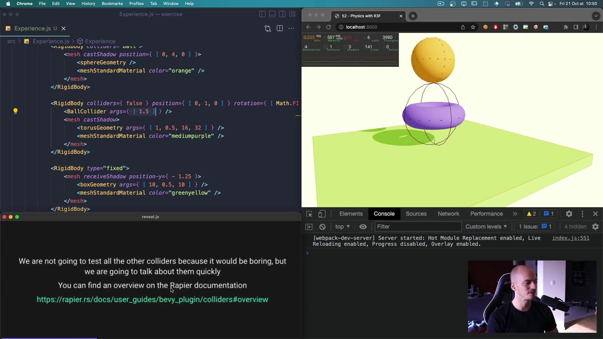
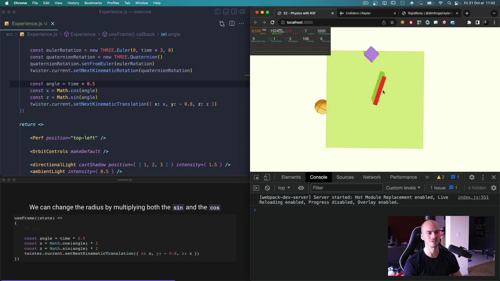

# 第 44 章 R3F 中的物理模拟

物理模拟为 3D 体验增添了真实感，但在原生 Three.js 中实现物理需要分别维护 Three.js 世界与物理世界，并在两者之间同步对象状态。本章将介绍如何借助 React Three Fiber（R3F）及其生态中的 React Three Rapier 库，以声明式方式轻松构建物理模拟。我们将从基本碰撞检测开始，逐步学习如何控制物体质量、施加冲量、监听碰撞事件，最终实现包含数百个对象的性能优化方案。

## 从 Cannon 到 Rapier

在早期的原生 Three.js 物理课程中，我们曾使用 Cannon.js 物理引擎。Cannon 是一个功能完整的物理库，但其原始代码已多年未更新。PMNDRS（Poimandres）团队维护了一个名为 cannon-es 的 fork，并开发了对应的 R3F 封装 @react-three/cannon。然而，当前 R3F 生态推荐使用的是名为 Rapier 的新一代物理库。

Rapier 最初发布于 2019 年，采用 Rust 语言编写，通过 WebAssembly 在 JavaScript 环境中运行。WebAssembly 允许将 Rust、C++ 等高性能语言编译成可在浏览器中执行的二进制格式，因此 Rapier 能够提供接近原生性能的物理计算。该库还强调确定性：在相同引擎版本、初始条件、固定时间步长和输入序列下，模拟结果可以复现。实际项目仍需控制这些条件，不能把“确定性”理解为任何设备和交互过程都必然逐帧一致。

React Three Rapier 是 PMNDRS 团队为整合 Rapier 与 R3F 而开发的封装库。它将物理实体的创建、状态同步等复杂流程抽象为一组 React 组件，开发者只需关心组件属性与层级关系，无需手动管理物理世界的更新循环。

## 环境配置与初始场景

开始前，首先在项目中安装 React Three Rapier：

```bash
npm install @react-three/rapier@1.1
```

此处固定了库版本以确保教学稳定性。安装后，我们在启动场景中包含一个橙色球体、一个紫色立方体和一个浅绿色地板：

```jsx
import { Physics } from '@react-three/rapier'

export default function Experience() {
    return <>
        <ambientLight intensity={0.5} />
        <directionalLight
            position={[10, 10, 5]}
            intensity={1}
            castShadow
        />

        <Physics>
            {/* 球体 */}
            <mesh castShadow position={[-2, 2, 0]}>
                <sphereGeometry />
                <meshStandardMaterial color="orange" />
            </mesh>

            {/* 立方体 */}
            <mesh castShadow position={[2, 2, 0]}>
                <boxGeometry args={[1, 1, 1]} />
                <meshStandardMaterial color="purple" />
            </mesh>

            {/* 地板 */}
            <mesh receiveShadow position-y={-1.25}>
                <boxGeometry args={[10, 0.5, 10]} />
                <meshStandardMaterial color="greenyellow" />
            </mesh>
        </Physics>

        <OrbitControls />
        <Perf />
    </>
}
```

注意地板厚度设为 0.5 而非通常的薄片。过薄或高速运动的物体更容易出现穿透，碰撞体厚度、时间步长和连续碰撞检测策略应结合场景速度与尺度确定。

## 启用物理：Physics 与 RigidBody

要为物体启用物理行为，首先需将 `<Physics>` 组件包裹在需要参与物理模拟的物体外层。不过仅有 `<Physics>` 容器还不够，还需使用 `<RigidBody>` 组件明确指定哪些物体应受物理规则影响。

修改上述示例，为球体与地板添加物理属性：

```jsx
import { Physics, RigidBody } from '@react-three/rapier'

export default function Experience() {
    return <>
        {/* ... 光照等代码 ... */}

        <Physics>
            {/* 球体：自由落体 */}
            <RigidBody>
                <mesh castShadow position={[-2, 2, 0]}>
                    <sphereGeometry />
                    <meshStandardMaterial color="orange" />
                </mesh>
            </RigidBody>

            {/* 立方体：暂不受物理影响 */}
            <mesh castShadow position={[2, 2, 0]}>
                <boxGeometry args={[1, 1, 1]} />
                <meshStandardMaterial color="purple" />
            </mesh>

            {/* 地板：固定类型 */}
            <RigidBody type="fixed">
                <mesh receiveShadow position-y={-1.25}>
                    <boxGeometry args={[10, 0.5, 10]} />
                    <meshStandardMaterial color="greenyellow" />
                </mesh>
            </RigidBody>
        </Physics>

        {/* ... 控件与性能监控 ... */}
    </>
}
```

球体和地板已经分别由 `RigidBody` 管理，因此可以参与碰撞；未包裹的立方体不会参与物理模拟，会穿过地板。为立方体添加相同的包裹后，它也会成为动态刚体，并能与地板及其他刚体发生碰撞。

```jsx
<RigidBody>
    <mesh castShadow position={[2, 2, 0]}>
        <boxGeometry args={[1, 1, 1]} />
        <meshStandardMaterial color="purple" />
    </mesh>
</RigidBody>
```

此时，球体与立方体均会下落后与地板碰撞。

### 物理调试模式

要直观查看 Rapier 生成的碰撞体形状，可在 `<Physics>` 组件添加 `debug` 属性：

```jsx
<Physics debug>
    {/* ... RigidBody 组件 ... */}
</Physics>
```

调试模式下，每个 `<RigidBody>` 会显示为半透明的白色线框。该功能在开发阶段尤其有用，能帮助确认碰撞体是否与视觉外观匹配。



*图 44-1 启用调试模式后显示的碰撞边界，白色线框对应 Rapier 物理引擎中的碰撞体*

## 碰撞体（Colliders）

默认情况下，当 `<RigidBody>` 内部包含几何体时，R3F Rapier 会自动推断碰撞体形状。但这种推断未必总能与视觉模型完美匹配，有时需要手动指定碰撞体类型或尺寸。

### 自动碰撞体推断

Rapier 支持多种碰撞体类型，部分对应常见几何体形状：

- **立方体碰撞体（Cuboid）**：适合盒子、平面等规则形状
- **球体碰撞体（Ball）**：适合球体、半球体
- **凸包碰撞体（Convex Hull）**：为复杂几何计算一个紧密包裹的简化外壳
- **三角网格碰撞体（Trimesh）**：精确匹配原始模型的顶点结构，性能开销较大
- **高度场碰撞体（Heightfield）**：适合地形、起伏表面

对于启动场景，球体自动获得球体碰撞体，立方体获得立方体碰撞体，二者均与视觉形状一致。

### 自定义碰撞体

当自动推断不满足需求时，可使用 `<CuboidCollider>`、`<BallCollider>` 等组件显式定义碰撞体。该方式尤其适用于以下场景：

1. **碰撞体与视觉模型分离**：例如需要更大碰撞范围的触发器区域
2. **组合碰撞体**：一个物体包含多个碰撞区域
3. **性能优化**：用简单碰撞体近似复杂几何

以下示例为球体定义一个比视觉模型更大的球体碰撞体：

```jsx
<RigidBody>
    <BallCollider args={[0.6]} />  {/* 半径 0.6 */}
    <mesh castShadow position={[-2, 2, 0]}>
        <sphereGeometry args={[0.5]} />  {/* 半径 0.5 */}
        <meshStandardMaterial color="orange" />
    </mesh>
</RigidBody>
```

同样，可为立方体指定自定义尺寸：

```jsx
<RigidBody>
    <CuboidCollider args={[0.6, 0.6, 0.6]} />  {/* 半宽、半高、半深 */}
    <mesh castShadow position={[2, 2, 0]}>
        <boxGeometry args={[1, 1, 1]} />  {/* 边长为 1 */}
        <meshStandardMaterial color="purple" />
    </mesh>
</RigidBody>
```

### 地板碰撞体优化

默认情况下，地板的碰撞体与视觉盒子一致。但当地板作为静态障碍时，使用 `<CuboidCollider>` 可避免生成多余的物理数据，同时保持相同碰撞行为：

```jsx
<RigidBody type="fixed">
    <CuboidCollider args={[5, 0.25, 5]} />
    <mesh receiveShadow position-y={-1.25}>
        <boxGeometry args={[10, 0.5, 10]} />
        <meshStandardMaterial color="greenyellow" />
    </mesh>
</RigidBody>
```



*图 44-2 自定义碰撞体应用场景：左侧为自动推断，右侧为手动指定碰撞形状*

注意：`<CuboidCollider>` 的参数为半尺寸（half-extents），而 `<boxGeometry>` 的参数为全尺寸。

## 物理属性与参数调整

### 重力修改

默认重力加速度为 `-9.81`（Y 轴向下）。可在 `<Physics>` 组件中通过 `gravity` 属性调整：

```jsx
<Physics gravity={[0, -2, 0]}>
    {/* ... */}
</Physics>
```

向量 `[x, y, z]` 分别对应三个轴向的加速度分量。设为 `[0, 0, 0]` 可完全禁用重力。

### 反弹系数（Restitution）

反弹系数决定物体碰撞后的能量损失。值域为 0（完全非弹性）到 1（完全弹性）。在 `<RigidBody>` 上设置 `restitution` 属性：

```jsx
<RigidBody restitution={0.7}>
    {/* 弹性较好的球体 */}
</RigidBody>
```

### 摩擦系数（Friction）

摩擦系数控制物体在表面滑动时的阻力。同样通过 `friction` 属性配置：

```jsx
<RigidBody friction={0.5}>
    {/* 中等摩擦的立方体 */}
</RigidBody>
```

### 质量与惯性

物体的质量影响其受力后的加速度。若不设置 `mass` 属性，Rapier 会根据碰撞体体积自动计算。手动设置质量：

```jsx
<RigidBody mass={0.5}>  {/* 质量 0.5 */}
    {/* 轻质物体 */}
</RigidBody>
```

对于静态物体（`type="fixed"`），质量属性无效。

## 施加力与冲量

要通过代码控制物体运动，需要获取 `<RigidBody>` 的引用。使用 `useRef` 钩子创建引用，再通过 `applyImpulse`、`applyForce` 等方法施加外力。

### 施加冲量

冲量（impulse）会瞬间改变物体速度，适合模拟击打、跳跃等瞬时作用：

```jsx
import { useRef } from 'react'
import { RigidBody } from '@react-three/rapier'

function Experience() {
    const sphereRef = useRef()

    const jump = () => {
        if (sphereRef.current) {
            sphereRef.current.applyImpulse({ x: 0, y: 5, z: 0 })
        }
    }

    return <>
        <button onClick={jump}>向上跳跃</button>

        <RigidBody ref={sphereRef}>
            <mesh castShadow position={[-2, 2, 0]}>
                <sphereGeometry />
                <meshStandardMaterial color="orange" />
            </mesh>
        </RigidBody>

        {/* ... 其他物体 ... */}
    </>
}
```

### 持续施加力

与冲量不同，力（force）会持续作用一段时间，适合模拟风力、喷流推进等：

```jsx
const pushRight = () => {
    if (sphereRef.current) {
        sphereRef.current.applyForce({ x: 5, y: 0, z: 0 })
    }
}
```

## 碰撞事件监听

React Three Rapier 提供了多种事件回调函数，可用于响应物理交互：

- **onCollisionEnter**：碰撞开始时触发
- **onCollisionExit**：碰撞结束时触发
- **onSleep**：物体静止并进入休眠时触发（性能优化）
- **onWake**：休眠物体被重新激活时触发

### 处理碰撞事件

以下示例记录球体与地板碰撞事件：

```jsx
<RigidBody
    onCollisionEnter={({ manifold, target, other }) => {
        console.log('碰撞开始', other.rigidBodyObject?.name)
    }}
    onCollisionExit={({ target, other }) => {
        console.log('碰撞结束', other.rigidBodyObject?.name)
    }}
>
    <mesh castShadow position={[-2, 2, 0]}>
        <sphereGeometry />
        <meshStandardMaterial color="orange" />
    </mesh>
</RigidBody>
```

回调参数包含碰撞相关对象信息，可通过 `other.rigidBodyObject` 访问碰撞对手的 Three.js 对象。

## 实例化物理对象

当场景需要大量相似物理对象时（如成百上千个立方体），为每个对象单独创建 `<RigidBody>` 会导致严重的性能开销。React Three Rapier 提供了 `<InstancedRigidBodies>` 组件来批量处理实例化物理对象。

### 创建实例化物理场景

首先准备一组初始位置与旋转数据：

```jsx
import { InstancedRigidBodies } from '@react-three/rapier'
import { useMemo } from 'react'

function Experience() {
    const cubeCount = 100
    const instances = useMemo(() => {
        const instances = []
        for (let i = 0; i < cubeCount; i++) {
            instances.push({
                key: `cube-${i}`,
                position: [
                    (Math.random() - 0.5) * 10,
                    5 + Math.random() * 5,
                    (Math.random() - 0.5) * 10
                ],
                rotation: [
                    Math.random() * Math.PI,
                    Math.random() * Math.PI,
                    Math.random() * Math.PI
                ]
            })
        }
        return instances
    }, [])

    return <>
        <Physics>
            <InstancedRigidBodies instances={instances}>
                <instancedMesh
                    args={[null, null, cubeCount]}
                    castShadow
                >
                    <boxGeometry args={[0.5, 0.5, 0.5]} />
                    <meshStandardMaterial color="purple" />
                </instancedMesh>
            </InstancedRigidBodies>

            {/* 地板 */}
            <RigidBody type="fixed">
                <CuboidCollider args={[5, 0.25, 5]} />
                <mesh receiveShadow position-y={-1.25}>
                    <boxGeometry args={[10, 0.5, 10]} />
                    <meshStandardMaterial color="greenyellow" />
                </mesh>
            </RigidBody>
        </Physics>
    </>
}
```

`<InstancedRigidBodies>` 会为每个实例数据创建独立的物理实体，但共享可视化网格，从而减少绘制调用和部分内存开销。独立刚体的碰撞与求解成本仍然存在，实例数量增加时仍需控制物理预算。

### 实例化性能注意事项

虽然实例化大幅提升了大量相同对象的处理效率，仍需注意：

1. **数量限制**：即使使用实例化，物理对象数量仍受物理引擎性能限制
2. **碰撞复杂度**：简单的立方体/球体碰撞体性能远高于复杂网格碰撞体
3. **休眠机制**：静止物体会自动进入休眠状态，减少计算量

## 导入模型的物理处理

为导入的外部 3D 模型添加物理需选择合适碰撞体类型。以下展示使用 GLTF 模型的三种常见方案。

### 简单包围盒方案

对精度要求不高时，可用立方体碰撞体包裹整个模型：

```jsx
import { useGLTF } from '@react-three/drei'

function ModelPhysics() {
    const { nodes, materials } = useGLTF('/model.glb')

    return (
        <RigidBody>
            <CuboidCollider args={[1, 1, 1]} />
            <primitive object={nodes.model} />
        </RigidBody>
    )
}
```

### 凸包碰撞体

凸包（Convex Hull）会生成一个恰好包裹模型所有顶点的简化外壳，比精确网格更高效：

```jsx
<RigidBody>
    <ConvexHullCollider args={[geometry.attributes.position.array]} />
    <mesh geometry={nodes.model.geometry} material={materials.model} />
</RigidBody>
```

### 精确三角网格碰撞体

当需要精确碰撞检测时（如复杂机械零件），可使用与原网格完全一致的三角网格碰撞体：

```jsx
const vertices = geometry.attributes.position.array
const indices = geometry.index.array

<RigidBody>
    <TrimeshCollider args={[vertices, indices]} />
    <mesh geometry={nodes.model.geometry} material={materials.model} />
</RigidBody>
```

凸包需要 `Float32Array` 顶点数据，三角网格还需要索引数据。若几何体没有索引，应建立与实际三角形一致的索引数组，不能只传入 `geometry` 对象。

注意三角网格碰撞体计算开销最大，应谨慎使用。

## 性能优化策略

### 对象休眠机制

物理引擎会自动将静止物体置为休眠状态，暂停对其的位置更新。当休眠物体受到外力时，会自动唤醒。该机制可显著减少不必要的计算。

手动控制休眠状态：

```jsx
<RigidBody
    onSleep={() => console.log('进入休眠')}
    onWake={() => console.log('唤醒激活')}
>
    {/* ... */}
</RigidBody>
```

### 碰撞图层过滤

当场景中存在大量物体但只有少数需要互相碰撞时，可通过碰撞组（collision groups）过滤，避免不必要的碰撞检测计算：

```jsx
<RigidBody collisionGroups={1}>
    {/* 只与同组物体碰撞 */}
</RigidBody>

<RigidBody collisionGroups={2}>
    {/* 不与组1物体碰撞 */}
</RigidBody>
```

### 简化碰撞体

用简单的球体、立方体碰撞体替代复杂网格碰撞体，性能差异可达数倍甚至数十倍。平衡视觉精度与性能需求。

## 本章小结

本章系统介绍了在 React Three Fiber 中使用 React Three Rapier 实现物理模拟的全流程，涵盖从基础到高级的各项特性：

1. **物理环境搭建**：通过 `<Physics>` 组件包裹物理世界，使用 `<RigidBody>` 标记参与物理模拟的物体，静态物体指定 `type="fixed"`。

2. **碰撞体配置**：Rapier 支持自动碰撞体推断与手动指定两种模式。关键组件包括 `<CuboidCollider>`、`<BallCollider>`、`<ConvexHullCollider>` 和 `<TrimeshCollider>`，应根据精度需求与性能预算合理选择。

3. **物理参数调控**：通过 `gravity` 调整重力，`restitution` 控制反弹强度，`friction` 设置表面阻力，`mass` 定义物体质量。这些参数共同决定物体的运动特性。

4. **运动控制**：借助 `useRef` 获取物理对象引用，使用 `applyImpulse()` 施加瞬时冲量，`applyForce()` 施加持续作用力，实现编程式物体操控。

5. **事件响应机制**：利用 `onCollisionEnter`、`onCollisionExit`、`onSleep`、`onWake` 等回调函数监听物理事件，构建交互反馈逻辑。

6. **性能优化技术**：针对大量相似对象，采用 `<InstancedRigidBodies>` 批量处理实例化物理实体；利用休眠机制暂停静止物体计算；通过碰撞图层过滤减少不必要的碰撞检测。

物理模拟将运动、碰撞等现实规律引入数字世界，显著提升用户体验的真实感与沉浸感。React Three Rapier 借助 R3F 的声明式范式，将原本繁琐的物理世界管理抽象为直观的组件层级关系，降低了实现门槛但保持了充分的灵活性。后续章节将运用这些知识构建完整的物理互动游戏项目，进一步加深对物理引擎在实际场景中应用的理解。