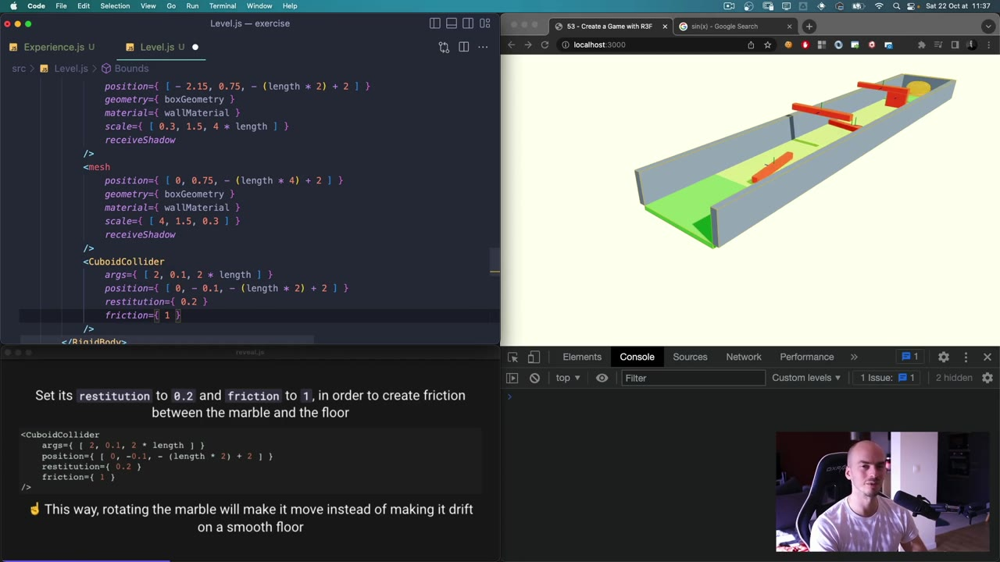
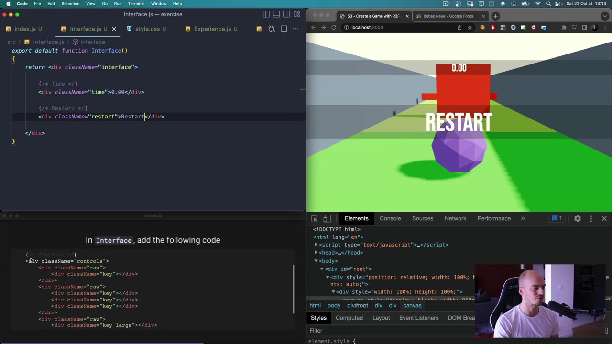

# 第 45 章 使用 R3F 创建游戏

本章将综合运用 React Three Fiber（R3F）及其生态工具构建一款完整的 3D 弹珠球游戏。游戏核心玩法是控制弹珠球穿越充满旋转、摆动与移动障碍的关卡，在计时机制下尽快到达终点汉堡模型。我们将从零开始构建完整的游戏系统，涵盖玩家控制、物理碰撞、关卡生成、相机跟随、全局状态管理、用户界面以及游戏逻辑整合等全方位功能。通过本章实践，您将掌握如何将 R3F、物理引擎、状态管理与 React 组件整合为具备完整交互逻辑的 3D 应用，为未来构建更复杂的交互式项目奠定坚实基础。

## 游戏概述与设计目标

本章构建的游戏是一款第三人称视角的物理模拟游戏。玩家通过键盘或触摸控制一颗弹珠球，在随机生成的关卡中躲避障碍，最终抵达终点。游戏具备以下核心机制：

1. **玩家控制**：支持键盘（WASD+空格跳跃）与触摸控制两种输入方式
2. **物理模拟**：基于 Rapier 物理引擎的真实碰撞与运动效果
3. **关卡生成**：程序化随机生成包含不同陷阱组合的关卡
4. **计时系统**：从玩家首次移动开始计时，通关后显示完成时间
5. **重新开始**：游戏结束后可重新开始，生成全新的关卡布局
6. **状态管理**：通过 zustand 管理游戏阶段、计时与重置状态
7. **相机跟随**：平滑的第三人称相机自动跟随弹珠球运动

游戏最终外观由简洁的现代设计语言构成：绿色基调的平台、彩色动态障碍、明确的视觉反馈以及直观的用户界面。



*图 45-1 包含多种障碍与完整 UI 的游戏场景*

## 项目初始配置与环境搭建

游戏开发采用标准的 React + Vite 项目结构，并集成必要的 R3F 生态系统库。初始包依赖如下：

```json
{
  "dependencies": {
    "@react-three/drei": "^9.0.0",
    "@react-three/fiber": "^8.0.0",
    "@react-three/postprocessing": "^2.0.0",
    "three": "^0.150.0",
    "zustand": "^4.0.0"
  }
}
```

物理引擎是游戏的核心依赖，需单独安装：

```bash
npm install @react-three/rapier@1.1
```

安装过程可能显示依赖或安全警告，应根据具体依赖链和漏洞内容判断，而不是把 WebAssembly 支持本身视为警告原因。

初始项目结构遵循 R3F 推荐模式：

```
src/
├── App.jsx           # 主应用组件
├── Experience.jsx    # 3D 场景入口
├── Level.jsx         # 关卡生成与管理
├── Player.jsx        # 玩家控制与物理
├── Camera.jsx        # 相机跟随系统
├── Interface.jsx     # 2D 用户界面
├── Lights.jsx        # 光照配置
├── store.js          # 全局状态管理
└── index.js         # 应用入口
```

基础场景包含三个简单几何体作为视觉参考：

```jsx
// Experience.jsx 初始版本
export default function Experience() {
    return <>
        <OrbitControls makeDefault />

        <Lights />

        {/* 参考几何体 */}
        <mesh castShadow position={[-2, 0.5, 0]}>
            <sphereGeometry />
            <meshStandardMaterial color="orange" />
        </mesh>

        <mesh castShadow position={[2, 0.75, 0]} scale={1.5}>
            <boxGeometry />
            <meshStandardMaterial color="mediumpurple" />
        </mesh>

        <mesh receiveShadow position-y={-1} rotation-x={-Math.PI * 0.5} scale={10}>
            <planeGeometry />
            <meshStandardMaterial color="greenyellow" />
        </mesh>
    </>
}
```

光照系统已封装在独立的 `<Lights>` 组件中，包含一个环境光与一个定向光：

```jsx
// Lights.jsx
export default function Lights() {
    return <>
        <ambientLight intensity={0.5} />

        <directionalLight
            castShadow
            position={[4, 4, 1]}
            intensity={1.5}
            shadow-mapSize={[1024, 1024]}
            shadow-camera-near={1}
            shadow-camera-far={10}
            shadow-camera-top={10}
            shadow-camera-right={10}
            shadow-camera-bottom={-10}
            shadow-camera-left={-10}
        />
    </>
}
```

定向光的阴影投射范围经过精心配置：`shadow-camera-*` 系列参数定义了 20×20 单位的阴影区域，足以覆盖整个游戏场景。

```jsx
// Lights 组件示例
export default function Lights() {
    return <>
        <ambientLight intensity={0.5} />
        <directionalLight
            castShadow
            position={[4, 4, 1]}
            intensity={1.5}
            shadow-mapSize={[1024, 1024]}
            shadow-camera-near={1}
            shadow-camera-far={10}
            shadow-camera-top={10}
            shadow-camera-right={10}
            shadow-camera-bottom={-10}
            shadow-camera-left={-10}
        />
    </>
}
```

灯光单独封装在 `<Lights>` 组件中，便于后续调整。定向光源已启用了较大范围的阴影投射，确保游戏场景有恰当的光影层次。虽然当前项目未集成性能监控（如 r3f-perf）与调试界面（如 Leva），但在实际游戏开发中强烈建议添加这些工具以优化性能与调试体验。

## 物理引擎集成与基础设置

物理模拟是 3D 游戏真实感的关键。Rapier 物理引擎通过 @react-three/rapier 与 R3F 无缝集成，提供声明式的物理组件开发模式。

### 初始化物理世界

在 `<Experience>` 组件中包裹 `<Physics>` 组件以启用物理系统：

```jsx
// Experience.jsx 物理集成版本
import { Physics } from '@react-three/rapier'

export default function Experience() {
    return <>
        <OrbitControls makeDefault />

        <Physics debug>
            <Lights />
            <Level />
        </Physics>
    </>
}
```

`debug` 属性启用物理碰撞体的可视化线框，这对于开发阶段的碰撞形状验证至关重要。调试模式会显示以下信息：
- 动态刚体：蓝色线框
- 固定刚体：绿色线框
- 运动学刚体：黄色线框
- 碰撞体形状：白色线框

### 刚体类型与属性

Rapier 中的刚体分为三种主要类型，对应不同的物理行为：

1. **动态刚体 (dynamic)**：受物理引擎完全控制，受重力与碰撞影响
2. **固定刚体 (fixed)**：位置锁定，可作为场景中的静态碰撞体
3. **运动学刚体 (kinematicPosition/kinematicVelocity)**：由代码控制运动，物理引擎仅处理碰撞检测

游戏中的障碍物主要使用 `kinematicPosition` 类型，因为它们的运动模式由代码精确控制而非物理模拟。

### 关卡组件重构

为保持代码组织性，我们将场景几何体移至独立的 `<Level>` 组件：

```jsx
// Level.jsx 初始版本
export default function Level() {
    return <>
        <mesh castShadow position-x={-2}>
            <sphereGeometry />
            <meshStandardMaterial color="orange" />
        </mesh>

        <mesh castShadow position-x={2} scale={1.5}>
            <boxGeometry />
            <meshStandardMaterial color="mediumpurple" />
        </mesh>

        <mesh receiveShadow position-y={-1} rotation-x={-Math.PI * 0.5} scale={10}>
            <planeGeometry />
            <meshStandardMaterial color="greenyellow" />
        </mesh>
    </>
}
```

此重构为后续的关卡系统扩展奠定了基础，所有关卡相关逻辑将集中在此组件中。

## 模块化关卡系统设计

游戏关卡采用模块化设计，由三种基本区块组成：起点区块、陷阱区块和终点区块。每个区块尺寸为 4×0.2×4 单位，沿 Z 轴负方向依次排列。

### 起点区块实现

起点区块 (`BlockStart`) 是玩家起始位置，仅包含平台地板：

```jsx
function BlockStart({ position = [0, 0, 0] }) {
    return <mesh position={position}>
        <boxGeometry args={[4, 0.2, 4]} />
        <meshStandardMaterial color="limegreen" />
    </mesh>
}
```

关键设计要点：
1. 使用盒体几何体而非平面，确保有足够厚度供物理引擎准确检测碰撞
2. 平台顶部位于 Y=0 位置，作为整个场景的高度基准
3. 柠檬绿色 (`limegreen`) 作为起点平台的视觉标识

### 刚体封装与碰撞设置

为启用物理碰撞，需将几何体包裹在 `<RigidBody>` 组件中：

```jsx
import { RigidBody } from '@react-three/rapier'

function BlockStart({ position = [0, 0, 0] }) {
    return (
        <RigidBody type="fixed" restitution={0.2}>
            <mesh position={position}>
                <boxGeometry args={[4, 0.2, 4]} />
                <meshStandardMaterial color="limegreen" />
            </mesh>
        </RigidBody>
    )
}
```

刚体参数说明：
- `type="fixed"`：平台固定不动，仅作为碰撞表面
- `restitution={0.2}`：弹性系数设为 0.2，提供适中的弹跳反馈
- 无需 `mass` 属性，固定刚体不受重力影响

此时移除原始场景中的三个几何体，仅保留 `<BlockStart>`：

```jsx
export default function Level() {
    return <>
        <BlockStart position={[0, 0, 0]} />
    </>
}
```

## 陷阱类型设计与动画系统

游戏包含三种不同类型的陷阱，每种都有独特的运动模式与挑战性。所有陷阱都遵循相同的组件结构：平台地板 + 运动障碍物。

### 旋转门陷阱 (BlockSpinner)

旋转门陷阱在垂直轴上旋转障碍杆，玩家需要把握时机通过：

```jsx
import { useRef, useState } from 'react'
import { useFrame } from '@react-three/fiber'
import { RigidBody } from '@react-three/rapier'
import * as THREE from 'three'

function BlockSpinner({ position = [0, 0, 0] }) {
    const obstacleRef = useRef()

    // 随机旋转速度与方向
    const [speed] = useState(() => {
        const baseSpeed = Math.random() + 0.2
        const direction = Math.random() < 0.5 ? -1 : 1
        return baseSpeed * direction
    })

    // 动画更新循环
    useFrame((state) => {
        const time = state.clock.getElapsedTime()
        const rotation = Math.sin(time * speed) * Math.PI * 0.2

        if (obstacleRef.current) {
            obstacleRef.current.setNextKinematicRotation(
                new THREE.Quaternion().setFromEuler(
                    new THREE.Euler(0, rotation, 0)
                )
            )
        }
    })

    return (
        <group position={position}>
            {/* 平台地板 */}
            <mesh>
                <boxGeometry args={[4, 0.2, 4]} />
                <meshStandardMaterial color="limegreen" />
            </mesh>

            {/* 旋转障碍物 */}
            <RigidBody
                ref={obstacleRef}
                type="kinematicPosition"
                position={[0, 0.3, 0]}
                restitution={0.2}
            >
                <mesh castShadow>
                    <boxGeometry args={[3.5, 0.3, 0.2]} />
                    <meshStandardMaterial color="red" />
                </mesh>
            </RigidBody>
        </group>
    )
}
```

关键技术细节：
1. **运动学刚体**：`type="kinematicPosition"` 表示位置与旋转由代码控制
2. **正弦运动**：`Math.sin(time * speed)` 产生平滑的往复旋转
3. `setNextKinematicRotation`：专门用于更新运动学刚体旋转的方法
4. **随机参数**：每个实例具有随机速度 (±0.2~1.2 rad/s) 与随机方向

### 斧摆陷阱 (BlockAxe)

斧摆陷阱模拟钟摆运动，障碍物在 X 轴方向摆动：

```jsx
function BlockAxe({ position = [0, 0, 0] }) {
    const obstacleRef = useRef()

    // 随机初始相位偏移
    const [timeOffset] = useState(() => Math.random() * Math.PI * 2)

    useFrame((state) => {
        const time = state.clock.getElapsedTime()
        const x = Math.sin(time + timeOffset) * 1.25

        if (obstacleRef.current) {
            obstacleRef.current.setNextKinematicPosition(
                new THREE.Vector3(position[0] + x, position[1] + 0.75, position[2])
            )
        }
    })

    return (
        <group position={position}>
            <mesh>
                <boxGeometry args={[4, 0.2, 4]} />
                <meshStandardMaterial color="limegreen" />
            </mesh>

            <RigidBody
                ref={obstacleRef}
                type="kinematicPosition"
                position={[0, 0.75, 0]}
                restitution={0.2}
            >
                <mesh castShadow>
                    <boxGeometry args={[1.5, 1.5, 0.2]} />
                    <meshStandardMaterial color="orange" />
                </mesh>
            </RigidBody>
        </group>
    )
}
```

斧摆特性：
1. **水平摆动**：摆幅 ±1.25 单位，中心位于平台上方 0.75 单位
2. **相位随机化**：`timeOffset` 确保关卡中的多个斧摆不同步
3. **方形障碍**：1.5×1.5×0.2 的薄板几何体

### 限高杆陷阱 (BlockLimbo)

限高杆要求玩家跳跃通过，障碍物在垂直方向移动：

```jsx
function BlockLimbo({ position = [0, 0, 0] }) {
    const obstacleRef = useRef()

    const [timeOffset] = useState(() => Math.random() * Math.PI * 2)

    useFrame((state) => {
        const time = state.clock.getElapsedTime()
        const y = Math.sin(time + timeOffset) + 1.15

        if (obstacleRef.current) {
            obstacleRef.current.setNextKinematicPosition(
                new THREE.Vector3(position[0], position[1] + y, position[2])
            )
        }
    })

    return (
        <group position={position}>
            <mesh>
                <boxGeometry args={[4, 0.2, 4]} />
                <meshStandardMaterial color="limegreen" />
            </mesh>

            <RigidBody
                ref={obstacleRef}
                type="kinematicPosition"
                position={[0, 1.15, 0]}
                restitution={0.2}
            >
                <mesh castShadow>
                    <boxGeometry args={[3.5, 0.2, 0.2]} />
                    <meshStandardMaterial color="green" />
                </mesh>
            </RigidBody>
        </group>
    )
}
```

限高杆参数：
1. **垂直运动**：Y 轴坐标在 0.15~2.15 范围内变化 (`Math.sin() + 1.15`)
2. **障碍尺寸**：3.5×0.2×0.2 的细长杆，考验跳跃时机
3. **绿色标识**：绿色材质与旋转门的红色、斧摆的橙色形成视觉区分

### 终点区块实现 (BlockEnd)

终点区块包含汉堡模型作为视觉目标与游戏结束触发器：

```jsx
import { useGLTF } from '@react-three/drei'

function BlockEnd({ position = [0, 0, 0] }) {
    const hamburger = useGLTF('./hamburger.glb')

    // 为所有子网格启用阴影
    hamburger.scene.children.forEach((mesh) => {
        mesh.castShadow = true
    })

    return (
        <group position={position}>
            <mesh>
                <boxGeometry args={[4, 0.2, 4]} />
                <meshStandardMaterial color="limegreen" />
            </mesh>

            <RigidBody
                type="fixed"
                position={[0, 0.25, 0]}
                restitution={0.2}
                name="hamburger"
            >
                <primitive
                    object={hamburger.scene}
                    scale={0.2}
                />
            </RigidBody>
        </group>
    )
}
```

终点区块注意事项：
1. **固定刚体**：汉堡模型位置固定，仅作为碰撞检测目标
2. **命名标识**：`name="hamburger"` 用于碰撞事件识别
3. **阴影优化**：圆形表面易产生阴影瑕疵，已禁用接收阴影
4. **适当缩放**：0.2 的缩放比例使汉堡尺寸合适



*图 45-2 旋转门、斧摆与限高杆三种陷阱样式*

## 性能优化：资源共享与实例化

随着陷阱数量增加，性能优化变得至关重要。游戏中的几何体与材质存在大量重复，通过资源共享可显著提升渲染效率。

### 几何体与材质实例化

在组件外部创建共享资源，避免每次渲染重新创建：

```jsx
// 共享几何体实例
const floorGeometry = new THREE.BoxGeometry(4, 0.2, 4)
const floorMaterial = new THREE.MeshStandardMaterial({
    color: "limegreen"
})

// 旋转门障碍几何体
const spinnerObstacleGeometry = new THREE.BoxGeometry(3.5, 0.3, 0.2)
const spinnerObstacleMaterial = new THREE.MeshStandardMaterial({
    color: "red"
})

// 斧摆障碍几何体
const axeObstacleGeometry = new THREE.BoxGeometry(1.5, 1.5, 0.2)
const axeObstacleMaterial = new THREE.MeshStandardMaterial({
    color: "orange"
})

// 限高杆障碍几何体
const limboObstacleGeometry = new THREE.BoxGeometry(3.5, 0.2, 0.2)
const limboObstacleMaterial = new THREE.MeshStandardMaterial({
    color: "green"
})
```

更新陷阱组件使用共享资源：

```jsx
function BlockSpinner({ position = [0, 0, 0] }) {
    // ... 动画逻辑保持不变

    return (
        <group position={position}>
            {/* 使用共享的几何体与材质 */}
            <mesh
                geometry={floorGeometry}
                material={floorMaterial}
            />

            <RigidBody
                ref={obstacleRef}
                type="kinematicPosition"
                position={[0, 0.3, 0]}
                restitution={0.2}
            >
                <mesh
                    castShadow
                    geometry={spinnerObstacleGeometry}
                    material={spinnerObstacleMaterial}
                />
            </RigidBody>
        </group>
    )
}
```

### 性能收益分析

资源共享带来多方面性能提升：

1. **内存占用减少**：避免为每个实例创建新的几何体与材质对象
2. **GPU 状态切换降低**：相同材质批次绘制，减少绘制调用 (draw calls)
3. **垃圾回收压力减小**：避免频繁创建与销毁资源对象

对于包含 10 个陷阱的关卡，资源共享可减少约 90% 的几何体创建开销与 80% 的材质创建开销。

### React 渲染优化

陷阱组件的随机参数不应在每次渲染时重新生成。使用 `useState` 初始值函数确保随机值仅计算一次：

```jsx
// 正确做法：使用初始值函数
const [speed] = useState(() => {
    const baseSpeed = Math.random() + 0.2
    const direction = Math.random() < 0.5 ? -1 : 1
    return baseSpeed * direction
})

// 错误做法：每次渲染重新计算
const speed = (Math.random() + 0.2) * (Math.random() < 0.5 ? -1 : 1)
```

`useState` 的初始值函数 (`() => value`) 仅在组件首次挂载时执行，后续渲染不会重新计算。

## 键盘输入控制系统

玩家控制是游戏交互的核心。我们将实现完整的键盘输入系统，支持方向控制与跳跃功能。

### 键盘控制钩子实现

使用 `@react-three/drei` 的 `useKeyboardControls` 创建类型安全的键盘输入系统：

```jsx
// Player.jsx 键盘控制部分
import { useRef } from 'react'
import { useFrame } from '@react-three/fiber'
import { RigidBody } from '@react-three/rapier'
import { useKeyboardControls } from '@react-three/drei'

export default function Player() {
    const ballRef = useRef()

    // 定义控制映射
    const [subscribeKeys, getKeys] = useKeyboardControls(() => ({
        forward: false,
        backward: false,
        leftward: false,
        rightward: false,
        jump: false
    }))

    // 物理更新循环
    useFrame((state, delta) => {
        const { forward, backward, leftward, rightward } = getKeys()

        const impulse = { x: 0, y: 0, z: 0 }
        const torque = { x: 0, y: 0, z: 0 }

        const impulseStrength = 0.6 * delta
        const torqueStrength = 0.2 * delta

        // 前后移动控制 (W/S 或 ↑/↓)
        if (forward) {
            impulse.z -= impulseStrength
            torque.x -= torqueStrength
        }

        if (backward) {
            impulse.z += impulseStrength
            torque.x += torqueStrength
        }

        // 左右移动控制 (A/D 或 ←/→)
        if (rightward) {
            impulse.x += impulseStrength
            torque.z -= torqueStrength
        }

        if (leftward) {
            impulse.x -= impulseStrength
            torque.z += torqueStrength
        }

        // 应用物理力
        if (ballRef.current) {
            ballRef.current.applyImpulse(impulse, true)
            ballRef.current.applyTorqueImpulse(torque, true)
        }
    })

    return (
        <RigidBody
            ref={ballRef}
            colliders="ball"
            mass={1}
            restitution={0.2}
            friction={1}
            linearDamping={0.5}
            angularDamping={0.5}
            position={[0, 1, 0]}
        >
            <mesh castShadow>
                <sphereGeometry args={[0.3, 32, 32]} />
                <meshStandardMaterial
                    color="orange"
                    metalness={0.5}
                    roughness={0}
                />
            </mesh>
        </RigidBody>
    )
}
```

### 物理参数详解

弹珠球的物理配置直接影响游戏手感：

1. **碰撞体类型**：`colliders="ball"` 指定球体碰撞形状
2. **弹性系数**：`restitution={0.2}` 提供适中的弹跳，值过高会导致过度弹跳
3. **摩擦力**：`friction={1}` 标准的表面摩擦力
4. **线性阻尼**：`linearDamping={0.5}` 减缓水平移动速度
5. **角阻尼**：`angularDamping={0.5}` 减缓旋转速度
6. **冲量与扭矩**：`applyImpulse()` 产生移动，`applyTorqueImpulse()` 产生滚动

冲量强度 (`impulseStrength`) 与扭矩强度 (`torqueStrength`) 乘以 `delta` 确保帧率无关的运动速度。

### 跳跃机制实现

跳跃是触发式输入，需要同时处理按键订阅和地面检测。课程使用 Rapier 的射线查询：从球体下缘向下发射短射线，只有命中点足够近时才允许施加冲量。球体半径为 `0.3`，因此原点下移 `0.31`：

```jsx
import { useEffect, useRef } from 'react'
import { useKeyboardControls } from '@react-three/drei'
import { useRapier } from '@react-three/rapier'

export default function Player() {
    const body = useRef()
    const [subscribeKeys, getKeys] = useKeyboardControls()
    const { rapier, world } = useRapier()

    const jump = () => {
        if (!body.current) return

        const origin = body.current.translation()
        origin.y -= 0.31
        const direction = { x: 0, y: -1, z: 0 }
        const ray = new rapier.Ray(origin, direction)
        const hit = world.castRay(ray, 10, true)

        if (hit && hit.toi < 0.15) {
            body.current.applyImpulse({ x: 0, y: 0.5, z: 0 })
        }
    }

    useEffect(() => {
        const unsubscribeJump = subscribeKeys(
            (state) => state.jump,
            (value) => {
                if (value) jump()
            }
        )
        return unsubscribeJump
    }, [subscribeKeys])

    // ... 刚体与网格
}
```

`world.castRay(ray, 10, true)` 的第三个参数启用 solid 检测，避免射线从地面碰撞体内部开始时错误命中其底部。`hit.toi` 表示命中距离，阈值用于限制连续跳跃。组件卸载时返回 `unsubscribeJump`，防止热更新或重建后重复订阅。

### 输入平台范围

课程实现以桌面键盘为主，并通过 `<KeyboardControls>` 的 `map` 配置 WASD、方向键和空格。触摸、设备方向或手柄支持可以作为后续扩展，但应复用统一的移动与跳跃动作映射，而不是引入未实现的虚拟摇杆占位代码。

## 关卡生成与随机化系统

程序化关卡生成是游戏可重玩性的保证。系统根据配置参数自动排列关卡元素。

### 关卡组件参数化

`<Level>` 组件接受配置参数，提供灵活的关卡定制能力：

```jsx
// Level.jsx 完整版本
export default function Level({
    count = 5,
    types = [BlockSpinner, BlockAxe, BlockLimbo]
}) {
    // 使用 useMemo 避免每次渲染重新生成随机序列
    const blocks = useMemo(() => {
        const blocks = []

        for (let i = 0; i < count; i++) {
            const randomIndex = Math.floor(Math.random() * types.length)
            const BlockType = types[randomIndex]
            blocks.push(BlockType)
        }

        return blocks
    }, [count, types]) // 依赖数组确保配置变化时重新生成

    return (
        <>
            {/* 起点区块 */}
            <BlockStart position={[0, 0, 0]} />

            {/* 陷阱区块 */}
            {blocks.map((Block, index) => {
                // 每个区块在 Z 轴间隔 4 个单位
                const position = [0, 0, -(index + 1) * 4]
                return (
                    <Block
                        key={`${index}-${Block.name}`}
                        position={position}
                    />
                )
            })}

            {/* 终点区块 */}
            <BlockEnd position={[0, 0, -(count + 1) * 4]} />
        </>
    )
}
```

### 配置接口示例

组件的参数化设计便于创建多样化关卡：

```jsx
// 示例 1：默认配置 - 5 个随机陷阱
<Level />

// 示例 2：10 个仅包含旋转门的关卡
<Level count={10} types={[BlockSpinner]} />

// 示例 3：混合类型但指定数量
<Level
    count={8}
    types={[BlockSpinner, BlockAxe, BlockLimbo]}
/>
```

### 性能优化的关键技巧

1. **随机序列缓存**：`useMemo` 确保随机序列仅在依赖变化时重新计算
2. **键值稳定性**：组合索引与组件名 (`${index}-${Block.name}`) 作为唯一键
3. **严格依赖数组**：仅当 `count` 或 `types` 变化时才重新计算 `blocks`

### 区块导出与复用

为支持外部配置，需要导出所有区块组件：

```jsx
// Level.jsx 末尾添加导出
export { BlockStart, BlockSpinner, BlockAxe, BlockLimbo, BlockEnd }
```

这样其他开发者可以导入特定区块类型创建自定义的 `types` 数组。

### 关卡测试与验证

开发过程中应验证以下关卡属性：
1. 区块正确间隔排列
2. 随机序列不重复生成
3. 各陷阱运动参数独立随机化
4. 资源实例化正常工作
5. 物理碰撞体大小与位置准确

## 全局状态管理与游戏逻辑

游戏需要协调多个系统：玩家控制、碰撞检测、计时与界面更新。我们使用 zustand 创建轻量级全局状态存储，管理游戏核心逻辑。

### 游戏状态存储定义

创建 `store.js` 文件定义全局状态：

```jsx
// store.js
import { create } from 'zustand'

export const useGameStore = create((set, get) => ({
    // 游戏阶段: 'ready' | 'playing' | 'ended'
    phase: 'ready',

    // 时间记录
    startTime: 0,
    endTime: 0,

    // 重新开始计数
    restartCount: 0,

    // 动作方法
    start: () => {
        set((state) => ({
            phase: 'playing',
            startTime: Date.now()
        }))
    },

    end: () => {
        set((state) => ({
            phase: 'ended',
            endTime: Date.now()
        }))
    },

    restart: () => {
        set((state) => ({
            phase: 'ready',
            startTime: 0,
            endTime: 0,
            restartCount: state.restartCount + 1
        }))
    }
}))
```

    // 使用选择器订阅 phase 变化时，store 需要 subscribeWithSelector 中间件。
    // 也可用 subscribeWithSelector((set, get) => ({ ... })) 包装上述状态定义。

### 状态转换与游戏逻辑

游戏阶段转换遵循明确的状态机：

1. **准备阶段 (ready)**：弹珠球静止，计时未开始
2. **进行阶段 (playing)**：玩家首次移动后进入，计时开始
3. **结束阶段 (ended)**：弹珠球接触汉堡后进入，计时停止

阶段转换由以下事件触发：

```jsx
// Player.jsx 状态转换部分
import { useGameStore } from './store'

export default function Player() {
    const { phase, start, end } = useGameStore()
    const ballRef = useRef()
    const hasStarted = useRef(false)

    // 检测首次移动以开始游戏
    useFrame(() => {
        if (phase === 'ready' && !hasStarted.current) {
            const { forward, backward, leftward, rightward } = getKeys()
            const anyKeyPressed = forward || backward || leftward || rightward

            if (anyKeyPressed) {
                hasStarted.current = true
                start() // 开始游戏
            }
        }
    })

    // 终点检测使用 RigidBody 的碰撞事件属性
    return (
        <RigidBody
            ref={ballRef}
            onCollisionEnter={(event) => {
                const otherName = event.other.rigidBodyObject?.name
                if (otherName === 'hamburger' && phase === 'playing') {
                    end()
                }
            }}
        >
            {/* 球体网格 */}
        </RigidBody>
    )
}
```

### 重置与重新开始逻辑

重新开始按钮触发完整的游戏重置：

```jsx
// Interface.jsx 重新开始部分
import { useGameStore } from './store'

export default function Interface() {
    const { phase, restart, restartCount } = useGameStore()

    const handleRestart = () => {
        // 重置玩家位置
        if (window.playerRef?.current) {
            window.playerRef.current.setTranslation({ x: 0, y: 1, z: 0 }, true)
            window.playerRef.current.setLinvel({ x: 0, y: 0, z: 0 }, true)
            window.playerRef.current.setAngvel({ x: 0, y: 0, z: 0 }, true)
        }

        // 更新全局状态
        restart()

        // 触发关卡重新生成
        // 通过 restartCount 变化触发 Level 组件的重新渲染
    }

    return (
        <div className="interface">
            {phase === 'ended' && (
                <button
                    className="restart-button"
                    onClick={handleRestart}
                >
                    重新开始
                </button>
            )}
        </div>
    )
}
```

### 状态订阅与响应式组件

界面组件需要响应游戏状态变化。zustand 提供多种订阅方式：

```jsx
// 方式1：直接在组件中使用状态
const { phase, startTime } = useGameStore()

// 方式2：选择特定状态字段（性能优化）
const phase = useGameStore((state) => state.phase)

// 方式3：自定义选择器
const gameTime = useGameStore((state) => {
    if (state.phase === 'playing') {
        return (Date.now() - state.startTime) / 1000
    }
    if (state.phase === 'ended') {
        return (state.endTime - state.startTime) / 1000
    }
    return 0
})
```

## 相机跟随系统实现

第三人称相机需要平滑跟随弹珠球，提供舒适的视角体验。

### 相机组件实现

```jsx
// Camera.jsx
import { useFrame, useThree } from '@react-three/fiber'
import { useRef } from 'react'
import * as THREE from 'three'

export default function Camera({ playerRef }) {
    const { camera } = useThree()

    // 相机参数
    const offset = new THREE.Vector3(0, 2, 5)
    const smoothness = 0.05

    useFrame(() => {
        if (!playerRef?.current) return

        // 获取玩家当前位置
        const playerPosition = playerRef.current.translation()

        // 计算目标相机位置（玩家位置 + 固定偏移）
        const targetPosition = new THREE.Vector3(
            playerPosition.x + offset.x,
            playerPosition.y + offset.y,
            playerPosition.z + offset.z
        )

        // 线性插值平滑移动
        camera.position.lerp(targetPosition, smoothness)

        // 计算看向点（略高于玩家中心）
        const lookAtTarget = new THREE.Vector3(
            playerPosition.x,
            playerPosition.y + 0.5, // 视线高度偏移
            playerPosition.z
        )

        camera.lookAt(lookAtTarget)
    })

    return null // Camera 组件不渲染任何可见对象
}
```

### 相机参数调优

相机系统需要根据游戏体验调整多个参数：

1. **偏移量 (offset)**：`[0, 2, 5]` 提供经典的第三人称视角
   - X: 水平偏移（通常为 0，保持中心对称）
   - Y: 垂直偏移（2 单位提供俯视角度）
   - Z: 深度偏移（5 单位确保足够视野）

2. **平滑度 (smoothness)**：0.05 提供良好的跟随响应
   - 值越小越平滑但响应越慢
   - 值越大越直接但可能产生抖动

3. **视线高度偏移**：+0.5 单位使相机看向弹珠球中心偏上位置

### 移除轨道控制

游戏运行后需要移除 `<OrbitControls>` 以避免玩家干扰相机：

```jsx
// Experience.jsx 最终版本
export default function Experience() {
    const { phase } = useGameStore()

    return (
        <>
            {/* 仅在准备阶段显示轨道控制 */}
            {phase === 'ready' && <OrbitControls makeDefault />}

            <Physics debug={phase === 'ready'}>
                <Lights />
                <Level key={restartCount} />
                <Player />
                <Camera playerRef={playerRef} />
            </Physics>
        </>
    )
}
```

### 相机边界约束

为防止相机穿帮或显示不当区域，可添加边界约束：

```jsx
useFrame(() => {
    // ... 基础相机逻辑

    // 约束相机最低高度
    const minHeight = 1.5
    if (camera.position.y < minHeight) {
        camera.position.y = minHeight
    }

    // 约束相机与玩家最大距离
    const maxDistance = 8
    const distance = camera.position.distanceTo(playerPosition)
    if (distance > maxDistance) {
        camera.position.lerp(
            playerPosition.clone().add(offset),
            0.1 // 更快的插值速度
        )
    }
})
```

## 用户界面设计与实现

游戏界面提供核心信息：计时器、游戏状态与重新开始功能。

### 计时器组件

```jsx
// Interface.jsx 计时器部分
export default function Interface() {
    const { phase, startTime, endTime } = useGameStore()
    const [currentTime, setCurrentTime] = useState(0)

    // 实时更新计时器
    useFrame(() => {
        if (phase === 'playing') {
            const elapsed = Date.now() - startTime
            setCurrentTime(elapsed)
        } else if (phase === 'ended') {
            const elapsed = endTime - startTime
            setCurrentTime(elapsed)
        } else {
            setCurrentTime(0)
        }
    })

    // 格式化时间显示
    const formattedTime = useMemo(() => {
        const seconds = currentTime / 1000
        return seconds.toFixed(2)
    }, [currentTime])

    return (
        <div className="interface">
            <div className="time-display">
                时间: <span className="time-value">{formattedTime}s</span>
            </div>

            <div className="phase-indicator">
                {phase === 'ready' && '准备开始 - 移动弹珠球以开始游戏'}
                {phase === 'playing' && '游戏进行中'}
                {phase === 'ended' && `游戏结束 - 用时: ${formattedTime}秒`}
            </div>

            {phase === 'ended' && (
                <button
                    className="restart-button"
                    onClick={handleRestart}
                >
                    重新开始
                </button>
            )}
        </div>
    )
}
```

### CSS 样式设计

游戏界面遵循简洁现代的设计原则：

```css
/* interface.css */
.interface {
    position: fixed;
    top: 0;
    left: 0;
    width: 100%;
    padding: 20px;
    color: white;
    font-family: 'Segoe UI', sans-serif;
    pointer-events: none;
    z-index: 1000;
}

.time-display {
    font-size: 24px;
    font-weight: 600;
    margin-bottom: 10px;
}

.time-value {
    color: #4ade80; /* 亮绿色 */
}

.phase-indicator {
    font-size: 18px;
    margin-bottom: 20px;
    opacity: 0.8;
}

.restart-button {
    pointer-events: auto;
    background: #3b82f6;
    color: white;
    border: none;
    border-radius: 8px;
    padding: 12px 24px;
    font-size: 16px;
    font-weight: 600;
    cursor: pointer;
    transition: background 0.2s;
}

.restart-button:hover {
    background: #2563eb;
}

.restart-button:active {
    background: #1d4ed8;
}
```

### 响应式布局

确保界面在不同屏幕尺寸下保持可用性：

```css
/* 移动端适配 */
@media (max-width: 768px) {
    .interface {
        padding: 15px;
    }

    .time-display {
        font-size: 20px;
    }

    .phase-indicator {
        font-size: 16px;
    }

    .restart-button {
        padding: 10px 20px;
        font-size: 14px;
    }
}
```

## 碰撞事件系统与游戏反馈

详细的碰撞事件处理为游戏提供丰富的交互反馈。

### 碰撞事件类型

R3F Rapier 通过 `RigidBody` 的事件属性处理碰撞与传感器交互，不需要额外的 `useRigidBodyEvent`：

```jsx
<RigidBody
    onCollisionEnter={(event) => {
        console.log('碰撞开始:', event.other.rigidBodyObject?.name)
    }}
    onCollisionExit={(event) => {
        console.log('碰撞结束:', event.other.rigidBodyObject?.name)
    }}
    onIntersectionEnter={(event) => {
        console.log('进入传感器区域:', event.other.rigidBodyObject?.name)
    }}
    onContactForce={(event) => {
        console.log('持续接触力:', event.totalForce)
    }}
>
    {/* 玩家网格 */}
</RigidBody>
```

`onCollisionEnter` 与 `onCollisionExit` 对应实体碰撞的开始和结束；`onIntersectionEnter` 用于不产生实体碰撞响应的传感器区域；`onContactForce` 则适合观察持续接触力。不同版本的载荷字段可能不同，应结合所用 `@react-three/rapier` 文档核对。

### 地面检测优化

跳跃的地面判断沿用前面的 Rapier 射线方案，不再通过碰撞事件维护另一套 `isOnFloor` 状态。这样可以避免多个接触面、事件顺序和组件重建造成状态不一致。若改用碰撞计数，应同时处理多个地面接触、退出事件和重置流程。

### 碰撞反馈效果

碰撞反馈可以使用 `onContactForce` 的强度决定音效或粒子效果，但应设置阈值和冷却时间，避免每次微小接触都触发大量对象。粒子生成与回收需要复用资源，不能在高频事件中无条件创建新几何体和材质。

## 游戏状态管理与相机系统

游戏需要跟踪多种状态：游戏阶段（开始、进行中、结束）、计时器、玩家位置等。我们使用 zustand 创建全局状态存储。

### zustand 状态存储

```jsx
import { create } from 'zustand'

const useGameStore = create((set) => ({
    phase: 'ready', // 'ready' | 'playing' | 'ended'
    startTime: 0,
    endTime: 0,
    restartCount: 0,

    start: () => {
        set((state) => ({
            phase: 'playing',
            startTime: Date.now()
        }))
    },

    end: () => {
        set((state) => ({
            phase: 'ended',
            endTime: Date.now()
        }))
    },

    restart: () => {
        set((state) => ({
            phase: 'ready',
            startTime: 0,
            endTime: 0,
            restartCount: state.restartCount + 1
        }))
    }
}))
```

状态变化触发条件：
- **游戏开始**：玩家首次移动弹珠球时
- **游戏结束**：弹珠球接触终点汉堡模型时
- **重新开始**：点击重新开始按钮时

### 相机跟随系统

第三人称相机需要平滑跟随弹珠球，同时保持适当高度与距离：

```jsx
function Camera({ ballRef }) {
    const camera = useThree((state) => state.camera)
    const clock = useRef(new THREE.Clock())

    useFrame((state) => {
        if (!ballRef.current) return

        const ballPosition = ballRef.current.translation()
        const targetPosition = new THREE.Vector3(0, 2, 5)

        // 相机位置平滑插值
        const currentPosition = camera.position.clone()
        const newPosition = new THREE.Vector3(
            ballPosition.x + targetPosition.x,
            ballPosition.y + targetPosition.y,
            ballPosition.z + targetPosition.z
        )

        camera.position.lerp(newPosition, 0.05)

        // 相机始终看向弹珠球
        const lookAtPosition = new THREE.Vector3(
            ballPosition.x,
            ballPosition.y + 0.5,
            ballPosition.z
        )
        camera.lookAt(lookAtPosition)
    })

    return null
}
```

相机系统关键特性：
- `lerp` 线性插值确保移动平滑
- 相对偏移量 (0, 2, 5) 提供适合的第三人称视角
- 看向点略高于弹珠球中心，提供更好的可视角度
- 移除 `OrbitControls` 避免玩家手动干扰相机

## 碰撞检测与游戏逻辑

游戏核心逻辑依赖于碰撞检测，特别是弹珠球与终点汉堡的碰撞。

### 碰撞监听与游戏状态转换

终点检测直接写在玩家刚体上，避免引入不存在的事件 Hook：

```jsx
function Ball() {
    const ballRef = useRef()
    const phase = useGameStore((state) => state.phase)
    const end = useGameStore((state) => state.end)

    return (
        <RigidBody
            ref={ballRef}
            name="ball"
            onCollisionEnter={(event) => {
                if (
                    event.other.rigidBodyObject?.name === 'hamburger' &&
                    phase === 'playing'
                ) {
                    end()
                }
            }}
        >
            {/* 弹珠球网格 */}
        </RigidBody>
    )
}
```

碰撞系统要点：
- 使用 `onCollisionEnter` 等 RigidBody 事件属性监听交互
- 通过刚体的 `name` 属性标识碰撞对象类型
- 游戏开始基于首次玩家输入而非单纯时间
- 终点的汉堡模型添加 `name="hamburger"` 标识
- 重置时通过 Zustand 的 `subscribe` 监听 `phase` 回到 `ready`，并复位玩家位置、速度和相关订阅

### 终点区块实现

终点区块包含汉堡模型作为视觉目标：

```jsx
function BlockEnd({ position = [0, 0, 0] }) {
    const hamburger = useGLTF('./hamburger.glb')

    // 为汉堡模型的所有子网格启用阴影投射
    hamburger.scene.traverse((mesh) => {
        if (mesh.isMesh) mesh.castShadow = true
    })

    return (
        <group position={position}>
            <mesh>
                <boxGeometry args={[4, 0.2, 4]} />
                <meshStandardMaterial color="limegreen" />
            </mesh>

            <RigidBody
                type="fixed"
                position={[0, 0.25, 0]}
                restitution={0.2}
                name="hamburger"
            >
                <primitive object={hamburger.scene} scale={0.2} />
            </RigidBody>
        </group>
    )
}
```

汉堡模型通过 GLTF 加载，缩放至合适尺寸。其刚体设为 `fixed` 类型，确保不会被弹珠球推动。

## 用户界面与交互反馈

游戏的用户界面提供计时、重新开始等关键信息，增强玩家体验。

### 计时器显示

```jsx
function Interface() {
    const { phase, startTime, endTime } = useGameStore()
    const [time, setTime] = useState(0)

    useFrame(() => {
        if (phase === "playing") {
            const elapsed = Date.now() - startTime
            setTime(elapsed)
        } else if (phase === "ended") {
            const elapsed = endTime - startTime
            setTime(elapsed)
        }
    })

    const formattedTime = useMemo(() => {
        const seconds = time / 1000
        return seconds.toFixed(2)
    }, [time])

    return (
        <div className="interface">
            <div className="time">时间: {formattedTime}s</div>

            {phase === "ended" && (
                <div className="restart" onClick={() => useGameStore.getState().restart()}>
                    重新开始
                </div>
            )}
        </div>
    )
}
```

计时器特性：
- 游戏进行中实时更新
- 游戏结束后显示最终用时
- 时间格式化为秒并保留两位小数
- 重新开始按钮仅在游戏结束后显示

### 游戏阶段指示器

```jsx
function PhaseIndicator() {
    const { phase } = useGameStore()

    return (
        <div className="phase-indicator">
            {phase === "ready" && "准备开始 - 移动弹珠球以开始游戏"}
            {phase === "playing" && "游戏进行中"}
            {phase === "ended" && "游戏结束"}
        </div>
    )
}
```

阶段指示器为玩家提供明确的状态反馈，特别是在等待开始与游戏结束时刻。

## 性能优化与实践建议

3D 游戏对性能要求较高，以下优化策略可提升运行效率：

### 资源复用与实例化

已实现几何体与材质共享，进一步可考虑：
- 障碍物模型实例化
- 纹理图集减少绘制调用
- 动态加载关卡区块

### 物理引擎优化

```jsx
<Physics
    debug={false} // 发布版本关闭调试
    gravity={[0, -9.81, 0]}
    timeStep="vary" // 自适应时间步长
    maxStabilizationIterations={10}
>
    {/* 游戏内容 */}
</Physics>
```

关键物理参数：
- `timeStep="vary"`：自适应时间步长平衡性能与精度
- `maxStabilizationIterations`：限制迭代次数避免性能开销
- 发布版本关闭 `debug` 模式

### 渲染优化

```jsx
<Canvas
    shadows
    gl={{
        antialias: true,
        powerPreference: "high-performance"
    }}
    dpr={[1, 2]} // 设备像素比范围
>
    {/* 游戏内容 */}
</Canvas>
```

Canvas 配置优化：
- 根据设备性能调整 `dpr`（设备像素比）
- `powerPreference: "high-performance"` 请求高性能 GPU
- 阴影根据距离动态调整质量

## 性能优化与调试实践

3D 游戏对性能要求严格，系统的优化策略与调试工具是开发过程中不可或缺的部分。

### 渲染性能优化

Canvas 配置优化对整体性能影响显著：

```jsx
// App.jsx 或主 Canvas 配置
<Canvas
    shadows // 启用阴影
    dpr={[1, 2]} // 设备像素比范围
    gl={{
        antialias: true, // 抗锯齿
        powerPreference: "high-performance", // 请求高性能 GPU
        alpha: false, // 禁用透明度（提升性能）
        stencil: false, // 禁用模板缓冲（提升性能）
        depth: true // 启用深度缓冲（必需）
    }}
    camera={{
        fov: 50, // 视野角度
        near: 0.1, // 近裁剪面
        far: 200 // 远裁剪面
    }}
>
    <Experience />
</Canvas>
```

### 物理引擎配置优化

物理引擎参数直接影响计算性能：

```jsx
<Physics
    debug={false} // 发布版本关闭调试模式
    gravity={[0, -9.81, 0]} // 标准重力
    timeStep="vary" // 自适应时间步长
    maxStabilizationIterations={8} // 最大稳定迭代次数
    substeps={1} // 子步数
>
    {/* 游戏内容 */}
</Physics>
```

关键参数说明：
1. **timeStep="vary"**：自适应时间步长，在高负荷时降低精度保持帧率
2. **maxStabilizationIterations**：限制物理稳定计算的迭代次数
3. **substeps**：每帧的物理子步数，增加提升精度但降低性能

### 性能监控工具

开发阶段应集成性能监控工具：

```jsx
import { Perf } from 'r3f-perf'

// 在需要监控性能的位置添加
export default function Experience() {
    return (
        <>
            <Perf
                position="top-right"
                showGraph={true}
            />

            {/* 游戏内容 */}
        </>
    )
}
```

r3f-perf 提供以下关键指标：
- **FPS**：帧率，目标保持 60 FPS 以上
- **Frame Time**：每帧耗时，应低于 16ms (60 FPS)
- **GPU Memory**：显存使用量
- **Triangles**：渲染的三角形数量
- **Calls**：绘制调用次数

### 调试界面集成

使用 Leva 创建运行时调试界面：

```jsx
import { Leva } from 'leva'
import { useControls } from 'leva'

function GameDebug() {
    const { gravity, damping, impulseStrength } = useControls({
        gravity: { value: 9.81, min: 1, max: 20 },
        damping: { value: 0.5, min: 0, max: 1 },
        impulseStrength: { value: 0.6, min: 0.1, max: 2 },
    })

    // 将调试值应用到物理世界
    useEffect(() => {
        // 更新物理参数
    }, [gravity, damping, impulseStrength])

    return <Leva />
}
```

## 扩展可能性与创意方向

本章游戏框架为多种扩展提供了坚实基础，以下是一些创意方向：

### 新陷阱类型实现示例

创建垂直移动平台陷阱：

```jsx
function BlockElevator({ position = [0, 0, 0] }) {
    const platformRef = useRef()
    const [timeOffset] = useState(() => Math.random() * Math.PI * 2)

    useFrame((state) => {
        const time = state.clock.getElapsedTime()
        const height = Math.sin(time + timeOffset) * 1.5 + 1

        if (platformRef.current) {
            platformRef.current.setNextKinematicPosition(
                new THREE.Vector3(position[0], position[1] + height, position[2])
            )
        }
    })

    return (
        <group position={position}>
            <mesh geometry={floorGeometry} material={floorMaterial} />

            <RigidBody
                ref={platformRef}
                type="kinematicPosition"
                position={[0, 1, 0]}
            >
                <mesh castShadow>
                    <boxGeometry args={[3, 0.2, 3]} />
                    <meshStandardMaterial color="cyan" />
                </mesh>
            </RigidBody>
        </group>
    )
}
```

### 游戏模式扩展

1. **时间挑战模式**：
   ```jsx
   const [timeLimit, setTimeLimit] = useState(30) // 30 秒限时
   const [timeRemaining, setTimeRemaining] = useState(timeLimit)

   // 游戏过程中递减
   useFrame((_, delta) => {
       if (phase === 'playing' && timeRemaining > 0) {
           setTimeRemaining(prev => Math.max(0, prev - delta)) // 按秒递减
       }
   })
   ```

2. **收集品系统**：
   ```jsx
   function Collectible({ position }) {
       const collectibleRef = useRef()
       const [collected, setCollected] = useState(false)

       if (collected) return null

       return (
           <RigidBody
               ref={collectibleRef}
               type="fixed"
               position={position}
               name="collectible"
               onCollisionEnter={(event) => {
                   if (event.other.rigidBodyObject?.name === 'ball') {
                       setCollected(true)
                       useGameStore.getState().addScore(100)
                   }
               }}
           >
               <mesh>
                   <sphereGeometry args={[0.3]} />
                   <meshStandardMaterial color="gold" emissive="gold" />
               </mesh>
           </RigidBody>
       )
   }
   ```

3. **多球合作模式**：
   ```jsx
   function MultiplayerGame() {
       return (
           <>
               <Player playerId={1} controls={player1Controls} />
               <Player playerId={2} controls={player2Controls} />
               {/* 共享相机跟踪多个玩家 */}
               <MultiplayerCamera playerRefs={[player1Ref, player2Ref]} />
           </>
       )
   }
   ```

### 视觉效果增强

1. **后期处理特效**：
   ```jsx
   import { EffectComposer, Bloom, Vignette } from '@react-three/postprocessing'

   function PostProcessing() {
       return (
           <EffectComposer>
               <Bloom
                   intensity={0.5}
                   luminanceThreshold={0.8}
               />
               <Vignette darkness={0.4} />
           </EffectComposer>
       )
   }
   ```

2. **动态光照**：
   ```jsx
   function DynamicLighting({ playerRef }) {
       const spotlightRef = useRef()

       useFrame(() => {
           if (playerRef.current && spotlightRef.current) {
               const playerPos = playerRef.current.translation()
               spotlightRef.current.position.copy(playerPos)
               spotlightRef.current.position.y += 3

               spotlightRef.current.target.position.copy(playerPos)
           }
       })

       return (
           <spotLight
               ref={spotlightRef}
               intensity={2}
               angle={0.3}
               penumbra={0.5}
               castShadow
           />
       )
   }
   ```

## 常见问题与解决方案

游戏开发过程中可能遇到的典型问题及其解决方法：

### 物理引擎问题

1. **物体穿透 (Penetration)**：
   - **原因**：碰撞体太薄或运动速度过快
   - **解决**：增加碰撞体厚度，降低最大速度，增加物理子步数

2. **过度弹跳 (Bounciness)**：
   - **原因**：弹性系数 (`restitution`) 过高
   - **解决**：降低 `restitution` 值 (0.1~0.3)，增加线性阻尼

3. **抖动 (Jittering)**：
   - **原因**：刚体堆叠或复杂碰撞形状
   - **解决**：增加 `maxStabilizationIterations`，简化碰撞体形状

### 渲染性能问题

1. **帧率下降 (Low FPS)**：
   - **监测**：使用性能分析工具定位瓶颈
   - **优化**：减少绘制调用，启用实例化，降低阴影质量

2. **内存泄漏 (Memory Leak)**：
   - **检测**：监控内存使用，检查事件监听器清理
   - **预防**：确保所有 `useEffect` 返回清理函数

3. **画面撕裂 (Tearing)**：
   - **原因**：帧率与刷新率不同步
   - **解决**：启用垂直同步，限制最大帧率

### 控制与交互问题

1. **输入延迟 (Input Lag)**：
   - **原因**：控制逻辑过于复杂或在渲染后执行
   - **解决**：确保控制逻辑在 `useFrame` 中尽早执行

2. **触摸不准确 (Touch Inaccuracy)**：
   - **原因**：触摸区域太小或响应阈值不当
   - **解决**：增大触摸区域，优化触摸事件处理

## 项目部署与发布准备

完成开发后，需进行优化与打包以准备发布：

### 生产环境构建

```bash
# 创建优化版本
npm run build

# 预览构建结果
npm run preview
```

### 构建配置优化

在 `vite.config.js` 中添加 Three.js 优化配置：

```js
// vite.config.js
export default {
    build: {
        target: 'esnext', // 现代浏览器支持
        minify: 'terser', // 代码压缩
        sourcemap: false, // 关闭源映射（减少体积）
    },
    optimizeDeps: {
        include: ['three', '@react-three/fiber']
    }
}
```

### 性能测试清单

发布前应验证以下项目：

1. **桌面端测试**：Chrome、Firefox、Safari、Edge
2. **移动端测试**：iOS Safari、Android Chrome
3. **性能基准**：不同设备上保持 60 FPS
4. **内存使用**：长时间运行无内存泄漏
5. **加载速度**：首次加载时间符合预期 (< 3秒)
6. **渐进增强**：基础功能在不支持 WebGL 的浏览器中降级

## 本章小结

本章系统构建了一款基于 React Three Fiber 的完整 3D 弹珠球游戏，涵盖了从基础架构到高级优化、从核心机制到扩展可能性的全方位开发实践。通过本章学习，您掌握了以下核心技术：

1. **R3F 生态系统整合**：综合运用 @react-three/fiber、@react-three/drei、@react-three/rapier 与 @react-three/postprocessing 构建复杂 3D 应用，理解各库的职责边界与协作方式，形成模块化、可维护的项目结构。

2. **物理引擎深度应用**：基于 Rapier 物理引擎实现真实的碰撞检测与运动模拟，熟练配置动态、固定、运动学三种刚体类型，优化物理参数平衡性能与真实性，构建可信的物理交互体验。

3. **游戏状态管理架构**：使用 zustand 创建轻量级全局状态机，清晰定义游戏阶段（准备、进行中、结束）与状态转换逻辑，实现状态驱动的游戏逻辑与界面响应。

4. **输入控制系统**：实现双平台（键盘与触摸）控制方案，处理持续输入（方向控制）与触发输入（跳跃）的不同模式，优化输入响应与用户体验。

5. **程序化关卡生成**：设计参数化、可配置的关卡系统，支持随机陷阱组合与固定间隔布局，确保游戏可重玩性，同时保持代码可扩展性以便添加新陷阱类型。

6. **相机与视角控制**：实现平滑的第三人称跟随相机，包含边界约束与视角优化，自动适配玩家运动与场景布局，提供舒适的游戏视角。

7. **性能优化策略**：从资源共享、物理配置、渲染设置到构建优化的多层级性能调优，确保游戏在各种设备上流畅运行，掌握性能监控与调试工具使用方法。

8. **完整游戏循环**：整合启动检测、计时逻辑、结束判断与重新开始机制，形成完整的游戏体验闭环，包含视觉反馈与界面交互的全方位玩家体验。

9. **扩展与创意框架**：游戏架构设计考虑了多种扩展可能性，包括新陷阱类型、游戏模式变体、视觉特效增强与多平台适配，为个性化创作提供坚实基础。

10. **工程化开发流程**：遵循现代前端开发最佳实践，包括组件模块化、状态管理、性能监控、调试工具集成与生产环境优化，形成可复用的 3D 游戏开发工作流。

本章游戏不仅是一个完整的 3D 应用示例，更是一套可扩展的 R3F 开发模式。读者可基于此框架探索更丰富的游戏机制、视觉效果与交互模式，将 Three.js 与 React 生态的潜力转化为实际项目，为构建商业级 3D 交互应用奠定技术基础。