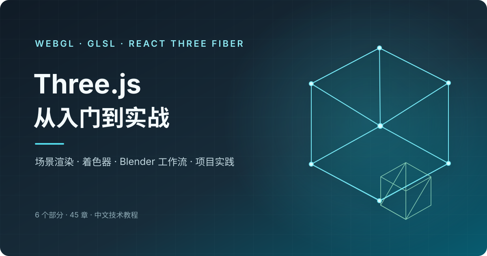

# Three.js 从入门到实战

**从 WebGL 与 Three.js 基础，到 GLSL、Blender 与 React Three Fiber 实战。**

本书依据 Three.js Journey 课程整理，将口语讲解重构为可独立阅读的中文技术教程。全书共 **6 个部分、45 章，另加后记**，保留核心知识、关键代码与项目实现顺序，并配合课程画面和原理示意图说明重要概念。

## 推荐阅读方式

- **系统学习**：按章节顺序阅读。前面的场景、材质、动画和渲染知识会在后续项目中反复使用。
- **关注 GLSL**：在掌握 Three.js 基础后，从第 18 章开始学习方法与语法，再进入各着色器项目。
- **关注工程化与性能**：阅读第 17 章的项目架构，以及第 31 章的后期处理和性能优化。
- **关注 React Three Fiber**：具备 React 基础后可阅读第六部分；不熟悉 React 时，建议先完成第 37 章。
- **边读边实践**：运行书中代码并修改参数，观察渲染结果。着色器和性能相关内容尤其需要实际验证。

!!! note "版本与使用说明"
    本书以课程所采用的 API 和项目结构为主要依据。Three.js、R3F 及相关生态更新较快，实际开发时应同时查阅对应版本的官方文档。原课程及视频画面的权利归原作者所有，本书用于个人学习与课程整理。

## 全书目录

### 第一部分 · Three.js 基础

从 WebGL 的基本定位开始，完成开发环境搭建，并掌握场景、网格、变换、动画、相机、几何体、纹理、材质与部署等基础知识。

- [第 1 章 课程导论与 WebGL 基础](chapters/ch01.md)
- [第 2 章 开发环境与第一个 Three.js 项目](chapters/ch02.md)
- [第 3 章 对象变换与动画](chapters/ch03.md)
- [第 4 章 相机与画布适配](chapters/ch04.md)
- [第 5 章 几何体与调试界面](chapters/ch05.md)
- [第 6 章 纹理](chapters/ch06.md)
- [第 7 章 材质](chapters/ch07.md)
- [第 8 章 3D 文本与项目部署](chapters/ch08.md)

### 第二部分 · 经典渲染技术

围绕灯光、阴影、粒子、物理、模型、环境贴图和写实渲染构建完整场景，并通过综合练习理解各项技术如何协同工作。

- [第 9 章 灯光与阴影](chapters/ch09.md)
- [第 10 章 鬼屋场景](chapters/ch10.md)
- [第 11 章 粒子与银河生成器](chapters/ch11.md)
- [第 12 章 滚动驱动动画](chapters/ch12.md)
- [第 13 章 物理模拟](chapters/ch13.md)
- [第 14 章 模型导入与射线交互](chapters/ch14.md)
- [第 15 章 使用 Blender 创建自定义模型](chapters/ch15.md)
- [第 16 章 环境贴图与写实渲染](chapters/ch16.md)

### 第三部分 · 工程化与 GLSL 着色器

先建立可持续扩展的项目结构，再系统学习 GLSL、材质定制、粒子与 GPGPU，将渲染控制延伸到 GPU 着色阶段。

- [第 17 章 大型项目的代码组织](chapters/ch17.md)
- [第 18 章 着色器基础](chapters/ch18.md)
- [第 19 章 着色器图案](chapters/ch19.md)
- [第 20 章 海面与动态银河](chapters/ch20.md)
- [第 21 章 修改内置材质](chapters/ch21.md)
- [第 22 章 咖啡烟雾与全息影像](chapters/ch22.md)
- [第 23 章 烟花着色器](chapters/ch23.md)
- [第 24 章 光照着色模型](chapters/ch24.md)
- [第 25 章 海面与半调着色](chapters/ch25.md)
- [第 26 章 地球着色器](chapters/ch26.md)
- [第 27 章 粒子光标与形变](chapters/ch27.md)
- [第 28 章 GPGPU 流场粒子](chapters/ch28.md)
- [第 29 章 摆动球体与切片模型](chapters/ch29.md)
- [第 30 章 程序化地形着色器](chapters/ch30.md)

### 第四部分 · 后期处理与交互体验

介绍后期处理链、性能诊断、加载过程以及 HTML 与 WebGL 的协同方式，兼顾视觉质量、运行效率和使用体验。

- [第 31 章 后期处理与性能优化](chapters/ch31.md)
- [第 32 章 加载体验与 HTML/WebGL 融合](chapters/ch32.md)

### 第五部分 · Blender 场景工作流

贯通 Blender 建模、烘焙、导出和 Three.js 导入优化流程，将 DCC 工具制作的场景转化为可交互的网页体验。

- [第 33 章 在 Blender 中创建场景](chapters/ch33.md)
- [第 34 章 烘焙与导出场景](chapters/ch34.md)
- [第 35 章 场景导入、优化与细节完善](chapters/ch35.md)

### 第六部分 · React Three Fiber

从 React 与 R3F 的基础开始，逐步学习 Drei、模型、事件、后期处理和物理系统，最终完成作品集与游戏项目。

- [第 36 章 React 与 React Three Fiber 简介](chapters/ch36.md)
- [第 37 章 React 应用基础](chapters/ch37.md)
- [第 38 章 第一个 R3F 应用与 Drei](chapters/ch38.md)
- [第 39 章 R3F 调试与环境布置](chapters/ch39.md)
- [第 40 章 R3F 模型与 3D 文本](chapters/ch40.md)
- [第 41 章 传送门场景与鼠标事件](chapters/ch41.md)
- [第 42 章 R3F 中的后期处理](chapters/ch42.md)
- [第 43 章 使用 R3F 构建简洁作品集](chapters/ch43.md)
- [第 44 章 R3F 中的物理模拟](chapters/ch44.md)
- [第 45 章 使用 R3F 创建游戏](chapters/ch45.md)

### 后记

- [后记 · 继续 Three.js 学习之旅](afterword.md)
